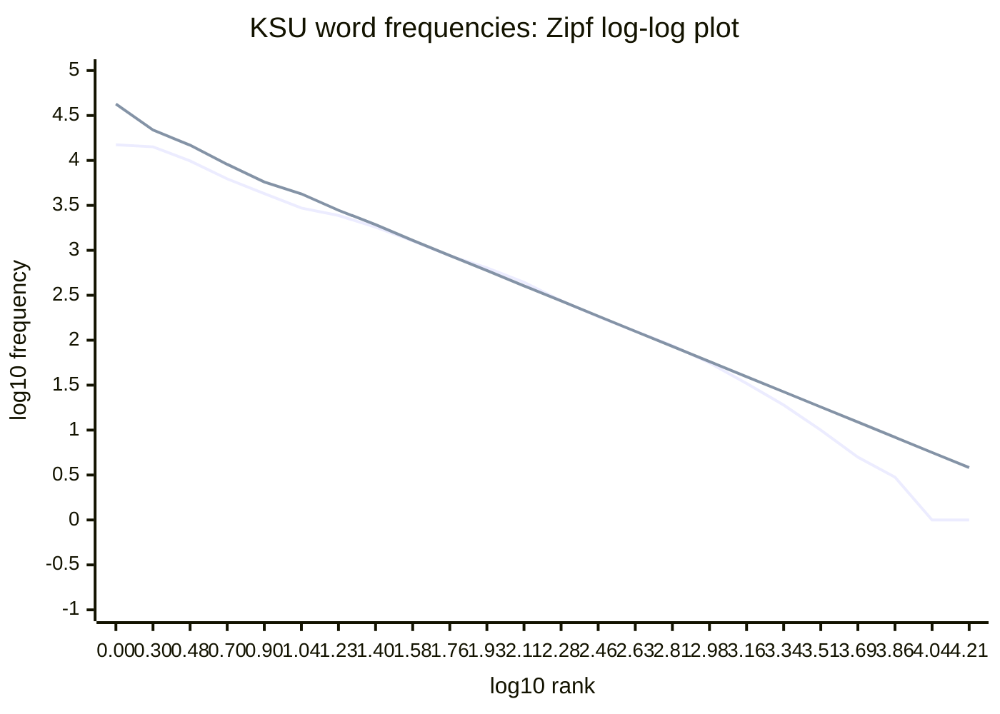

# Analysis of the 500-page KSU crawl

Generated offline with `python src/analyze.py --artifacts artifacts --output docs/analysis.md --seed 42`. Corpus: 500 distinct URLs; 2026-10-12T02:25:19.481658+00:00 to 2026-10-12T02:35:02.208243+00:00; 582.735 seconds. Input integrity checks match stored log records, unique URLs, and stats. No full recrawl is required.

Methods: counts below refer to this finite BFS sample, not the entire KSU website. Tokenization uses lowercase ASCII alphabetic words with internal apostrophes; numbers, punctuation and accented/non-Latin letters are excluded. Crawl word_count instead uses Unicode word characters and includes numbers, so Q5 recomputes both sides consistently.

## Q1 — URL patterns and traps

Exact shapes preserve literal path names, replacing numeric/date/UUID segments and keeping only query parameter names. Section prefixes are shown separately because ordinary named pages otherwise form singletons.

| Exact shape | URLs | Distinct text hashes | Budget % |
| --- | --- | --- | --- |
| ksumail.kennesaw.edu/ | 2 | 1 | 0.4 |
| artspurchase.kennesaw.edu/Events | 1 | 1 | 0.2 |
| azindex.kennesaw.edu/ | 1 | 1 | 0.2 |
| calendar.kennesaw.edu/ | 1 | 1 | 0.2 |
| calendar.kennesaw.edu/department/human_resources/ | 1 | 1 | 0.2 |
| campus.kennesaw.edu/ | 1 | 1 | 0.2 |
| campus.kennesaw.edu/campus-resources/campus-moves.php | 1 | 1 | 0.2 |
| campus.kennesaw.edu/colleges-departments/ | 1 | 1 | 0.2 |
| campus.kennesaw.edu/colleges-departments/arts/ | 1 | 1 | 0.2 |
| campus.kennesaw.edu/colleges-departments/arts/academics/dance/ | 1 | 1 | 0.2 |

| Host / first two path segments | URLs | Distinct text hashes | Budget % |
| --- | --- | --- | --- |
| campus.kennesaw.edu/colleges-departments/ccse | 55 | 49 | 11.0 |
| campus.kennesaw.edu/current-students/student-affairs | 47 | 39 | 9.4 |
| campus.kennesaw.edu/colleges-departments/coles | 24 | 24 | 4.8 |
| campus.kennesaw.edu/colleges-departments/radow | 18 | 18 | 3.6 |
| campus.kennesaw.edu/faculty-staff/academic-affairs | 17 | 16 | 3.4 |
| campus.kennesaw.edu/current-students/academics | 15 | 14 | 3.0 |
| campus.kennesaw.edu/offices-services/fiscal-services | 13 | 12 | 2.6 |
| campus.kennesaw.edu/offices-services/research | 13 | 13 | 2.6 |
| campus.kennesaw.edu/colleges-departments/bagwell | 12 | 12 | 2.4 |
| www.kennesaw.edu/news/stories | 12 | 12 | 2.4 |

Only 2 stored URLs contain queries. The largest section is ordinary CCSE content; the largest exact-shape tie is not evidence of an unlimited generator. Pagination links were discovered near the end of the run. The policy preserved queries and trailing slashes, deduplicated canonical URLs, and enforced only the global 500-page budget; no per-pattern trap limit was implemented. This can exclude relevant later BFS pages and does not prevent unbounded discovery at a larger budget. Manual probe evidence appears below if available.

## Q2 — Duplicate-content census

| Category | Measurement |
| --- | --- |
| response_hash | 2 groups, 4 participating pages, 2 redundant pages, 2 pairs |
| content_hash | 43 groups, 89 participating pages, 46 redundant pages, 50 pairs |
| Near duplicates | 1 pairs, 2 participating pages |
| Canonical declarations | 485 declared; 293 point to a different URL; 41 targets were fetched |

Near duplicates use raw 5-word shingle sets, excluding identical normalized-text hashes and empty shingle sets. Threshold 0.80; sensitivity at 0.80 / 0.90 / 0.95: 1 / 0 / 0 pairs. This sensitivity check exposes threshold dependence; repeated navigation can inflate raw-text similarity. Categories overlap and must not be added. Canonical declarations are publisher claims, not proof of identical bytes. Empty text can make unrelated pages share a content hash.

Byte-identical example: https://catalog.kennesaw.edu/ and https://catalog.kennesaw.edu/index.php. Same response SHA-256; scheme or routing aliases can serve the same response. Inspect the URLs to distinguish this from shared navigation.

Near-duplicate example: https://www.kennesaw.edu/degrees-programs/ and https://www.kennesaw.edu/degrees-programs/endorsements/index.php (Jaccard 0.8275); differing response/text hashes but largely shared text. Their shared site template and overlapping content account for the similarity; this is not proof of a deliberate duplicate.

Self-declared example: https://campus.kennesaw.edu/colleges-departments/ccse/ declares https://campus.kennesaw.edu/colleges-departments/ccse/index.php. Directory and index.php aliases normalize to different crawler URLs under the preserved trailing-slash policy. Both were fetched; identical normalized text: True.

## Q3 — Fetch failures

| Rank | Reason | Count | Example |
| --- | --- | --- | --- |
| 1 | robots_unavailable (HTTP 301) | 43 | https://owllife.kennesaw.edu/robots.txt |
| 2 | http_403 | 2 | https://experience.kennesaw.edu/virtualtour |
| 3 | robots_unavailable (HTTP 302) | 1 | https://degreeworks.kennesaw.edu/robots.txt |
| 4 | tls_error | 1 | https://ksuconnect.kennesaw.edu/robots.txt |
| 5 | non_html | 1 | https://www.kennesaw.edu/docs/core-impacts-usg-final-4k-mixed-ad.mp3 |

These are error events (including robots fetches), not all skips or unique failed pages. Only four original reason labels occurred; splitting robots_unavailable by observed HTTP status gives five concrete failure modes without inventing a fifth label. Ties are ranked by first occurrence. robots_unavailable is an unusual policy-acquisition failure beyond Req 13: robots.txt redirects (43 HTTP 301 and one HTTP 302) trigger conservative denial rather than being followed. This is a crawler limitation, not a claim that those hosts forbid crawling. robots_disallowed, outside_scope, and already_seen are policy decisions, not transport failures. No retry was performed.

## Q4 — Link rankings

Incoming links count distinct fetched source pages, and outgoing links count deduplicated in-scope targets. Rankings below use fetched pages only; links from the uncrawled web are unknown.

| Incoming rank | Fetched URL | Sources |
| --- | --- | --- |
| 1 | https://www.kennesaw.edu/ | 492 |
| 2 | https://www.kennesaw.edu/accreditation.php | 490 |
| 3 | https://www.kennesaw.edu/feedback.php | 489 |
| 4 | https://campus.kennesaw.edu/ | 487 |
| 5 | https://maps.kennesaw.edu/ | 487 |

| Outgoing rank | Fetched URL | Targets |
| --- | --- | --- |
| 1 | https://facultyweb.kennesaw.edu/ | 1380 |
| 2 | https://digitalcommons.kennesaw.edu/facpubs/ | 626 |
| 3 | https://azindex.kennesaw.edu/ | 279 |
| 4 | https://campus.kennesaw.edu/colleges-departments/ | 202 |
| 5 | https://www.kennesaw.edu/degrees-programs/minors/index.php | 192 |

## Q5 — Boilerplate removal

Repeated-line template detection operates per host: on hosts with at least ten fetched pages, remove an entire normalized line appearing in at least 50% of pages, with at least five supporting pages. Small hosts remain unchanged. This uses the saved newline boundaries and requires no unavailable DOM/HTML. DOM-density and main/article extraction would require raw HTML. Whole-line removal is easier to inspect than deleting isolated shared shingles, but may remove legitimate recurring headings and miss section-specific menus.

Mean words before: 1089.32; after: 772.97. Removed 158172 / 544658 words (29.04%). Estimated per-page boilerplate fractions mean: 39.49%; empty pages counted as zero. This estimates recurrent template text, not a ground-truth annotation.

| URL | Before words | After words | Removed % |
| --- | --- | --- | --- |
| https://www.kennesaw.edu/ | 763 | 436 | 42.9 |
| https://campus.kennesaw.edu/colleges-departments/ccse/ | 910 | 581 | 36.2 |
| https://www.kennesaw.edu/apply.php | 532 | 206 | 61.3 |
| https://www.kennesaw.edu/visit.php | 724 | 381 | 47.4 |
| https://www.kennesaw.edu/give.php | 698 | 368 | 47.3 |
| https://www.kennesaw.edu/calendar.php | 1016 | 693 | 31.8 |
| https://azindex.kennesaw.edu/ | 985 | 985 | 0.0 |
| https://campus.kennesaw.edu/current-students/ | 1485 | 1100 | 25.9 |
| https://campus.kennesaw.edu/faculty-staff/ | 1008 | 612 | 39.3 |
| https://www.kennesaw.edu/parents-family/ | 1124 | 777 | 30.9 |
| https://www.kennesaw.edu/alumni-friends/ | 572 | 240 | 58.0 |
| https://www.kennesaw.edu/community-business/ | 734 | 393 | 46.5 |
| https://campus.kennesaw.edu/ | 605 | 213 | 64.8 |
| https://www.kennesaw.edu/about/ | 1334 | 983 | 26.3 |
| https://www.kennesaw.edu/news/ | 715 | 387 | 45.9 |
| https://campus.kennesaw.edu/current-students/student-affairs/ | 530 | 206 | 61.1 |
| https://www.kennesaw.edu/president/strategic-plan/ | 609 | 280 | 54.0 |
| https://campus.kennesaw.edu/offices-services/research/university-initiatives/ | 770 | 452 | 41.3 |
| https://www.kennesaw.edu/alumni/ | 484 | 163 | 66.3 |
| https://campus.kennesaw.edu/faculty-staff/human-resources/careers/ | 829 | 506 | 39.0 |
| https://www.kennesaw.edu/conferences/ | 912 | 586 | 35.7 |
| https://www.kennesaw.edu/president/ | 546 | 212 | 61.2 |
| https://www.kennesaw.edu/president/cabinet.php | 612 | 282 | 53.9 |
| https://www.kennesaw.edu/foundation/ | 689 | 365 | 47.0 |
| https://www.kennesaw.edu/academics/ | 1705 | 1335 | 21.7 |
| https://www.kennesaw.edu/degrees-programs/ | 352 | 31 | 91.2 |
| https://campus.kennesaw.edu/faculty-staff/academic-affairs/ | 953 | 620 | 34.9 |
| https://campus.kennesaw.edu/current-students/academics/global-education/ | 585 | 258 | 55.9 |
| https://www.kennesaw.edu/ksu-online/ | 565 | 235 | 58.4 |
| https://www.kennesaw.edu/double-owl/ | 815 | 484 | 40.6 |
| https://campus.kennesaw.edu/current-students/registrar/academic-calendars.php | 4524 | 4191 | 7.4 |
| https://campus.kennesaw.edu/offices-services/library/ | 862 | 525 | 39.1 |
| https://catalog.kennesaw.edu/ | 767 | 767 | 0.0 |
| https://campus.kennesaw.edu/current-students/academics/academic-advising/ | 555 | 228 | 58.9 |
| https://campus.kennesaw.edu/colleges-departments/coles/ | 663 | 335 | 49.5 |
| https://campus.kennesaw.edu/colleges-departments/arts/ | 617 | 286 | 53.6 |
| https://campus.kennesaw.edu/colleges-departments/cacm/ | 861 | 543 | 36.9 |
| https://campus.kennesaw.edu/colleges-departments/bagwell/ | 861 | 535 | 37.9 |
| https://campus.kennesaw.edu/colleges-departments/radow/ | 961 | 642 | 33.2 |
| https://campus.kennesaw.edu/colleges-departments/csm/ | 673 | 348 | 48.3 |
| https://campus.kennesaw.edu/colleges-departments/graduate/ | 695 | 369 | 46.9 |
| https://campus.kennesaw.edu/colleges-departments/honors/ | 777 | 446 | 42.6 |
| https://campus.kennesaw.edu/colleges-departments/spceet/ | 779 | 459 | 41.1 |
| https://campus.kennesaw.edu/colleges-departments/wellstar/ | 575 | 256 | 55.5 |
| https://www.kennesaw.edu/admissions/ | 945 | 602 | 36.3 |
| https://www.kennesaw.edu/admissions/graduate/ | 663 | 331 | 50.1 |
| https://campus.kennesaw.edu/colleges-departments/honors/admission/ | 2265 | 1938 | 14.4 |
| https://www.kennesaw.edu/admissions/undergraduate/admission-requirements/transfer.php | 863 | 533 | 38.2 |
| https://campus.kennesaw.edu/offices-services/fiscal-services/bursar/tuition-fees/ | 2605 | 2278 | 12.6 |
| https://campus.kennesaw.edu/current-students/financial-aid/ | 773 | 448 | 42.0 |
| https://campus.kennesaw.edu/current-students/registrar/ | 798 | 477 | 40.2 |
| https://cpe.kennesaw.edu/ | 1290 | 1290 | 0.0 |
| https://www.kennesaw.edu/visit/ | 556 | 230 | 58.6 |
| https://www.kennesaw.edu/request-info.php | 657 | 336 | 48.9 |
| https://www.kennesaw.edu/admissions/undergraduate/check-your-status/ | 714 | 385 | 46.1 |
| https://www.kennesaw.edu/orientation/ | 548 | 220 | 59.9 |
| https://www.kennesaw.edu/discover-student-affairs/ | 1872 | 1545 | 17.5 |
| https://campus.kennesaw.edu/current-students/student-affairs/wellbeing/counseling/ | 551 | 223 | 59.5 |
| https://campus.kennesaw.edu/current-students/student-affairs/dean-of-students/student-disability-services/ | 671 | 342 | 49.0 |
| https://campus.kennesaw.edu/offices-services/careers/ | 644 | 320 | 50.3 |
| https://campus.kennesaw.edu/offices-services/housing/ | 807 | 488 | 39.5 |
| https://campus.kennesaw.edu/offices-services/dining/ | 931 | 606 | 34.9 |
| https://campus.kennesaw.edu/current-students/student-affairs/wellbeing/university-recreation/ | 475 | 150 | 68.4 |
| https://campus.kennesaw.edu/offices-services/student-health/ | 795 | 462 | 41.9 |
| https://campus.kennesaw.edu/current-students/student-affairs/wellbeing/ | 1203 | 877 | 27.1 |
| https://campus.kennesaw.edu/current-students/student-affairs/involvement/ | 685 | 362 | 47.2 |
| https://campus.kennesaw.edu/current-students/student-affairs/spirit-traditions/ | 1419 | 1092 | 23.0 |
| https://campus.kennesaw.edu/current-students/student-affairs/involvement/fraternity-sorority-life/ | 2203 | 1877 | 14.8 |
| https://www.kennesaw.edu/research.php | 1206 | 884 | 26.7 |
| https://campus.kennesaw.edu/offices-services/research/ | 632 | 314 | 50.3 |
| https://campus.kennesaw.edu/offices-services/research/industry-business/ | 2204 | 1886 | 14.4 |
| https://campus.kennesaw.edu/offices-services/research/centers-facilities/ | 783 | 464 | 40.7 |
| https://campus.kennesaw.edu/offices-services/research/undergraduate-research/ | 840 | 521 | 38.0 |
| https://campus.kennesaw.edu/offices-services/research/news/ | 657 | 339 | 48.4 |
| https://digitalcommons.kennesaw.edu/ | 175 | 175 | 0.0 |
| https://campus.kennesaw.edu/offices-services/research/podcast/ | 2271 | 1952 | 14.0 |
| https://www.kennesaw.edu/athletics/ | 1317 | 993 | 24.6 |
| https://www.kennesaw.edu/news/whats-new.php | 995 | 667 | 33.0 |
| https://www.kennesaw.edu/president/annual-report/ | 1100 | 771 | 29.9 |
| https://www.kennesaw.edu/degrees-programs/certificates/index.php | 423 | 102 | 75.9 |
| https://www.kennesaw.edu/degrees-programs/graduate-certificates/index.php | 523 | 202 | 61.4 |
| https://www.kennesaw.edu/degrees-programs/endorsements/index.php | 358 | 37 | 89.7 |
| https://www.kennesaw.edu/degrees-programs/minors/index.php | 755 | 434 | 42.5 |
| https://www.kennesaw.edu/admissions/undergraduate/open-house/index.php | 898 | 560 | 37.6 |
| https://campus.kennesaw.edu/current-students/financial-aid/student-resources/cost-of-attendance.php | 1125 | 794 | 29.4 |
| https://www.kennesaw.edu/admissions/graduate/financial-information.php | 1240 | 912 | 26.5 |
| https://www.kennesaw.edu/news/stories/2026/engineering-student-creates-robotic-hand-track-patient-health.php | 955 | 627 | 34.3 |
| https://www.kennesaw.edu/news/stories/2026/ksu-researchers-receive-nsf-grant-soft-robotics.php | 1230 | 902 | 26.7 |
| https://www.kennesaw.edu/news/stories/2026/engineering-student-uses-nasa-data-study-distant-star-systems.php | 1134 | 806 | 28.9 |
| https://campus.kennesaw.edu/colleges-departments/coles/news/stories/2026-10-05-executive-mba-alumna-named-an-atlanta-woman-of-influence.php | 1020 | 696 | 31.8 |
| https://calendar.kennesaw.edu/ | 723 | 723 | 0.0 |
| https://campus.kennesaw.edu/colleges-departments/coles/degrees-programs/graduate/fintech/ | 1208 | 878 | 27.3 |
| https://www.kennesaw.edu/request-info.php?major=Request+Info+&url=https%3A%2F%2Fwww.kennesaw.edu%2Frequest-info.php | 657 | 336 | 48.9 |
| https://maps.kennesaw.edu/ | 7 | 7 | 0.0 |
| https://campus.kennesaw.edu/offices-services/parking/ | 496 | 171 | 65.5 |
| https://www.kennesaw.edu/news/media-resources.php | 710 | 376 | 47.0 |
| https://campus.kennesaw.edu/current-students/d2l/ | 2245 | 1920 | 14.5 |
| https://campus.kennesaw.edu/offices-services/uits/ | 808 | 465 | 42.5 |
| https://campus.kennesaw.edu/offices-services/public-safety-police/ | 743 | 422 | 43.2 |
| https://campus.kennesaw.edu/offices-services/sustainability/ | 382 | 61 | 84.0 |
| https://www.kennesaw.edu/accessibility/ | 782 | 445 | 43.1 |
| https://www.kennesaw.edu/privacy-statement.php | 2031 | 1710 | 15.8 |
| https://www.kennesaw.edu/accreditation.php | 419 | 96 | 77.1 |
| https://www.kennesaw.edu/emergency/ | 364 | 43 | 88.2 |
| https://campus.kennesaw.edu/offices-services/concern/ | 915 | 594 | 35.1 |
| https://www.kennesaw.edu/feedback.php | 570 | 247 | 56.7 |
| https://campus.kennesaw.edu/offices-services/legal-affairs/open-record-requests.php | 647 | 324 | 49.9 |
| https://ksumail.kennesaw.edu/ | 0 | 0 | 0 |
| https://campus.kennesaw.edu/offices-services/talon-one/kcash.php | 762 | 434 | 43.0 |
| https://campus.kennesaw.edu/faculty-staff/course-evaluations/ | 1370 | 1041 | 24.0 |
| https://campus.kennesaw.edu/faculty-staff/human-resources/student-employment/ | 637 | 306 | 52.0 |
| https://campus.kennesaw.edu/faculty-staff/human-resources/resources/dept-hierarchy.php | 759 | 433 | 43.0 |
| https://www.kennesaw.edu/info/additional-resources.php | 670 | 347 | 48.2 |
| https://campus.kennesaw.edu/faculty-staff/academic-affairs/student-success/ | 920 | 587 | 36.2 |
| https://campus.kennesaw.edu/policies-governance/handbooks/ | 1385 | 1017 | 26.6 |
| https://campus.kennesaw.edu/offices-services/fiscal-services/bursar/ | 1230 | 901 | 26.7 |
| https://vpn.kennesaw.edu/global-protect/login.esp | 0 | 0 | 0 |
| https://campus.kennesaw.edu/faculty-staff/academic-affairs/faculty-affairs/ | 442 | 114 | 74.2 |
| https://campus.kennesaw.edu/faculty-staff/cetl/ | 635 | 307 | 51.7 |
| https://campus.kennesaw.edu/offices-services/library/faculty/ | 713 | 387 | 45.7 |
| https://campus.kennesaw.edu/faculty-staff/academic-affairs/faculty-affairs/annual-review-promotion-tenure.php | 693 | 367 | 47.0 |
| https://campus.kennesaw.edu/faculty-staff/human-resources/ | 862 | 533 | 38.2 |
| https://campus.kennesaw.edu/offices-services/campus-services/ | 431 | 98 | 77.3 |
| https://campus.kennesaw.edu/offices-services/fiscal-services/payroll/ | 1133 | 806 | 28.9 |
| https://campus.kennesaw.edu/colleges-departments/ | 1454 | 1081 | 25.7 |
| https://campus.kennesaw.edu/offices-services/ | 909 | 556 | 38.8 |
| https://www.kennesaw.edu/event-venue-management/ | 17312 | 16987 | 1.9 |
| https://campus.kennesaw.edu/offices-services/fiscal-services/ | 908 | 578 | 36.3 |
| https://campus.kennesaw.edu/offices-services/campus-operations/ | 794 | 462 | 41.8 |
| https://campus.kennesaw.edu/offices-services/stratcomm/ | 1278 | 956 | 25.2 |
| https://campus.kennesaw.edu/policies-governance/ | 690 | 338 | 51.0 |
| https://campus.kennesaw.edu/policies-governance/institutional-policies/ | 494 | 159 | 67.8 |
| https://www.kennesaw.edu/complaintsappeals.php | 847 | 525 | 38.0 |
| https://campus.kennesaw.edu/policies-governance/conflict-of-interest/ | 909 | 580 | 36.2 |
| https://campus.kennesaw.edu/policies-governance/general-data-protection-regulation/ | 1209 | 883 | 27.0 |
| https://campus.kennesaw.edu/offices-services/campus-operations/protecting-minors/ | 771 | 440 | 42.9 |
| https://campus.kennesaw.edu/current-students/student-affairs/public-forum.php | 4521 | 4182 | 7.5 |
| https://campus.kennesaw.edu/offices-services/ferpa/ | 2753 | 2430 | 11.7 |
| https://campus.kennesaw.edu/policies-governance/university-council/ | 734 | 406 | 44.7 |
| https://campus.kennesaw.edu/policies-governance/administrators-council/ | 576 | 251 | 56.4 |
| https://campus.kennesaw.edu/policies-governance/staff-senate/ | 682 | 355 | 47.9 |
| https://campus.kennesaw.edu/policies-governance/faculty-senate/ | 436 | 112 | 74.3 |
| https://campus.kennesaw.edu/current-students/student-affairs/involvement/student-government-association.php | 978 | 638 | 34.8 |
| https://www.kennesaw.edu/news/stories/2024/kennesaw-state-offers-master-of-science-artificial-intelligence.php | 990 | 662 | 33.1 |
| https://campus.kennesaw.edu/colleges-departments/ccse/index.php | 910 | 581 | 36.2 |
| https://campus.kennesaw.edu/colleges-departments/ccse/about/index.php | 928 | 601 | 35.2 |
| https://campus.kennesaw.edu/colleges-departments/ccse/about/executive-advisory-board.php | 1452 | 1125 | 22.5 |
| https://campus.kennesaw.edu/colleges-departments/ccse/about/faculty-staff.php | 1409 | 1082 | 23.2 |
| https://campus.kennesaw.edu/colleges-departments/ccse/about/jobs.php | 896 | 569 | 36.5 |
| https://campus.kennesaw.edu/colleges-departments/ccse/academics/index.php | 1158 | 831 | 28.2 |
| https://campus.kennesaw.edu/colleges-departments/ccse/academics/data-science-analytics/index.php | 881 | 556 | 36.9 |
| https://campus.kennesaw.edu/colleges-departments/ccse/academics/computer-science/index.php | 846 | 525 | 37.9 |
| https://campus.kennesaw.edu/colleges-departments/ccse/academics/information-technology/index.php | 732 | 409 | 44.1 |
| https://campus.kennesaw.edu/colleges-departments/ccse/academics/software-engineering-and-game-development/index.php | 826 | 505 | 38.9 |
| https://campus.kennesaw.edu/colleges-departments/ccse/degrees-programs/index.php | 785 | 458 | 41.7 |
| https://campus.kennesaw.edu/colleges-departments/ccse/degrees-programs/graduate/index.php | 1492 | 1165 | 21.9 |
| https://campus.kennesaw.edu/colleges-departments/ccse/degrees-programs/undergraduate/index.php | 1348 | 1021 | 24.3 |
| https://campus.kennesaw.edu/colleges-departments/ccse/degrees-programs/minors/index.php | 1072 | 745 | 30.5 |
| https://campus.kennesaw.edu/colleges-departments/ccse/advising/index.php | 470 | 145 | 69.1 |
| https://campus.kennesaw.edu/colleges-departments/ccse/events/index.php | 780 | 462 | 40.8 |
| https://campus.kennesaw.edu/colleges-departments/ccse/academics/data-science-analytics/analytics-day.php | 721 | 396 | 45.1 |
| https://campus.kennesaw.edu/colleges-departments/ccse/events/computing-showcase/index.php | 627 | 309 | 50.7 |
| https://campus.kennesaw.edu/colleges-departments/ccse/events/hackathon/index.php | 767 | 449 | 41.5 |
| https://campus.kennesaw.edu/colleges-departments/ccse/events/employer-networking.php | 686 | 368 | 46.4 |
| https://campus.kennesaw.edu/colleges-departments/ccse/events/career-compass.php | 1464 | 1146 | 21.7 |
| https://campus.kennesaw.edu/colleges-departments/ccse/academics/software-engineering-and-game-development/global-game-jam.php | 726 | 405 | 44.2 |
| https://campus.kennesaw.edu/colleges-departments/ccse/events/center-applied-computing-nexus.php | 583 | 263 | 54.9 |
| https://campus.kennesaw.edu/colleges-departments/ccse/resources/index.php | 3557 | 3213 | 9.7 |
| https://campus.kennesaw.edu/colleges-departments/ccse/resources/co-ops-internships-jobs.php | 1497 | 1170 | 21.8 |
| https://campus.kennesaw.edu/colleges-departments/ccse/resources/mentoring.php | 1820 | 1493 | 18.0 |
| https://campus.kennesaw.edu/colleges-departments/ccse/labs/tutoring-lab.php | 1367 | 1036 | 24.2 |
| https://campus.kennesaw.edu/colleges-departments/ccse/resources/financial-assistance-programs.php | 980 | 649 | 33.8 |
| https://campus.kennesaw.edu/colleges-departments/ccse/resources/student-scholarships.php | 1798 | 1470 | 18.2 |
| https://campus.kennesaw.edu/colleges-departments/ccse/international.php | 2396 | 2066 | 13.8 |
| https://campus.kennesaw.edu/colleges-departments/ccse/resources/student-organizations.php | 1710 | 1383 | 19.1 |
| https://campus.kennesaw.edu/colleges-departments/ccse/resources/capstone.php | 579 | 250 | 56.8 |
| https://campus.kennesaw.edu/colleges-departments/ccse/resources/innovative-courses-computing.php | 875 | 548 | 37.4 |
| https://campus.kennesaw.edu/colleges-departments/ccse/resources/out-of-state-tuition-waivers.php | 923 | 596 | 35.4 |
| https://campus.kennesaw.edu/colleges-departments/ccse/faculty-resources/index.php | 1380 | 1053 | 23.7 |
| https://campus.kennesaw.edu/colleges-departments/ccse/research/index.php | 1115 | 788 | 29.3 |
| https://campus.kennesaw.edu/colleges-departments/ccse/research/research-experience-undergraduate.php | 897 | 570 | 36.5 |
| https://campus.kennesaw.edu/colleges-departments/ccse/research/faculty-research.php | 671 | 344 | 48.7 |
| https://campus.kennesaw.edu/colleges-departments/ccse/labs/ | 1892 | 1561 | 17.5 |
| https://campus.kennesaw.edu/colleges-departments/ccse/labs/index.php | 1892 | 1561 | 17.5 |
| https://campus.kennesaw.edu/colleges-departments/ccse/partnerships/index.php | 2356 | 2029 | 13.9 |
| https://campus.kennesaw.edu/colleges-departments/ccse/partnerships/friends-corporate-affiliates.php | 1143 | 816 | 28.6 |
| https://campus.kennesaw.edu/colleges-departments/ccse/outreach/index.php | 1660 | 1341 | 19.2 |
| https://campus.kennesaw.edu/colleges-departments/ccse/alumni.php | 1082 | 755 | 30.2 |
| https://campus.kennesaw.edu/colleges-departments/ccse/giving.php | 908 | 581 | 36.0 |
| https://campus.kennesaw.edu/colleges-departments/ccse/about/contact-us.php | 535 | 205 | 61.7 |
| https://campus.kennesaw.edu/colleges-departments/ccse/first-year-experience/index.php | 2103 | 1784 | 15.2 |
| https://www.kennesaw.edu/news/news-releases/computing-software-engineering.php | 1109 | 779 | 29.8 |
| https://www.kennesaw.edu/news/stories/2026/ksu-researcher-earns-nsf-career-award.php | 1187 | 859 | 27.6 |
| https://www.kennesaw.edu/news/stories/2026/researcher-receives-nih-grant-study-sleep-apnea.php | 1104 | 776 | 29.7 |
| https://www.kennesaw.edu/news/stories/2026/student-advances-research-ai-integration-limited-power.php | 1193 | 865 | 27.5 |
| https://www.kennesaw.edu/news/stories/2026/ksu-researcher-developing-safer-computing-vehicles.php | 1137 | 809 | 28.8 |
| https://www.kennesaw.edu/admissions/undergraduate/apply.php | 707 | 382 | 46.0 |
| https://www.kennesaw.edu/admissions/undergraduate/index.php | 915 | 583 | 36.3 |
| https://www.kennesaw.edu/admissions/graduate/graduate-application.php | 745 | 417 | 44.0 |
| https://www.kennesaw.edu/admissions/graduate/index.php | 663 | 331 | 50.1 |
| https://www.kennesaw.edu/visit/campus-tours/index.php | 17947 | 17621 | 1.8 |
| https://www.kennesaw.edu/visit/campus-tours/hs-tours.php | 1168 | 836 | 28.4 |
| https://www.kennesaw.edu/visit/campus-tours/ | 17947 | 17621 | 1.8 |
| https://campus.kennesaw.edu/offices-services/campus-services/visitor-resources.php | 1817 | 1483 | 18.4 |
| https://www.kennesaw.edu/giving/online-giving/ | 457 | 117 | 74.4 |
| https://www.kennesaw.edu/giving/where/ | 623 | 283 | 54.6 |
| https://www.kennesaw.edu/giving/where/students.php | 876 | 534 | 39.0 |
| https://www.kennesaw.edu/giving/ | 821 | 475 | 42.1 |
| https://artspurchase.kennesaw.edu/Events | 0 | 0 | 0 |
| https://www.kennesaw.edu/commencement/ | 1001 | 678 | 32.3 |
| https://www.kennesaw.edu/centers/printing-resources/ | 689 | 360 | 47.8 |
| https://www.kennesaw.edu/external-affairs/burruss-institute/index.php | 741 | 419 | 43.5 |
| https://campus.kennesaw.edu/colleges-departments/wellstar/academics/academy/ | 1381 | 1058 | 23.4 |
| https://campus.kennesaw.edu/colleges-departments/coles/academics/accountancy/ | 867 | 539 | 37.8 |
| https://campus.kennesaw.edu/offices-services/fiscal-services/procurement-payment-services/accounts-payable/ | 489 | 170 | 65.2 |
| https://campus.kennesaw.edu/offices-services/administration-finance-division/ | 1342 | 995 | 25.9 |
| https://www.kennesaw.edu/adult-learner/ | 838 | 506 | 39.6 |
| https://campus.kennesaw.edu/current-students/academics/global-education/center-for-africana-studies/ | 566 | 244 | 56.9 |
| https://campus.kennesaw.edu/colleges-departments/radow/degrees-programs/graduate/ma-american-studies/ | 949 | 628 | 33.8 |
| https://campus.kennesaw.edu/current-students/academics/global-education/year-of/ | 1657 | 1332 | 19.6 |
| https://campus.kennesaw.edu/colleges-departments/cacm/academics/architecture/ | 794 | 475 | 40.2 |
| https://www.kennesaw.edu/marb/archives/ | 644 | 322 | 50.0 |
| https://campus.kennesaw.edu/colleges-departments/arts/academics/visual-arts/ | 953 | 627 | 34.2 |
| https://campus.kennesaw.edu/colleges-departments/radow/degrees-programs/undergraduate/ba-asian-studies/ | 843 | 524 | 37.8 |
| https://campus.kennesaw.edu/current-students/student-affairs/dean-of-students/behavioral-response-team.php | 2508 | 2171 | 13.4 |
| https://www.kennesaw.edu/marb/rare-books/ | 1317 | 994 | 24.5 |
| https://www.kennesaw.edu/bioinnovation-lab/ | 1097 | 774 | 29.4 |
| https://campus.kennesaw.edu/colleges-departments/arts/box-office/ | 1470 | 1138 | 22.6 |
| https://campus.kennesaw.edu/colleges-departments/coles/academics/information-systems-security/labs/brainlab/ | 528 | 200 | 62.1 |
| https://campus.kennesaw.edu/offices-services/fiscal-services/budget-planning/ | 704 | 383 | 45.6 |
| https://campus.kennesaw.edu/offices-services/postal-services/ | 1127 | 795 | 29.5 |
| https://campus.kennesaw.edu/offices-services/talon-one/ | 724 | 389 | 46.3 |
| https://campus.kennesaw.edu/current-students/student-affairs/wellbeing/care-services/ | 574 | 243 | 57.7 |
| https://catalog.kennesaw.edu/index.php | 767 | 767 | 0.0 |
| https://campus.kennesaw.edu/offices-services/catering/ | 1085 | 766 | 29.4 |
| https://campus.kennesaw.edu/current-students/student-affairs/wellbeing/center-addiction-recovery-prevention-education/ | 1229 | 896 | 27.1 |
| https://www.kennesaw.edu/centers/center-advanced-materials-research-education/ | 770 | 439 | 43.0 |
| https://campus.kennesaw.edu/colleges-departments/radow/centers/center-conflict-management/ | 445 | 124 | 72.1 |
| https://campus.kennesaw.edu/colleges-departments/coles/centers/cyber-center/ | 1203 | 872 | 27.5 |
| https://campus.kennesaw.edu/colleges-departments/ccse/academics/data-science-analytics/center-data-science-analytics/ | 906 | 579 | 36.1 |
| https://campus.kennesaw.edu/colleges-departments/ccse/labs/machine-vision-security-lab.php | 882 | 548 | 37.9 |
| https://campus.kennesaw.edu/colleges-departments/coles/centers/professional-selling/ | 976 | 640 | 34.4 |
| https://campus.kennesaw.edu/colleges-departments/radow/centers/center-sustainable-journalism/ | 408 | 87 | 78.7 |
| https://campus.kennesaw.edu/offices-services/campus-operations/central-receiving-distribution/ | 931 | 605 | 35.0 |
| https://campus.kennesaw.edu/colleges-departments/csm/academics/chemistry-biochemistry/index.php | 719 | 397 | 44.8 |
| https://campus.kennesaw.edu/colleges-departments/spceet/academics/civil-environmental-engineering/ | 677 | 356 | 47.4 |
| https://campus.kennesaw.edu/colleges-departments/bagwell/units-centers/clinical-experiences-placements-partnerships/ | 1236 | 912 | 26.2 |
| https://campus.kennesaw.edu/faculty-staff/academic-affairs/student-success/programs/coca-cola-scholars/ | 665 | 340 | 48.9 |
| https://campus.kennesaw.edu/colleges-departments/coles/center-for-student-success/ | 666 | 334 | 49.8 |
| https://campus.kennesaw.edu/colleges-departments/radow/academics/communication-media/ | 791 | 465 | 41.2 |
| https://campus.kennesaw.edu/current-students/academics/global-education/community-engagement-and-outreach/ | 544 | 221 | 59.4 |
| https://campus.kennesaw.edu/faculty-staff/human-resources/compensation/ | 539 | 214 | 60.3 |
| https://campus.kennesaw.edu/current-students/student-affairs/involvement/competition-teams/index.php | 2182 | 1857 | 14.9 |
| https://campus.kennesaw.edu/colleges-departments/ccse/academics/computer-science/ | 846 | 525 | 37.9 |
| https://campus.kennesaw.edu/colleges-departments/radow/academics/conflict-management-peacebuilding-development/ | 668 | 347 | 48.1 |
| https://campus.kennesaw.edu/colleges-departments/cacm/academics/construction-management/ | 840 | 516 | 38.6 |
| https://campus.kennesaw.edu/offices-services/printing-services/ | 455 | 134 | 70.5 |
| https://campus.kennesaw.edu/colleges-departments/coles/corporate-governance-group/ | 848 | 517 | 39.0 |
| https://campus.kennesaw.edu/current-students/student-affairs/wellbeing/counseling/index.php | 551 | 223 | 59.5 |
| https://campus.kennesaw.edu/colleges-departments/radow/academics/sociology-criminal-justice/ | 950 | 629 | 33.8 |
| https://campus.kennesaw.edu/faculty-staff/academic-affairs/curriculum-instruction-assessment/ | 486 | 163 | 66.5 |
| https://campus.kennesaw.edu/colleges-departments/arts/academics/dance/ | 668 | 339 | 49.3 |
| https://campus.kennesaw.edu/offices-services/data-strategy/ | 1024 | 706 | 31.1 |
| https://campus.kennesaw.edu/current-students/student-affairs/dean-of-students/ | 567 | 237 | 58.2 |
| https://campus.kennesaw.edu/faculty-staff/academic-affairs/curriculum-instruction-assessment/digital-learning-innovations/ | 968 | 644 | 33.5 |
| https://www.kennesaw.edu/double-owl/index.php | 815 | 484 | 40.6 |
| https://www.kennesaw.edu/dual-enrollment/ | 523 | 200 | 61.8 |
| https://campus.kennesaw.edu/colleges-departments/csm/academics/eeob/ | 650 | 328 | 49.5 |
| https://campus.kennesaw.edu/colleges-departments/coles/academics/economics/ | 1146 | 812 | 29.1 |
| https://www.kennesaw.edu/ecore/ | 629 | 307 | 51.2 |
| https://campus.kennesaw.edu/current-students/academics/global-education/education-abroad/ | 946 | 615 | 35.0 |
| https://campus.kennesaw.edu/colleges-departments/coles/centers/education-economics-center/ | 495 | 167 | 66.3 |
| https://campus.kennesaw.edu/colleges-departments/bagwell/academics/educational-leadership/ | 1100 | 782 | 28.9 |
| https://campus.kennesaw.edu/colleges-departments/spceet/academics/electrical-computer-engineering/ | 986 | 665 | 32.6 |
| https://campus.kennesaw.edu/colleges-departments/bagwell/academics/elementary-early-childhood-education/ | 1056 | 738 | 30.1 |
| https://campus.kennesaw.edu/current-students/student-affairs/wellbeing/care-services/community-resources/emergency-assistance.php | 680 | 357 | 47.5 |
| https://campus.kennesaw.edu/faculty-staff/employee-well-being/ | 805 | 480 | 40.4 |
| https://campus.kennesaw.edu/faculty-staff/engagement/ | 2538 | 2215 | 12.7 |
| https://campus.kennesaw.edu/colleges-departments/spceet/academics/engineering-technology/ | 669 | 348 | 48.0 |
| https://campus.kennesaw.edu/colleges-departments/radow/academics/english/ | 1728 | 1407 | 18.6 |
| https://campus.kennesaw.edu/current-students/academics/writing-center/english-language-program/ | 1008 | 685 | 32.0 |
| https://campus.kennesaw.edu/offices-services/planning-construction/environmental-health-safety/ | 513 | 189 | 63.2 |
| https://campus.kennesaw.edu/colleges-departments/coles/degrees-programs/executive-education/ | 656 | 318 | 51.5 |
| https://campus.kennesaw.edu/colleges-departments/coles/degrees-programs/graduate/emba/ | 1114 | 784 | 29.6 |
| https://campus.kennesaw.edu/colleges-departments/wellstar/academics/exercise-science-sport-management/ | 865 | 544 | 37.1 |
| https://campus.kennesaw.edu/offices-services/campus-operations/facilities/ | 545 | 219 | 59.8 |
| https://www.kennesaw.edu/faculty-support/ | 574 | 251 | 56.3 |
| https://campus.kennesaw.edu/colleges-departments/coles/centers/family-enterprise-center/ | 488 | 158 | 67.6 |
| https://campus.kennesaw.edu/current-students/financial-aid/federal-work-study/ | 1085 | 758 | 30.1 |
| https://www.kennesaw.edu/event-venue-management/campus-venues/fifth-third-stadium/ | 750 | 428 | 42.9 |
| https://campus.kennesaw.edu/offices-services/fiscal-services/accounting/ | 851 | 532 | 37.5 |
| https://campus.kennesaw.edu/current-students/student-affairs/community/flight.php | 1035 | 712 | 31.2 |
| https://campus.kennesaw.edu/colleges-departments/radow/academics/geography-anthropology/ | 1672 | 1349 | 19.3 |
| https://www.kennesaw.edu/centers/georgia-pavement-traffic-research-center/ | 1894 | 1572 | 17.0 |
| https://campus.kennesaw.edu/colleges-departments/radow/academics/government-international-affairs/ | 772 | 451 | 41.6 |
| https://www.kennesaw.edu/graduate-orientation/ | 1064 | 733 | 31.1 |
| https://campus.kennesaw.edu/faculty-staff/academic-affairs/curriculum-instruction-assessment/academic-program-planning-development/committees/graduate-policies-curriculum-committee.php | 688 | 363 | 47.2 |
| https://campus.kennesaw.edu/offices-services/student-health/health-advisory/ | 403 | 83 | 79.4 |
| https://campus.kennesaw.edu/colleges-departments/wellstar/academics/health-promotion-physical-education/ | 884 | 563 | 36.3 |
| https://campus.kennesaw.edu/current-students/student-affairs/wellbeing/wellness/ | 649 | 315 | 51.5 |
| https://campus.kennesaw.edu/colleges-departments/coles/degrees-programs/graduate/healthcare-management-informatics/ | 862 | 532 | 38.3 |
| https://campus.kennesaw.edu/colleges-departments/radow/academics/history-philosophy/ | 1251 | 922 | 26.3 |
| https://campus.kennesaw.edu/colleges-departments/radow/degrees-programs/undergraduate/bs-history-education/ | 1895 | 1576 | 16.8 |
| https://campus.kennesaw.edu/current-students/student-affairs/spirit-traditions/homecoming/ | 660 | 337 | 48.9 |
| https://campus.kennesaw.edu/colleges-departments/coles/center-for-student-success/professionalism.php | 625 | 295 | 52.8 |
| https://www.kennesaw.edu/immunizations/ | 1673 | 1351 | 19.2 |
| https://campus.kennesaw.edu/colleges-departments/bagwell/academics/inclusive-education/ | 862 | 544 | 36.9 |
| https://campus.kennesaw.edu/colleges-departments/spceet/academics/industrial-systems-engineering/ | 751 | 430 | 42.7 |
| https://campus.kennesaw.edu/colleges-departments/coles/academics/information-systems-security/ | 879 | 549 | 37.5 |
| https://campus.kennesaw.edu/colleges-departments/ccse/academics/information-technology/ | 732 | 409 | 44.1 |
| https://campus.kennesaw.edu/colleges-departments/bagwell/labs/innovation-lab/ | 743 | 422 | 43.2 |
| https://campus.kennesaw.edu/offices-services/research/resources/research-integrity/compliance-committees/institutional-animal-care-use-committee/ | 577 | 256 | 55.6 |
| https://campus.kennesaw.edu/offices-services/research/resources/research-integrity/compliance-committees/institutional-biosafety-committee/ | 488 | 167 | 65.8 |
| https://campus.kennesaw.edu/offices-services/institutional-equity/ | 578 | 252 | 56.4 |
| https://campus.kennesaw.edu/offices-services/data-strategy/institutional-research/ | 755 | 435 | 42.4 |
| https://campus.kennesaw.edu/offices-services/research/resources/research-integrity/compliance-committees/institutional-review-board/ | 787 | 466 | 40.8 |
| https://campus.kennesaw.edu/colleges-departments/bagwell/academics/instructional-technology-innovation/ | 1558 | 1240 | 20.4 |
| https://cpe.kennesaw.edu/iep/ | 853 | 853 | 0.0 |
| https://www.kennesaw.edu/irml/ | 751 | 421 | 43.9 |
| https://campus.kennesaw.edu/colleges-departments/radow/academics/interdisciplinary-studies/ | 882 | 563 | 36.2 |
| https://campus.kennesaw.edu/colleges-departments/coles/centers/internal-audit-center/ | 494 | 165 | 66.6 |
| https://www.kennesaw.edu/admissions/undergraduate/admission-requirements/international.php | 2149 | 1817 | 15.4 |
| https://campus.kennesaw.edu/colleges-departments/bagwell/iteach/ | 817 | 492 | 39.8 |
| https://www.kennesaw.edu/mebus/ | 957 | 634 | 33.8 |
| https://campus.kennesaw.edu/current-students/student-affairs/involvement/activities/kennesaw-activities-board.php | 477 | 152 | 68.1 |
| https://campus.kennesaw.edu/offices-services/research/centers-facilities/ksu-field-station/ | 625 | 304 | 51.4 |
| https://www.kennesaw.edu/info/index.php | 484 | 153 | 68.4 |
| https://campus.kennesaw.edu/current-students/academics/global-education/ksu-italy/ | 514 | 194 | 62.3 |
| https://epay.kennesaw.edu/C20923_ustores/web/index.jsp | 45 | 45 | 0.0 |
| https://campus.kennesaw.edu/offices-services/research/about/research-service-foundation/ | 616 | 293 | 52.4 |
| https://www.kennesaw.edu/event-venue-management/campus-venues/sports-entertainment-park/ | 662 | 339 | 48.8 |
| https://campus.kennesaw.edu/colleges-departments/coles/academics/management-entrepreneurship-hospitality/ | 1131 | 803 | 29.0 |
| https://www.kennesaw.edu/marching-owls/ | 577 | 255 | 55.8 |
| https://campus.kennesaw.edu/colleges-departments/coles/academics/marketing-professional-sales/ | 892 | 564 | 36.8 |
| https://campus.kennesaw.edu/colleges-departments/coles/degrees-programs/graduate/mba/ | 1274 | 944 | 25.9 |
| https://campus.kennesaw.edu/colleges-departments/csm/academics/mathematics/index.php | 617 | 297 | 51.9 |
| https://www.kennesaw.edu/maya-heritage-community-project/ | 782 | 460 | 41.2 |
| https://campus.kennesaw.edu/colleges-departments/spceet/academics/mechanical-engineering/ | 957 | 635 | 33.6 |
| https://campus.kennesaw.edu/current-students/student-affairs/community/military-veteran-services/ | 667 | 329 | 50.7 |
| https://campus.kennesaw.edu/colleges-departments/csm/academics/molecular-cellular-biology/ | 688 | 368 | 46.5 |
| https://www.kennesaw.edu/marb/museum-history-holocaust-education/ | 773 | 448 | 42.0 |
| https://www.kennesaw.edu/marb/ | 576 | 254 | 55.9 |
| https://campus.kennesaw.edu/colleges-departments/arts/academics/music/index.php | 827 | 499 | 39.7 |
| https://www.kennesaw.edu/event-venue-management/night-owl/ | 554 | 231 | 58.3 |
| https://campus.kennesaw.edu/colleges-departments/wellstar/academics/nursing/ | 971 | 650 | 33.1 |
| https://campus.kennesaw.edu/current-students/student-affairs/involvement/student-leadership/mentoring-initiatives.php | 470 | 145 | 69.1 |
| https://campus.kennesaw.edu/offices-services/uits/security/ | 670 | 338 | 49.6 |
| https://campus.kennesaw.edu/offices-services/emergency-management/ | 540 | 218 | 59.6 |
| https://campus.kennesaw.edu/offices-services/ombuds/ | 1024 | 700 | 31.6 |
| https://campus.kennesaw.edu/faculty-staff/organizational-success/index.php | 550 | 232 | 57.8 |
| https://campus.kennesaw.edu/current-students/academics/academic-advising/owl-advising/ | 483 | 152 | 68.5 |
| https://campus.kennesaw.edu/current-students/student-affairs/parent-family-engagement.php | 1210 | 878 | 27.4 |
| https://campus.kennesaw.edu/colleges-departments/ccse/academics/data-science-analytics/ | 881 | 556 | 36.9 |
| https://campus.kennesaw.edu/colleges-departments/radow/degrees-programs/graduate/phd-international-conflict-management/ | 1117 | 796 | 28.7 |
| https://campus.kennesaw.edu/colleges-departments/csm/academics/physics/index.php | 837 | 517 | 38.2 |
| https://campus.kennesaw.edu/offices-services/planning-construction/ | 548 | 227 | 58.6 |
| https://campus.kennesaw.edu/offices-services/fiscal-services/procurement-payment-services/ | 500 | 177 | 64.6 |
| https://campus.kennesaw.edu/colleges-departments/radow/academics/psychological-science/ | 842 | 520 | 38.2 |
| https://www.kennesaw.edu/marb/records/ | 465 | 143 | 69.2 |
| https://campus.kennesaw.edu/current-students/student-affairs/involvement/activities/registered-student-organizations/ | 509 | 188 | 63.1 |
| https://www.kennesaw.edu/reporting-hotline.php | 600 | 279 | 53.5 |
| https://www.kennesaw.edu/retirees/ | 496 | 175 | 64.7 |
| https://campus.kennesaw.edu/offices-services/fiscal-services/risk-management/ | 444 | 121 | 72.7 |
| https://campus.kennesaw.edu/colleges-departments/spceet/academics/robotics-mechatronics-engineering/ | 976 | 655 | 32.9 |
| https://campus.kennesaw.edu/colleges-departments/spceet/research/rubble-house/ | 742 | 423 | 43.0 |
| https://campus.kennesaw.edu/offices-services/safe-center/ | 1067 | 728 | 31.8 |
| https://campus.kennesaw.edu/current-students/student-affairs/dean-of-students/department-student-conduct-academic-integrity/ | 892 | 563 | 36.9 |
| https://campus.kennesaw.edu/current-students/financial-aid/scholarships/ | 1302 | 977 | 25.0 |
| https://campus.kennesaw.edu/current-students/student-affairs/involvement/scrappys-bucket-list.php | 1682 | 1353 | 19.6 |
| https://campus.kennesaw.edu/colleges-departments/bagwell/academics/secondary-middle-grades-education/ | 700 | 382 | 45.4 |
| https://campus.kennesaw.edu/colleges-departments/coles/centers/shore-entrepreneurship-center/ | 580 | 248 | 57.2 |
| https://campus.kennesaw.edu/colleges-departments/coles/centers/small-business-development-center/ | 604 | 274 | 54.6 |
| https://campus.kennesaw.edu/faculty-staff/academic-affairs/student-success/smart-center/ | 601 | 276 | 54.1 |
| https://campus.kennesaw.edu/colleges-departments/wellstar/academics/social-work-human-services/ | 1859 | 1538 | 17.3 |
| https://campus.kennesaw.edu/colleges-departments/ccse/academics/software-engineering-and-game-development/ | 826 | 505 | 38.9 |
| https://campus.kennesaw.edu/current-students/student-affairs/spirit-traditions/index.php | 1419 | 1092 | 23.0 |
| https://campus.kennesaw.edu/colleges-departments/wellstar/degrees-programs/undergraduate/bachelor-sport-management/ | 1060 | 741 | 30.1 |
| https://campus.kennesaw.edu/current-students/student-affairs/assessment/ | 514 | 188 | 63.4 |
| https://campus.kennesaw.edu/current-students/student-affairs/involvement/activities/ | 1114 | 775 | 30.4 |
| https://campus.kennesaw.edu/current-students/student-affairs/community/student-engagement-support/index.php | 594 | 267 | 55.1 |
| https://campus.kennesaw.edu/current-students/student-affairs/involvement/student-leadership/index.php | 589 | 261 | 55.7 |
| https://campus.kennesaw.edu/current-students/student-affairs/involvement/student-media/index.php | 976 | 651 | 33.3 |
| https://campus.kennesaw.edu/policies-governance/student-technology-fee/ | 890 | 570 | 36.0 |
| https://campus.kennesaw.edu/current-students/student-affairs/involvement/student-volunteerism/ | 1698 | 1372 | 19.2 |
| https://campus.kennesaw.edu/faculty-staff/academic-affairs/student-success/supplemental-instruction/ | 1582 | 1253 | 20.8 |
| https://campus.kennesaw.edu/faculty-staff/human-resources/careers/talent-acquisition/ | 493 | 170 | 65.5 |
| https://campus.kennesaw.edu/colleges-departments/bagwell/policies/teacher-certification.php | 620 | 298 | 51.9 |
| https://campus.kennesaw.edu/colleges-departments/bagwell/units-centers/teacher-resource-activity-corner/ | 942 | 621 | 34.1 |
| https://campus.kennesaw.edu/current-students/academics/testing-center/ | 754 | 433 | 42.6 |
| https://www.kennesaw.edu/georgia-network/ | 1070 | 749 | 30.0 |
| https://campus.kennesaw.edu/colleges-departments/arts/academics/theatre/ | 624 | 298 | 52.2 |
| https://www.kennesaw.edu/trademark-licensing/ | 1150 | 822 | 28.5 |
| https://campus.kennesaw.edu/current-students/registrar/transfer/ | 736 | 412 | 44.0 |
| https://campus.kennesaw.edu/offices-services/fiscal-services/procurement-payment-services/travel/ | 779 | 456 | 41.5 |
| https://campus.kennesaw.edu/colleges-departments/bagwell/units-centers/trio-programs/ | 1104 | 785 | 28.9 |
| https://www.kennesaw.edu/tuition-classification/index.php | 1052 | 728 | 30.8 |
| https://campus.kennesaw.edu/faculty-staff/academic-affairs/curriculum-instruction-assessment/academic-program-planning-development/committees/undergraduate-policies-curriculum-committee.php | 688 | 363 | 47.2 |
| https://campus.kennesaw.edu/offices-services/stratcomm/branding/ | 828 | 510 | 38.4 |
| https://campus.kennesaw.edu/offices-services/dining/vending.php | 1405 | 1069 | 23.9 |
| https://campus.kennesaw.edu/current-students/student-affairs/wellbeing/index.php | 1203 | 877 | 27.1 |
| https://campus.kennesaw.edu/colleges-departments/wellstar/advising/ | 1246 | 916 | 26.5 |
| https://campus.kennesaw.edu/colleges-departments/radow/academics/world-languages-cultures/ | 1048 | 726 | 30.7 |
| https://campus.kennesaw.edu/colleges-departments/arts/academics/visual-arts/zuckerman/ | 751 | 423 | 43.7 |
| https://campus.kennesaw.edu/current-students/student-affairs/owl-life.php | 513 | 182 | 64.5 |
| https://campus.kennesaw.edu/online-students/index.php | 1293 | 936 | 27.6 |
| https://campus.kennesaw.edu/current-students/academics/index.php | 707 | 380 | 46.3 |
| https://campus.kennesaw.edu/faculty-staff/academic-affairs/student-success/programs/index.php | 451 | 124 | 72.5 |
| https://campus.kennesaw.edu/current-students/registrar/index.php | 798 | 477 | 40.2 |
| https://campus.kennesaw.edu/current-students/academics/writing-center/ | 518 | 199 | 61.6 |
| https://campus.kennesaw.edu/current-students/student-affairs/wellbeing/university-recreation/programs/esports.php | 659 | 332 | 49.6 |
| https://campus.kennesaw.edu/offices-services/dining/index.php | 931 | 606 | 34.9 |
| https://campus.kennesaw.edu/offices-services/housing/index.php | 807 | 488 | 39.5 |
| https://campus.kennesaw.edu/offices-services/parking/index.php | 496 | 171 | 65.5 |
| https://campus.kennesaw.edu/offices-services/student-health/index.php | 795 | 462 | 41.9 |
| https://campus.kennesaw.edu/offices-services/talon-one/mobile-credential.php | 2498 | 2176 | 12.9 |
| https://campus.kennesaw.edu/offices-services/talon-one/index.php | 724 | 389 | 46.3 |
| https://campus.kennesaw.edu/offices-services/campus-services/index.php | 431 | 98 | 77.3 |
| https://campus.kennesaw.edu/current-students/financial-aid/index.php | 773 | 448 | 42.0 |
| https://campus.kennesaw.edu/offices-services/research/centers-facilities/center-research-computing/ | 1051 | 729 | 30.6 |
| https://campus.kennesaw.edu/current-students/student-affairs/wellbeing/university-recreation/programs/club-sports.php | 2304 | 1973 | 14.4 |
| https://campus.kennesaw.edu/current-students/student-affairs/involvement/student-media/ | 976 | 651 | 33.3 |
| https://campus.kennesaw.edu/current-students/student-affairs/community/index.php | 596 | 273 | 54.2 |
| https://campus.kennesaw.edu/current-students/student-affairs/index.php | 530 | 206 | 61.1 |
| https://campus.kennesaw.edu/current-students/student-affairs/wellbeing/center-addiction-recovery-prevention-education/index.php | 1229 | 896 | 27.1 |
| https://www.kennesaw.edu/immunizations/index.php | 1673 | 1351 | 19.2 |
| https://campus.kennesaw.edu/faculty-staff/organizational-success/ | 550 | 232 | 57.8 |
| https://campus.kennesaw.edu/faculty-staff/engagement/index.php | 2538 | 2215 | 12.7 |
| https://campus.kennesaw.edu/current-students/student-affairs/students/carmichael-student-center.php | 1900 | 1566 | 17.6 |
| https://campus.kennesaw.edu/current-students/student-affairs/students/wilson-student-center.php | 2073 | 1739 | 16.1 |
| https://campus.kennesaw.edu/offices-services/sustainability/resources.php | 816 | 495 | 39.3 |
| https://campus.kennesaw.edu/colleges-departments/spceet/centers/student-success/ | 1098 | 777 | 29.2 |
| https://campus.kennesaw.edu/colleges-departments/coles/degrees-programs/undergraduate/center-for-student-success/tutoring-academic-support.php | 880 | 546 | 38.0 |
| https://campus.kennesaw.edu/colleges-departments/radow/world-languages-resource-collection/tutoring/ | 970 | 649 | 33.1 |
| https://campus.kennesaw.edu/colleges-departments/ccse/academics/data-science-analytics/resources/ | 1197 | 871 | 27.2 |
| https://campus.kennesaw.edu/faculty-staff/academic-affairs/student-success/learning-assistants/index.php | 1285 | 956 | 25.6 |
| https://campus.kennesaw.edu/faculty-staff/academic-affairs/student-success/smart-center/resources/math-1111.php | 627 | 302 | 51.8 |
| https://campus.kennesaw.edu/current-students/core-impacts-curriculum.php | 632 | 312 | 50.6 |
| https://www.kennesaw.edu/need-help-get-help.php | 393 | 67 | 83.0 |
| https://www.kennesaw.edu/see-something-say-something.php | 399 | 78 | 80.5 |
| https://campus.kennesaw.edu/current-students/academics/academic-advising/get-academic-advising/find-your-advisor.php | 3612 | 3261 | 9.7 |
| https://campus.kennesaw.edu/offices-services/careers/index.php | 644 | 320 | 50.3 |
| http://ksumail.kennesaw.edu/ | 0 | 0 | 0 |
| https://campus.kennesaw.edu/offices-services/uits/banner/ | 861 | 535 | 37.9 |
| https://campus.kennesaw.edu/current-students/academics/writing-center/index.php | 518 | 199 | 61.6 |
| https://campus.kennesaw.edu/faculty-staff/course-evaluations/index.php | 1370 | 1041 | 24.0 |
| https://campus.kennesaw.edu/faculty-staff/academic-affairs/curriculum-instruction-assessment/academic-program-planning-development/committees/ | 436 | 113 | 74.1 |
| https://campus.kennesaw.edu/faculty-staff/academic-affairs/curriculum-instruction-assessment/digital-learning-innovations/academic-web-accessibility/ | 473 | 152 | 67.9 |
| https://campus.kennesaw.edu/campus-resources/campus-moves.php | 646 | 328 | 49.2 |
| https://campus.kennesaw.edu/offices-services/campus-operations/plant-operations.php | 1429 | 1100 | 23.0 |
| https://campus.kennesaw.edu/policies-governance/chairs-directors-assembly/ | 843 | 516 | 38.8 |
| https://campus.kennesaw.edu/faculty-staff/human-resources/benefits/ | 544 | 219 | 59.7 |
| https://campus.kennesaw.edu/faculty-staff/human-resources/professional-development/training/ | 2709 | 2375 | 12.3 |
| https://campus.kennesaw.edu/policies-governance/smoke-free/ | 1300 | 981 | 24.5 |
| https://www.kennesaw.edu/massive-open-online-courses/ | 632 | 310 | 50.9 |
| https://campus.kennesaw.edu/offices-services/uits/services/training-consulting/ | 3569 | 3237 | 9.3 |
| https://www.kennesaw.edu/credit-prior-learning/ | 630 | 308 | 51.1 |
| https://facultyweb.kennesaw.edu/ | 3041 | 3041 | 0.0 |
| https://campus.kennesaw.edu/faculty-staff/human-resources/resources/oneusg-connect/ | 618 | 287 | 53.6 |
| https://calendar.kennesaw.edu/department/human_resources/ | 803 | 803 | 0.0 |
| https://campus.kennesaw.edu/current-students/student-affairs/dean-of-students/student-disability-services/index.php | 671 | 342 | 49.0 |
| https://campus.kennesaw.edu/current-students/student-affairs/community/ | 596 | 273 | 54.2 |
| https://www.kennesaw.edu/alumni/affinity-groups/ | 518 | 197 | 62.0 |
| https://www.kennesaw.edu/news/stories/2026/alumna-earns-competitive-scholarship-study-japan.php | 1096 | 768 | 29.9 |
| https://www.kennesaw.edu/news/stories/2026/ksu-architecture-alumnus-finds-career-success.php | 1132 | 804 | 29.0 |
| https://www.kennesaw.edu/news/stories/2026/alumni-association-announces-2026-2027-officers.php | 1061 | 733 | 30.9 |
| https://www.kennesaw.edu/news/stories/2026/from-ksu-owl-network-to-fifa-world-cup-alumna-builds-sports-media-career.php | 1348 | 1020 | 24.3 |
| https://www.kennesaw.edu/news/film-on-campus.php | 460 | 134 | 70.9 |
| https://campus.kennesaw.edu/offices-services/careers/employers/jobs-internships/index.php | 476 | 155 | 67.4 |
| https://campus.kennesaw.edu/offices-services/careers/employers/connect-campus/index.php | 986 | 665 | 32.6 |
| https://campus.kennesaw.edu/colleges-departments/arts/concerts-events/ | 956 | 626 | 34.5 |
| https://www.kennesaw.edu/event-venue-management/campus-venues/kennesaw-campus.php | 1988 | 1661 | 16.4 |
| https://www.kennesaw.edu/event-venue-management/campus-venues/marietta-campus.php | 1720 | 1391 | 19.1 |
| https://www.kennesaw.edu/summer/summer-camps.php | 860 | 534 | 37.9 |
| https://campus.kennesaw.edu/offices-services/public-safety-police/community-outreach-recruitment-engagement/ | 1000 | 679 | 32.1 |
| https://campus.kennesaw.edu/offices-services/fiscal-services/procurement-payment-services/procurement/ | 626 | 305 | 51.3 |
| https://campus.kennesaw.edu/offices-services/careers/employers/ | 828 | 507 | 38.8 |
| https://campus.kennesaw.edu/offices-services/fiscal-services/supplier-vendor-involvement.php | 3816 | 3493 | 8.5 |
| https://www.kennesaw.edu/campus/ | 932 | 578 | 38.0 |
| https://campus.kennesaw.edu/current-students/academics/academic-advising/tutoring-student-support/index.php | 450 | 125 | 72.2 |
| https://campus.kennesaw.edu/current-students/index.php | 1485 | 1100 | 25.9 |
| https://www.kennesaw.edu/myksu/index.php | 455 | 126 | 72.3 |
| https://campus.kennesaw.edu/faculty-staff/academic-affairs/faculty-affairs/index.php | 442 | 114 | 74.2 |
| https://campus.kennesaw.edu/offices-services/fiscal-services/payroll/index.php | 1133 | 806 | 28.9 |
| https://campus.kennesaw.edu/faculty-staff/index.php | 1008 | 612 | 39.3 |
| https://campus.kennesaw.edu/offices-services/campus-operations/index.php | 794 | 462 | 41.8 |
| https://campus.kennesaw.edu/offices-services/index.php | 909 | 556 | 38.8 |
| https://catalog.kennesaw.edu/index.php?catoid=81 | 767 | 767 | 0.0 |
| https://campus.kennesaw.edu/current-students/student-affairs/dean-of-students/resources/index.php | 1101 | 770 | 30.1 |
| https://campus.kennesaw.edu/offices-services/campus-operations/protecting-minors/index.php | 771 | 440 | 42.9 |
| https://campus.kennesaw.edu/offices-services/ferpa/index.php | 2753 | 2430 | 11.7 |
| https://campus.kennesaw.edu/policies-governance/index.php | 690 | 338 | 51.0 |
| https://digitalcommons.kennesaw.edu/facpubs/ | 13293 | 13293 | 0.0 |
| https://www.kennesaw.edu/institutional-rankings-insights/ | 647 | 326 | 49.6 |
| https://www.kennesaw.edu/news/news-releases/index.php | 1068 | 738 | 30.9 |
| https://www.kennesaw.edu/news/news-releases/alumni.php | 1173 | 841 | 28.3 |
| https://www.kennesaw.edu/news/news-releases/arts.php | 1206 | 876 | 27.4 |
| https://www.kennesaw.edu/news/news-releases/athletics.php | 1027 | 695 | 32.3 |
| https://www.kennesaw.edu/news/news-releases/architecture-construction-management.php | 1031 | 701 | 32.0 |
| https://www.kennesaw.edu/news/news-releases/business.php | 1005 | 675 | 32.8 |
| https://www.kennesaw.edu/news/news-releases/campus-community.php | 976 | 646 | 33.8 |

| Ranking | URL | Words |
| --- | --- | --- |
| Before | https://www.kennesaw.edu/visit/campus-tours/ | 17947 |
| Before | https://www.kennesaw.edu/visit/campus-tours/index.php | 17947 |
| Before | https://www.kennesaw.edu/event-venue-management/ | 17312 |
| Before | https://digitalcommons.kennesaw.edu/facpubs/ | 13293 |
| Before | https://campus.kennesaw.edu/current-students/registrar/academic-calendars.php | 4524 |
| After | https://www.kennesaw.edu/visit/campus-tours/ | 17621 |
| After | https://www.kennesaw.edu/visit/campus-tours/index.php | 17621 |
| After | https://www.kennesaw.edu/event-venue-management/ | 16987 |
| After | https://digitalcommons.kennesaw.edu/facpubs/ | 13293 |
| After | https://campus.kennesaw.edu/current-students/registrar/academic-calendars.php | 4191 |

Top-five order unchanged: True. Campus-tour and event-venue pages contain very long material beyond shared headers; removing roughly 325 words cannot overcome their lead. Digital Commons remains unchanged because its host sample is below the cleaning minimum. The academic calendar also retains a large body. Samples in Q7 show actual retained text for qualitative inspection.

## Q6 — Word frequencies and Zipf law

Both frequency lists use boilerplate-cleaned text; the first retains stopwords and the second removes the fixed English stopword list embedded in analyze.py.

| Rank | Before stopword removal | Count | After stopword removal | Count |
| --- | --- | --- | --- | --- |
| 1 | and | 14913 | campus | 4843 |
| 2 | the | 14195 | kennesaw | 3411 |
| 3 | of | 9883 | student | 2934 |
| 4 | to | 8551 | information | 2861 |
| 5 | a | 6240 | ksu | 2788 |
| 6 | in | 5123 | students | 2410 |
| 7 | campus | 4843 | tour | 1923 |
| 8 | for | 4279 | state | 1741 |
| 9 | kennesaw | 3411 | university | 1719 |
| 10 | your | 3363 | programs | 1576 |
| 11 | by | 2952 | research | 1494 |
| 12 | student | 2934 | center | 1437 |
| 13 | information | 2861 | session | 1287 |
| 14 | you | 2812 | major | 1236 |
| 15 | ksu | 2788 | faculty | 1175 |
| 16 | is | 2447 | college | 1126 |
| 17 | with | 2445 | s | 1108 |
| 18 | students | 2410 | pm | 1102 |
| 19 | at | 2201 | engineering | 1090 |
| 20 | are | 2116 | program | 1088 |
| 21 | on | 2080 | services | 1061 |
| 22 | that | 2036 | resources | 996 |
| 23 | or | 2016 | link | 985 |
| 24 | tour | 1923 | financial | 982 |
| 25 | be | 1810 | education | 965 |
| 26 | state | 1741 | marietta | 959 |
| 27 | university | 1719 | all | 899 |
| 28 | programs | 1576 | academic | 896 |
| 29 | our | 1572 | am | 894 |
| 30 | from | 1571 | graduate | 871 |

Stopwords describe grammar; the filtered head describes the university, student services and the BFS section mix. KSU and university vocabulary may still be genuine repeated institutional language or residual menus.

OLS log frequency versus log rank on ranks 10–1000: fitted exponent 0.9601, R² 0.9977; f(r)=exp(10.6558) r^(-0.9601). A partial Zipf-like middle does not establish an exact law. Head terms: and, the, of, to, a, in, campus, for, kennesaw, your. Tail has 6607 hapax words, including a's, aba, abatement, abaza, abc, abderrahman, abderraouf, abdulrahman, abdur, abeeha, abellan, abernathy, abhijeet, abhra, abide, ableism, aboput, abrow, absent, absolutely, abu, abul, abundances, abundant, ac, acalho, acambro, accelerates, acceleration, accelerometer; names and ASCII splitting contribute. Finite sampling and one-occurrence quantization flatten the tail.

<svg xmlns="http://www.w3.org/2000/svg" viewBox="0 0 640 300" role="img" aria-label="Zipf log-log plot"><rect width="640" height="300" fill="white"/><path d="M45 25V260H610" fill="none" stroke="black"/><polyline points="45.0,30.0 84.3,31.2 107.3,39.8 123.6,43.3 136.3,50.9 146.6,55.6 155.3,56.9 162.9,59.9 169.6,65.3 175.6,65.6 181.0,68.8 185.9,68.9 190.4,69.5 194.6,69.9 198.5,70.1 202.2,73.3 205.6,73.3 208.9,73.6 211.9,75.8 214.9,76.7 217.6,77.1 220.3,77.7 222.8,77.9 225.2,79.0 227.5,80.5 229.7,81.4 231.9,81.7 233.9,83.8 235.9,83.8 237.8,83.9 239.7,84.3 241.5,85.1 243.3,85.4 244.9,86.0 246.6,87.0 248.2,87.5 249.7,88.6 251.2,88.9 252.7,89.6 254.2,90.8 255.6,91.8 256.9,92.2 258.3,92.3 259.6,92.6 260.8,92.7 262.1,93.3 263.3,94.5 264.5,94.8 265.7,95.0 266.8,95.1 267.9,95.5 269.0,95.7 270.1,96.5 271.2,97.2 272.2,97.3 273.2,97.4 274.2,98.0 275.2,98.8 276.2,99.2 277.1,99.3 278.1,99.7 279.0,99.8 279.9,100.2 280.8,100.3 281.7,100.3 282.6,100.3 283.4,101.2 284.2,102.5 285.1,102.9 285.9,102.9 286.7,103.0 287.5,103.2 288.3,103.2 289.0,103.2 289.8,103.2 290.6,103.3 291.3,103.4 292.0,103.4 292.7,103.5 293.5,103.5 294.2,103.9 294.9,104.9 295.5,105.0 296.2,105.2 296.9,105.4 297.6,105.7 298.2,105.7 298.9,105.8 299.5,105.9 300.1,106.1 300.8,106.3 301.4,106.4 302.0,106.5 302.6,106.7 303.2,106.7 303.8,106.9 304.4,107.0 305.0,107.1 305.5,107.1 306.1,107.2 306.7,107.3 307.2,107.5 307.8,107.5 308.3,107.9 308.9,109.0 309.4,109.1 309.9,109.2 310.5,109.4 311.0,109.6 311.5,109.7 312.0,109.9 312.5,110.9 313.0,110.9 313.5,111.3 314.0,112.0 314.5,112.0 315.0,112.0 315.5,112.6 316.0,112.7 316.4,112.9 316.9,113.2 317.4,113.2 317.8,113.7 318.3,113.8 318.8,113.8 319.2,113.9 319.7,114.0 320.1,114.3 320.5,114.8 321.0,115.2 321.4,115.3 321.9,115.5 322.3,115.8 322.7,116.2 323.1,116.3 323.5,116.4 324.0,116.5 324.4,116.8 324.8,116.8 325.2,117.1 325.6,117.1 326.0,117.2 326.4,117.3 326.8,117.5 327.2,118.0 327.6,118.1 328.0,118.1 328.3,118.5 328.7,118.7 329.1,118.9 329.5,119.3 329.9,119.6 330.2,119.7 330.6,120.1 331.0,120.1 331.3,120.2 331.7,120.3 332.0,120.4 332.4,120.4 332.8,120.6 333.1,120.8 333.5,120.8 333.8,120.9 334.2,121.3 334.5,121.8 334.8,122.0 335.2,122.2 335.5,122.2 335.9,122.6 336.2,122.9 336.5,122.9 336.9,122.9 337.2,122.9 337.5,122.9 337.8,123.1 338.2,123.1 338.5,123.5 338.8,123.9 339.1,123.9 339.4,124.0 339.8,124.3 340.1,124.5 340.4,124.7 340.7,124.9 341.0,124.9 341.3,125.1 341.6,125.2 341.9,125.3 342.2,125.3 342.5,125.4 342.8,125.5 343.1,125.7 343.4,125.7 343.7,125.7 344.0,126.0 344.3,126.1 344.6,126.8 344.8,126.9 345.1,126.9 345.4,127.0 345.7,127.4 346.0,127.5 346.3,127.5 346.5,127.6 346.8,127.6 347.1,127.8 347.4,127.9 347.6,128.4 347.9,128.4 348.2,128.5 348.4,128.7 348.7,128.8 349.0,128.9 349.2,128.9 349.5,129.4 349.8,129.6 350.0,129.7 350.3,129.8 350.6,130.0 350.8,130.0 351.1,130.0 351.3,130.2 351.6,130.2 351.8,130.4 352.1,130.7 352.3,130.7 352.6,130.8 352.8,130.9 353.1,131.1 353.3,131.2 353.6,131.2 353.8,131.4 354.1,131.5 354.3,131.5 354.6,131.6 354.8,131.6 355.0,131.6 355.3,131.7 355.5,131.7 355.7,131.7 356.0,131.8 356.2,132.0 356.5,132.1 356.7,132.1 356.9,132.5 357.1,132.6 357.4,132.7 357.6,132.7 357.8,132.7 358.1,132.8 358.3,132.8 358.5,132.8 358.7,133.0 359.0,133.0 359.2,133.1 359.4,133.2 359.6,133.2 359.8,133.6 360.1,133.6 360.3,133.6 360.5,133.6 360.7,133.6 360.9,133.6 361.2,133.8 361.4,133.8 361.6,133.8 361.8,133.8 362.0,134.2 362.2,134.3 362.4,134.3 362.6,134.4 362.8,134.4 363.1,134.4 363.3,134.4 363.5,134.4 363.7,134.5 363.9,134.5 364.1,134.5 364.3,134.7 364.5,134.7 364.7,134.8 364.9,134.9 365.1,134.9 365.3,135.1 365.5,135.1 365.7,135.2 365.9,135.3 366.1,135.5 366.3,135.5 366.5,135.5 366.7,135.5 366.9,135.6 367.1,135.6 367.3,135.6 367.4,135.7 367.6,135.7 367.8,135.8 368.0,136.0 368.2,136.0 368.4,136.0 368.6,136.0 368.8,136.3 369.0,136.4 369.2,136.4 369.3,136.5 369.5,136.7 369.7,136.7 369.9,136.7 370.1,136.8 370.3,136.8 370.4,136.8 370.6,136.8 370.8,137.1 371.0,137.1 371.2,137.1 371.3,137.2 371.5,137.2 371.7,137.4 371.9,137.4 372.1,137.5 372.2,137.5 372.4,137.7 372.6,137.8 372.8,137.9 372.9,137.9 373.1,138.1 373.3,138.2 373.5,138.2 373.6,138.2 373.8,138.4 374.0,138.4 374.1,138.7 374.3,138.8 374.5,138.8 374.7,139.0 374.8,139.0 375.0,139.0 375.2,139.1 375.3,139.1 375.5,139.4 375.7,139.4 375.8,139.4 376.0,139.6 376.2,139.8 376.3,139.8 376.5,139.8 376.7,139.9 376.8,139.9 377.0,140.1 377.1,140.1 377.3,140.2 377.5,140.2 377.6,140.2 377.8,140.2 377.9,140.2 378.1,140.4 378.3,140.4 378.4,140.4 378.6,140.4 378.7,140.4 378.9,140.6 379.1,140.6 379.2,140.7 379.4,140.7 379.5,140.7 379.7,140.9 379.8,140.9 380.0,141.1 380.1,141.1 380.3,141.1 380.4,141.1 380.6,141.1 380.8,141.2 380.9,141.2 381.1,141.4 381.2,141.4 381.4,141.4 381.5,141.4 381.7,141.6 381.8,141.6 382.0,141.6 382.1,141.7 382.3,141.7 382.4,141.7 382.5,141.7 382.7,141.7 382.8,141.9 383.0,141.9 383.1,142.1 383.3,142.1 383.4,142.1 383.6,142.1 383.7,142.4 383.9,142.4 384.0,142.6 384.1,142.6 384.3,142.6 384.4,142.6 384.6,142.6 384.7,142.8 384.9,142.8 385.0,142.8 385.1,142.8 385.3,143.0 385.4,143.0 385.6,143.0 385.7,143.0 385.8,143.1 386.0,143.1 386.1,143.1 386.3,143.3 386.4,143.5 386.5,143.5 386.7,143.5 386.8,143.5 386.9,143.5 387.1,143.5 387.2,143.5 387.3,143.7 387.5,143.7 387.6,143.7 387.7,143.9 387.9,143.9 388.0,143.9 388.2,144.1 388.3,144.1 388.4,144.1 388.5,144.1 388.7,144.1 388.8,144.3 388.9,144.3 389.1,144.3 389.2,144.3 389.3,144.4 389.5,144.4 389.6,144.4 389.7,144.6 389.9,144.6 390.0,144.6 390.1,144.8 390.2,144.8 390.4,144.8 390.5,145.0 390.6,145.0 390.8,145.0 390.9,145.2 391.0,145.2 391.1,145.2 391.3,145.2 391.4,145.2 391.5,145.2 391.6,145.2 391.8,145.2 391.9,145.4 392.0,145.4 392.1,145.4 392.3,145.6 392.4,145.6 392.5,145.6 392.6,145.8 392.8,145.8 392.9,145.8 393.0,145.8 393.1,145.8 393.3,146.0 393.4,146.0 393.5,146.2 393.6,146.2 393.7,146.4 393.9,146.4 394.0,146.4 394.1,146.6 394.2,146.6 394.3,146.6 394.5,146.6 394.6,146.6 394.7,146.6 394.8,146.9 394.9,146.9 395.1,146.9 395.2,146.9 395.3,147.1 395.4,147.1 395.5,147.1 395.6,147.1 395.8,147.1 395.9,147.1 396.0,147.1 396.1,147.3 396.2,147.3 396.3,147.3 396.5,147.3 396.6,147.3 396.7,147.5 396.8,147.5 396.9,147.5 397.0,147.5 397.1,147.5 397.3,147.5 397.4,147.7 397.5,147.7 397.6,147.7 397.7,147.7 397.8,147.7 397.9,147.9 398.0,147.9 398.2,147.9 398.3,147.9 398.4,147.9 398.5,147.9 398.6,147.9 398.7,148.2 398.8,148.2 398.9,148.2 399.0,148.2 399.2,148.2 399.3,148.4 399.4,148.4 399.5,148.4 399.6,148.4 399.7,148.4 399.8,148.4 399.9,148.6 400.0,148.6 400.1,148.6 400.2,148.8 400.3,148.8 400.5,148.8 400.6,148.8 400.7,149.1 400.8,149.1 400.9,149.1 401.0,149.1 401.1,149.1 401.2,149.3 401.3,149.3 401.4,149.3 401.5,149.3 401.6,149.3 401.7,149.3 401.8,149.3 401.9,149.5 402.0,149.5 402.1,149.5 402.3,149.5 402.4,149.5 402.5,149.5 402.6,149.5 402.7,149.5 402.8,149.5 402.9,149.8 403.0,149.8 403.1,149.8 403.2,149.8 403.3,149.8 403.4,149.8 403.5,149.8 403.6,150.0 403.7,150.0 403.8,150.3 403.9,150.3 404.0,150.3 404.1,150.3 404.2,150.3 404.3,150.3 404.4,150.3 404.5,150.3 404.6,150.3 404.7,150.5 404.8,150.5 404.9,150.5 405.0,150.5 405.1,150.5 405.2,150.5 405.3,150.5 405.4,150.5 405.5,150.8 405.6,150.8 405.7,150.8 405.8,151.0 405.9,151.0 406.0,151.0 406.1,151.0 406.2,151.0 406.3,151.0 406.4,151.3 406.5,151.3 406.6,151.3 406.7,151.3 406.7,151.3 406.8,151.3 406.9,151.3 407.0,151.5 407.1,151.5 407.2,151.5 407.3,151.5 407.4,151.5 407.5,151.5 407.6,151.5 407.7,151.5 407.8,151.5 407.9,151.8 408.0,151.8 408.1,151.8 408.2,151.8 408.3,151.8 408.4,152.0 408.5,152.0 408.5,152.0 408.6,152.0 408.7,152.0 408.8,152.0 408.9,152.0 409.0,152.0 409.1,152.0 409.2,152.3 409.3,152.3 409.4,152.3 409.5,152.3 409.6,152.3 409.7,152.3 409.7,152.3 409.8,152.3 409.9,152.6 410.0,152.6 410.1,152.6 410.2,152.8 410.3,152.8 410.4,152.8 410.5,152.8 410.6,152.8 410.6,152.8 410.7,152.8 410.8,152.8 410.9,152.8 411.0,153.1 411.1,153.1 411.2,153.1 411.3,153.1 411.4,153.1 411.5,153.1 411.5,153.1 411.6,153.1 411.7,153.1 411.8,153.1 411.9,153.4 412.0,153.4 412.1,153.4 412.2,153.4 412.2,153.4 412.3,153.4 412.4,153.4 412.5,153.4 412.6,153.4 412.7,153.4 412.8,153.7 412.8,153.7 412.9,153.7 413.0,153.7 413.1,153.7 413.2,153.7 413.3,154.0 413.4,154.0 413.4,154.0 413.5,154.0 413.6,154.0 413.7,154.0 413.8,154.2 413.9,154.2 414.0,154.2 414.0,154.2 414.1,154.2 414.2,154.2 414.3,154.2 414.4,154.5 414.5,154.5 414.5,154.5 414.6,154.5 414.7,154.5 414.8,154.5 414.9,154.5 415.0,154.5 415.0,154.5 415.1,154.5 415.2,154.5 415.3,154.8 415.4,154.8 415.5,154.8 415.5,154.8 415.6,154.8 415.7,154.8 415.8,154.8 415.9,154.8 416.0,154.8 416.0,154.8 416.1,154.8 416.2,155.1 416.3,155.1 416.4,155.1 416.4,155.1 416.5,155.1 416.6,155.1 416.7,155.1 416.8,155.4 416.8,155.4 416.9,155.4 417.0,155.4 417.1,155.4 417.2,155.4 417.2,155.4 417.3,155.4 417.4,155.4 417.5,155.4 417.6,155.7 417.6,155.7 417.7,155.7 417.8,155.7 417.9,155.7 418.0,155.7 418.0,155.7 418.1,155.7 418.2,155.7 418.3,155.7 418.4,155.7 418.4,155.7 418.5,156.0 418.6,156.0 418.7,156.0 418.7,156.0 418.8,156.0 418.9,156.0 419.0,156.0 419.1,156.4 419.1,156.4 419.2,156.4 419.3,156.4 419.4,156.4 419.4,156.4 419.5,156.4 419.6,156.4 419.7,156.4 419.7,156.7 419.8,156.7 419.9,156.7 420.0,156.7 420.1,156.7 420.1,156.7 420.2,156.7 420.3,157.0 420.4,157.0 420.4,157.0 420.5,157.0 420.6,157.0 420.7,157.0 420.7,157.3 420.8,157.3 420.9,157.3 421.0,157.3 421.0,157.3 421.1,157.3 421.2,157.3 421.3,157.3 421.3,157.3 421.4,157.3 421.5,157.3 421.6,157.3 421.6,157.6 421.7,157.6 421.8,157.6 421.8,157.6 421.9,157.6 422.0,157.6 422.1,157.6 422.1,158.0 422.2,158.0 422.3,158.0 422.4,158.0 422.4,158.0 422.5,158.0 422.6,158.0 422.7,158.0 422.7,158.0 422.8,158.0 422.9,158.0 422.9,158.0 423.0,158.0 423.1,158.0 423.2,158.3 423.2,158.3 423.3,158.3 423.4,158.3 423.4,158.3 423.5,158.3 423.6,158.3 423.7,158.3 423.7,158.3 423.8,158.3 423.9,158.3 423.9,158.3 424.0,158.3 424.1,158.7 424.2,158.7 424.2,158.7 424.3,158.7 424.4,158.7 424.4,158.7 424.5,158.7 424.6,158.7 424.6,158.7 424.7,158.7 424.8,158.7 424.9,159.0 424.9,159.0 425.0,159.0 425.1,159.0 425.1,159.0 425.2,159.0 425.3,159.0 425.3,159.0 425.4,159.0 425.5,159.0 425.6,159.0 425.6,159.0 425.7,159.0 425.8,159.0 425.8,159.0 425.9,159.0 426.0,159.4 426.0,159.4 426.1,159.4 426.2,159.4 426.2,159.4 426.3,159.4 426.4,159.4 426.4,159.4 426.5,159.4 426.6,159.4 426.6,159.4 426.7,159.7 426.8,159.7 426.8,159.7 426.9,159.7 427.0,159.7 427.0,159.7 427.1,159.7 427.2,159.7 427.3,159.7 427.3,159.7 427.4,160.1 427.5,160.1 427.5,160.1 427.6,160.1 427.7,160.1 427.7,160.1 427.8,160.1 427.9,160.1 427.9,160.1 428.0,160.1 428.0,160.5 428.1,160.5 428.2,160.5 428.2,160.5 428.3,160.5 428.4,160.5 428.4,160.5 428.5,160.5 428.6,160.5 428.6,160.5 428.7,160.5 428.8,160.5 428.8,160.5 428.9,160.8 429.0,160.8 429.0,160.8 429.1,160.8 429.2,160.8 429.2,161.2 429.3,161.2 429.4,161.2 429.4,161.2 429.5,161.2 429.5,161.2 429.6,161.2 429.7,161.2 429.7,161.2 429.8,161.2 429.9,161.2 429.9,161.2 430.0,161.2 430.1,161.6 430.1,161.6 430.2,161.6 430.2,161.6 430.3,161.6 430.4,161.6 430.4,161.6 430.5,161.6 430.6,161.6 430.6,161.6 430.7,161.6 430.8,162.0 430.8,162.0 430.9,162.0 430.9,162.0 431.0,162.0 431.1,162.0 431.1,162.0 431.2,162.0 431.3,162.0 431.3,162.0 431.4,162.4 431.4,162.4 431.5,162.4 431.6,162.4 431.6,162.4 431.7,162.4 431.8,162.4 431.8,162.4 431.9,162.4 431.9,162.4 432.0,162.4 432.1,162.4 432.1,162.8 432.2,162.8 432.2,162.8 432.3,162.8 432.4,162.8 432.4,162.8 432.5,162.8 432.6,162.8 432.6,162.8 432.7,162.8 432.7,162.8 432.8,163.2 432.9,163.2 432.9,163.2 433.0,163.2 433.0,163.2 433.1,163.2 433.2,163.2 433.2,163.2 433.3,163.2 433.3,163.2 433.4,163.2 433.5,163.2 433.5,163.2 433.6,163.2 433.6,163.7 433.7,163.7 433.8,163.7 433.8,163.7 433.9,163.7 433.9,163.7 434.0,163.7 434.1,163.7 434.1,163.7 434.2,163.7 434.2,163.7 434.3,163.7 434.4,163.7 434.4,163.7 434.5,163.7 434.5,163.7 434.6,163.7 434.6,163.7 434.7,163.7 434.8,163.7 434.8,164.1 434.9,164.1 434.9,164.1 435.0,164.1 435.1,164.1 435.1,164.1 435.2,164.1 435.2,164.5 435.3,164.5 435.3,164.5 435.4,164.5 435.5,164.5 435.5,164.5 435.6,164.5 435.6,164.5 435.7,164.5 435.8,164.5 435.8,164.5 435.9,164.5 435.9,164.5 436.0,164.5 436.0,165.0 436.1,165.0 436.2,165.0 436.2,165.0 436.3,165.0 436.3,165.0 436.4,165.0 436.4,165.0 436.5,165.0 436.6,165.4 436.6,165.4 436.7,165.4 436.7,165.4 436.8,165.4 436.8,165.4 436.9,165.4 436.9,165.4 437.0,165.4 437.1,165.4 437.1,165.4 437.2,165.4 437.2,165.4 437.3,165.4 437.3,165.4 437.4,165.4 437.5,165.9 437.5,165.9 437.6,165.9 437.6,165.9 437.7,165.9 437.7,165.9 437.8,165.9 437.8,165.9 437.9,165.9 438.0,166.4 438.0,166.4 438.1,166.4 438.1,166.4 438.2,166.4 438.2,166.4 438.3,166.4 438.3,166.4 438.4,166.4 438.5,166.4 438.5,166.4 438.6,166.4 438.6,166.4 438.7,166.4 438.7,166.4 438.8,166.4 438.8,166.9 438.9,166.9 438.9,166.9 439.0,166.9 439.1,166.9 439.1,166.9 439.2,166.9 439.2,166.9 439.3,166.9 439.3,166.9 439.4,166.9 439.4,166.9 439.5,166.9 439.5,166.9 439.6,166.9 439.6,166.9 439.7,167.3 439.8,167.3 439.8,167.3 439.9,167.3 439.9,167.3 440.0,167.3 440.0,167.3 440.1,167.3 440.1,167.3 440.2,167.3 440.2,167.3 440.3,167.3 440.3,167.9 440.4,167.9 440.4,167.9 440.5,167.9 440.6,167.9 440.6,167.9 440.7,167.9 440.7,167.9 440.8,167.9 440.8,167.9 440.9,167.9 440.9,167.9 441.0,167.9 441.0,167.9 441.1,167.9 441.1,167.9 441.2,167.9 441.2,167.9 441.3,167.9 441.3,168.4 441.4,168.4 441.4,168.4 441.5,168.4 441.6,168.4 441.6,168.4 441.7,168.4 441.7,168.4 441.8,168.4 441.8,168.4 441.9,168.4 441.9,168.4 442.0,168.4 442.0,168.4 442.1,168.4 442.1,168.4 442.2,168.4 442.2,168.4 442.3,168.4 442.3,168.4 442.4,168.4 442.4,168.4 442.5,168.4 442.5,168.4 442.6,168.4 442.6,168.4 442.7,168.4 442.7,168.4 442.8,168.9 442.8,168.9 442.9,168.9 442.9,168.9 443.0,168.9 443.0,168.9 443.1,168.9 443.1,168.9 443.2,168.9 443.2,168.9 443.3,168.9 443.3,168.9 443.4,168.9 443.4,168.9 443.5,168.9 443.5,168.9 443.6,168.9 443.6,168.9 443.7,168.9 443.7,168.9 443.8,169.4 443.8,169.4 443.9,169.4 443.9,169.4 444.0,169.4 444.0,169.4 444.1,169.4 444.1,169.4 444.2,169.4 444.2,169.4 444.3,169.4 444.3,169.4 444.4,169.4 444.4,169.4 444.5,169.4 444.5,169.4 444.6,169.4 444.6,169.4 444.7,169.4 444.7,169.4 444.8,169.4 444.8,169.4 444.9,169.4 444.9,169.4 445.0,169.4 445.0,169.4 445.1,169.4 445.1,170.0 445.2,170.0 445.2,170.0 445.3,170.0 445.3,170.0 445.4,170.0 445.4,170.0 445.5,170.0 445.5,170.0 445.6,170.0 445.6,170.0 445.7,170.0 445.7,170.0 445.8,170.0 445.8,170.0 445.9,170.0 445.9,170.0 446.0,170.0 446.0,170.5 446.1,170.5 446.1,170.5 446.1,170.5 446.2,170.5 446.2,170.5 446.3,170.5 446.3,170.5 446.4,170.5 446.4,170.5 446.5,170.5 446.5,170.5 446.6,170.5 446.6,170.5 446.7,170.5 446.7,170.5 446.8,170.5 446.8,170.5 446.9,170.5 446.9,170.5 447.0,170.5 447.0,170.5 447.1,170.5 447.1,170.5 447.1,170.5 447.2,170.5 447.2,170.5 447.3,170.5 447.3,171.1 447.4,171.1 447.4,171.1 447.5,171.1 447.5,171.1 447.6,171.1 447.6,171.1 447.7,171.1 447.7,171.1 447.8,171.1 447.8,171.1 447.8,171.1 447.9,171.1 447.9,171.1 448.0,171.1 448.0,171.1 448.1,171.1 448.1,171.1 448.2,171.1 448.2,171.1 448.3,171.1 448.3,171.1 448.4,171.1 448.4,171.1 448.4,171.1 448.5,171.7 448.5,171.7 448.6,171.7 448.6,171.7 448.7,171.7 448.7,171.7 448.8,171.7 448.8,171.7 448.9,171.7 448.9,171.7 449.0,171.7 449.0,171.7 449.0,171.7 449.1,171.7 449.1,171.7 449.2,171.7 449.2,171.7 449.3,171.7 449.3,171.7 449.4,171.7 449.4,171.7 449.5,171.7 449.5,171.7 449.5,171.7 449.6,171.7 449.6,171.7 449.7,171.7 449.7,171.7 449.8,171.7 449.8,172.3 449.9,172.3 449.9,172.3 449.9,172.3 450.0,172.3 450.0,172.3 450.1,172.3 450.1,172.3 450.2,172.3 450.2,172.3 450.3,172.3 450.3,172.3 450.4,172.3 450.4,172.3 450.4,172.3 450.5,172.3 450.5,172.3 450.6,172.3 450.6,172.3 450.7,172.9 450.7,172.9 450.8,172.9 450.8,172.9 450.8,172.9 450.9,172.9 450.9,172.9 451.0,172.9 451.0,172.9 451.1,172.9 451.1,172.9 451.1,172.9 451.2,172.9 451.2,172.9 451.3,172.9 451.3,172.9 451.4,172.9 451.4,172.9 451.5,172.9 451.5,172.9 451.5,172.9 451.6,172.9 451.6,172.9 451.7,172.9 451.7,172.9 451.8,172.9 451.8,172.9 451.8,172.9 451.9,172.9 451.9,172.9 452.0,172.9 452.0,173.6 452.1,173.6 452.1,173.6 452.1,173.6 452.2,173.6 452.2,173.6 452.3,173.6 452.3,173.6 452.4,173.6 452.4,173.6 452.5,173.6 452.5,173.6 452.5,173.6 452.6,173.6 452.6,173.6 452.7,173.6 452.7,173.6 452.8,173.6 452.8,173.6 452.8,173.6 452.9,173.6 452.9,173.6 453.0,173.6 453.0,173.6 453.0,173.6 453.1,173.6 453.1,173.6 453.2,173.6 453.2,173.6 453.3,173.6 453.3,173.6 453.3,173.6 453.4,173.6 453.4,174.2 453.5,174.2 453.5,174.2 453.6,174.2 453.6,174.2 453.6,174.2 453.7,174.2 453.7,174.2 453.8,174.2 453.8,174.2 453.8,174.2 453.9,174.2 453.9,174.2 454.0,174.2 454.0,174.2 454.1,174.2 454.1,174.2 454.1,174.2 454.2,174.2 454.2,174.2 454.3,174.2 454.3,174.2 454.3,174.2 454.4,174.2 454.4,174.2 454.5,174.2 454.5,174.9 454.6,174.9 454.6,174.9 454.6,174.9 454.7,174.9 454.7,174.9 454.8,174.9 454.8,174.9 454.8,174.9 454.9,174.9 454.9,174.9 455.0,174.9 455.0,174.9 455.1,174.9 455.1,174.9 455.1,174.9 455.2,174.9 455.2,174.9 455.3,174.9 455.3,174.9 455.3,174.9 455.4,174.9 455.4,174.9 455.5,174.9 455.5,174.9 455.5,174.9 455.6,174.9 455.6,174.9 455.7,174.9 455.7,174.9 455.7,175.6 455.8,175.6 455.8,175.6 455.9,175.6 455.9,175.6 455.9,175.6 456.0,175.6 456.0,175.6 456.1,175.6 456.1,175.6 456.1,175.6 456.2,175.6 456.2,175.6 456.3,175.6 456.3,175.6 456.3,175.6 456.4,175.6 456.4,175.6 456.5,175.6 456.5,175.6 456.5,175.6 456.6,176.3 456.6,176.3 456.7,176.3 456.7,176.3 456.7,176.3 456.8,176.3 456.8,176.3 456.9,176.3 456.9,176.3 456.9,176.3 457.0,176.3 457.0,176.3 457.1,176.3 457.1,176.3 457.1,176.3 457.2,176.3 457.2,176.3 457.3,176.3 457.3,176.3 457.3,176.3 457.4,176.3 457.4,176.3 457.5,176.3 457.5,176.3 457.5,176.3 457.6,176.3 457.6,176.3 457.7,176.3 457.7,176.3 457.7,176.3 457.8,176.3 457.8,176.3 457.9,176.3 457.9,176.3 457.9,177.1 458.0,177.1 458.0,177.1 458.0,177.1 458.1,177.1 458.1,177.1 458.2,177.1 458.2,177.1 458.2,177.1 458.3,177.1 458.3,177.1 458.4,177.1 458.4,177.1 458.4,177.1 458.5,177.1 458.5,177.1 458.5,177.1 458.6,177.1 458.6,177.1 458.7,177.1 458.7,177.1 458.7,177.1 458.8,177.1 458.8,177.1 458.9,177.1 458.9,177.1 458.9,177.1 459.0,177.1 459.0,177.8 459.0,177.8 459.1,177.8 459.1,177.8 459.2,177.8 459.2,177.8 459.2,177.8 459.3,177.8 459.3,177.8 459.4,177.8 459.4,177.8 459.4,177.8 459.5,177.8 459.5,177.8 459.5,177.8 459.6,177.8 459.6,177.8 459.7,177.8 459.7,177.8 459.7,177.8 459.8,177.8 459.8,177.8 459.8,177.8 459.9,177.8 459.9,177.8 460.0,177.8 460.0,177.8 460.0,177.8 460.1,177.8 460.1,177.8 460.1,177.8 460.2,177.8 460.2,177.8 460.3,177.8 460.3,177.8 460.3,177.8 460.4,177.8 460.4,178.6 460.4,178.6 460.5,178.6 460.5,178.6 460.6,178.6 460.6,178.6 460.6,178.6 460.7,178.6 460.7,178.6 460.7,178.6 460.8,178.6 460.8,178.6 460.9,178.6 460.9,178.6 460.9,178.6 461.0,178.6 461.0,178.6 461.0,178.6 461.1,178.6 461.1,178.6 461.1,178.6 461.2,178.6 461.2,178.6 461.3,178.6 461.3,178.6 461.3,178.6 461.4,178.6 461.4,178.6 461.4,178.6 461.5,178.6 461.5,178.6 461.6,178.6 461.6,178.6 461.6,178.6 461.7,178.6 461.7,178.6 461.7,178.6 461.8,178.6 461.8,178.6 461.8,178.6 461.9,178.6 461.9,178.6 462.0,178.6 462.0,178.6 462.0,178.6 462.1,178.6 462.1,178.6 462.1,178.6 462.2,179.4 462.2,179.4 462.2,179.4 462.3,179.4 462.3,179.4 462.3,179.4 462.4,179.4 462.4,179.4 462.5,179.4 462.5,179.4 462.5,179.4 462.6,179.4 462.6,179.4 462.6,179.4 462.7,179.4 462.7,179.4 462.7,179.4 462.8,179.4 462.8,179.4 462.9,179.4 462.9,179.4 462.9,179.4 463.0,179.4 463.0,179.4 463.0,179.4 463.1,179.4 463.1,179.4 463.1,179.4 463.2,179.4 463.2,179.4 463.2,179.4 463.3,179.4 463.3,179.4 463.4,179.4 463.4,179.4 463.4,179.4 463.5,179.4 463.5,179.4 463.5,179.4 463.6,179.4 463.6,179.4 463.6,179.4 463.7,179.4 463.7,180.2 463.7,180.2 463.8,180.2 463.8,180.2 463.8,180.2 463.9,180.2 463.9,180.2 463.9,180.2 464.0,180.2 464.0,180.2 464.1,180.2 464.1,180.2 464.1,180.2 464.2,180.2 464.2,180.2 464.2,180.2 464.3,180.2 464.3,180.2 464.3,180.2 464.4,180.2 464.4,180.2 464.4,180.2 464.5,180.2 464.5,180.2 464.5,180.2 464.6,180.2 464.6,180.2 464.6,180.2 464.7,180.2 464.7,180.2 464.7,180.2 464.8,180.2 464.8,180.2 464.9,180.2 464.9,180.2 464.9,180.2 465.0,180.2 465.0,180.2 465.0,180.2 465.1,180.2 465.1,180.2 465.1,181.1 465.2,181.1 465.2,181.1 465.2,181.1 465.3,181.1 465.3,181.1 465.3,181.1 465.4,181.1 465.4,181.1 465.4,181.1 465.5,181.1 465.5,181.1 465.5,181.1 465.6,181.1 465.6,181.1 465.6,181.1 465.7,181.1 465.7,181.1 465.7,181.1 465.8,181.1 465.8,181.1 465.8,181.1 465.9,181.1 465.9,181.1 465.9,181.1 466.0,181.1 466.0,181.1 466.0,181.1 466.1,181.1 466.1,181.1 466.1,181.1 466.2,181.1 466.2,181.1 466.2,181.1 466.3,181.1 466.3,181.1 466.4,181.1 466.4,181.1 466.4,181.1 466.5,181.1 466.5,181.1 466.5,181.1 466.6,181.1 466.6,181.1 466.6,181.1 466.7,181.1 466.7,181.1 466.7,181.1 466.8,181.1 466.8,182.0 466.8,182.0 466.9,182.0 466.9,182.0 466.9,182.0 467.0,182.0 467.0,182.0 467.0,182.0 467.1,182.0 467.1,182.0 467.1,182.0 467.2,182.0 467.2,182.0 467.2,182.0 467.3,182.0 467.3,182.0 467.3,182.0 467.3,182.0 467.4,182.0 467.4,182.0 467.4,182.0 467.5,182.0 467.5,182.0 467.5,182.0 467.6,182.0 467.6,182.0 467.6,182.0 467.7,182.0 467.7,182.0 467.7,182.0 467.8,182.0 467.8,182.0 467.8,182.0 467.9,182.0 467.9,182.0 467.9,182.0 468.0,182.0 468.0,182.0 468.0,182.0 468.1,182.0 468.1,182.0 468.1,182.0 468.2,182.0 468.2,183.0 468.2,183.0 468.3,183.0 468.3,183.0 468.3,183.0 468.4,183.0 468.4,183.0 468.4,183.0 468.5,183.0 468.5,183.0 468.5,183.0 468.6,183.0 468.6,183.0 468.6,183.0 468.7,183.0 468.7,183.0 468.7,183.0 468.8,183.0 468.8,183.0 468.8,183.0 468.8,183.0 468.9,183.0 468.9,183.0 468.9,183.0 469.0,183.0 469.0,183.0 469.0,183.0 469.1,183.0 469.1,183.0 469.1,183.0 469.2,183.0 469.2,183.0 469.2,183.0 469.3,183.0 469.3,183.0 469.3,183.0 469.4,183.0 469.4,183.0 469.4,183.0 469.5,183.0 469.5,183.0 469.5,183.0 469.6,183.0 469.6,183.0 469.6,183.0 469.6,183.9 469.7,183.9 469.7,183.9 469.7,183.9 469.8,183.9 469.8,183.9 469.8,183.9 469.9,183.9 469.9,183.9 469.9,183.9 470.0,183.9 470.0,183.9 470.0,183.9 470.1,183.9 470.1,183.9 470.1,183.9 470.2,183.9 470.2,183.9 470.2,183.9 470.2,183.9 470.3,183.9 470.3,183.9 470.3,183.9 470.4,183.9 470.4,183.9 470.4,183.9 470.5,183.9 470.5,183.9 470.5,183.9 470.6,183.9 470.6,183.9 470.6,183.9 470.7,183.9 470.7,183.9 470.7,183.9 470.7,183.9 470.8,183.9 470.8,183.9 470.8,183.9 470.9,183.9 470.9,183.9 470.9,183.9 471.0,183.9 471.0,183.9 471.0,183.9 471.1,183.9 471.1,183.9 471.1,183.9 471.1,183.9 471.2,183.9 471.2,183.9 471.2,183.9 471.3,183.9 471.3,185.0 471.3,185.0 471.4,185.0 471.4,185.0 471.4,185.0 471.5,185.0 471.5,185.0 471.5,185.0 471.5,185.0 471.6,185.0 471.6,185.0 471.6,185.0 471.7,185.0 471.7,185.0 471.7,185.0 471.8,185.0 471.8,185.0 471.8,185.0 471.9,185.0 471.9,185.0 471.9,185.0 471.9,185.0 472.0,185.0 472.0,185.0 472.0,185.0 472.1,185.0 472.1,185.0 472.1,185.0 472.2,185.0 472.2,185.0 472.2,185.0 472.2,185.0 472.3,185.0 472.3,185.0 472.3,185.0 472.4,185.0 472.4,185.0 472.4,185.0 472.5,185.0 472.5,185.0 472.5,185.0 472.5,185.0 472.6,185.0 472.6,185.0 472.6,185.0 472.7,185.0 472.7,185.0 472.7,185.0 472.8,185.0 472.8,185.0 472.8,185.0 472.8,185.0 472.9,185.0 472.9,185.0 472.9,185.0 473.0,185.0 473.0,185.0 473.0,185.0 473.1,186.0 473.1,186.0 473.1,186.0 473.1,186.0 473.2,186.0 473.2,186.0 473.2,186.0 473.3,186.0 473.3,186.0 473.3,186.0 473.4,186.0 473.4,186.0 473.4,186.0 473.4,186.0 473.5,186.0 473.5,186.0 473.5,186.0 473.6,186.0 473.6,186.0 473.6,186.0 473.7,186.0 473.7,186.0 473.7,186.0 473.7,186.0 473.8,186.0 473.8,186.0 473.8,186.0 473.9,186.0 473.9,186.0 473.9,186.0 473.9,186.0 474.0,186.0 474.0,186.0 474.0,186.0 474.1,186.0 474.1,186.0 474.1,186.0 474.2,186.0 474.2,186.0 474.2,186.0 474.2,186.0 474.3,186.0 474.3,186.0 474.3,186.0 474.4,186.0 474.4,186.0 474.4,186.0 474.4,186.0 474.5,186.0 474.5,186.0 474.5,186.0 474.6,186.0 474.6,186.0 474.6,186.0 474.6,186.0 474.7,186.0 474.7,186.0 474.7,186.0 474.8,186.0 474.8,186.0 474.8,186.0 474.9,186.0 474.9,186.0 474.9,186.0 474.9,186.0 475.0,186.0 475.0,186.0 475.0,186.0 475.1,186.0 475.1,186.0 475.1,186.0 475.1,186.0 475.2,186.0 475.2,186.0 475.2,186.0 475.3,186.0 475.3,186.0 475.3,187.1 475.3,187.1 475.4,187.1 475.4,187.1 475.4,187.1 475.5,187.1 475.5,187.1 475.5,187.1 475.5,187.1 475.6,187.1 475.6,187.1 475.6,187.1 475.7,187.1 475.7,187.1 475.7,187.1 475.7,187.1 475.8,187.1 475.8,187.1 475.8,187.1 475.9,187.1 475.9,187.1 475.9,187.1 475.9,187.1 476.0,187.1 476.0,187.1 476.0,187.1 476.1,187.1 476.1,187.1 476.1,187.1 476.1,187.1 476.2,187.1 476.2,187.1 476.2,187.1 476.2,187.1 476.3,187.1 476.3,187.1 476.3,187.1 476.4,187.1 476.4,187.1 476.4,187.1 476.4,187.1 476.5,187.1 476.5,187.1 476.5,187.1 476.6,187.1 476.6,187.1 476.6,187.1 476.6,187.1 476.7,187.1 476.7,187.1 476.7,187.1 476.8,187.1 476.8,187.1 476.8,187.1 476.8,187.1 476.9,187.1 476.9,187.1 476.9,187.1 477.0,188.3 477.0,188.3 477.0,188.3 477.0,188.3 477.1,188.3 477.1,188.3 477.1,188.3 477.1,188.3 477.2,188.3 477.2,188.3 477.2,188.3 477.3,188.3 477.3,188.3 477.3,188.3 477.3,188.3 477.4,188.3 477.4,188.3 477.4,188.3 477.5,188.3 477.5,188.3 477.5,188.3 477.5,188.3 477.6,188.3 477.6,188.3 477.6,188.3 477.6,188.3 477.7,188.3 477.7,188.3 477.7,188.3 477.8,188.3 477.8,188.3 477.8,188.3 477.8,188.3 477.9,188.3 477.9,188.3 477.9,188.3 477.9,188.3 478.0,188.3 478.0,188.3 478.0,188.3 478.1,188.3 478.1,188.3 478.1,188.3 478.1,188.3 478.2,188.3 478.2,188.3 478.2,188.3 478.2,188.3 478.3,188.3 478.3,188.3 478.3,188.3 478.4,188.3 478.4,188.3 478.4,188.3 478.4,188.3 478.5,188.3 478.5,188.3 478.5,188.3 478.5,188.3 478.6,188.3 478.6,188.3 478.6,188.3 478.7,188.3 478.7,188.3 478.7,188.3 478.7,188.3 478.8,188.3 478.8,188.3 478.8,188.3 478.8,188.3 478.9,188.3 478.9,188.3 478.9,188.3 478.9,188.3 479.0,188.3 479.0,188.3 479.0,188.3 479.1,188.3 479.1,188.3 479.1,189.5 479.1,189.5 479.2,189.5 479.2,189.5 479.2,189.5 479.2,189.5 479.3,189.5 479.3,189.5 479.3,189.5 479.4,189.5 479.4,189.5 479.4,189.5 479.4,189.5 479.5,189.5 479.5,189.5 479.5,189.5 479.5,189.5 479.6,189.5 479.6,189.5 479.6,189.5 479.6,189.5 479.7,189.5 479.7,189.5 479.7,189.5 479.8,189.5 479.8,189.5 479.8,189.5 479.8,189.5 479.9,189.5 479.9,189.5 479.9,189.5 479.9,189.5 480.0,189.5 480.0,189.5 480.0,189.5 480.0,189.5 480.1,189.5 480.1,189.5 480.1,189.5 480.1,189.5 480.2,189.5 480.2,189.5 480.2,189.5 480.3,189.5 480.3,189.5 480.3,189.5 480.3,189.5 480.4,189.5 480.4,189.5 480.4,189.5 480.4,189.5 480.5,189.5 480.5,189.5 480.5,189.5 480.5,189.5 480.6,189.5 480.6,189.5 480.6,189.5 480.6,189.5 480.7,189.5 480.7,189.5 480.7,189.5 480.7,189.5 480.8,189.5 480.8,189.5 480.8,189.5 480.9,189.5 480.9,189.5 480.9,189.5 480.9,189.5 481.0,189.5 481.0,190.8 481.0,190.8 481.0,190.8 481.1,190.8 481.1,190.8 481.1,190.8 481.1,190.8 481.2,190.8 481.2,190.8 481.2,190.8 481.2,190.8 481.3,190.8 481.3,190.8 481.3,190.8 481.3,190.8 481.4,190.8 481.4,190.8 481.4,190.8 481.4,190.8 481.5,190.8 481.5,190.8 481.5,190.8 481.6,190.8 481.6,190.8 481.6,190.8 481.6,190.8 481.7,190.8 481.7,190.8 481.7,190.8 481.7,190.8 481.8,190.8 481.8,190.8 481.8,190.8 481.8,190.8 481.9,190.8 481.9,190.8 481.9,190.8 481.9,190.8 482.0,190.8 482.0,190.8 482.0,190.8 482.0,190.8 482.1,190.8 482.1,190.8 482.1,190.8 482.1,190.8 482.2,190.8 482.2,190.8 482.2,190.8 482.2,190.8 482.3,190.8 482.3,190.8 482.3,190.8 482.3,190.8 482.4,190.8 482.4,190.8 482.4,190.8 482.4,190.8 482.5,190.8 482.5,190.8 482.5,190.8 482.5,190.8 482.6,190.8 482.6,190.8 482.6,190.8 482.6,190.8 482.7,190.8 482.7,190.8 482.7,190.8 482.7,190.8 482.8,190.8 482.8,190.8 482.8,190.8 482.8,190.8 482.9,190.8 482.9,190.8 482.9,190.8 482.9,190.8 483.0,190.8 483.0,190.8 483.0,190.8 483.0,190.8 483.1,190.8 483.1,190.8 483.1,190.8 483.1,190.8 483.2,190.8 483.2,190.8 483.2,192.2 483.2,192.2 483.3,192.2 483.3,192.2 483.3,192.2 483.3,192.2 483.4,192.2 483.4,192.2 483.4,192.2 483.4,192.2 483.5,192.2 483.5,192.2 483.5,192.2 483.5,192.2 483.6,192.2 483.6,192.2 483.6,192.2 483.6,192.2 483.7,192.2 483.7,192.2 483.7,192.2 483.7,192.2 483.8,192.2 483.8,192.2 483.8,192.2 483.8,192.2 483.9,192.2 483.9,192.2 483.9,192.2 483.9,192.2 484.0,192.2 484.0,192.2 484.0,192.2 484.0,192.2 484.1,192.2 484.1,192.2 484.1,192.2 484.1,192.2 484.2,192.2 484.2,192.2 484.2,192.2 484.2,192.2 484.3,192.2 484.3,192.2 484.3,192.2 484.3,192.2 484.4,192.2 484.4,192.2 484.4,192.2 484.4,192.2 484.5,192.2 484.5,192.2 484.5,192.2 484.5,192.2 484.6,192.2 484.6,192.2 484.6,192.2 484.6,192.2 484.7,192.2 484.7,192.2 484.7,192.2 484.7,192.2 484.7,192.2 484.8,192.2 484.8,192.2 484.8,192.2 484.8,192.2 484.9,192.2 484.9,192.2 484.9,192.2 484.9,192.2 485.0,192.2 485.0,192.2 485.0,192.2 485.0,192.2 485.1,192.2 485.1,192.2 485.1,192.2 485.1,192.2 485.2,192.2 485.2,192.2 485.2,192.2 485.2,192.2 485.3,192.2 485.3,192.2 485.3,192.2 485.3,192.2 485.4,192.2 485.4,192.2 485.4,192.2 485.4,192.2 485.4,192.2 485.5,192.2 485.5,192.2 485.5,192.2 485.5,193.6 485.6,193.6 485.6,193.6 485.6,193.6 485.6,193.6 485.7,193.6 485.7,193.6 485.7,193.6 485.7,193.6 485.8,193.6 485.8,193.6 485.8,193.6 485.8,193.6 485.9,193.6 485.9,193.6 485.9,193.6 485.9,193.6 485.9,193.6 486.0,193.6 486.0,193.6 486.0,193.6 486.0,193.6 486.1,193.6 486.1,193.6 486.1,193.6 486.1,193.6 486.2,193.6 486.2,193.6 486.2,193.6 486.2,193.6 486.3,193.6 486.3,193.6 486.3,193.6 486.3,193.6 486.4,193.6 486.4,193.6 486.4,193.6 486.4,193.6 486.4,193.6 486.5,193.6 486.5,193.6 486.5,193.6 486.5,193.6 486.6,193.6 486.6,193.6 486.6,193.6 486.6,193.6 486.7,193.6 486.7,193.6 486.7,193.6 486.7,193.6 486.8,193.6 486.8,193.6 486.8,193.6 486.8,193.6 486.8,193.6 486.9,193.6 486.9,193.6 486.9,193.6 486.9,193.6 487.0,193.6 487.0,193.6 487.0,193.6 487.0,193.6 487.1,193.6 487.1,193.6 487.1,193.6 487.1,193.6 487.1,193.6 487.2,193.6 487.2,193.6 487.2,193.6 487.2,193.6 487.3,193.6 487.3,193.6 487.3,193.6 487.3,193.6 487.4,193.6 487.4,193.6 487.4,193.6 487.4,193.6 487.5,193.6 487.5,193.6 487.5,193.6 487.5,193.6 487.5,193.6 487.6,193.6 487.6,193.6 487.6,193.6 487.6,193.6 487.7,193.6 487.7,193.6 487.7,193.6 487.7,193.6 487.8,193.6 487.8,193.6 487.8,195.2 487.8,195.2 487.8,195.2 487.9,195.2 487.9,195.2 487.9,195.2 487.9,195.2 488.0,195.2 488.0,195.2 488.0,195.2 488.0,195.2 488.0,195.2 488.1,195.2 488.1,195.2 488.1,195.2 488.1,195.2 488.2,195.2 488.2,195.2 488.2,195.2 488.2,195.2 488.3,195.2 488.3,195.2 488.3,195.2 488.3,195.2 488.3,195.2 488.4,195.2 488.4,195.2 488.4,195.2 488.4,195.2 488.5,195.2 488.5,195.2 488.5,195.2 488.5,195.2 488.6,195.2 488.6,195.2 488.6,195.2 488.6,195.2 488.6,195.2 488.7,195.2 488.7,195.2 488.7,195.2 488.7,195.2 488.8,195.2 488.8,195.2 488.8,195.2 488.8,195.2 488.8,195.2 488.9,195.2 488.9,195.2 488.9,195.2 488.9,195.2 489.0,195.2 489.0,195.2 489.0,195.2 489.0,195.2 489.0,195.2 489.1,195.2 489.1,195.2 489.1,195.2 489.1,195.2 489.2,195.2 489.2,195.2 489.2,195.2 489.2,195.2 489.3,195.2 489.3,195.2 489.3,195.2 489.3,195.2 489.3,195.2 489.4,195.2 489.4,195.2 489.4,195.2 489.4,195.2 489.5,195.2 489.5,195.2 489.5,195.2 489.5,195.2 489.5,195.2 489.6,195.2 489.6,195.2 489.6,195.2 489.6,195.2 489.7,195.2 489.7,195.2 489.7,195.2 489.7,195.2 489.7,195.2 489.8,195.2 489.8,195.2 489.8,195.2 489.8,195.2 489.9,195.2 489.9,195.2 489.9,195.2 489.9,195.2 489.9,195.2 490.0,195.2 490.0,195.2 490.0,195.2 490.0,195.2 490.1,195.2 490.1,195.2 490.1,195.2 490.1,195.2 490.1,196.8 490.2,196.8 490.2,196.8 490.2,196.8 490.2,196.8 490.3,196.8 490.3,196.8 490.3,196.8 490.3,196.8 490.3,196.8 490.4,196.8 490.4,196.8 490.4,196.8 490.4,196.8 490.4,196.8 490.5,196.8 490.5,196.8 490.5,196.8 490.5,196.8 490.6,196.8 490.6,196.8 490.6,196.8 490.6,196.8 490.6,196.8 490.7,196.8 490.7,196.8 490.7,196.8 490.7,196.8 490.8,196.8 490.8,196.8 490.8,196.8 490.8,196.8 490.8,196.8 490.9,196.8 490.9,196.8 490.9,196.8 490.9,196.8 491.0,196.8 491.0,196.8 491.0,196.8 491.0,196.8 491.0,196.8 491.1,196.8 491.1,196.8 491.1,196.8 491.1,196.8 491.1,196.8 491.2,196.8 491.2,196.8 491.2,196.8 491.2,196.8 491.3,196.8 491.3,196.8 491.3,196.8 491.3,196.8 491.3,196.8 491.4,196.8 491.4,196.8 491.4,196.8 491.4,196.8 491.5,196.8 491.5,196.8 491.5,196.8 491.5,196.8 491.5,196.8 491.6,196.8 491.6,196.8 491.6,196.8 491.6,196.8 491.6,196.8 491.7,196.8 491.7,196.8 491.7,196.8 491.7,196.8 491.8,196.8 491.8,196.8 491.8,196.8 491.8,196.8 491.8,196.8 491.9,196.8 491.9,196.8 491.9,196.8 491.9,196.8 491.9,196.8 492.0,196.8 492.0,196.8 492.0,196.8 492.0,196.8 492.1,196.8 492.1,196.8 492.1,196.8 492.1,196.8 492.1,196.8 492.2,196.8 492.2,196.8 492.2,196.8 492.2,196.8 492.2,196.8 492.3,196.8 492.3,196.8 492.3,196.8 492.3,196.8 492.3,196.8 492.4,196.8 492.4,196.8 492.4,196.8 492.4,196.8 492.5,196.8 492.5,196.8 492.5,196.8 492.5,196.8 492.5,196.8 492.6,196.8 492.6,196.8 492.6,196.8 492.6,198.6 492.6,198.6 492.7,198.6 492.7,198.6 492.7,198.6 492.7,198.6 492.8,198.6 492.8,198.6 492.8,198.6 492.8,198.6 492.8,198.6 492.9,198.6 492.9,198.6 492.9,198.6 492.9,198.6 492.9,198.6 493.0,198.6 493.0,198.6 493.0,198.6 493.0,198.6 493.0,198.6 493.1,198.6 493.1,198.6 493.1,198.6 493.1,198.6 493.2,198.6 493.2,198.6 493.2,198.6 493.2,198.6 493.2,198.6 493.3,198.6 493.3,198.6 493.3,198.6 493.3,198.6 493.3,198.6 493.4,198.6 493.4,198.6 493.4,198.6 493.4,198.6 493.4,198.6 493.5,198.6 493.5,198.6 493.5,198.6 493.5,198.6 493.5,198.6 493.6,198.6 493.6,198.6 493.6,198.6 493.6,198.6 493.7,198.6 493.7,198.6 493.7,198.6 493.7,198.6 493.7,198.6 493.8,198.6 493.8,198.6 493.8,198.6 493.8,198.6 493.8,198.6 493.9,198.6 493.9,198.6 493.9,198.6 493.9,198.6 493.9,198.6 494.0,198.6 494.0,198.6 494.0,198.6 494.0,198.6 494.0,198.6 494.1,198.6 494.1,198.6 494.1,198.6 494.1,198.6 494.1,198.6 494.2,198.6 494.2,198.6 494.2,198.6 494.2,198.6 494.2,198.6 494.3,198.6 494.3,198.6 494.3,198.6 494.3,198.6 494.4,198.6 494.4,198.6 494.4,198.6 494.4,198.6 494.4,198.6 494.5,198.6 494.5,198.6 494.5,198.6 494.5,198.6 494.5,198.6 494.6,198.6 494.6,198.6 494.6,198.6 494.6,198.6 494.6,198.6 494.7,198.6 494.7,198.6 494.7,198.6 494.7,198.6 494.7,198.6 494.8,198.6 494.8,198.6 494.8,198.6 494.8,198.6 494.8,198.6 494.9,198.6 494.9,198.6 494.9,198.6 494.9,198.6 494.9,198.6 495.0,198.6 495.0,198.6 495.0,198.6 495.0,198.6 495.0,198.6 495.1,198.6 495.1,198.6 495.1,198.6 495.1,198.6 495.1,198.6 495.2,198.6 495.2,198.6 495.2,198.6 495.2,200.5 495.2,200.5 495.3,200.5 495.3,200.5 495.3,200.5 495.3,200.5 495.3,200.5 495.4,200.5 495.4,200.5 495.4,200.5 495.4,200.5 495.4,200.5 495.5,200.5 495.5,200.5 495.5,200.5 495.5,200.5 495.5,200.5 495.6,200.5 495.6,200.5 495.6,200.5 495.6,200.5 495.6,200.5 495.7,200.5 495.7,200.5 495.7,200.5 495.7,200.5 495.7,200.5 495.8,200.5 495.8,200.5 495.8,200.5 495.8,200.5 495.8,200.5 495.9,200.5 495.9,200.5 495.9,200.5 495.9,200.5 495.9,200.5 496.0,200.5 496.0,200.5 496.0,200.5 496.0,200.5 496.0,200.5 496.1,200.5 496.1,200.5 496.1,200.5 496.1,200.5 496.1,200.5 496.2,200.5 496.2,200.5 496.2,200.5 496.2,200.5 496.2,200.5 496.3,200.5 496.3,200.5 496.3,200.5 496.3,200.5 496.3,200.5 496.4,200.5 496.4,200.5 496.4,200.5 496.4,200.5 496.4,200.5 496.5,200.5 496.5,200.5 496.5,200.5 496.5,200.5 496.5,200.5 496.6,200.5 496.6,200.5 496.6,200.5 496.6,200.5 496.6,200.5 496.7,200.5 496.7,200.5 496.7,200.5 496.7,200.5 496.7,200.5 496.8,200.5 496.8,200.5 496.8,200.5 496.8,200.5 496.8,200.5 496.9,200.5 496.9,200.5 496.9,200.5 496.9,200.5 496.9,200.5 497.0,200.5 497.0,200.5 497.0,200.5 497.0,200.5 497.0,200.5 497.1,200.5 497.1,200.5 497.1,200.5 497.1,200.5 497.1,200.5 497.2,200.5 497.2,200.5 497.2,200.5 497.2,200.5 497.2,200.5 497.2,200.5 497.3,200.5 497.3,200.5 497.3,200.5 497.3,200.5 497.3,200.5 497.4,200.5 497.4,200.5 497.4,200.5 497.4,200.5 497.4,200.5 497.5,200.5 497.5,200.5 497.5,200.5 497.5,200.5 497.5,200.5 497.6,200.5 497.6,200.5 497.6,200.5 497.6,200.5 497.6,200.5 497.7,200.5 497.7,200.5 497.7,200.5 497.7,200.5 497.7,200.5 497.8,200.5 497.8,200.5 497.8,200.5 497.8,200.5 497.8,200.5 497.8,200.5 497.9,200.5 497.9,200.5 497.9,200.5 497.9,200.5 497.9,200.5 498.0,200.5 498.0,200.5 498.0,200.5 498.0,200.5 498.0,200.5 498.1,200.5 498.1,200.5 498.1,200.5 498.1,200.5 498.1,200.5 498.2,200.5 498.2,200.5 498.2,200.5 498.2,200.5 498.2,200.5 498.3,200.5 498.3,200.5 498.3,200.5 498.3,200.5 498.3,200.5 498.3,200.5 498.4,200.5 498.4,200.5 498.4,200.5 498.4,202.6 498.4,202.6 498.5,202.6 498.5,202.6 498.5,202.6 498.5,202.6 498.5,202.6 498.6,202.6 498.6,202.6 498.6,202.6 498.6,202.6 498.6,202.6 498.7,202.6 498.7,202.6 498.7,202.6 498.7,202.6 498.7,202.6 498.7,202.6 498.8,202.6 498.8,202.6 498.8,202.6 498.8,202.6 498.8,202.6 498.9,202.6 498.9,202.6 498.9,202.6 498.9,202.6 498.9,202.6 499.0,202.6 499.0,202.6 499.0,202.6 499.0,202.6 499.0,202.6 499.1,202.6 499.1,202.6 499.1,202.6 499.1,202.6 499.1,202.6 499.1,202.6 499.2,202.6 499.2,202.6 499.2,202.6 499.2,202.6 499.2,202.6 499.3,202.6 499.3,202.6 499.3,202.6 499.3,202.6 499.3,202.6 499.4,202.6 499.4,202.6 499.4,202.6 499.4,202.6 499.4,202.6 499.4,202.6 499.5,202.6 499.5,202.6 499.5,202.6 499.5,202.6 499.5,202.6 499.6,202.6 499.6,202.6 499.6,202.6 499.6,202.6 499.6,202.6 499.7,202.6 499.7,202.6 499.7,202.6 499.7,202.6 499.7,202.6 499.7,202.6 499.8,202.6 499.8,202.6 499.8,202.6 499.8,202.6 499.8,202.6 499.9,202.6 499.9,202.6 499.9,202.6 499.9,202.6 499.9,202.6 499.9,202.6 500.0,202.6 500.0,202.6 500.0,202.6 500.0,202.6 500.0,202.6 500.1,202.6 500.1,202.6 500.1,202.6 500.1,202.6 500.1,202.6 500.2,202.6 500.2,202.6 500.2,202.6 500.2,202.6 500.2,202.6 500.2,202.6 500.3,202.6 500.3,202.6 500.3,202.6 500.3,202.6 500.3,202.6 500.4,202.6 500.4,202.6 500.4,202.6 500.4,202.6 500.4,202.6 500.4,202.6 500.5,202.6 500.5,202.6 500.5,202.6 500.5,202.6 500.5,202.6 500.6,202.6 500.6,202.6 500.6,202.6 500.6,202.6 500.6,202.6 500.7,202.6 500.7,202.6 500.7,202.6 500.7,202.6 500.7,202.6 500.7,202.6 500.8,202.6 500.8,202.6 500.8,202.6 500.8,202.6 500.8,202.6 500.9,202.6 500.9,202.6 500.9,202.6 500.9,202.6 500.9,202.6 500.9,202.6 501.0,202.6 501.0,202.6 501.0,202.6 501.0,202.6 501.0,202.6 501.1,202.6 501.1,202.6 501.1,202.6 501.1,202.6 501.1,202.6 501.1,202.6 501.2,202.6 501.2,202.6 501.2,202.6 501.2,202.6 501.2,202.6 501.3,202.6 501.3,202.6 501.3,202.6 501.3,202.6 501.3,202.6 501.3,202.6 501.4,202.6 501.4,202.6 501.4,202.6 501.4,202.6 501.4,202.6 501.5,202.6 501.5,202.6 501.5,204.9 501.5,204.9 501.5,204.9 501.5,204.9 501.6,204.9 501.6,204.9 501.6,204.9 501.6,204.9 501.6,204.9 501.7,204.9 501.7,204.9 501.7,204.9 501.7,204.9 501.7,204.9 501.7,204.9 501.8,204.9 501.8,204.9 501.8,204.9 501.8,204.9 501.8,204.9 501.8,204.9 501.9,204.9 501.9,204.9 501.9,204.9 501.9,204.9 501.9,204.9 502.0,204.9 502.0,204.9 502.0,204.9 502.0,204.9 502.0,204.9 502.0,204.9 502.1,204.9 502.1,204.9 502.1,204.9 502.1,204.9 502.1,204.9 502.2,204.9 502.2,204.9 502.2,204.9 502.2,204.9 502.2,204.9 502.2,204.9 502.3,204.9 502.3,204.9 502.3,204.9 502.3,204.9 502.3,204.9 502.3,204.9 502.4,204.9 502.4,204.9 502.4,204.9 502.4,204.9 502.4,204.9 502.5,204.9 502.5,204.9 502.5,204.9 502.5,204.9 502.5,204.9 502.5,204.9 502.6,204.9 502.6,204.9 502.6,204.9 502.6,204.9 502.6,204.9 502.7,204.9 502.7,204.9 502.7,204.9 502.7,204.9 502.7,204.9 502.7,204.9 502.8,204.9 502.8,204.9 502.8,204.9 502.8,204.9 502.8,204.9 502.8,204.9 502.9,204.9 502.9,204.9 502.9,204.9 502.9,204.9 502.9,204.9 503.0,204.9 503.0,204.9 503.0,204.9 503.0,204.9 503.0,204.9 503.0,204.9 503.1,204.9 503.1,204.9 503.1,204.9 503.1,204.9 503.1,204.9 503.1,204.9 503.2,204.9 503.2,204.9 503.2,204.9 503.2,204.9 503.2,204.9 503.3,204.9 503.3,204.9 503.3,204.9 503.3,204.9 503.3,204.9 503.3,204.9 503.4,204.9 503.4,204.9 503.4,204.9 503.4,204.9 503.4,204.9 503.4,204.9 503.5,204.9 503.5,204.9 503.5,204.9 503.5,204.9 503.5,204.9 503.5,204.9 503.6,204.9 503.6,204.9 503.6,204.9 503.6,204.9 503.6,204.9 503.7,204.9 503.7,204.9 503.7,204.9 503.7,204.9 503.7,204.9 503.7,204.9 503.8,204.9 503.8,204.9 503.8,204.9 503.8,204.9 503.8,204.9 503.8,204.9 503.9,204.9 503.9,204.9 503.9,204.9 503.9,204.9 503.9,204.9 503.9,204.9 504.0,204.9 504.0,204.9 504.0,204.9 504.0,204.9 504.0,204.9 504.1,204.9 504.1,204.9 504.1,204.9 504.1,204.9 504.1,204.9 504.1,204.9 504.2,204.9 504.2,204.9 504.2,204.9 504.2,204.9 504.2,204.9 504.2,204.9 504.3,204.9 504.3,204.9 504.3,204.9 504.3,204.9 504.3,204.9 504.3,204.9 504.4,204.9 504.4,204.9 504.4,204.9 504.4,204.9 504.4,204.9 504.4,204.9 504.5,204.9 504.5,204.9 504.5,204.9 504.5,204.9 504.5,204.9 504.5,204.9 504.6,204.9 504.6,204.9 504.6,204.9 504.6,204.9 504.6,204.9 504.7,204.9 504.7,204.9 504.7,204.9 504.7,204.9 504.7,204.9 504.7,204.9 504.8,204.9 504.8,204.9 504.8,204.9 504.8,204.9 504.8,204.9 504.8,204.9 504.9,204.9 504.9,204.9 504.9,204.9 504.9,204.9 504.9,204.9 504.9,204.9 505.0,204.9 505.0,204.9 505.0,204.9 505.0,204.9 505.0,204.9 505.0,204.9 505.1,204.9 505.1,204.9 505.1,204.9 505.1,204.9 505.1,204.9 505.1,204.9 505.2,204.9 505.2,204.9 505.2,204.9 505.2,204.9 505.2,204.9 505.2,204.9 505.3,204.9 505.3,204.9 505.3,204.9 505.3,204.9 505.3,204.9 505.3,204.9 505.4,204.9 505.4,204.9 505.4,204.9 505.4,204.9 505.4,204.9 505.4,204.9 505.5,204.9 505.5,204.9 505.5,204.9 505.5,204.9 505.5,204.9 505.6,204.9 505.6,204.9 505.6,204.9 505.6,204.9 505.6,204.9 505.6,204.9 505.7,204.9 505.7,204.9 505.7,204.9 505.7,204.9 505.7,204.9 505.7,204.9 505.8,204.9 505.8,204.9 505.8,204.9 505.8,204.9 505.8,207.4 505.8,207.4 505.9,207.4 505.9,207.4 505.9,207.4 505.9,207.4 505.9,207.4 505.9,207.4 506.0,207.4 506.0,207.4 506.0,207.4 506.0,207.4 506.0,207.4 506.0,207.4 506.1,207.4 506.1,207.4 506.1,207.4 506.1,207.4 506.1,207.4 506.1,207.4 506.2,207.4 506.2,207.4 506.2,207.4 506.2,207.4 506.2,207.4 506.2,207.4 506.3,207.4 506.3,207.4 506.3,207.4 506.3,207.4 506.3,207.4 506.3,207.4 506.4,207.4 506.4,207.4 506.4,207.4 506.4,207.4 506.4,207.4 506.4,207.4 506.5,207.4 506.5,207.4 506.5,207.4 506.5,207.4 506.5,207.4 506.5,207.4 506.6,207.4 506.6,207.4 506.6,207.4 506.6,207.4 506.6,207.4 506.6,207.4 506.7,207.4 506.7,207.4 506.7,207.4 506.7,207.4 506.7,207.4 506.7,207.4 506.7,207.4 506.8,207.4 506.8,207.4 506.8,207.4 506.8,207.4 506.8,207.4 506.8,207.4 506.9,207.4 506.9,207.4 506.9,207.4 506.9,207.4 506.9,207.4 506.9,207.4 507.0,207.4 507.0,207.4 507.0,207.4 507.0,207.4 507.0,207.4 507.0,207.4 507.1,207.4 507.1,207.4 507.1,207.4 507.1,207.4 507.1,207.4 507.1,207.4 507.2,207.4 507.2,207.4 507.2,207.4 507.2,207.4 507.2,207.4 507.2,207.4 507.3,207.4 507.3,207.4 507.3,207.4 507.3,207.4 507.3,207.4 507.3,207.4 507.4,207.4 507.4,207.4 507.4,207.4 507.4,207.4 507.4,207.4 507.4,207.4 507.5,207.4 507.5,207.4 507.5,207.4 507.5,207.4 507.5,207.4 507.5,207.4 507.6,207.4 507.6,207.4 507.6,207.4 507.6,207.4 507.6,207.4 507.6,207.4 507.6,207.4 507.7,207.4 507.7,207.4 507.7,207.4 507.7,207.4 507.7,207.4 507.7,207.4 507.8,207.4 507.8,207.4 507.8,207.4 507.8,207.4 507.8,207.4 507.8,207.4 507.9,207.4 507.9,207.4 507.9,207.4 507.9,207.4 507.9,207.4 507.9,207.4 508.0,207.4 508.0,207.4 508.0,207.4 508.0,207.4 508.0,207.4 508.0,207.4 508.1,207.4 508.1,207.4 508.1,207.4 508.1,207.4 508.1,207.4 508.1,207.4 508.1,207.4 508.2,207.4 508.2,207.4 508.2,207.4 508.2,207.4 508.2,207.4 508.2,207.4 508.3,207.4 508.3,207.4 508.3,207.4 508.3,207.4 508.3,207.4 508.3,207.4 508.4,207.4 508.4,207.4 508.4,207.4 508.4,207.4 508.4,207.4 508.4,207.4 508.5,207.4 508.5,207.4 508.5,207.4 508.5,207.4 508.5,207.4 508.5,207.4 508.5,207.4 508.6,207.4 508.6,207.4 508.6,207.4 508.6,207.4 508.6,207.4 508.6,207.4 508.7,207.4 508.7,207.4 508.7,207.4 508.7,207.4 508.7,207.4 508.7,207.4 508.8,207.4 508.8,207.4 508.8,207.4 508.8,207.4 508.8,207.4 508.8,207.4 508.9,207.4 508.9,207.4 508.9,207.4 508.9,207.4 508.9,207.4 508.9,207.4 508.9,207.4 509.0,207.4 509.0,207.4 509.0,207.4 509.0,207.4 509.0,207.4 509.0,207.4 509.1,207.4 509.1,207.4 509.1,207.4 509.1,207.4 509.1,207.4 509.1,207.4 509.2,207.4 509.2,207.4 509.2,207.4 509.2,207.4 509.2,207.4 509.2,207.4 509.2,207.4 509.3,207.4 509.3,207.4 509.3,207.4 509.3,207.4 509.3,207.4 509.3,207.4 509.4,207.4 509.4,207.4 509.4,207.4 509.4,207.4 509.4,207.4 509.4,207.4 509.5,207.4 509.5,207.4 509.5,207.4 509.5,207.4 509.5,207.4 509.5,207.4 509.5,207.4 509.6,207.4 509.6,207.4 509.6,207.4 509.6,207.4 509.6,207.4 509.6,207.4 509.7,207.4 509.7,207.4 509.7,207.4 509.7,210.2 509.7,210.2 509.7,210.2 509.7,210.2 509.8,210.2 509.8,210.2 509.8,210.2 509.8,210.2 509.8,210.2 509.8,210.2 509.9,210.2 509.9,210.2 509.9,210.2 509.9,210.2 509.9,210.2 509.9,210.2 510.0,210.2 510.0,210.2 510.0,210.2 510.0,210.2 510.0,210.2 510.0,210.2 510.0,210.2 510.1,210.2 510.1,210.2 510.1,210.2 510.1,210.2 510.1,210.2 510.1,210.2 510.2,210.2 510.2,210.2 510.2,210.2 510.2,210.2 510.2,210.2 510.2,210.2 510.2,210.2 510.3,210.2 510.3,210.2 510.3,210.2 510.3,210.2 510.3,210.2 510.3,210.2 510.4,210.2 510.4,210.2 510.4,210.2 510.4,210.2 510.4,210.2 510.4,210.2 510.4,210.2 510.5,210.2 510.5,210.2 510.5,210.2 510.5,210.2 510.5,210.2 510.5,210.2 510.6,210.2 510.6,210.2 510.6,210.2 510.6,210.2 510.6,210.2 510.6,210.2 510.6,210.2 510.7,210.2 510.7,210.2 510.7,210.2 510.7,210.2 510.7,210.2 510.7,210.2 510.8,210.2 510.8,210.2 510.8,210.2 510.8,210.2 510.8,210.2 510.8,210.2 510.8,210.2 510.9,210.2 510.9,210.2 510.9,210.2 510.9,210.2 510.9,210.2 510.9,210.2 511.0,210.2 511.0,210.2 511.0,210.2 511.0,210.2 511.0,210.2 511.0,210.2 511.0,210.2 511.1,210.2 511.1,210.2 511.1,210.2 511.1,210.2 511.1,210.2 511.1,210.2 511.2,210.2 511.2,210.2 511.2,210.2 511.2,210.2 511.2,210.2 511.2,210.2 511.2,210.2 511.3,210.2 511.3,210.2 511.3,210.2 511.3,210.2 511.3,210.2 511.3,210.2 511.4,210.2 511.4,210.2 511.4,210.2 511.4,210.2 511.4,210.2 511.4,210.2 511.4,210.2 511.5,210.2 511.5,210.2 511.5,210.2 511.5,210.2 511.5,210.2 511.5,210.2 511.5,210.2 511.6,210.2 511.6,210.2 511.6,210.2 511.6,210.2 511.6,210.2 511.6,210.2 511.7,210.2 511.7,210.2 511.7,210.2 511.7,210.2 511.7,210.2 511.7,210.2 511.7,210.2 511.8,210.2 511.8,210.2 511.8,210.2 511.8,210.2 511.8,210.2 511.8,210.2 511.9,210.2 511.9,210.2 511.9,210.2 511.9,210.2 511.9,210.2 511.9,210.2 511.9,210.2 512.0,210.2 512.0,210.2 512.0,210.2 512.0,210.2 512.0,210.2 512.0,210.2 512.0,210.2 512.1,210.2 512.1,210.2 512.1,210.2 512.1,210.2 512.1,210.2 512.1,210.2 512.2,210.2 512.2,210.2 512.2,210.2 512.2,210.2 512.2,210.2 512.2,210.2 512.2,210.2 512.3,210.2 512.3,210.2 512.3,210.2 512.3,210.2 512.3,210.2 512.3,210.2 512.3,210.2 512.4,210.2 512.4,210.2 512.4,210.2 512.4,210.2 512.4,210.2 512.4,210.2 512.4,210.2 512.5,210.2 512.5,210.2 512.5,210.2 512.5,210.2 512.5,210.2 512.5,210.2 512.6,210.2 512.6,210.2 512.6,210.2 512.6,210.2 512.6,210.2 512.6,210.2 512.6,210.2 512.7,210.2 512.7,210.2 512.7,210.2 512.7,210.2 512.7,210.2 512.7,210.2 512.7,210.2 512.8,210.2 512.8,210.2 512.8,210.2 512.8,210.2 512.8,210.2 512.8,210.2 512.9,210.2 512.9,210.2 512.9,210.2 512.9,210.2 512.9,210.2 512.9,210.2 512.9,210.2 513.0,210.2 513.0,210.2 513.0,210.2 513.0,210.2 513.0,210.2 513.0,210.2 513.0,210.2 513.1,210.2 513.1,210.2 513.1,210.2 513.1,210.2 513.1,210.2 513.1,210.2 513.1,210.2 513.2,210.2 513.2,210.2 513.2,210.2 513.2,210.2 513.2,210.2 513.2,210.2 513.2,210.2 513.3,210.2 513.3,210.2 513.3,210.2 513.3,210.2 513.3,210.2 513.3,210.2 513.4,210.2 513.4,210.2 513.4,210.2 513.4,210.2 513.4,210.2 513.4,210.2 513.4,210.2 513.5,210.2 513.5,210.2 513.5,210.2 513.5,210.2 513.5,210.2 513.5,210.2 513.5,210.2 513.6,210.2 513.6,210.2 513.6,210.2 513.6,210.2 513.6,210.2 513.6,210.2 513.6,210.2 513.7,210.2 513.7,210.2 513.7,210.2 513.7,210.2 513.7,210.2 513.7,210.2 513.7,210.2 513.8,213.4 513.8,213.4 513.8,213.4 513.8,213.4 513.8,213.4 513.8,213.4 513.8,213.4 513.9,213.4 513.9,213.4 513.9,213.4 513.9,213.4 513.9,213.4 513.9,213.4 513.9,213.4 514.0,213.4 514.0,213.4 514.0,213.4 514.0,213.4 514.0,213.4 514.0,213.4 514.1,213.4 514.1,213.4 514.1,213.4 514.1,213.4 514.1,213.4 514.1,213.4 514.1,213.4 514.2,213.4 514.2,213.4 514.2,213.4 514.2,213.4 514.2,213.4 514.2,213.4 514.2,213.4 514.3,213.4 514.3,213.4 514.3,213.4 514.3,213.4 514.3,213.4 514.3,213.4 514.3,213.4 514.4,213.4 514.4,213.4 514.4,213.4 514.4,213.4 514.4,213.4 514.4,213.4 514.4,213.4 514.5,213.4 514.5,213.4 514.5,213.4 514.5,213.4 514.5,213.4 514.5,213.4 514.5,213.4 514.6,213.4 514.6,213.4 514.6,213.4 514.6,213.4 514.6,213.4 514.6,213.4 514.6,213.4 514.7,213.4 514.7,213.4 514.7,213.4 514.7,213.4 514.7,213.4 514.7,213.4 514.7,213.4 514.8,213.4 514.8,213.4 514.8,213.4 514.8,213.4 514.8,213.4 514.8,213.4 514.8,213.4 514.9,213.4 514.9,213.4 514.9,213.4 514.9,213.4 514.9,213.4 514.9,213.4 514.9,213.4 515.0,213.4 515.0,213.4 515.0,213.4 515.0,213.4 515.0,213.4 515.0,213.4 515.0,213.4 515.1,213.4 515.1,213.4 515.1,213.4 515.1,213.4 515.1,213.4 515.1,213.4 515.1,213.4 515.2,213.4 515.2,213.4 515.2,213.4 515.2,213.4 515.2,213.4 515.2,213.4 515.2,213.4 515.3,213.4 515.3,213.4 515.3,213.4 515.3,213.4 515.3,213.4 515.3,213.4 515.3,213.4 515.4,213.4 515.4,213.4 515.4,213.4 515.4,213.4 515.4,213.4 515.4,213.4 515.4,213.4 515.5,213.4 515.5,213.4 515.5,213.4 515.5,213.4 515.5,213.4 515.5,213.4 515.5,213.4 515.6,213.4 515.6,213.4 515.6,213.4 515.6,213.4 515.6,213.4 515.6,213.4 515.6,213.4 515.6,213.4 515.7,213.4 515.7,213.4 515.7,213.4 515.7,213.4 515.7,213.4 515.7,213.4 515.7,213.4 515.8,213.4 515.8,213.4 515.8,213.4 515.8,213.4 515.8,213.4 515.8,213.4 515.8,213.4 515.9,213.4 515.9,213.4 515.9,213.4 515.9,213.4 515.9,213.4 515.9,213.4 515.9,213.4 516.0,213.4 516.0,213.4 516.0,213.4 516.0,213.4 516.0,213.4 516.0,213.4 516.0,213.4 516.1,213.4 516.1,213.4 516.1,213.4 516.1,213.4 516.1,213.4 516.1,213.4 516.1,213.4 516.2,213.4 516.2,213.4 516.2,213.4 516.2,213.4 516.2,213.4 516.2,213.4 516.2,213.4 516.3,213.4 516.3,213.4 516.3,213.4 516.3,213.4 516.3,213.4 516.3,213.4 516.3,213.4 516.3,213.4 516.4,213.4 516.4,213.4 516.4,213.4 516.4,213.4 516.4,213.4 516.4,213.4 516.4,213.4 516.5,213.4 516.5,213.4 516.5,213.4 516.5,213.4 516.5,213.4 516.5,213.4 516.5,213.4 516.6,213.4 516.6,213.4 516.6,213.4 516.6,213.4 516.6,213.4 516.6,213.4 516.6,213.4 516.7,213.4 516.7,213.4 516.7,213.4 516.7,213.4 516.7,213.4 516.7,213.4 516.7,213.4 516.8,213.4 516.8,213.4 516.8,213.4 516.8,213.4 516.8,213.4 516.8,213.4 516.8,213.4 516.8,213.4 516.9,213.4 516.9,213.4 516.9,213.4 516.9,213.4 516.9,213.4 516.9,213.4 516.9,213.4 517.0,213.4 517.0,213.4 517.0,213.4 517.0,213.4 517.0,213.4 517.0,213.4 517.0,213.4 517.1,213.4 517.1,213.4 517.1,213.4 517.1,213.4 517.1,213.4 517.1,213.4 517.1,213.4 517.2,213.4 517.2,213.4 517.2,213.4 517.2,213.4 517.2,213.4 517.2,213.4 517.2,213.4 517.2,213.4 517.3,213.4 517.3,213.4 517.3,213.4 517.3,213.4 517.3,213.4 517.3,213.4 517.3,213.4 517.4,213.4 517.4,213.4 517.4,213.4 517.4,213.4 517.4,213.4 517.4,213.4 517.4,213.4 517.5,213.4 517.5,213.4 517.5,213.4 517.5,213.4 517.5,213.4 517.5,213.4 517.5,213.4 517.5,213.4 517.6,213.4 517.6,213.4 517.6,213.4 517.6,213.4 517.6,213.4 517.6,213.4 517.6,213.4 517.7,213.4 517.7,213.4 517.7,213.4 517.7,213.4 517.7,213.4 517.7,213.4 517.7,213.4 517.8,213.4 517.8,213.4 517.8,213.4 517.8,213.4 517.8,213.4 517.8,213.4 517.8,213.4 517.8,213.4 517.9,213.4 517.9,213.4 517.9,213.4 517.9,213.4 517.9,213.4 517.9,213.4 517.9,213.4 518.0,213.4 518.0,213.4 518.0,213.4 518.0,213.4 518.0,213.4 518.0,213.4 518.0,213.4 518.0,213.4 518.1,213.4 518.1,213.4 518.1,213.4 518.1,213.4 518.1,213.4 518.1,213.4 518.1,213.4 518.2,213.4 518.2,213.4 518.2,213.4 518.2,213.4 518.2,213.4 518.2,213.4 518.2,213.4 518.3,213.4 518.3,213.4 518.3,213.4 518.3,213.4 518.3,213.4 518.3,213.4 518.3,213.4 518.3,213.4 518.4,213.4 518.4,213.4 518.4,213.4 518.4,213.4 518.4,213.4 518.4,213.4 518.4,213.4 518.5,213.4 518.5,213.4 518.5,213.4 518.5,213.4 518.5,213.4 518.5,213.4 518.5,213.4 518.5,213.4 518.6,213.4 518.6,213.4 518.6,213.4 518.6,213.4 518.6,213.4 518.6,213.4 518.6,213.4 518.7,213.4 518.7,213.4 518.7,213.4 518.7,213.4 518.7,213.4 518.7,213.4 518.7,213.4 518.7,213.4 518.8,213.4 518.8,213.4 518.8,213.4 518.8,213.4 518.8,213.4 518.8,213.4 518.8,213.4 518.9,213.4 518.9,213.4 518.9,213.4 518.9,213.4 518.9,213.4 518.9,213.4 518.9,213.4 518.9,213.4 519.0,213.4 519.0,213.4 519.0,217.1 519.0,217.1 519.0,217.1 519.0,217.1 519.0,217.1 519.1,217.1 519.1,217.1 519.1,217.1 519.1,217.1 519.1,217.1 519.1,217.1 519.1,217.1 519.1,217.1 519.2,217.1 519.2,217.1 519.2,217.1 519.2,217.1 519.2,217.1 519.2,217.1 519.2,217.1 519.2,217.1 519.3,217.1 519.3,217.1 519.3,217.1 519.3,217.1 519.3,217.1 519.3,217.1 519.3,217.1 519.4,217.1 519.4,217.1 519.4,217.1 519.4,217.1 519.4,217.1 519.4,217.1 519.4,217.1 519.4,217.1 519.5,217.1 519.5,217.1 519.5,217.1 519.5,217.1 519.5,217.1 519.5,217.1 519.5,217.1 519.6,217.1 519.6,217.1 519.6,217.1 519.6,217.1 519.6,217.1 519.6,217.1 519.6,217.1 519.6,217.1 519.7,217.1 519.7,217.1 519.7,217.1 519.7,217.1 519.7,217.1 519.7,217.1 519.7,217.1 519.7,217.1 519.8,217.1 519.8,217.1 519.8,217.1 519.8,217.1 519.8,217.1 519.8,217.1 519.8,217.1 519.9,217.1 519.9,217.1 519.9,217.1 519.9,217.1 519.9,217.1 519.9,217.1 519.9,217.1 519.9,217.1 520.0,217.1 520.0,217.1 520.0,217.1 520.0,217.1 520.0,217.1 520.0,217.1 520.0,217.1 520.1,217.1 520.1,217.1 520.1,217.1 520.1,217.1 520.1,217.1 520.1,217.1 520.1,217.1 520.1,217.1 520.2,217.1 520.2,217.1 520.2,217.1 520.2,217.1 520.2,217.1 520.2,217.1 520.2,217.1 520.2,217.1 520.3,217.1 520.3,217.1 520.3,217.1 520.3,217.1 520.3,217.1 520.3,217.1 520.3,217.1 520.3,217.1 520.4,217.1 520.4,217.1 520.4,217.1 520.4,217.1 520.4,217.1 520.4,217.1 520.4,217.1 520.5,217.1 520.5,217.1 520.5,217.1 520.5,217.1 520.5,217.1 520.5,217.1 520.5,217.1 520.5,217.1 520.6,217.1 520.6,217.1 520.6,217.1 520.6,217.1 520.6,217.1 520.6,217.1 520.6,217.1 520.6,217.1 520.7,217.1 520.7,217.1 520.7,217.1 520.7,217.1 520.7,217.1 520.7,217.1 520.7,217.1 520.7,217.1 520.8,217.1 520.8,217.1 520.8,217.1 520.8,217.1 520.8,217.1 520.8,217.1 520.8,217.1 520.9,217.1 520.9,217.1 520.9,217.1 520.9,217.1 520.9,217.1 520.9,217.1 520.9,217.1 520.9,217.1 521.0,217.1 521.0,217.1 521.0,217.1 521.0,217.1 521.0,217.1 521.0,217.1 521.0,217.1 521.0,217.1 521.1,217.1 521.1,217.1 521.1,217.1 521.1,217.1 521.1,217.1 521.1,217.1 521.1,217.1 521.1,217.1 521.2,217.1 521.2,217.1 521.2,217.1 521.2,217.1 521.2,217.1 521.2,217.1 521.2,217.1 521.2,217.1 521.3,217.1 521.3,217.1 521.3,217.1 521.3,217.1 521.3,217.1 521.3,217.1 521.3,217.1 521.4,217.1 521.4,217.1 521.4,217.1 521.4,217.1 521.4,217.1 521.4,217.1 521.4,217.1 521.4,217.1 521.5,217.1 521.5,217.1 521.5,217.1 521.5,217.1 521.5,217.1 521.5,217.1 521.5,217.1 521.5,217.1 521.6,217.1 521.6,217.1 521.6,217.1 521.6,217.1 521.6,217.1 521.6,217.1 521.6,217.1 521.6,217.1 521.7,217.1 521.7,217.1 521.7,217.1 521.7,217.1 521.7,217.1 521.7,217.1 521.7,217.1 521.7,217.1 521.8,217.1 521.8,217.1 521.8,217.1 521.8,217.1 521.8,217.1 521.8,217.1 521.8,217.1 521.8,217.1 521.9,217.1 521.9,217.1 521.9,217.1 521.9,217.1 521.9,217.1 521.9,217.1 521.9,217.1 521.9,217.1 522.0,217.1 522.0,217.1 522.0,217.1 522.0,217.1 522.0,217.1 522.0,217.1 522.0,217.1 522.0,217.1 522.1,217.1 522.1,217.1 522.1,217.1 522.1,217.1 522.1,217.1 522.1,217.1 522.1,217.1 522.1,217.1 522.2,217.1 522.2,217.1 522.2,217.1 522.2,217.1 522.2,217.1 522.2,217.1 522.2,217.1 522.2,217.1 522.3,217.1 522.3,217.1 522.3,217.1 522.3,217.1 522.3,217.1 522.3,217.1 522.3,217.1 522.3,217.1 522.4,217.1 522.4,217.1 522.4,217.1 522.4,217.1 522.4,217.1 522.4,217.1 522.4,217.1 522.4,217.1 522.5,217.1 522.5,217.1 522.5,217.1 522.5,217.1 522.5,217.1 522.5,217.1 522.5,217.1 522.5,217.1 522.6,217.1 522.6,217.1 522.6,217.1 522.6,217.1 522.6,217.1 522.6,217.1 522.6,217.1 522.6,217.1 522.7,217.1 522.7,217.1 522.7,217.1 522.7,217.1 522.7,217.1 522.7,217.1 522.7,217.1 522.7,217.1 522.8,217.1 522.8,217.1 522.8,217.1 522.8,217.1 522.8,217.1 522.8,217.1 522.8,217.1 522.8,217.1 522.9,217.1 522.9,217.1 522.9,217.1 522.9,217.1 522.9,217.1 522.9,217.1 522.9,217.1 522.9,217.1 523.0,217.1 523.0,217.1 523.0,217.1 523.0,217.1 523.0,217.1 523.0,217.1 523.0,217.1 523.0,217.1 523.1,217.1 523.1,217.1 523.1,217.1 523.1,217.1 523.1,217.1 523.1,217.1 523.1,217.1 523.1,217.1 523.2,217.1 523.2,217.1 523.2,217.1 523.2,217.1 523.2,217.1 523.2,217.1 523.2,217.1 523.2,217.1 523.3,217.1 523.3,217.1 523.3,217.1 523.3,217.1 523.3,217.1 523.3,217.1 523.3,217.1 523.3,217.1 523.4,217.1 523.4,217.1 523.4,217.1 523.4,217.1 523.4,217.1 523.4,217.1 523.4,217.1 523.4,217.1 523.5,217.1 523.5,217.1 523.5,217.1 523.5,217.1 523.5,217.1 523.5,217.1 523.5,217.1 523.5,217.1 523.5,217.1 523.6,217.1 523.6,217.1 523.6,217.1 523.6,217.1 523.6,217.1 523.6,217.1 523.6,217.1 523.6,217.1 523.7,217.1 523.7,217.1 523.7,217.1 523.7,217.1 523.7,217.1 523.7,217.1 523.7,217.1 523.7,217.1 523.8,217.1 523.8,217.1 523.8,217.1 523.8,217.1 523.8,217.1 523.8,217.1 523.8,217.1 523.8,217.1 523.9,217.1 523.9,217.1 523.9,217.1 523.9,217.1 523.9,217.1 523.9,217.1 523.9,217.1 523.9,217.1 524.0,217.1 524.0,217.1 524.0,217.1 524.0,217.1 524.0,217.1 524.0,217.1 524.0,217.1 524.0,217.1 524.0,217.1 524.1,217.1 524.1,217.1 524.1,217.1 524.1,217.1 524.1,217.1 524.1,217.1 524.1,217.1 524.1,217.1 524.2,217.1 524.2,217.1 524.2,217.1 524.2,217.1 524.2,217.1 524.2,217.1 524.2,217.1 524.2,217.1 524.3,217.1 524.3,217.1 524.3,217.1 524.3,217.1 524.3,217.1 524.3,217.1 524.3,217.1 524.3,217.1 524.4,217.1 524.4,217.1 524.4,217.1 524.4,217.1 524.4,217.1 524.4,221.5 524.4,221.5 524.4,221.5 524.4,221.5 524.5,221.5 524.5,221.5 524.5,221.5 524.5,221.5 524.5,221.5 524.5,221.5 524.5,221.5 524.5,221.5 524.6,221.5 524.6,221.5 524.6,221.5 524.6,221.5 524.6,221.5 524.6,221.5 524.6,221.5 524.6,221.5 524.7,221.5 524.7,221.5 524.7,221.5 524.7,221.5 524.7,221.5 524.7,221.5 524.7,221.5 524.7,221.5 524.7,221.5 524.8,221.5 524.8,221.5 524.8,221.5 524.8,221.5 524.8,221.5 524.8,221.5 524.8,221.5 524.8,221.5 524.9,221.5 524.9,221.5 524.9,221.5 524.9,221.5 524.9,221.5 524.9,221.5 524.9,221.5 524.9,221.5 525.0,221.5 525.0,221.5 525.0,221.5 525.0,221.5 525.0,221.5 525.0,221.5 525.0,221.5 525.0,221.5 525.0,221.5 525.1,221.5 525.1,221.5 525.1,221.5 525.1,221.5 525.1,221.5 525.1,221.5 525.1,221.5 525.1,221.5 525.2,221.5 525.2,221.5 525.2,221.5 525.2,221.5 525.2,221.5 525.2,221.5 525.2,221.5 525.2,221.5 525.3,221.5 525.3,221.5 525.3,221.5 525.3,221.5 525.3,221.5 525.3,221.5 525.3,221.5 525.3,221.5 525.3,221.5 525.4,221.5 525.4,221.5 525.4,221.5 525.4,221.5 525.4,221.5 525.4,221.5 525.4,221.5 525.4,221.5 525.5,221.5 525.5,221.5 525.5,221.5 525.5,221.5 525.5,221.5 525.5,221.5 525.5,221.5 525.5,221.5 525.5,221.5 525.6,221.5 525.6,221.5 525.6,221.5 525.6,221.5 525.6,221.5 525.6,221.5 525.6,221.5 525.6,221.5 525.7,221.5 525.7,221.5 525.7,221.5 525.7,221.5 525.7,221.5 525.7,221.5 525.7,221.5 525.7,221.5 525.7,221.5 525.8,221.5 525.8,221.5 525.8,221.5 525.8,221.5 525.8,221.5 525.8,221.5 525.8,221.5 525.8,221.5 525.9,221.5 525.9,221.5 525.9,221.5 525.9,221.5 525.9,221.5 525.9,221.5 525.9,221.5 525.9,221.5 525.9,221.5 526.0,221.5 526.0,221.5 526.0,221.5 526.0,221.5 526.0,221.5 526.0,221.5 526.0,221.5 526.0,221.5 526.1,221.5 526.1,221.5 526.1,221.5 526.1,221.5 526.1,221.5 526.1,221.5 526.1,221.5 526.1,221.5 526.1,221.5 526.2,221.5 526.2,221.5 526.2,221.5 526.2,221.5 526.2,221.5 526.2,221.5 526.2,221.5 526.2,221.5 526.3,221.5 526.3,221.5 526.3,221.5 526.3,221.5 526.3,221.5 526.3,221.5 526.3,221.5 526.3,221.5 526.3,221.5 526.4,221.5 526.4,221.5 526.4,221.5 526.4,221.5 526.4,221.5 526.4,221.5 526.4,221.5 526.4,221.5 526.4,221.5 526.5,221.5 526.5,221.5 526.5,221.5 526.5,221.5 526.5,221.5 526.5,221.5 526.5,221.5 526.5,221.5 526.6,221.5 526.6,221.5 526.6,221.5 526.6,221.5 526.6,221.5 526.6,221.5 526.6,221.5 526.6,221.5 526.6,221.5 526.7,221.5 526.7,221.5 526.7,221.5 526.7,221.5 526.7,221.5 526.7,221.5 526.7,221.5 526.7,221.5 526.8,221.5 526.8,221.5 526.8,221.5 526.8,221.5 526.8,221.5 526.8,221.5 526.8,221.5 526.8,221.5 526.8,221.5 526.9,221.5 526.9,221.5 526.9,221.5 526.9,221.5 526.9,221.5 526.9,221.5 526.9,221.5 526.9,221.5 526.9,221.5 527.0,221.5 527.0,221.5 527.0,221.5 527.0,221.5 527.0,221.5 527.0,221.5 527.0,221.5 527.0,221.5 527.1,221.5 527.1,221.5 527.1,221.5 527.1,221.5 527.1,221.5 527.1,221.5 527.1,221.5 527.1,221.5 527.1,221.5 527.2,221.5 527.2,221.5 527.2,221.5 527.2,221.5 527.2,221.5 527.2,221.5 527.2,221.5 527.2,221.5 527.2,221.5 527.3,221.5 527.3,221.5 527.3,221.5 527.3,221.5 527.3,221.5 527.3,221.5 527.3,221.5 527.3,221.5 527.4,221.5 527.4,221.5 527.4,221.5 527.4,221.5 527.4,221.5 527.4,221.5 527.4,221.5 527.4,221.5 527.4,221.5 527.5,221.5 527.5,221.5 527.5,221.5 527.5,221.5 527.5,221.5 527.5,221.5 527.5,221.5 527.5,221.5 527.5,221.5 527.6,221.5 527.6,221.5 527.6,221.5 527.6,221.5 527.6,221.5 527.6,221.5 527.6,221.5 527.6,221.5 527.6,221.5 527.7,221.5 527.7,221.5 527.7,221.5 527.7,221.5 527.7,221.5 527.7,221.5 527.7,221.5 527.7,221.5 527.7,221.5 527.8,221.5 527.8,221.5 527.8,221.5 527.8,221.5 527.8,221.5 527.8,221.5 527.8,221.5 527.8,221.5 527.9,221.5 527.9,221.5 527.9,221.5 527.9,221.5 527.9,221.5 527.9,221.5 527.9,221.5 527.9,221.5 527.9,221.5 528.0,221.5 528.0,221.5 528.0,221.5 528.0,221.5 528.0,221.5 528.0,221.5 528.0,221.5 528.0,221.5 528.0,221.5 528.1,221.5 528.1,221.5 528.1,221.5 528.1,221.5 528.1,221.5 528.1,221.5 528.1,221.5 528.1,221.5 528.1,221.5 528.2,221.5 528.2,221.5 528.2,221.5 528.2,221.5 528.2,221.5 528.2,221.5 528.2,221.5 528.2,221.5 528.2,221.5 528.3,221.5 528.3,221.5 528.3,221.5 528.3,221.5 528.3,221.5 528.3,221.5 528.3,221.5 528.3,221.5 528.3,221.5 528.4,221.5 528.4,221.5 528.4,221.5 528.4,221.5 528.4,221.5 528.4,221.5 528.4,221.5 528.4,221.5 528.5,221.5 528.5,221.5 528.5,221.5 528.5,221.5 528.5,221.5 528.5,221.5 528.5,221.5 528.5,221.5 528.5,221.5 528.6,221.5 528.6,221.5 528.6,221.5 528.6,221.5 528.6,221.5 528.6,221.5 528.6,221.5 528.6,221.5 528.6,221.5 528.7,221.5 528.7,221.5 528.7,221.5 528.7,221.5 528.7,221.5 528.7,221.5 528.7,221.5 528.7,221.5 528.7,221.5 528.8,221.5 528.8,221.5 528.8,221.5 528.8,221.5 528.8,221.5 528.8,221.5 528.8,221.5 528.8,221.5 528.8,221.5 528.9,221.5 528.9,221.5 528.9,221.5 528.9,221.5 528.9,221.5 528.9,221.5 528.9,221.5 528.9,221.5 528.9,221.5 529.0,221.5 529.0,221.5 529.0,221.5 529.0,221.5 529.0,221.5 529.0,221.5 529.0,221.5 529.0,221.5 529.0,221.5 529.1,221.5 529.1,221.5 529.1,221.5 529.1,221.5 529.1,221.5 529.1,221.5 529.1,221.5 529.1,221.5 529.1,221.5 529.2,221.5 529.2,221.5 529.2,221.5 529.2,221.5 529.2,221.5 529.2,221.5 529.2,221.5 529.2,221.5 529.2,221.5 529.3,221.5 529.3,221.5 529.3,221.5 529.3,221.5 529.3,221.5 529.3,221.5 529.3,221.5 529.3,221.5 529.3,221.5 529.4,221.5 529.4,221.5 529.4,221.5 529.4,221.5 529.4,221.5 529.4,221.5 529.4,221.5 529.4,221.5 529.4,221.5 529.5,221.5 529.5,221.5 529.5,221.5 529.5,221.5 529.5,221.5 529.5,221.5 529.5,221.5 529.5,221.5 529.5,221.5 529.6,221.5 529.6,221.5 529.6,221.5 529.6,221.5 529.6,221.5 529.6,221.5 529.6,221.5 529.6,221.5 529.6,221.5 529.7,221.5 529.7,221.5 529.7,221.5 529.7,221.5 529.7,221.5 529.7,221.5 529.7,221.5 529.7,221.5 529.7,221.5 529.8,221.5 529.8,221.5 529.8,221.5 529.8,221.5 529.8,221.5 529.8,221.5 529.8,221.5 529.8,221.5 529.8,221.5 529.8,221.5 529.9,221.5 529.9,221.5 529.9,221.5 529.9,221.5 529.9,221.5 529.9,221.5 529.9,221.5 529.9,221.5 529.9,221.5 530.0,221.5 530.0,221.5 530.0,221.5 530.0,221.5 530.0,221.5 530.0,221.5 530.0,221.5 530.0,221.5 530.0,221.5 530.1,221.5 530.1,221.5 530.1,221.5 530.1,221.5 530.1,221.5 530.1,221.5 530.1,221.5 530.1,221.5 530.1,221.5 530.2,221.5 530.2,221.5 530.2,221.5 530.2,221.5 530.2,221.5 530.2,221.5 530.2,221.5 530.2,221.5 530.2,221.5 530.3,221.5 530.3,221.5 530.3,221.5 530.3,221.5 530.3,221.5 530.3,221.5 530.3,221.5 530.3,221.5 530.3,221.5 530.4,221.5 530.4,221.5 530.4,221.5 530.4,221.5 530.4,221.5 530.4,221.5 530.4,221.5 530.4,221.5 530.4,221.5 530.4,221.5 530.5,221.5 530.5,221.5 530.5,221.5 530.5,221.5 530.5,221.5 530.5,221.5 530.5,221.5 530.5,221.5 530.5,221.5 530.6,221.5 530.6,221.5 530.6,221.5 530.6,221.5 530.6,221.5 530.6,221.5 530.6,221.5 530.6,221.5 530.6,221.5 530.7,221.5 530.7,221.5 530.7,221.5 530.7,221.5 530.7,221.5 530.7,221.5 530.7,221.5 530.7,221.5 530.7,221.5 530.8,221.5 530.8,221.5 530.8,221.5 530.8,221.5 530.8,221.5 530.8,221.5 530.8,221.5 530.8,221.5 530.8,221.5 530.8,221.5 530.9,221.5 530.9,221.5 530.9,221.5 530.9,221.5 530.9,221.5 530.9,221.5 530.9,221.5 530.9,221.5 530.9,221.5 531.0,221.5 531.0,221.5 531.0,221.5 531.0,221.5 531.0,221.5 531.0,221.5 531.0,221.5 531.0,221.5 531.0,221.5 531.1,221.5 531.1,221.5 531.1,226.8 531.1,226.8 531.1,226.8 531.1,226.8 531.1,226.8 531.1,226.8 531.1,226.8 531.1,226.8 531.2,226.8 531.2,226.8 531.2,226.8 531.2,226.8 531.2,226.8 531.2,226.8 531.2,226.8 531.2,226.8 531.2,226.8 531.3,226.8 531.3,226.8 531.3,226.8 531.3,226.8 531.3,226.8 531.3,226.8 531.3,226.8 531.3,226.8 531.3,226.8 531.4,226.8 531.4,226.8 531.4,226.8 531.4,226.8 531.4,226.8 531.4,226.8 531.4,226.8 531.4,226.8 531.4,226.8 531.4,226.8 531.5,226.8 531.5,226.8 531.5,226.8 531.5,226.8 531.5,226.8 531.5,226.8 531.5,226.8 531.5,226.8 531.5,226.8 531.6,226.8 531.6,226.8 531.6,226.8 531.6,226.8 531.6,226.8 531.6,226.8 531.6,226.8 531.6,226.8 531.6,226.8 531.7,226.8 531.7,226.8 531.7,226.8 531.7,226.8 531.7,226.8 531.7,226.8 531.7,226.8 531.7,226.8 531.7,226.8 531.7,226.8 531.8,226.8 531.8,226.8 531.8,226.8 531.8,226.8 531.8,226.8 531.8,226.8 531.8,226.8 531.8,226.8 531.8,226.8 531.9,226.8 531.9,226.8 531.9,226.8 531.9,226.8 531.9,226.8 531.9,226.8 531.9,226.8 531.9,226.8 531.9,226.8 531.9,226.8 532.0,226.8 532.0,226.8 532.0,226.8 532.0,226.8 532.0,226.8 532.0,226.8 532.0,226.8 532.0,226.8 532.0,226.8 532.1,226.8 532.1,226.8 532.1,226.8 532.1,226.8 532.1,226.8 532.1,226.8 532.1,226.8 532.1,226.8 532.1,226.8 532.1,226.8 532.2,226.8 532.2,226.8 532.2,226.8 532.2,226.8 532.2,226.8 532.2,226.8 532.2,226.8 532.2,226.8 532.2,226.8 532.3,226.8 532.3,226.8 532.3,226.8 532.3,226.8 532.3,226.8 532.3,226.8 532.3,226.8 532.3,226.8 532.3,226.8 532.3,226.8 532.4,226.8 532.4,226.8 532.4,226.8 532.4,226.8 532.4,226.8 532.4,226.8 532.4,226.8 532.4,226.8 532.4,226.8 532.5,226.8 532.5,226.8 532.5,226.8 532.5,226.8 532.5,226.8 532.5,226.8 532.5,226.8 532.5,226.8 532.5,226.8 532.5,226.8 532.6,226.8 532.6,226.8 532.6,226.8 532.6,226.8 532.6,226.8 532.6,226.8 532.6,226.8 532.6,226.8 532.6,226.8 532.7,226.8 532.7,226.8 532.7,226.8 532.7,226.8 532.7,226.8 532.7,226.8 532.7,226.8 532.7,226.8 532.7,226.8 532.7,226.8 532.8,226.8 532.8,226.8 532.8,226.8 532.8,226.8 532.8,226.8 532.8,226.8 532.8,226.8 532.8,226.8 532.8,226.8 532.8,226.8 532.9,226.8 532.9,226.8 532.9,226.8 532.9,226.8 532.9,226.8 532.9,226.8 532.9,226.8 532.9,226.8 532.9,226.8 533.0,226.8 533.0,226.8 533.0,226.8 533.0,226.8 533.0,226.8 533.0,226.8 533.0,226.8 533.0,226.8 533.0,226.8 533.0,226.8 533.1,226.8 533.1,226.8 533.1,226.8 533.1,226.8 533.1,226.8 533.1,226.8 533.1,226.8 533.1,226.8 533.1,226.8 533.1,226.8 533.2,226.8 533.2,226.8 533.2,226.8 533.2,226.8 533.2,226.8 533.2,226.8 533.2,226.8 533.2,226.8 533.2,226.8 533.3,226.8 533.3,226.8 533.3,226.8 533.3,226.8 533.3,226.8 533.3,226.8 533.3,226.8 533.3,226.8 533.3,226.8 533.3,226.8 533.4,226.8 533.4,226.8 533.4,226.8 533.4,226.8 533.4,226.8 533.4,226.8 533.4,226.8 533.4,226.8 533.4,226.8 533.4,226.8 533.5,226.8 533.5,226.8 533.5,226.8 533.5,226.8 533.5,226.8 533.5,226.8 533.5,226.8 533.5,226.8 533.5,226.8 533.6,226.8 533.6,226.8 533.6,226.8 533.6,226.8 533.6,226.8 533.6,226.8 533.6,226.8 533.6,226.8 533.6,226.8 533.6,226.8 533.7,226.8 533.7,226.8 533.7,226.8 533.7,226.8 533.7,226.8 533.7,226.8 533.7,226.8 533.7,226.8 533.7,226.8 533.7,226.8 533.8,226.8 533.8,226.8 533.8,226.8 533.8,226.8 533.8,226.8 533.8,226.8 533.8,226.8 533.8,226.8 533.8,226.8 533.8,226.8 533.9,226.8 533.9,226.8 533.9,226.8 533.9,226.8 533.9,226.8 533.9,226.8 533.9,226.8 533.9,226.8 533.9,226.8 533.9,226.8 534.0,226.8 534.0,226.8 534.0,226.8 534.0,226.8 534.0,226.8 534.0,226.8 534.0,226.8 534.0,226.8 534.0,226.8 534.1,226.8 534.1,226.8 534.1,226.8 534.1,226.8 534.1,226.8 534.1,226.8 534.1,226.8 534.1,226.8 534.1,226.8 534.1,226.8 534.2,226.8 534.2,226.8 534.2,226.8 534.2,226.8 534.2,226.8 534.2,226.8 534.2,226.8 534.2,226.8 534.2,226.8 534.2,226.8 534.3,226.8 534.3,226.8 534.3,226.8 534.3,226.8 534.3,226.8 534.3,226.8 534.3,226.8 534.3,226.8 534.3,226.8 534.3,226.8 534.4,226.8 534.4,226.8 534.4,226.8 534.4,226.8 534.4,226.8 534.4,226.8 534.4,226.8 534.4,226.8 534.4,226.8 534.4,226.8 534.5,226.8 534.5,226.8 534.5,226.8 534.5,226.8 534.5,226.8 534.5,226.8 534.5,226.8 534.5,226.8 534.5,226.8 534.5,226.8 534.6,226.8 534.6,226.8 534.6,226.8 534.6,226.8 534.6,226.8 534.6,226.8 534.6,226.8 534.6,226.8 534.6,226.8 534.6,226.8 534.7,226.8 534.7,226.8 534.7,226.8 534.7,226.8 534.7,226.8 534.7,226.8 534.7,226.8 534.7,226.8 534.7,226.8 534.7,226.8 534.8,226.8 534.8,226.8 534.8,226.8 534.8,226.8 534.8,226.8 534.8,226.8 534.8,226.8 534.8,226.8 534.8,226.8 534.8,226.8 534.9,226.8 534.9,226.8 534.9,226.8 534.9,226.8 534.9,226.8 534.9,226.8 534.9,226.8 534.9,226.8 534.9,226.8 535.0,226.8 535.0,226.8 535.0,226.8 535.0,226.8 535.0,226.8 535.0,226.8 535.0,226.8 535.0,226.8 535.0,226.8 535.0,226.8 535.1,226.8 535.1,226.8 535.1,226.8 535.1,226.8 535.1,226.8 535.1,226.8 535.1,226.8 535.1,226.8 535.1,226.8 535.1,226.8 535.2,226.8 535.2,226.8 535.2,226.8 535.2,226.8 535.2,226.8 535.2,226.8 535.2,226.8 535.2,226.8 535.2,226.8 535.2,226.8 535.2,226.8 535.3,226.8 535.3,226.8 535.3,226.8 535.3,226.8 535.3,226.8 535.3,226.8 535.3,226.8 535.3,226.8 535.3,226.8 535.3,226.8 535.4,226.8 535.4,226.8 535.4,226.8 535.4,226.8 535.4,226.8 535.4,226.8 535.4,226.8 535.4,226.8 535.4,226.8 535.4,226.8 535.5,226.8 535.5,226.8 535.5,226.8 535.5,226.8 535.5,226.8 535.5,226.8 535.5,226.8 535.5,226.8 535.5,226.8 535.5,226.8 535.6,226.8 535.6,226.8 535.6,226.8 535.6,226.8 535.6,226.8 535.6,226.8 535.6,226.8 535.6,226.8 535.6,226.8 535.6,226.8 535.7,226.8 535.7,226.8 535.7,226.8 535.7,226.8 535.7,226.8 535.7,226.8 535.7,226.8 535.7,226.8 535.7,226.8 535.7,226.8 535.8,226.8 535.8,226.8 535.8,226.8 535.8,226.8 535.8,226.8 535.8,226.8 535.8,226.8 535.8,226.8 535.8,226.8 535.8,226.8 535.9,226.8 535.9,226.8 535.9,226.8 535.9,226.8 535.9,226.8 535.9,226.8 535.9,226.8 535.9,226.8 535.9,226.8 535.9,226.8 536.0,226.8 536.0,226.8 536.0,226.8 536.0,226.8 536.0,226.8 536.0,226.8 536.0,226.8 536.0,226.8 536.0,226.8 536.0,226.8 536.1,226.8 536.1,226.8 536.1,226.8 536.1,226.8 536.1,226.8 536.1,226.8 536.1,226.8 536.1,226.8 536.1,226.8 536.1,226.8 536.1,226.8 536.2,226.8 536.2,226.8 536.2,226.8 536.2,226.8 536.2,226.8 536.2,226.8 536.2,226.8 536.2,226.8 536.2,226.8 536.2,226.8 536.3,226.8 536.3,226.8 536.3,226.8 536.3,226.8 536.3,226.8 536.3,226.8 536.3,226.8 536.3,226.8 536.3,226.8 536.3,226.8 536.4,226.8 536.4,226.8 536.4,226.8 536.4,226.8 536.4,226.8 536.4,226.8 536.4,226.8 536.4,226.8 536.4,226.8 536.4,226.8 536.5,226.8 536.5,226.8 536.5,226.8 536.5,226.8 536.5,226.8 536.5,226.8 536.5,226.8 536.5,226.8 536.5,226.8 536.5,226.8 536.6,226.8 536.6,226.8 536.6,226.8 536.6,226.8 536.6,226.8 536.6,226.8 536.6,226.8 536.6,226.8 536.6,226.8 536.6,226.8 536.6,226.8 536.7,226.8 536.7,226.8 536.7,226.8 536.7,226.8 536.7,226.8 536.7,226.8 536.7,226.8 536.7,226.8 536.7,226.8 536.7,226.8 536.8,226.8 536.8,226.8 536.8,226.8 536.8,226.8 536.8,226.8 536.8,226.8 536.8,226.8 536.8,226.8 536.8,226.8 536.8,226.8 536.9,226.8 536.9,226.8 536.9,226.8 536.9,226.8 536.9,226.8 536.9,226.8 536.9,226.8 536.9,226.8 536.9,226.8 536.9,226.8 536.9,226.8 537.0,226.8 537.0,226.8 537.0,226.8 537.0,226.8 537.0,226.8 537.0,226.8 537.0,226.8 537.0,226.8 537.0,226.8 537.0,226.8 537.1,226.8 537.1,226.8 537.1,226.8 537.1,226.8 537.1,226.8 537.1,226.8 537.1,226.8 537.1,226.8 537.1,226.8 537.1,226.8 537.2,226.8 537.2,226.8 537.2,226.8 537.2,226.8 537.2,226.8 537.2,226.8 537.2,226.8 537.2,226.8 537.2,226.8 537.2,226.8 537.2,226.8 537.3,226.8 537.3,226.8 537.3,226.8 537.3,226.8 537.3,226.8 537.3,226.8 537.3,226.8 537.3,226.8 537.3,226.8 537.3,226.8 537.4,226.8 537.4,226.8 537.4,226.8 537.4,226.8 537.4,226.8 537.4,226.8 537.4,226.8 537.4,226.8 537.4,226.8 537.4,226.8 537.4,226.8 537.5,226.8 537.5,226.8 537.5,226.8 537.5,226.8 537.5,226.8 537.5,226.8 537.5,226.8 537.5,226.8 537.5,226.8 537.5,226.8 537.6,226.8 537.6,226.8 537.6,226.8 537.6,226.8 537.6,226.8 537.6,226.8 537.6,226.8 537.6,226.8 537.6,226.8 537.6,226.8 537.6,226.8 537.7,226.8 537.7,226.8 537.7,226.8 537.7,226.8 537.7,226.8 537.7,226.8 537.7,226.8 537.7,226.8 537.7,226.8 537.7,226.8 537.8,226.8 537.8,226.8 537.8,226.8 537.8,226.8 537.8,226.8 537.8,226.8 537.8,226.8 537.8,226.8 537.8,226.8 537.8,226.8 537.8,226.8 537.9,226.8 537.9,226.8 537.9,226.8 537.9,226.8 537.9,226.8 537.9,226.8 537.9,226.8 537.9,226.8 537.9,226.8 537.9,226.8 538.0,226.8 538.0,226.8 538.0,226.8 538.0,226.8 538.0,226.8 538.0,226.8 538.0,226.8 538.0,226.8 538.0,226.8 538.0,226.8 538.0,226.8 538.1,226.8 538.1,226.8 538.1,226.8 538.1,226.8 538.1,226.8 538.1,226.8 538.1,226.8 538.1,226.8 538.1,226.8 538.1,226.8 538.2,226.8 538.2,226.8 538.2,226.8 538.2,226.8 538.2,226.8 538.2,226.8 538.2,226.8 538.2,226.8 538.2,226.8 538.2,226.8 538.2,226.8 538.3,226.8 538.3,226.8 538.3,226.8 538.3,226.8 538.3,226.8 538.3,226.8 538.3,226.8 538.3,226.8 538.3,226.8 538.3,226.8 538.4,226.8 538.4,226.8 538.4,226.8 538.4,226.8 538.4,226.8 538.4,226.8 538.4,226.8 538.4,226.8 538.4,226.8 538.4,226.8 538.4,226.8 538.5,226.8 538.5,226.8 538.5,226.8 538.5,226.8 538.5,226.8 538.5,226.8 538.5,226.8 538.5,226.8 538.5,226.8 538.5,226.8 538.5,226.8 538.6,226.8 538.6,226.8 538.6,226.8 538.6,226.8 538.6,226.8 538.6,226.8 538.6,226.8 538.6,226.8 538.6,226.8 538.6,226.8 538.7,226.8 538.7,226.8 538.7,226.8 538.7,226.8 538.7,226.8 538.7,226.8 538.7,226.8 538.7,226.8 538.7,226.8 538.7,226.8 538.7,226.8 538.8,226.8 538.8,226.8 538.8,226.8 538.8,226.8 538.8,226.8 538.8,226.8 538.8,226.8 538.8,226.8 538.8,226.8 538.8,226.8 538.9,226.8 538.9,226.8 538.9,226.8 538.9,226.8 538.9,226.8 538.9,226.8 538.9,226.8 538.9,226.8 538.9,226.8 538.9,226.8 538.9,226.8 539.0,226.8 539.0,226.8 539.0,226.8 539.0,226.8 539.0,226.8 539.0,226.8 539.0,226.8 539.0,226.8 539.0,226.8 539.0,226.8 539.0,226.8 539.1,226.8 539.1,226.8 539.1,226.8 539.1,226.8 539.1,226.8 539.1,226.8 539.1,226.8 539.1,226.8 539.1,226.8 539.1,226.8 539.1,226.8 539.2,226.8 539.2,226.8 539.2,226.8 539.2,226.8 539.2,226.8 539.2,226.8 539.2,226.8 539.2,226.8 539.2,226.8 539.2,226.8 539.3,226.8 539.3,226.8 539.3,226.8 539.3,226.8 539.3,226.8 539.3,226.8 539.3,226.8 539.3,226.8 539.3,226.8 539.3,226.8 539.3,226.8 539.4,226.8 539.4,226.8 539.4,226.8 539.4,226.8 539.4,233.7 539.4,233.7 539.4,233.7 539.4,233.7 539.4,233.7 539.4,233.7 539.4,233.7 539.5,233.7 539.5,233.7 539.5,233.7 539.5,233.7 539.5,233.7 539.5,233.7 539.5,233.7 539.5,233.7 539.5,233.7 539.5,233.7 539.5,233.7 539.6,233.7 539.6,233.7 539.6,233.7 539.6,233.7 539.6,233.7 539.6,233.7 539.6,233.7 539.6,233.7 539.6,233.7 539.6,233.7 539.6,233.7 539.7,233.7 539.7,233.7 539.7,233.7 539.7,233.7 539.7,233.7 539.7,233.7 539.7,233.7 539.7,233.7 539.7,233.7 539.7,233.7 539.7,233.7 539.8,233.7 539.8,233.7 539.8,233.7 539.8,233.7 539.8,233.7 539.8,233.7 539.8,233.7 539.8,233.7 539.8,233.7 539.8,233.7 539.9,233.7 539.9,233.7 539.9,233.7 539.9,233.7 539.9,233.7 539.9,233.7 539.9,233.7 539.9,233.7 539.9,233.7 539.9,233.7 539.9,233.7 540.0,233.7 540.0,233.7 540.0,233.7 540.0,233.7 540.0,233.7 540.0,233.7 540.0,233.7 540.0,233.7 540.0,233.7 540.0,233.7 540.0,233.7 540.1,233.7 540.1,233.7 540.1,233.7 540.1,233.7 540.1,233.7 540.1,233.7 540.1,233.7 540.1,233.7 540.1,233.7 540.1,233.7 540.1,233.7 540.2,233.7 540.2,233.7 540.2,233.7 540.2,233.7 540.2,233.7 540.2,233.7 540.2,233.7 540.2,233.7 540.2,233.7 540.2,233.7 540.2,233.7 540.3,233.7 540.3,233.7 540.3,233.7 540.3,233.7 540.3,233.7 540.3,233.7 540.3,233.7 540.3,233.7 540.3,233.7 540.3,233.7 540.3,233.7 540.4,233.7 540.4,233.7 540.4,233.7 540.4,233.7 540.4,233.7 540.4,233.7 540.4,233.7 540.4,233.7 540.4,233.7 540.4,233.7 540.4,233.7 540.5,233.7 540.5,233.7 540.5,233.7 540.5,233.7 540.5,233.7 540.5,233.7 540.5,233.7 540.5,233.7 540.5,233.7 540.5,233.7 540.5,233.7 540.6,233.7 540.6,233.7 540.6,233.7 540.6,233.7 540.6,233.7 540.6,233.7 540.6,233.7 540.6,233.7 540.6,233.7 540.6,233.7 540.6,233.7 540.7,233.7 540.7,233.7 540.7,233.7 540.7,233.7 540.7,233.7 540.7,233.7 540.7,233.7 540.7,233.7 540.7,233.7 540.7,233.7 540.7,233.7 540.8,233.7 540.8,233.7 540.8,233.7 540.8,233.7 540.8,233.7 540.8,233.7 540.8,233.7 540.8,233.7 540.8,233.7 540.8,233.7 540.8,233.7 540.9,233.7 540.9,233.7 540.9,233.7 540.9,233.7 540.9,233.7 540.9,233.7 540.9,233.7 540.9,233.7 540.9,233.7 540.9,233.7 540.9,233.7 541.0,233.7 541.0,233.7 541.0,233.7 541.0,233.7 541.0,233.7 541.0,233.7 541.0,233.7 541.0,233.7 541.0,233.7 541.0,233.7 541.0,233.7 541.1,233.7 541.1,233.7 541.1,233.7 541.1,233.7 541.1,233.7 541.1,233.7 541.1,233.7 541.1,233.7 541.1,233.7 541.1,233.7 541.1,233.7 541.2,233.7 541.2,233.7 541.2,233.7 541.2,233.7 541.2,233.7 541.2,233.7 541.2,233.7 541.2,233.7 541.2,233.7 541.2,233.7 541.2,233.7 541.2,233.7 541.3,233.7 541.3,233.7 541.3,233.7 541.3,233.7 541.3,233.7 541.3,233.7 541.3,233.7 541.3,233.7 541.3,233.7 541.3,233.7 541.3,233.7 541.4,233.7 541.4,233.7 541.4,233.7 541.4,233.7 541.4,233.7 541.4,233.7 541.4,233.7 541.4,233.7 541.4,233.7 541.4,233.7 541.4,233.7 541.5,233.7 541.5,233.7 541.5,233.7 541.5,233.7 541.5,233.7 541.5,233.7 541.5,233.7 541.5,233.7 541.5,233.7 541.5,233.7 541.5,233.7 541.6,233.7 541.6,233.7 541.6,233.7 541.6,233.7 541.6,233.7 541.6,233.7 541.6,233.7 541.6,233.7 541.6,233.7 541.6,233.7 541.6,233.7 541.7,233.7 541.7,233.7 541.7,233.7 541.7,233.7 541.7,233.7 541.7,233.7 541.7,233.7 541.7,233.7 541.7,233.7 541.7,233.7 541.7,233.7 541.7,233.7 541.8,233.7 541.8,233.7 541.8,233.7 541.8,233.7 541.8,233.7 541.8,233.7 541.8,233.7 541.8,233.7 541.8,233.7 541.8,233.7 541.8,233.7 541.9,233.7 541.9,233.7 541.9,233.7 541.9,233.7 541.9,233.7 541.9,233.7 541.9,233.7 541.9,233.7 541.9,233.7 541.9,233.7 541.9,233.7 542.0,233.7 542.0,233.7 542.0,233.7 542.0,233.7 542.0,233.7 542.0,233.7 542.0,233.7 542.0,233.7 542.0,233.7 542.0,233.7 542.0,233.7 542.0,233.7 542.1,233.7 542.1,233.7 542.1,233.7 542.1,233.7 542.1,233.7 542.1,233.7 542.1,233.7 542.1,233.7 542.1,233.7 542.1,233.7 542.1,233.7 542.2,233.7 542.2,233.7 542.2,233.7 542.2,233.7 542.2,233.7 542.2,233.7 542.2,233.7 542.2,233.7 542.2,233.7 542.2,233.7 542.2,233.7 542.3,233.7 542.3,233.7 542.3,233.7 542.3,233.7 542.3,233.7 542.3,233.7 542.3,233.7 542.3,233.7 542.3,233.7 542.3,233.7 542.3,233.7 542.3,233.7 542.4,233.7 542.4,233.7 542.4,233.7 542.4,233.7 542.4,233.7 542.4,233.7 542.4,233.7 542.4,233.7 542.4,233.7 542.4,233.7 542.4,233.7 542.5,233.7 542.5,233.7 542.5,233.7 542.5,233.7 542.5,233.7 542.5,233.7 542.5,233.7 542.5,233.7 542.5,233.7 542.5,233.7 542.5,233.7 542.6,233.7 542.6,233.7 542.6,233.7 542.6,233.7 542.6,233.7 542.6,233.7 542.6,233.7 542.6,233.7 542.6,233.7 542.6,233.7 542.6,233.7 542.6,233.7 542.7,233.7 542.7,233.7 542.7,233.7 542.7,233.7 542.7,233.7 542.7,233.7 542.7,233.7 542.7,233.7 542.7,233.7 542.7,233.7 542.7,233.7 542.8,233.7 542.8,233.7 542.8,233.7 542.8,233.7 542.8,233.7 542.8,233.7 542.8,233.7 542.8,233.7 542.8,233.7 542.8,233.7 542.8,233.7 542.8,233.7 542.9,233.7 542.9,233.7 542.9,233.7 542.9,233.7 542.9,233.7 542.9,233.7 542.9,233.7 542.9,233.7 542.9,233.7 542.9,233.7 542.9,233.7 543.0,233.7 543.0,233.7 543.0,233.7 543.0,233.7 543.0,233.7 543.0,233.7 543.0,233.7 543.0,233.7 543.0,233.7 543.0,233.7 543.0,233.7 543.0,233.7 543.1,233.7 543.1,233.7 543.1,233.7 543.1,233.7 543.1,233.7 543.1,233.7 543.1,233.7 543.1,233.7 543.1,233.7 543.1,233.7 543.1,233.7 543.2,233.7 543.2,233.7 543.2,233.7 543.2,233.7 543.2,233.7 543.2,233.7 543.2,233.7 543.2,233.7 543.2,233.7 543.2,233.7 543.2,233.7 543.2,233.7 543.3,233.7 543.3,233.7 543.3,233.7 543.3,233.7 543.3,233.7 543.3,233.7 543.3,233.7 543.3,233.7 543.3,233.7 543.3,233.7 543.3,233.7 543.4,233.7 543.4,233.7 543.4,233.7 543.4,233.7 543.4,233.7 543.4,233.7 543.4,233.7 543.4,233.7 543.4,233.7 543.4,233.7 543.4,233.7 543.4,233.7 543.5,233.7 543.5,233.7 543.5,233.7 543.5,233.7 543.5,233.7 543.5,233.7 543.5,233.7 543.5,233.7 543.5,233.7 543.5,233.7 543.5,233.7 543.6,233.7 543.6,233.7 543.6,233.7 543.6,233.7 543.6,233.7 543.6,233.7 543.6,233.7 543.6,233.7 543.6,233.7 543.6,233.7 543.6,233.7 543.6,233.7 543.7,233.7 543.7,233.7 543.7,233.7 543.7,233.7 543.7,233.7 543.7,233.7 543.7,233.7 543.7,233.7 543.7,233.7 543.7,233.7 543.7,233.7 543.7,233.7 543.8,233.7 543.8,233.7 543.8,233.7 543.8,233.7 543.8,233.7 543.8,233.7 543.8,233.7 543.8,233.7 543.8,233.7 543.8,233.7 543.8,233.7 543.9,233.7 543.9,233.7 543.9,233.7 543.9,233.7 543.9,233.7 543.9,233.7 543.9,233.7 543.9,233.7 543.9,233.7 543.9,233.7 543.9,233.7 543.9,233.7 544.0,233.7 544.0,233.7 544.0,233.7 544.0,233.7 544.0,233.7 544.0,233.7 544.0,233.7 544.0,233.7 544.0,233.7 544.0,233.7 544.0,233.7 544.0,233.7 544.1,233.7 544.1,233.7 544.1,233.7 544.1,233.7 544.1,233.7 544.1,233.7 544.1,233.7 544.1,233.7 544.1,233.7 544.1,233.7 544.1,233.7 544.1,233.7 544.2,233.7 544.2,233.7 544.2,233.7 544.2,233.7 544.2,233.7 544.2,233.7 544.2,233.7 544.2,233.7 544.2,233.7 544.2,233.7 544.2,233.7 544.3,233.7 544.3,233.7 544.3,233.7 544.3,233.7 544.3,233.7 544.3,233.7 544.3,233.7 544.3,233.7 544.3,233.7 544.3,233.7 544.3,233.7 544.3,233.7 544.4,233.7 544.4,233.7 544.4,233.7 544.4,233.7 544.4,233.7 544.4,233.7 544.4,233.7 544.4,233.7 544.4,233.7 544.4,233.7 544.4,233.7 544.4,233.7 544.5,233.7 544.5,233.7 544.5,233.7 544.5,233.7 544.5,233.7 544.5,233.7 544.5,233.7 544.5,233.7 544.5,233.7 544.5,233.7 544.5,233.7 544.5,233.7 544.6,233.7 544.6,233.7 544.6,233.7 544.6,233.7 544.6,233.7 544.6,233.7 544.6,233.7 544.6,233.7 544.6,233.7 544.6,233.7 544.6,233.7 544.6,233.7 544.7,233.7 544.7,233.7 544.7,233.7 544.7,233.7 544.7,233.7 544.7,233.7 544.7,233.7 544.7,233.7 544.7,233.7 544.7,233.7 544.7,233.7 544.8,233.7 544.8,233.7 544.8,233.7 544.8,233.7 544.8,233.7 544.8,233.7 544.8,233.7 544.8,233.7 544.8,233.7 544.8,233.7 544.8,233.7 544.8,233.7 544.9,233.7 544.9,233.7 544.9,233.7 544.9,233.7 544.9,233.7 544.9,233.7 544.9,233.7 544.9,233.7 544.9,233.7 544.9,233.7 544.9,233.7 544.9,233.7 545.0,233.7 545.0,233.7 545.0,233.7 545.0,233.7 545.0,233.7 545.0,233.7 545.0,233.7 545.0,233.7 545.0,233.7 545.0,233.7 545.0,233.7 545.0,233.7 545.1,233.7 545.1,233.7 545.1,233.7 545.1,233.7 545.1,233.7 545.1,233.7 545.1,233.7 545.1,233.7 545.1,233.7 545.1,233.7 545.1,233.7 545.1,233.7 545.2,233.7 545.2,233.7 545.2,233.7 545.2,233.7 545.2,233.7 545.2,233.7 545.2,233.7 545.2,233.7 545.2,233.7 545.2,233.7 545.2,233.7 545.2,233.7 545.3,233.7 545.3,233.7 545.3,233.7 545.3,233.7 545.3,233.7 545.3,233.7 545.3,233.7 545.3,233.7 545.3,233.7 545.3,233.7 545.3,233.7 545.3,233.7 545.4,233.7 545.4,233.7 545.4,233.7 545.4,233.7 545.4,233.7 545.4,233.7 545.4,233.7 545.4,233.7 545.4,233.7 545.4,233.7 545.4,233.7 545.4,233.7 545.5,233.7 545.5,233.7 545.5,233.7 545.5,233.7 545.5,233.7 545.5,233.7 545.5,233.7 545.5,233.7 545.5,233.7 545.5,233.7 545.5,233.7 545.5,233.7 545.6,233.7 545.6,233.7 545.6,233.7 545.6,233.7 545.6,233.7 545.6,233.7 545.6,233.7 545.6,233.7 545.6,233.7 545.6,233.7 545.6,233.7 545.6,233.7 545.7,233.7 545.7,233.7 545.7,233.7 545.7,233.7 545.7,233.7 545.7,233.7 545.7,233.7 545.7,233.7 545.7,233.7 545.7,233.7 545.7,233.7 545.7,233.7 545.8,233.7 545.8,233.7 545.8,233.7 545.8,233.7 545.8,233.7 545.8,233.7 545.8,233.7 545.8,233.7 545.8,233.7 545.8,233.7 545.8,233.7 545.8,233.7 545.9,233.7 545.9,233.7 545.9,233.7 545.9,233.7 545.9,233.7 545.9,233.7 545.9,233.7 545.9,233.7 545.9,233.7 545.9,233.7 545.9,233.7 545.9,233.7 546.0,233.7 546.0,233.7 546.0,233.7 546.0,233.7 546.0,233.7 546.0,233.7 546.0,233.7 546.0,233.7 546.0,233.7 546.0,233.7 546.0,233.7 546.0,233.7 546.1,233.7 546.1,233.7 546.1,233.7 546.1,233.7 546.1,233.7 546.1,233.7 546.1,233.7 546.1,233.7 546.1,233.7 546.1,233.7 546.1,233.7 546.1,233.7 546.1,233.7 546.2,233.7 546.2,233.7 546.2,233.7 546.2,233.7 546.2,233.7 546.2,233.7 546.2,233.7 546.2,233.7 546.2,233.7 546.2,233.7 546.2,233.7 546.2,233.7 546.3,233.7 546.3,233.7 546.3,233.7 546.3,233.7 546.3,233.7 546.3,233.7 546.3,233.7 546.3,233.7 546.3,233.7 546.3,233.7 546.3,233.7 546.3,233.7 546.4,233.7 546.4,233.7 546.4,233.7 546.4,233.7 546.4,233.7 546.4,233.7 546.4,233.7 546.4,233.7 546.4,233.7 546.4,233.7 546.4,233.7 546.4,233.7 546.5,233.7 546.5,233.7 546.5,233.7 546.5,233.7 546.5,233.7 546.5,233.7 546.5,233.7 546.5,233.7 546.5,233.7 546.5,233.7 546.5,233.7 546.5,233.7 546.6,233.7 546.6,233.7 546.6,233.7 546.6,233.7 546.6,233.7 546.6,233.7 546.6,233.7 546.6,233.7 546.6,233.7 546.6,233.7 546.6,233.7 546.6,233.7 546.6,233.7 546.7,233.7 546.7,233.7 546.7,233.7 546.7,233.7 546.7,233.7 546.7,233.7 546.7,233.7 546.7,233.7 546.7,233.7 546.7,233.7 546.7,233.7 546.7,233.7 546.8,233.7 546.8,233.7 546.8,233.7 546.8,233.7 546.8,233.7 546.8,233.7 546.8,233.7 546.8,233.7 546.8,233.7 546.8,233.7 546.8,233.7 546.8,233.7 546.9,233.7 546.9,233.7 546.9,233.7 546.9,233.7 546.9,233.7 546.9,233.7 546.9,233.7 546.9,233.7 546.9,233.7 546.9,233.7 546.9,233.7 546.9,233.7 546.9,233.7 547.0,233.7 547.0,233.7 547.0,233.7 547.0,233.7 547.0,233.7 547.0,233.7 547.0,233.7 547.0,233.7 547.0,233.7 547.0,233.7 547.0,233.7 547.0,233.7 547.1,233.7 547.1,233.7 547.1,233.7 547.1,233.7 547.1,233.7 547.1,233.7 547.1,233.7 547.1,233.7 547.1,233.7 547.1,233.7 547.1,233.7 547.1,233.7 547.2,233.7 547.2,233.7 547.2,233.7 547.2,233.7 547.2,233.7 547.2,233.7 547.2,233.7 547.2,233.7 547.2,233.7 547.2,233.7 547.2,233.7 547.2,233.7 547.2,233.7 547.3,233.7 547.3,233.7 547.3,233.7 547.3,233.7 547.3,233.7 547.3,233.7 547.3,233.7 547.3,233.7 547.3,233.7 547.3,233.7 547.3,233.7 547.3,233.7 547.4,233.7 547.4,233.7 547.4,233.7 547.4,233.7 547.4,233.7 547.4,233.7 547.4,233.7 547.4,233.7 547.4,233.7 547.4,233.7 547.4,233.7 547.4,233.7 547.4,233.7 547.5,233.7 547.5,233.7 547.5,233.7 547.5,233.7 547.5,233.7 547.5,233.7 547.5,233.7 547.5,233.7 547.5,233.7 547.5,233.7 547.5,233.7 547.5,233.7 547.6,233.7 547.6,233.7 547.6,233.7 547.6,233.7 547.6,233.7 547.6,233.7 547.6,233.7 547.6,233.7 547.6,233.7 547.6,233.7 547.6,233.7 547.6,233.7 547.7,233.7 547.7,233.7 547.7,233.7 547.7,233.7 547.7,233.7 547.7,233.7 547.7,233.7 547.7,233.7 547.7,233.7 547.7,233.7 547.7,233.7 547.7,233.7 547.7,233.7 547.8,233.7 547.8,233.7 547.8,233.7 547.8,233.7 547.8,233.7 547.8,233.7 547.8,233.7 547.8,233.7 547.8,233.7 547.8,233.7 547.8,233.7 547.8,233.7 547.9,233.7 547.9,233.7 547.9,233.7 547.9,233.7 547.9,233.7 547.9,233.7 547.9,233.7 547.9,233.7 547.9,233.7 547.9,233.7 547.9,233.7 547.9,233.7 547.9,233.7 548.0,233.7 548.0,233.7 548.0,233.7 548.0,233.7 548.0,233.7 548.0,233.7 548.0,233.7 548.0,233.7 548.0,233.7 548.0,233.7 548.0,233.7 548.0,233.7 548.0,233.7 548.1,233.7 548.1,233.7 548.1,233.7 548.1,233.7 548.1,233.7 548.1,233.7 548.1,233.7 548.1,233.7 548.1,233.7 548.1,233.7 548.1,233.7 548.1,233.7 548.2,233.7 548.2,233.7 548.2,233.7 548.2,233.7 548.2,233.7 548.2,233.7 548.2,233.7 548.2,233.7 548.2,233.7 548.2,233.7 548.2,233.7 548.2,233.7 548.2,233.7 548.3,233.7 548.3,233.7 548.3,233.7 548.3,233.7 548.3,233.7 548.3,233.7 548.3,233.7 548.3,233.7 548.3,233.7 548.3,233.7 548.3,233.7 548.3,233.7 548.4,233.7 548.4,233.7 548.4,233.7 548.4,233.7 548.4,233.7 548.4,233.7 548.4,233.7 548.4,233.7 548.4,233.7 548.4,233.7 548.4,233.7 548.4,233.7 548.4,233.7 548.5,233.7 548.5,233.7 548.5,233.7 548.5,233.7 548.5,233.7 548.5,233.7 548.5,233.7 548.5,233.7 548.5,233.7 548.5,233.7 548.5,233.7 548.5,233.7 548.5,233.7 548.6,233.7 548.6,233.7 548.6,233.7 548.6,233.7 548.6,233.7 548.6,233.7 548.6,233.7 548.6,233.7 548.6,233.7 548.6,233.7 548.6,233.7 548.6,233.7 548.7,233.7 548.7,233.7 548.7,233.7 548.7,233.7 548.7,233.7 548.7,233.7 548.7,233.7 548.7,233.7 548.7,233.7 548.7,233.7 548.7,233.7 548.7,233.7 548.7,233.7 548.8,233.7 548.8,233.7 548.8,233.7 548.8,233.7 548.8,233.7 548.8,233.7 548.8,233.7 548.8,233.7 548.8,233.7 548.8,233.7 548.8,233.7 548.8,233.7 548.8,233.7 548.9,233.7 548.9,233.7 548.9,233.7 548.9,233.7 548.9,233.7 548.9,233.7 548.9,233.7 548.9,233.7 548.9,233.7 548.9,233.7 548.9,233.7 548.9,233.7 548.9,233.7 549.0,233.7 549.0,233.7 549.0,233.7 549.0,233.7 549.0,233.7 549.0,233.7 549.0,233.7 549.0,233.7 549.0,233.7 549.0,233.7 549.0,233.7 549.0,233.7 549.1,233.7 549.1,233.7 549.1,233.7 549.1,233.7 549.1,233.7 549.1,233.7 549.1,233.7 549.1,233.7 549.1,233.7 549.1,233.7 549.1,233.7 549.1,233.7 549.1,233.7 549.2,233.7 549.2,233.7 549.2,233.7 549.2,233.7 549.2,233.7 549.2,233.7 549.2,233.7 549.2,233.7 549.2,233.7 549.2,233.7 549.2,233.7 549.2,233.7 549.2,233.7 549.3,233.7 549.3,233.7 549.3,233.7 549.3,233.7 549.3,233.7 549.3,233.7 549.3,233.7 549.3,233.7 549.3,233.7 549.3,233.7 549.3,233.7 549.3,233.7 549.3,233.7 549.4,233.7 549.4,243.4 549.4,243.4 549.4,243.4 549.4,243.4 549.4,243.4 549.4,243.4 549.4,243.4 549.4,243.4 549.4,243.4 549.4,243.4 549.4,243.4 549.4,243.4 549.5,243.4 549.5,243.4 549.5,243.4 549.5,243.4 549.5,243.4 549.5,243.4 549.5,243.4 549.5,243.4 549.5,243.4 549.5,243.4 549.5,243.4 549.5,243.4 549.5,243.4 549.6,243.4 549.6,243.4 549.6,243.4 549.6,243.4 549.6,243.4 549.6,243.4 549.6,243.4 549.6,243.4 549.6,243.4 549.6,243.4 549.6,243.4 549.6,243.4 549.6,243.4 549.7,243.4 549.7,243.4 549.7,243.4 549.7,243.4 549.7,243.4 549.7,243.4 549.7,243.4 549.7,243.4 549.7,243.4 549.7,243.4 549.7,243.4 549.7,243.4 549.7,243.4 549.8,243.4 549.8,243.4 549.8,243.4 549.8,243.4 549.8,243.4 549.8,243.4 549.8,243.4 549.8,243.4 549.8,243.4 549.8,243.4 549.8,243.4 549.8,243.4 549.8,243.4 549.9,243.4 549.9,243.4 549.9,243.4 549.9,243.4 549.9,243.4 549.9,243.4 549.9,243.4 549.9,243.4 549.9,243.4 549.9,243.4 549.9,243.4 549.9,243.4 549.9,243.4 550.0,243.4 550.0,243.4 550.0,243.4 550.0,243.4 550.0,243.4 550.0,243.4 550.0,243.4 550.0,243.4 550.0,243.4 550.0,243.4 550.0,243.4 550.0,243.4 550.0,243.4 550.1,243.4 550.1,243.4 550.1,243.4 550.1,243.4 550.1,243.4 550.1,243.4 550.1,243.4 550.1,243.4 550.1,243.4 550.1,243.4 550.1,243.4 550.1,243.4 550.1,243.4 550.2,243.4 550.2,243.4 550.2,243.4 550.2,243.4 550.2,243.4 550.2,243.4 550.2,243.4 550.2,243.4 550.2,243.4 550.2,243.4 550.2,243.4 550.2,243.4 550.2,243.4 550.3,243.4 550.3,243.4 550.3,243.4 550.3,243.4 550.3,243.4 550.3,243.4 550.3,243.4 550.3,243.4 550.3,243.4 550.3,243.4 550.3,243.4 550.3,243.4 550.3,243.4 550.4,243.4 550.4,243.4 550.4,243.4 550.4,243.4 550.4,243.4 550.4,243.4 550.4,243.4 550.4,243.4 550.4,243.4 550.4,243.4 550.4,243.4 550.4,243.4 550.4,243.4 550.5,243.4 550.5,243.4 550.5,243.4 550.5,243.4 550.5,243.4 550.5,243.4 550.5,243.4 550.5,243.4 550.5,243.4 550.5,243.4 550.5,243.4 550.5,243.4 550.5,243.4 550.6,243.4 550.6,243.4 550.6,243.4 550.6,243.4 550.6,243.4 550.6,243.4 550.6,243.4 550.6,243.4 550.6,243.4 550.6,243.4 550.6,243.4 550.6,243.4 550.6,243.4 550.7,243.4 550.7,243.4 550.7,243.4 550.7,243.4 550.7,243.4 550.7,243.4 550.7,243.4 550.7,243.4 550.7,243.4 550.7,243.4 550.7,243.4 550.7,243.4 550.7,243.4 550.8,243.4 550.8,243.4 550.8,243.4 550.8,243.4 550.8,243.4 550.8,243.4 550.8,243.4 550.8,243.4 550.8,243.4 550.8,243.4 550.8,243.4 550.8,243.4 550.8,243.4 550.8,243.4 550.9,243.4 550.9,243.4 550.9,243.4 550.9,243.4 550.9,243.4 550.9,243.4 550.9,243.4 550.9,243.4 550.9,243.4 550.9,243.4 550.9,243.4 550.9,243.4 550.9,243.4 551.0,243.4 551.0,243.4 551.0,243.4 551.0,243.4 551.0,243.4 551.0,243.4 551.0,243.4 551.0,243.4 551.0,243.4 551.0,243.4 551.0,243.4 551.0,243.4 551.0,243.4 551.1,243.4 551.1,243.4 551.1,243.4 551.1,243.4 551.1,243.4 551.1,243.4 551.1,243.4 551.1,243.4 551.1,243.4 551.1,243.4 551.1,243.4 551.1,243.4 551.1,243.4 551.2,243.4 551.2,243.4 551.2,243.4 551.2,243.4 551.2,243.4 551.2,243.4 551.2,243.4 551.2,243.4 551.2,243.4 551.2,243.4 551.2,243.4 551.2,243.4 551.2,243.4 551.2,243.4 551.3,243.4 551.3,243.4 551.3,243.4 551.3,243.4 551.3,243.4 551.3,243.4 551.3,243.4 551.3,243.4 551.3,243.4 551.3,243.4 551.3,243.4 551.3,243.4 551.3,243.4 551.4,243.4 551.4,243.4 551.4,243.4 551.4,243.4 551.4,243.4 551.4,243.4 551.4,243.4 551.4,243.4 551.4,243.4 551.4,243.4 551.4,243.4 551.4,243.4 551.4,243.4 551.5,243.4 551.5,243.4 551.5,243.4 551.5,243.4 551.5,243.4 551.5,243.4 551.5,243.4 551.5,243.4 551.5,243.4 551.5,243.4 551.5,243.4 551.5,243.4 551.5,243.4 551.5,243.4 551.6,243.4 551.6,243.4 551.6,243.4 551.6,243.4 551.6,243.4 551.6,243.4 551.6,243.4 551.6,243.4 551.6,243.4 551.6,243.4 551.6,243.4 551.6,243.4 551.6,243.4 551.7,243.4 551.7,243.4 551.7,243.4 551.7,243.4 551.7,243.4 551.7,243.4 551.7,243.4 551.7,243.4 551.7,243.4 551.7,243.4 551.7,243.4 551.7,243.4 551.7,243.4 551.8,243.4 551.8,243.4 551.8,243.4 551.8,243.4 551.8,243.4 551.8,243.4 551.8,243.4 551.8,243.4 551.8,243.4 551.8,243.4 551.8,243.4 551.8,243.4 551.8,243.4 551.8,243.4 551.9,243.4 551.9,243.4 551.9,243.4 551.9,243.4 551.9,243.4 551.9,243.4 551.9,243.4 551.9,243.4 551.9,243.4 551.9,243.4 551.9,243.4 551.9,243.4 551.9,243.4 552.0,243.4 552.0,243.4 552.0,243.4 552.0,243.4 552.0,243.4 552.0,243.4 552.0,243.4 552.0,243.4 552.0,243.4 552.0,243.4 552.0,243.4 552.0,243.4 552.0,243.4 552.0,243.4 552.1,243.4 552.1,243.4 552.1,243.4 552.1,243.4 552.1,243.4 552.1,243.4 552.1,243.4 552.1,243.4 552.1,243.4 552.1,243.4 552.1,243.4 552.1,243.4 552.1,243.4 552.2,243.4 552.2,243.4 552.2,243.4 552.2,243.4 552.2,243.4 552.2,243.4 552.2,243.4 552.2,243.4 552.2,243.4 552.2,243.4 552.2,243.4 552.2,243.4 552.2,243.4 552.2,243.4 552.3,243.4 552.3,243.4 552.3,243.4 552.3,243.4 552.3,243.4 552.3,243.4 552.3,243.4 552.3,243.4 552.3,243.4 552.3,243.4 552.3,243.4 552.3,243.4 552.3,243.4 552.4,243.4 552.4,243.4 552.4,243.4 552.4,243.4 552.4,243.4 552.4,243.4 552.4,243.4 552.4,243.4 552.4,243.4 552.4,243.4 552.4,243.4 552.4,243.4 552.4,243.4 552.4,243.4 552.5,243.4 552.5,243.4 552.5,243.4 552.5,243.4 552.5,243.4 552.5,243.4 552.5,243.4 552.5,243.4 552.5,243.4 552.5,243.4 552.5,243.4 552.5,243.4 552.5,243.4 552.5,243.4 552.6,243.4 552.6,243.4 552.6,243.4 552.6,243.4 552.6,243.4 552.6,243.4 552.6,243.4 552.6,243.4 552.6,243.4 552.6,243.4 552.6,243.4 552.6,243.4 552.6,243.4 552.7,243.4 552.7,243.4 552.7,243.4 552.7,243.4 552.7,243.4 552.7,243.4 552.7,243.4 552.7,243.4 552.7,243.4 552.7,243.4 552.7,243.4 552.7,243.4 552.7,243.4 552.7,243.4 552.8,243.4 552.8,243.4 552.8,243.4 552.8,243.4 552.8,243.4 552.8,243.4 552.8,243.4 552.8,243.4 552.8,243.4 552.8,243.4 552.8,243.4 552.8,243.4 552.8,243.4 552.8,243.4 552.9,243.4 552.9,243.4 552.9,243.4 552.9,243.4 552.9,243.4 552.9,243.4 552.9,243.4 552.9,243.4 552.9,243.4 552.9,243.4 552.9,243.4 552.9,243.4 552.9,243.4 553.0,243.4 553.0,243.4 553.0,243.4 553.0,243.4 553.0,243.4 553.0,243.4 553.0,243.4 553.0,243.4 553.0,243.4 553.0,243.4 553.0,243.4 553.0,243.4 553.0,243.4 553.0,243.4 553.1,243.4 553.1,243.4 553.1,243.4 553.1,243.4 553.1,243.4 553.1,243.4 553.1,243.4 553.1,243.4 553.1,243.4 553.1,243.4 553.1,243.4 553.1,243.4 553.1,243.4 553.1,243.4 553.2,243.4 553.2,243.4 553.2,243.4 553.2,243.4 553.2,243.4 553.2,243.4 553.2,243.4 553.2,243.4 553.2,243.4 553.2,243.4 553.2,243.4 553.2,243.4 553.2,243.4 553.2,243.4 553.3,243.4 553.3,243.4 553.3,243.4 553.3,243.4 553.3,243.4 553.3,243.4 553.3,243.4 553.3,243.4 553.3,243.4 553.3,243.4 553.3,243.4 553.3,243.4 553.3,243.4 553.4,243.4 553.4,243.4 553.4,243.4 553.4,243.4 553.4,243.4 553.4,243.4 553.4,243.4 553.4,243.4 553.4,243.4 553.4,243.4 553.4,243.4 553.4,243.4 553.4,243.4 553.4,243.4 553.5,243.4 553.5,243.4 553.5,243.4 553.5,243.4 553.5,243.4 553.5,243.4 553.5,243.4 553.5,243.4 553.5,243.4 553.5,243.4 553.5,243.4 553.5,243.4 553.5,243.4 553.5,243.4 553.6,243.4 553.6,243.4 553.6,243.4 553.6,243.4 553.6,243.4 553.6,243.4 553.6,243.4 553.6,243.4 553.6,243.4 553.6,243.4 553.6,243.4 553.6,243.4 553.6,243.4 553.6,243.4 553.7,243.4 553.7,243.4 553.7,243.4 553.7,243.4 553.7,243.4 553.7,243.4 553.7,243.4 553.7,243.4 553.7,243.4 553.7,243.4 553.7,243.4 553.7,243.4 553.7,243.4 553.7,243.4 553.8,243.4 553.8,243.4 553.8,243.4 553.8,243.4 553.8,243.4 553.8,243.4 553.8,243.4 553.8,243.4 553.8,243.4 553.8,243.4 553.8,243.4 553.8,243.4 553.8,243.4 553.8,243.4 553.9,243.4 553.9,243.4 553.9,243.4 553.9,243.4 553.9,243.4 553.9,243.4 553.9,243.4 553.9,243.4 553.9,243.4 553.9,243.4 553.9,243.4 553.9,243.4 553.9,243.4 553.9,243.4 554.0,243.4 554.0,243.4 554.0,243.4 554.0,243.4 554.0,243.4 554.0,243.4 554.0,243.4 554.0,243.4 554.0,243.4 554.0,243.4 554.0,243.4 554.0,243.4 554.0,243.4 554.0,243.4 554.1,243.4 554.1,243.4 554.1,243.4 554.1,243.4 554.1,243.4 554.1,243.4 554.1,243.4 554.1,243.4 554.1,243.4 554.1,243.4 554.1,243.4 554.1,243.4 554.1,243.4 554.1,243.4 554.2,243.4 554.2,243.4 554.2,243.4 554.2,243.4 554.2,243.4 554.2,243.4 554.2,243.4 554.2,243.4 554.2,243.4 554.2,243.4 554.2,243.4 554.2,243.4 554.2,243.4 554.2,243.4 554.3,243.4 554.3,243.4 554.3,243.4 554.3,243.4 554.3,243.4 554.3,243.4 554.3,243.4 554.3,243.4 554.3,243.4 554.3,243.4 554.3,243.4 554.3,243.4 554.3,243.4 554.3,243.4 554.4,243.4 554.4,243.4 554.4,243.4 554.4,243.4 554.4,243.4 554.4,243.4 554.4,243.4 554.4,243.4 554.4,243.4 554.4,243.4 554.4,243.4 554.4,243.4 554.4,243.4 554.4,243.4 554.5,243.4 554.5,243.4 554.5,243.4 554.5,243.4 554.5,243.4 554.5,243.4 554.5,243.4 554.5,243.4 554.5,243.4 554.5,243.4 554.5,243.4 554.5,243.4 554.5,243.4 554.5,243.4 554.6,243.4 554.6,243.4 554.6,243.4 554.6,243.4 554.6,243.4 554.6,243.4 554.6,243.4 554.6,243.4 554.6,243.4 554.6,243.4 554.6,243.4 554.6,243.4 554.6,243.4 554.6,243.4 554.7,243.4 554.7,243.4 554.7,243.4 554.7,243.4 554.7,243.4 554.7,243.4 554.7,243.4 554.7,243.4 554.7,243.4 554.7,243.4 554.7,243.4 554.7,243.4 554.7,243.4 554.7,243.4 554.8,243.4 554.8,243.4 554.8,243.4 554.8,243.4 554.8,243.4 554.8,243.4 554.8,243.4 554.8,243.4 554.8,243.4 554.8,243.4 554.8,243.4 554.8,243.4 554.8,243.4 554.8,243.4 554.9,243.4 554.9,243.4 554.9,243.4 554.9,243.4 554.9,243.4 554.9,243.4 554.9,243.4 554.9,243.4 554.9,243.4 554.9,243.4 554.9,243.4 554.9,243.4 554.9,243.4 554.9,243.4 555.0,243.4 555.0,243.4 555.0,243.4 555.0,243.4 555.0,243.4 555.0,243.4 555.0,243.4 555.0,243.4 555.0,243.4 555.0,243.4 555.0,243.4 555.0,243.4 555.0,243.4 555.0,243.4 555.0,243.4 555.1,243.4 555.1,243.4 555.1,243.4 555.1,243.4 555.1,243.4 555.1,243.4 555.1,243.4 555.1,243.4 555.1,243.4 555.1,243.4 555.1,243.4 555.1,243.4 555.1,243.4 555.1,243.4 555.2,243.4 555.2,243.4 555.2,243.4 555.2,243.4 555.2,243.4 555.2,243.4 555.2,243.4 555.2,243.4 555.2,243.4 555.2,243.4 555.2,243.4 555.2,243.4 555.2,243.4 555.2,243.4 555.3,243.4 555.3,243.4 555.3,243.4 555.3,243.4 555.3,243.4 555.3,243.4 555.3,243.4 555.3,243.4 555.3,243.4 555.3,243.4 555.3,243.4 555.3,243.4 555.3,243.4 555.3,243.4 555.4,243.4 555.4,243.4 555.4,243.4 555.4,243.4 555.4,243.4 555.4,243.4 555.4,243.4 555.4,243.4 555.4,243.4 555.4,243.4 555.4,243.4 555.4,243.4 555.4,243.4 555.4,243.4 555.4,243.4 555.5,243.4 555.5,243.4 555.5,243.4 555.5,243.4 555.5,243.4 555.5,243.4 555.5,243.4 555.5,243.4 555.5,243.4 555.5,243.4 555.5,243.4 555.5,243.4 555.5,243.4 555.5,243.4 555.6,243.4 555.6,243.4 555.6,243.4 555.6,243.4 555.6,243.4 555.6,243.4 555.6,243.4 555.6,243.4 555.6,243.4 555.6,243.4 555.6,243.4 555.6,243.4 555.6,243.4 555.6,243.4 555.7,243.4 555.7,243.4 555.7,243.4 555.7,243.4 555.7,243.4 555.7,243.4 555.7,243.4 555.7,243.4 555.7,243.4 555.7,243.4 555.7,243.4 555.7,243.4 555.7,243.4 555.7,243.4 555.7,243.4 555.8,243.4 555.8,243.4 555.8,243.4 555.8,243.4 555.8,243.4 555.8,243.4 555.8,243.4 555.8,243.4 555.8,243.4 555.8,243.4 555.8,243.4 555.8,243.4 555.8,243.4 555.8,243.4 555.9,243.4 555.9,243.4 555.9,243.4 555.9,243.4 555.9,243.4 555.9,243.4 555.9,243.4 555.9,243.4 555.9,243.4 555.9,243.4 555.9,243.4 555.9,243.4 555.9,243.4 555.9,243.4 555.9,243.4 556.0,243.4 556.0,243.4 556.0,243.4 556.0,243.4 556.0,243.4 556.0,243.4 556.0,243.4 556.0,243.4 556.0,243.4 556.0,243.4 556.0,243.4 556.0,243.4 556.0,243.4 556.0,243.4 556.1,243.4 556.1,243.4 556.1,243.4 556.1,243.4 556.1,243.4 556.1,243.4 556.1,243.4 556.1,243.4 556.1,243.4 556.1,243.4 556.1,243.4 556.1,243.4 556.1,243.4 556.1,243.4 556.1,243.4 556.2,243.4 556.2,243.4 556.2,243.4 556.2,243.4 556.2,243.4 556.2,243.4 556.2,243.4 556.2,243.4 556.2,243.4 556.2,243.4 556.2,243.4 556.2,243.4 556.2,243.4 556.2,243.4 556.3,243.4 556.3,243.4 556.3,243.4 556.3,243.4 556.3,243.4 556.3,243.4 556.3,243.4 556.3,243.4 556.3,243.4 556.3,243.4 556.3,243.4 556.3,243.4 556.3,243.4 556.3,243.4 556.3,243.4 556.4,243.4 556.4,243.4 556.4,243.4 556.4,243.4 556.4,243.4 556.4,243.4 556.4,243.4 556.4,243.4 556.4,243.4 556.4,243.4 556.4,243.4 556.4,243.4 556.4,243.4 556.4,243.4 556.5,243.4 556.5,243.4 556.5,243.4 556.5,243.4 556.5,243.4 556.5,243.4 556.5,243.4 556.5,243.4 556.5,243.4 556.5,243.4 556.5,243.4 556.5,243.4 556.5,243.4 556.5,243.4 556.5,243.4 556.6,243.4 556.6,243.4 556.6,243.4 556.6,243.4 556.6,243.4 556.6,243.4 556.6,243.4 556.6,243.4 556.6,243.4 556.6,243.4 556.6,243.4 556.6,243.4 556.6,243.4 556.6,243.4 556.6,243.4 556.7,243.4 556.7,243.4 556.7,243.4 556.7,243.4 556.7,243.4 556.7,243.4 556.7,243.4 556.7,243.4 556.7,243.4 556.7,243.4 556.7,243.4 556.7,243.4 556.7,243.4 556.7,243.4 556.8,243.4 556.8,243.4 556.8,243.4 556.8,243.4 556.8,243.4 556.8,243.4 556.8,243.4 556.8,243.4 556.8,243.4 556.8,243.4 556.8,243.4 556.8,243.4 556.8,243.4 556.8,243.4 556.8,243.4 556.9,243.4 556.9,243.4 556.9,243.4 556.9,243.4 556.9,243.4 556.9,243.4 556.9,243.4 556.9,243.4 556.9,243.4 556.9,243.4 556.9,243.4 556.9,243.4 556.9,243.4 556.9,243.4 556.9,243.4 557.0,243.4 557.0,243.4 557.0,243.4 557.0,243.4 557.0,243.4 557.0,243.4 557.0,243.4 557.0,243.4 557.0,243.4 557.0,243.4 557.0,243.4 557.0,243.4 557.0,243.4 557.0,243.4 557.1,243.4 557.1,243.4 557.1,243.4 557.1,243.4 557.1,243.4 557.1,243.4 557.1,243.4 557.1,243.4 557.1,243.4 557.1,243.4 557.1,243.4 557.1,243.4 557.1,243.4 557.1,243.4 557.1,243.4 557.2,243.4 557.2,243.4 557.2,243.4 557.2,243.4 557.2,243.4 557.2,243.4 557.2,243.4 557.2,243.4 557.2,243.4 557.2,243.4 557.2,243.4 557.2,243.4 557.2,243.4 557.2,243.4 557.2,243.4 557.3,243.4 557.3,243.4 557.3,243.4 557.3,243.4 557.3,243.4 557.3,243.4 557.3,243.4 557.3,243.4 557.3,243.4 557.3,243.4 557.3,243.4 557.3,243.4 557.3,243.4 557.3,243.4 557.3,243.4 557.4,243.4 557.4,243.4 557.4,243.4 557.4,243.4 557.4,243.4 557.4,243.4 557.4,243.4 557.4,243.4 557.4,243.4 557.4,243.4 557.4,243.4 557.4,243.4 557.4,243.4 557.4,243.4 557.5,243.4 557.5,243.4 557.5,243.4 557.5,243.4 557.5,243.4 557.5,243.4 557.5,243.4 557.5,243.4 557.5,243.4 557.5,243.4 557.5,243.4 557.5,243.4 557.5,243.4 557.5,243.4 557.5,243.4 557.6,243.4 557.6,243.4 557.6,243.4 557.6,243.4 557.6,243.4 557.6,243.4 557.6,243.4 557.6,243.4 557.6,243.4 557.6,243.4 557.6,243.4 557.6,243.4 557.6,243.4 557.6,243.4 557.6,243.4 557.7,243.4 557.7,243.4 557.7,243.4 557.7,243.4 557.7,243.4 557.7,243.4 557.7,243.4 557.7,243.4 557.7,243.4 557.7,243.4 557.7,243.4 557.7,243.4 557.7,243.4 557.7,243.4 557.7,243.4 557.8,243.4 557.8,243.4 557.8,243.4 557.8,243.4 557.8,243.4 557.8,243.4 557.8,243.4 557.8,243.4 557.8,243.4 557.8,243.4 557.8,243.4 557.8,243.4 557.8,243.4 557.8,243.4 557.8,243.4 557.9,243.4 557.9,243.4 557.9,243.4 557.9,243.4 557.9,243.4 557.9,243.4 557.9,243.4 557.9,243.4 557.9,243.4 557.9,243.4 557.9,243.4 557.9,243.4 557.9,243.4 557.9,243.4 557.9,243.4 558.0,243.4 558.0,243.4 558.0,243.4 558.0,243.4 558.0,243.4 558.0,243.4 558.0,243.4 558.0,243.4 558.0,243.4 558.0,243.4 558.0,243.4 558.0,243.4 558.0,243.4 558.0,243.4 558.0,243.4 558.1,243.4 558.1,243.4 558.1,243.4 558.1,243.4 558.1,243.4 558.1,243.4 558.1,243.4 558.1,243.4 558.1,243.4 558.1,243.4 558.1,243.4 558.1,243.4 558.1,243.4 558.1,243.4 558.1,243.4 558.2,243.4 558.2,243.4 558.2,243.4 558.2,243.4 558.2,243.4 558.2,243.4 558.2,243.4 558.2,243.4 558.2,243.4 558.2,243.4 558.2,243.4 558.2,243.4 558.2,243.4 558.2,243.4 558.2,243.4 558.3,243.4 558.3,243.4 558.3,243.4 558.3,243.4 558.3,243.4 558.3,243.4 558.3,243.4 558.3,243.4 558.3,243.4 558.3,243.4 558.3,243.4 558.3,243.4 558.3,243.4 558.3,243.4 558.3,243.4 558.4,243.4 558.4,243.4 558.4,243.4 558.4,243.4 558.4,243.4 558.4,243.4 558.4,243.4 558.4,243.4 558.4,243.4 558.4,243.4 558.4,243.4 558.4,243.4 558.4,243.4 558.4,243.4 558.4,243.4 558.5,243.4 558.5,243.4 558.5,243.4 558.5,243.4 558.5,243.4 558.5,243.4 558.5,243.4 558.5,243.4 558.5,243.4 558.5,243.4 558.5,243.4 558.5,243.4 558.5,243.4 558.5,243.4 558.5,243.4 558.6,243.4 558.6,243.4 558.6,243.4 558.6,243.4 558.6,243.4 558.6,243.4 558.6,243.4 558.6,243.4 558.6,243.4 558.6,243.4 558.6,243.4 558.6,243.4 558.6,243.4 558.6,243.4 558.6,243.4 558.6,243.4 558.7,243.4 558.7,243.4 558.7,243.4 558.7,243.4 558.7,243.4 558.7,243.4 558.7,243.4 558.7,243.4 558.7,243.4 558.7,243.4 558.7,243.4 558.7,243.4 558.7,243.4 558.7,243.4 558.7,243.4 558.8,243.4 558.8,243.4 558.8,243.4 558.8,243.4 558.8,243.4 558.8,243.4 558.8,243.4 558.8,243.4 558.8,243.4 558.8,243.4 558.8,243.4 558.8,243.4 558.8,243.4 558.8,243.4 558.8,243.4 558.9,243.4 558.9,243.4 558.9,243.4 558.9,243.4 558.9,243.4 558.9,243.4 558.9,243.4 558.9,243.4 558.9,243.4 558.9,243.4 558.9,243.4 558.9,243.4 558.9,243.4 558.9,243.4 558.9,243.4 559.0,243.4 559.0,243.4 559.0,243.4 559.0,243.4 559.0,243.4 559.0,243.4 559.0,243.4 559.0,243.4 559.0,243.4 559.0,243.4 559.0,243.4 559.0,243.4 559.0,243.4 559.0,243.4 559.0,243.4 559.1,243.4 559.1,243.4 559.1,243.4 559.1,243.4 559.1,243.4 559.1,243.4 559.1,243.4 559.1,243.4 559.1,243.4 559.1,243.4 559.1,243.4 559.1,243.4 559.1,243.4 559.1,243.4 559.1,243.4 559.1,243.4 559.2,243.4 559.2,243.4 559.2,243.4 559.2,243.4 559.2,243.4 559.2,243.4 559.2,243.4 559.2,243.4 559.2,243.4 559.2,243.4 559.2,243.4 559.2,243.4 559.2,243.4 559.2,243.4 559.2,243.4 559.3,243.4 559.3,243.4 559.3,243.4 559.3,243.4 559.3,243.4 559.3,243.4 559.3,243.4 559.3,243.4 559.3,243.4 559.3,243.4 559.3,243.4 559.3,243.4 559.3,243.4 559.3,243.4 559.3,243.4 559.4,243.4 559.4,243.4 559.4,243.4 559.4,243.4 559.4,243.4 559.4,243.4 559.4,243.4 559.4,243.4 559.4,243.4 559.4,243.4 559.4,243.4 559.4,243.4 559.4,243.4 559.4,243.4 559.4,243.4 559.4,243.4 559.5,243.4 559.5,243.4 559.5,243.4 559.5,243.4 559.5,243.4 559.5,243.4 559.5,243.4 559.5,243.4 559.5,243.4 559.5,243.4 559.5,243.4 559.5,243.4 559.5,243.4 559.5,243.4 559.5,243.4 559.6,243.4 559.6,243.4 559.6,243.4 559.6,243.4 559.6,243.4 559.6,243.4 559.6,243.4 559.6,243.4 559.6,243.4 559.6,243.4 559.6,243.4 559.6,243.4 559.6,243.4 559.6,243.4 559.6,243.4 559.7,243.4 559.7,243.4 559.7,243.4 559.7,243.4 559.7,243.4 559.7,243.4 559.7,243.4 559.7,243.4 559.7,243.4 559.7,243.4 559.7,243.4 559.7,243.4 559.7,243.4 559.7,243.4 559.7,243.4 559.7,243.4 559.8,243.4 559.8,243.4 559.8,243.4 559.8,243.4 559.8,243.4 559.8,243.4 559.8,243.4 559.8,243.4 559.8,243.4 559.8,243.4 559.8,243.4 559.8,243.4 559.8,243.4 559.8,243.4 559.8,243.4 559.9,243.4 559.9,243.4 559.9,243.4 559.9,243.4 559.9,243.4 559.9,243.4 559.9,243.4 559.9,243.4 559.9,243.4 559.9,243.4 559.9,243.4 559.9,243.4 559.9,243.4 559.9,243.4 559.9,243.4 559.9,243.4 560.0,243.4 560.0,243.4 560.0,243.4 560.0,243.4 560.0,243.4 560.0,243.4 560.0,243.4 560.0,243.4 560.0,243.4 560.0,243.4 560.0,243.4 560.0,243.4 560.0,243.4 560.0,243.4 560.0,243.4 560.1,243.4 560.1,243.4 560.1,243.4 560.1,243.4 560.1,243.4 560.1,243.4 560.1,243.4 560.1,243.4 560.1,243.4 560.1,243.4 560.1,243.4 560.1,243.4 560.1,243.4 560.1,243.4 560.1,243.4 560.1,243.4 560.2,243.4 560.2,243.4 560.2,243.4 560.2,243.4 560.2,243.4 560.2,243.4 560.2,243.4 560.2,243.4 560.2,243.4 560.2,243.4 560.2,243.4 560.2,243.4 560.2,243.4 560.2,243.4 560.2,243.4 560.2,243.4 560.3,243.4 560.3,243.4 560.3,243.4 560.3,243.4 560.3,243.4 560.3,243.4 560.3,243.4 560.3,243.4 560.3,243.4 560.3,243.4 560.3,243.4 560.3,243.4 560.3,243.4 560.3,243.4 560.3,243.4 560.4,243.4 560.4,243.4 560.4,243.4 560.4,243.4 560.4,243.4 560.4,243.4 560.4,243.4 560.4,243.4 560.4,243.4 560.4,243.4 560.4,243.4 560.4,243.4 560.4,243.4 560.4,243.4 560.4,243.4 560.4,243.4 560.5,243.4 560.5,243.4 560.5,243.4 560.5,243.4 560.5,243.4 560.5,243.4 560.5,243.4 560.5,243.4 560.5,243.4 560.5,243.4 560.5,243.4 560.5,243.4 560.5,243.4 560.5,243.4 560.5,243.4 560.6,243.4 560.6,243.4 560.6,243.4 560.6,243.4 560.6,243.4 560.6,243.4 560.6,243.4 560.6,243.4 560.6,243.4 560.6,243.4 560.6,243.4 560.6,243.4 560.6,243.4 560.6,243.4 560.6,243.4 560.6,243.4 560.7,243.4 560.7,243.4 560.7,243.4 560.7,243.4 560.7,243.4 560.7,243.4 560.7,243.4 560.7,243.4 560.7,243.4 560.7,243.4 560.7,243.4 560.7,243.4 560.7,243.4 560.7,243.4 560.7,243.4 560.7,243.4 560.8,243.4 560.8,243.4 560.8,243.4 560.8,243.4 560.8,243.4 560.8,243.4 560.8,243.4 560.8,243.4 560.8,243.4 560.8,243.4 560.8,243.4 560.8,243.4 560.8,243.4 560.8,243.4 560.8,243.4 560.8,243.4 560.9,243.4 560.9,243.4 560.9,243.4 560.9,243.4 560.9,243.4 560.9,243.4 560.9,243.4 560.9,243.4 560.9,243.4 560.9,243.4 560.9,243.4 560.9,243.4 560.9,243.4 560.9,243.4 560.9,243.4 561.0,243.4 561.0,243.4 561.0,243.4 561.0,243.4 561.0,243.4 561.0,243.4 561.0,243.4 561.0,243.4 561.0,243.4 561.0,243.4 561.0,243.4 561.0,243.4 561.0,243.4 561.0,243.4 561.0,243.4 561.0,243.4 561.1,243.4 561.1,243.4 561.1,243.4 561.1,243.4 561.1,243.4 561.1,243.4 561.1,243.4 561.1,243.4 561.1,243.4 561.1,243.4 561.1,243.4 561.1,243.4 561.1,243.4 561.1,243.4 561.1,243.4 561.1,243.4 561.2,243.4 561.2,243.4 561.2,243.4 561.2,243.4 561.2,243.4 561.2,243.4 561.2,243.4 561.2,243.4 561.2,243.4 561.2,243.4 561.2,243.4 561.2,243.4 561.2,243.4 561.2,243.4 561.2,243.4 561.2,243.4 561.3,243.4 561.3,243.4 561.3,243.4 561.3,243.4 561.3,243.4 561.3,243.4 561.3,243.4 561.3,243.4 561.3,243.4 561.3,243.4 561.3,243.4 561.3,243.4 561.3,243.4 561.3,243.4 561.3,243.4 561.3,243.4 561.4,243.4 561.4,243.4 561.4,243.4 561.4,243.4 561.4,243.4 561.4,243.4 561.4,243.4 561.4,243.4 561.4,243.4 561.4,243.4 561.4,243.4 561.4,243.4 561.4,243.4 561.4,243.4 561.4,243.4 561.4,243.4 561.5,243.4 561.5,243.4 561.5,243.4 561.5,243.4 561.5,243.4 561.5,243.4 561.5,243.4 561.5,243.4 561.5,243.4 561.5,243.4 561.5,243.4 561.5,243.4 561.5,243.4 561.5,243.4 561.5,243.4 561.5,243.4 561.6,243.4 561.6,243.4 561.6,243.4 561.6,243.4 561.6,243.4 561.6,243.4 561.6,243.4 561.6,243.4 561.6,243.4 561.6,243.4 561.6,243.4 561.6,243.4 561.6,243.4 561.6,243.4 561.6,243.4 561.6,243.4 561.7,243.4 561.7,243.4 561.7,243.4 561.7,243.4 561.7,243.4 561.7,243.4 561.7,243.4 561.7,243.4 561.7,243.4 561.7,243.4 561.7,243.4 561.7,243.4 561.7,243.4 561.7,243.4 561.7,243.4 561.7,243.4 561.8,243.4 561.8,243.4 561.8,243.4 561.8,243.4 561.8,243.4 561.8,243.4 561.8,243.4 561.8,243.4 561.8,243.4 561.8,243.4 561.8,243.4 561.8,243.4 561.8,243.4 561.8,243.4 561.8,243.4 561.8,243.4 561.9,243.4 561.9,243.4 561.9,243.4 561.9,243.4 561.9,243.4 561.9,243.4 561.9,243.4 561.9,243.4 561.9,243.4 561.9,243.4 561.9,243.4 561.9,243.4 561.9,243.4 561.9,243.4 561.9,243.4 561.9,243.4 562.0,243.4 562.0,243.4 562.0,243.4 562.0,243.4 562.0,243.4 562.0,243.4 562.0,243.4 562.0,243.4 562.0,243.4 562.0,243.4 562.0,243.4 562.0,243.4 562.0,243.4 562.0,243.4 562.0,243.4 562.0,243.4 562.1,243.4 562.1,243.4 562.1,243.4 562.1,243.4 562.1,243.4 562.1,243.4 562.1,243.4 562.1,243.4 562.1,243.4 562.1,243.4 562.1,243.4 562.1,243.4 562.1,243.4 562.1,243.4 562.1,243.4 562.1,243.4 562.2,243.4 562.2,243.4 562.2,243.4 562.2,243.4 562.2,243.4 562.2,243.4 562.2,243.4 562.2,243.4 562.2,243.4 562.2,243.4 562.2,243.4 562.2,243.4 562.2,243.4 562.2,243.4 562.2,243.4 562.2,243.4 562.3,243.4 562.3,243.4 562.3,243.4 562.3,243.4 562.3,243.4 562.3,243.4 562.3,243.4 562.3,243.4 562.3,243.4 562.3,243.4 562.3,243.4 562.3,243.4 562.3,243.4 562.3,243.4 562.3,243.4 562.3,243.4 562.4,243.4 562.4,243.4 562.4,243.4 562.4,243.4 562.4,243.4 562.4,243.4 562.4,243.4 562.4,243.4 562.4,243.4 562.4,243.4 562.4,243.4 562.4,243.4 562.4,243.4 562.4,243.4 562.4,243.4 562.4,243.4 562.5,243.4 562.5,243.4 562.5,243.4 562.5,243.4 562.5,243.4 562.5,243.4 562.5,243.4 562.5,243.4 562.5,243.4 562.5,243.4 562.5,243.4 562.5,243.4 562.5,243.4 562.5,243.4 562.5,243.4 562.5,243.4 562.5,243.4 562.6,243.4 562.6,243.4 562.6,243.4 562.6,243.4 562.6,243.4 562.6,243.4 562.6,243.4 562.6,243.4 562.6,243.4 562.6,243.4 562.6,243.4 562.6,243.4 562.6,243.4 562.6,243.4 562.6,243.4 562.6,243.4 562.7,243.4 562.7,243.4 562.7,243.4 562.7,243.4 562.7,243.4 562.7,243.4 562.7,243.4 562.7,243.4 562.7,243.4 562.7,243.4 562.7,243.4 562.7,243.4 562.7,243.4 562.7,243.4 562.7,243.4 562.7,243.4 562.8,243.4 562.8,243.4 562.8,243.4 562.8,243.4 562.8,243.4 562.8,243.4 562.8,243.4 562.8,243.4 562.8,243.4 562.8,243.4 562.8,243.4 562.8,243.4 562.8,243.4 562.8,243.4 562.8,243.4 562.8,243.4 562.8,243.4 562.9,243.4 562.9,243.4 562.9,243.4 562.9,243.4 562.9,243.4 562.9,243.4 562.9,243.4 562.9,243.4 562.9,243.4 562.9,243.4 562.9,243.4 562.9,243.4 562.9,243.4 562.9,243.4 562.9,243.4 562.9,243.4 563.0,243.4 563.0,243.4 563.0,243.4 563.0,243.4 563.0,243.4 563.0,243.4 563.0,243.4 563.0,243.4 563.0,243.4 563.0,243.4 563.0,243.4 563.0,243.4 563.0,243.4 563.0,243.4 563.0,243.4 563.0,243.4 563.1,243.4 563.1,243.4 563.1,243.4 563.1,243.4 563.1,243.4 563.1,243.4 563.1,243.4 563.1,243.4 563.1,243.4 563.1,243.4 563.1,243.4 563.1,243.4 563.1,243.4 563.1,243.4 563.1,243.4 563.1,243.4 563.1,243.4 563.2,243.4 563.2,243.4 563.2,243.4 563.2,243.4 563.2,243.4 563.2,243.4 563.2,243.4 563.2,243.4 563.2,243.4 563.2,243.4 563.2,243.4 563.2,243.4 563.2,243.4 563.2,243.4 563.2,243.4 563.2,243.4 563.3,243.4 563.3,243.4 563.3,243.4 563.3,243.4 563.3,243.4 563.3,243.4 563.3,243.4 563.3,243.4 563.3,243.4 563.3,243.4 563.3,243.4 563.3,243.4 563.3,243.4 563.3,243.4 563.3,243.4 563.3,243.4 563.3,243.4 563.4,243.4 563.4,243.4 563.4,243.4 563.4,243.4 563.4,243.4 563.4,243.4 563.4,243.4 563.4,243.4 563.4,243.4 563.4,243.4 563.4,243.4 563.4,243.4 563.4,243.4 563.4,243.4 563.4,243.4 563.4,243.4 563.5,243.4 563.5,243.4 563.5,243.4 563.5,243.4 563.5,243.4 563.5,243.4 563.5,243.4 563.5,243.4 563.5,243.4 563.5,243.4 563.5,243.4 563.5,243.4 563.5,243.4 563.5,243.4 563.5,243.4 563.5,243.4 563.5,243.4 563.6,243.4 563.6,243.4 563.6,243.4 563.6,243.4 563.6,243.4 563.6,243.4 563.6,243.4 563.6,243.4 563.6,243.4 563.6,243.4 563.6,243.4 563.6,243.4 563.6,243.4 563.6,243.4 563.6,243.4 563.6,243.4 563.7,243.4 563.7,243.4 563.7,243.4 563.7,243.4 563.7,243.4 563.7,243.4 563.7,243.4 563.7,243.4 563.7,243.4 563.7,243.4 563.7,243.4 563.7,243.4 563.7,243.4 563.7,243.4 563.7,243.4 563.7,243.4 563.7,243.4 563.8,243.4 563.8,243.4 563.8,243.4 563.8,243.4 563.8,243.4 563.8,243.4 563.8,243.4 563.8,243.4 563.8,243.4 563.8,243.4 563.8,243.4 563.8,243.4 563.8,243.4 563.8,243.4 563.8,243.4 563.8,243.4 563.9,243.4 563.9,243.4 563.9,243.4 563.9,243.4 563.9,243.4 563.9,243.4 563.9,243.4 563.9,243.4 563.9,243.4 563.9,243.4 563.9,243.4 563.9,243.4 563.9,243.4 563.9,243.4 563.9,243.4 563.9,243.4 563.9,243.4 564.0,243.4 564.0,243.4 564.0,243.4 564.0,243.4 564.0,243.4 564.0,243.4 564.0,243.4 564.0,243.4 564.0,243.4 564.0,243.4 564.0,243.4 564.0,243.4 564.0,243.4 564.0,243.4 564.0,243.4 564.0,243.4 564.0,243.4 564.1,243.4 564.1,243.4 564.1,243.4 564.1,243.4 564.1,243.4 564.1,243.4 564.1,243.4 564.1,243.4 564.1,243.4 564.1,243.4 564.1,243.4 564.1,243.4 564.1,243.4 564.1,243.4 564.1,243.4 564.1,243.4 564.2,243.4 564.2,243.4 564.2,243.4 564.2,243.4 564.2,243.4 564.2,243.4 564.2,243.4 564.2,243.4 564.2,243.4 564.2,243.4 564.2,243.4 564.2,243.4 564.2,243.4 564.2,243.4 564.2,243.4 564.2,243.4 564.2,243.4 564.3,243.4 564.3,243.4 564.3,243.4 564.3,243.4 564.3,243.4 564.3,243.4 564.3,243.4 564.3,243.4 564.3,243.4 564.3,243.4 564.3,243.4 564.3,243.4 564.3,243.4 564.3,243.4 564.3,243.4 564.3,243.4 564.3,243.4 564.4,243.4 564.4,243.4 564.4,243.4 564.4,243.4 564.4,243.4 564.4,243.4 564.4,243.4 564.4,243.4 564.4,243.4 564.4,243.4 564.4,243.4 564.4,243.4 564.4,243.4 564.4,243.4 564.4,243.4 564.4,243.4 564.5,243.4 564.5,243.4 564.5,243.4 564.5,243.4 564.5,243.4 564.5,243.4 564.5,243.4 564.5,243.4 564.5,243.4 564.5,243.4 564.5,243.4 564.5,243.4 564.5,243.4 564.5,243.4 564.5,243.4 564.5,243.4 564.5,243.4 564.6,243.4 564.6,243.4 564.6,243.4 564.6,243.4 564.6,243.4 564.6,243.4 564.6,243.4 564.6,243.4 564.6,243.4 564.6,243.4 564.6,243.4 564.6,243.4 564.6,243.4 564.6,243.4 564.6,243.4 564.6,243.4 564.6,243.4 564.7,243.4 564.7,243.4 564.7,243.4 564.7,243.4 564.7,243.4 564.7,243.4 564.7,243.4 564.7,243.4 564.7,243.4 564.7,243.4 564.7,243.4 564.7,243.4 564.7,243.4 564.7,243.4 564.7,243.4 564.7,243.4 564.7,243.4 564.8,243.4 564.8,243.4 564.8,243.4 564.8,243.4 564.8,243.4 564.8,243.4 564.8,243.4 564.8,243.4 564.8,243.4 564.8,243.4 564.8,243.4 564.8,243.4 564.8,243.4 564.8,243.4 564.8,243.4 564.8,243.4 564.8,243.4 564.9,243.4 564.9,243.4 564.9,243.4 564.9,243.4 564.9,243.4 564.9,243.4 564.9,243.4 564.9,243.4 564.9,243.4 564.9,243.4 564.9,243.4 564.9,243.4 564.9,243.4 564.9,243.4 564.9,243.4 564.9,243.4 564.9,243.4 565.0,243.4 565.0,243.4 565.0,243.4 565.0,243.4 565.0,243.4 565.0,243.4 565.0,243.4 565.0,243.4 565.0,243.4 565.0,243.4 565.0,243.4 565.0,243.4 565.0,243.4 565.0,243.4 565.0,243.4 565.0,243.4 565.0,243.4 565.1,243.4 565.1,243.4 565.1,243.4 565.1,243.4 565.1,243.4 565.1,243.4 565.1,243.4 565.1,243.4 565.1,243.4 565.1,243.4 565.1,243.4 565.1,243.4 565.1,243.4 565.1,243.4 565.1,243.4 565.1,243.4 565.1,243.4 565.2,243.4 565.2,243.4 565.2,243.4 565.2,243.4 565.2,243.4 565.2,243.4 565.2,243.4 565.2,243.4 565.2,243.4 565.2,243.4 565.2,243.4 565.2,243.4 565.2,243.4 565.2,243.4 565.2,243.4 565.2,243.4 565.2,243.4 565.3,243.4 565.3,243.4 565.3,243.4 565.3,243.4 565.3,243.4 565.3,243.4 565.3,243.4 565.3,243.4 565.3,243.4 565.3,243.4 565.3,243.4 565.3,243.4 565.3,243.4 565.3,243.4 565.3,243.4 565.3,243.4 565.3,243.4 565.4,243.4 565.4,243.4 565.4,243.4 565.4,243.4 565.4,243.4 565.4,243.4 565.4,243.4 565.4,243.4 565.4,243.4 565.4,243.4 565.4,243.4 565.4,243.4 565.4,243.4 565.4,243.4 565.4,243.4 565.4,243.4 565.4,243.4 565.5,243.4 565.5,243.4 565.5,243.4 565.5,243.4 565.5,243.4 565.5,243.4 565.5,243.4 565.5,243.4 565.5,243.4 565.5,243.4 565.5,243.4 565.5,243.4 565.5,243.4 565.5,243.4 565.5,243.4 565.5,243.4 565.5,243.4 565.6,243.4 565.6,243.4 565.6,243.4 565.6,243.4 565.6,243.4 565.6,243.4 565.6,260.0 565.6,260.0 565.6,260.0 565.6,260.0 565.6,260.0 565.6,260.0 565.6,260.0 565.6,260.0 565.6,260.0 565.6,260.0 565.6,260.0 565.7,260.0 565.7,260.0 565.7,260.0 565.7,260.0 565.7,260.0 565.7,260.0 565.7,260.0 565.7,260.0 565.7,260.0 565.7,260.0 565.7,260.0 565.7,260.0 565.7,260.0 565.7,260.0 565.7,260.0 565.7,260.0 565.7,260.0 565.8,260.0 565.8,260.0 565.8,260.0 565.8,260.0 565.8,260.0 565.8,260.0 565.8,260.0 565.8,260.0 565.8,260.0 565.8,260.0 565.8,260.0 565.8,260.0 565.8,260.0 565.8,260.0 565.8,260.0 565.8,260.0 565.8,260.0 565.8,260.0 565.9,260.0 565.9,260.0 565.9,260.0 565.9,260.0 565.9,260.0 565.9,260.0 565.9,260.0 565.9,260.0 565.9,260.0 565.9,260.0 565.9,260.0 565.9,260.0 565.9,260.0 565.9,260.0 565.9,260.0 565.9,260.0 565.9,260.0 566.0,260.0 566.0,260.0 566.0,260.0 566.0,260.0 566.0,260.0 566.0,260.0 566.0,260.0 566.0,260.0 566.0,260.0 566.0,260.0 566.0,260.0 566.0,260.0 566.0,260.0 566.0,260.0 566.0,260.0 566.0,260.0 566.0,260.0 566.1,260.0 566.1,260.0 566.1,260.0 566.1,260.0 566.1,260.0 566.1,260.0 566.1,260.0 566.1,260.0 566.1,260.0 566.1,260.0 566.1,260.0 566.1,260.0 566.1,260.0 566.1,260.0 566.1,260.0 566.1,260.0 566.1,260.0 566.2,260.0 566.2,260.0 566.2,260.0 566.2,260.0 566.2,260.0 566.2,260.0 566.2,260.0 566.2,260.0 566.2,260.0 566.2,260.0 566.2,260.0 566.2,260.0 566.2,260.0 566.2,260.0 566.2,260.0 566.2,260.0 566.2,260.0 566.2,260.0 566.3,260.0 566.3,260.0 566.3,260.0 566.3,260.0 566.3,260.0 566.3,260.0 566.3,260.0 566.3,260.0 566.3,260.0 566.3,260.0 566.3,260.0 566.3,260.0 566.3,260.0 566.3,260.0 566.3,260.0 566.3,260.0 566.3,260.0 566.4,260.0 566.4,260.0 566.4,260.0 566.4,260.0 566.4,260.0 566.4,260.0 566.4,260.0 566.4,260.0 566.4,260.0 566.4,260.0 566.4,260.0 566.4,260.0 566.4,260.0 566.4,260.0 566.4,260.0 566.4,260.0 566.4,260.0 566.5,260.0 566.5,260.0 566.5,260.0 566.5,260.0 566.5,260.0 566.5,260.0 566.5,260.0 566.5,260.0 566.5,260.0 566.5,260.0 566.5,260.0 566.5,260.0 566.5,260.0 566.5,260.0 566.5,260.0 566.5,260.0 566.5,260.0 566.5,260.0 566.6,260.0 566.6,260.0 566.6,260.0 566.6,260.0 566.6,260.0 566.6,260.0 566.6,260.0 566.6,260.0 566.6,260.0 566.6,260.0 566.6,260.0 566.6,260.0 566.6,260.0 566.6,260.0 566.6,260.0 566.6,260.0 566.6,260.0 566.7,260.0 566.7,260.0 566.7,260.0 566.7,260.0 566.7,260.0 566.7,260.0 566.7,260.0 566.7,260.0 566.7,260.0 566.7,260.0 566.7,260.0 566.7,260.0 566.7,260.0 566.7,260.0 566.7,260.0 566.7,260.0 566.7,260.0 566.7,260.0 566.8,260.0 566.8,260.0 566.8,260.0 566.8,260.0 566.8,260.0 566.8,260.0 566.8,260.0 566.8,260.0 566.8,260.0 566.8,260.0 566.8,260.0 566.8,260.0 566.8,260.0 566.8,260.0 566.8,260.0 566.8,260.0 566.8,260.0 566.9,260.0 566.9,260.0 566.9,260.0 566.9,260.0 566.9,260.0 566.9,260.0 566.9,260.0 566.9,260.0 566.9,260.0 566.9,260.0 566.9,260.0 566.9,260.0 566.9,260.0 566.9,260.0 566.9,260.0 566.9,260.0 566.9,260.0 566.9,260.0 567.0,260.0 567.0,260.0 567.0,260.0 567.0,260.0 567.0,260.0 567.0,260.0 567.0,260.0 567.0,260.0 567.0,260.0 567.0,260.0 567.0,260.0 567.0,260.0 567.0,260.0 567.0,260.0 567.0,260.0 567.0,260.0 567.0,260.0 567.1,260.0 567.1,260.0 567.1,260.0 567.1,260.0 567.1,260.0 567.1,260.0 567.1,260.0 567.1,260.0 567.1,260.0 567.1,260.0 567.1,260.0 567.1,260.0 567.1,260.0 567.1,260.0 567.1,260.0 567.1,260.0 567.1,260.0 567.1,260.0 567.2,260.0 567.2,260.0 567.2,260.0 567.2,260.0 567.2,260.0 567.2,260.0 567.2,260.0 567.2,260.0 567.2,260.0 567.2,260.0 567.2,260.0 567.2,260.0 567.2,260.0 567.2,260.0 567.2,260.0 567.2,260.0 567.2,260.0 567.2,260.0 567.3,260.0 567.3,260.0 567.3,260.0 567.3,260.0 567.3,260.0 567.3,260.0 567.3,260.0 567.3,260.0 567.3,260.0 567.3,260.0 567.3,260.0 567.3,260.0 567.3,260.0 567.3,260.0 567.3,260.0 567.3,260.0 567.3,260.0 567.4,260.0 567.4,260.0 567.4,260.0 567.4,260.0 567.4,260.0 567.4,260.0 567.4,260.0 567.4,260.0 567.4,260.0 567.4,260.0 567.4,260.0 567.4,260.0 567.4,260.0 567.4,260.0 567.4,260.0 567.4,260.0 567.4,260.0 567.4,260.0 567.5,260.0 567.5,260.0 567.5,260.0 567.5,260.0 567.5,260.0 567.5,260.0 567.5,260.0 567.5,260.0 567.5,260.0 567.5,260.0 567.5,260.0 567.5,260.0 567.5,260.0 567.5,260.0 567.5,260.0 567.5,260.0 567.5,260.0 567.5,260.0 567.6,260.0 567.6,260.0 567.6,260.0 567.6,260.0 567.6,260.0 567.6,260.0 567.6,260.0 567.6,260.0 567.6,260.0 567.6,260.0 567.6,260.0 567.6,260.0 567.6,260.0 567.6,260.0 567.6,260.0 567.6,260.0 567.6,260.0 567.7,260.0 567.7,260.0 567.7,260.0 567.7,260.0 567.7,260.0 567.7,260.0 567.7,260.0 567.7,260.0 567.7,260.0 567.7,260.0 567.7,260.0 567.7,260.0 567.7,260.0 567.7,260.0 567.7,260.0 567.7,260.0 567.7,260.0 567.7,260.0 567.8,260.0 567.8,260.0 567.8,260.0 567.8,260.0 567.8,260.0 567.8,260.0 567.8,260.0 567.8,260.0 567.8,260.0 567.8,260.0 567.8,260.0 567.8,260.0 567.8,260.0 567.8,260.0 567.8,260.0 567.8,260.0 567.8,260.0 567.8,260.0 567.9,260.0 567.9,260.0 567.9,260.0 567.9,260.0 567.9,260.0 567.9,260.0 567.9,260.0 567.9,260.0 567.9,260.0 567.9,260.0 567.9,260.0 567.9,260.0 567.9,260.0 567.9,260.0 567.9,260.0 567.9,260.0 567.9,260.0 567.9,260.0 568.0,260.0 568.0,260.0 568.0,260.0 568.0,260.0 568.0,260.0 568.0,260.0 568.0,260.0 568.0,260.0 568.0,260.0 568.0,260.0 568.0,260.0 568.0,260.0 568.0,260.0 568.0,260.0 568.0,260.0 568.0,260.0 568.0,260.0 568.0,260.0 568.1,260.0 568.1,260.0 568.1,260.0 568.1,260.0 568.1,260.0 568.1,260.0 568.1,260.0 568.1,260.0 568.1,260.0 568.1,260.0 568.1,260.0 568.1,260.0 568.1,260.0 568.1,260.0 568.1,260.0 568.1,260.0 568.1,260.0 568.1,260.0 568.2,260.0 568.2,260.0 568.2,260.0 568.2,260.0 568.2,260.0 568.2,260.0 568.2,260.0 568.2,260.0 568.2,260.0 568.2,260.0 568.2,260.0 568.2,260.0 568.2,260.0 568.2,260.0 568.2,260.0 568.2,260.0 568.2,260.0 568.2,260.0 568.3,260.0 568.3,260.0 568.3,260.0 568.3,260.0 568.3,260.0 568.3,260.0 568.3,260.0 568.3,260.0 568.3,260.0 568.3,260.0 568.3,260.0 568.3,260.0 568.3,260.0 568.3,260.0 568.3,260.0 568.3,260.0 568.3,260.0 568.3,260.0 568.4,260.0 568.4,260.0 568.4,260.0 568.4,260.0 568.4,260.0 568.4,260.0 568.4,260.0 568.4,260.0 568.4,260.0 568.4,260.0 568.4,260.0 568.4,260.0 568.4,260.0 568.4,260.0 568.4,260.0 568.4,260.0 568.4,260.0 568.4,260.0 568.5,260.0 568.5,260.0 568.5,260.0 568.5,260.0 568.5,260.0 568.5,260.0 568.5,260.0 568.5,260.0 568.5,260.0 568.5,260.0 568.5,260.0 568.5,260.0 568.5,260.0 568.5,260.0 568.5,260.0 568.5,260.0 568.5,260.0 568.5,260.0 568.6,260.0 568.6,260.0 568.6,260.0 568.6,260.0 568.6,260.0 568.6,260.0 568.6,260.0 568.6,260.0 568.6,260.0 568.6,260.0 568.6,260.0 568.6,260.0 568.6,260.0 568.6,260.0 568.6,260.0 568.6,260.0 568.6,260.0 568.6,260.0 568.7,260.0 568.7,260.0 568.7,260.0 568.7,260.0 568.7,260.0 568.7,260.0 568.7,260.0 568.7,260.0 568.7,260.0 568.7,260.0 568.7,260.0 568.7,260.0 568.7,260.0 568.7,260.0 568.7,260.0 568.7,260.0 568.7,260.0 568.7,260.0 568.8,260.0 568.8,260.0 568.8,260.0 568.8,260.0 568.8,260.0 568.8,260.0 568.8,260.0 568.8,260.0 568.8,260.0 568.8,260.0 568.8,260.0 568.8,260.0 568.8,260.0 568.8,260.0 568.8,260.0 568.8,260.0 568.8,260.0 568.8,260.0 568.9,260.0 568.9,260.0 568.9,260.0 568.9,260.0 568.9,260.0 568.9,260.0 568.9,260.0 568.9,260.0 568.9,260.0 568.9,260.0 568.9,260.0 568.9,260.0 568.9,260.0 568.9,260.0 568.9,260.0 568.9,260.0 568.9,260.0 568.9,260.0 569.0,260.0 569.0,260.0 569.0,260.0 569.0,260.0 569.0,260.0 569.0,260.0 569.0,260.0 569.0,260.0 569.0,260.0 569.0,260.0 569.0,260.0 569.0,260.0 569.0,260.0 569.0,260.0 569.0,260.0 569.0,260.0 569.0,260.0 569.0,260.0 569.1,260.0 569.1,260.0 569.1,260.0 569.1,260.0 569.1,260.0 569.1,260.0 569.1,260.0 569.1,260.0 569.1,260.0 569.1,260.0 569.1,260.0 569.1,260.0 569.1,260.0 569.1,260.0 569.1,260.0 569.1,260.0 569.1,260.0 569.1,260.0 569.1,260.0 569.2,260.0 569.2,260.0 569.2,260.0 569.2,260.0 569.2,260.0 569.2,260.0 569.2,260.0 569.2,260.0 569.2,260.0 569.2,260.0 569.2,260.0 569.2,260.0 569.2,260.0 569.2,260.0 569.2,260.0 569.2,260.0 569.2,260.0 569.2,260.0 569.3,260.0 569.3,260.0 569.3,260.0 569.3,260.0 569.3,260.0 569.3,260.0 569.3,260.0 569.3,260.0 569.3,260.0 569.3,260.0 569.3,260.0 569.3,260.0 569.3,260.0 569.3,260.0 569.3,260.0 569.3,260.0 569.3,260.0 569.3,260.0 569.4,260.0 569.4,260.0 569.4,260.0 569.4,260.0 569.4,260.0 569.4,260.0 569.4,260.0 569.4,260.0 569.4,260.0 569.4,260.0 569.4,260.0 569.4,260.0 569.4,260.0 569.4,260.0 569.4,260.0 569.4,260.0 569.4,260.0 569.4,260.0 569.5,260.0 569.5,260.0 569.5,260.0 569.5,260.0 569.5,260.0 569.5,260.0 569.5,260.0 569.5,260.0 569.5,260.0 569.5,260.0 569.5,260.0 569.5,260.0 569.5,260.0 569.5,260.0 569.5,260.0 569.5,260.0 569.5,260.0 569.5,260.0 569.5,260.0 569.6,260.0 569.6,260.0 569.6,260.0 569.6,260.0 569.6,260.0 569.6,260.0 569.6,260.0 569.6,260.0 569.6,260.0 569.6,260.0 569.6,260.0 569.6,260.0 569.6,260.0 569.6,260.0 569.6,260.0 569.6,260.0 569.6,260.0 569.6,260.0 569.7,260.0 569.7,260.0 569.7,260.0 569.7,260.0 569.7,260.0 569.7,260.0 569.7,260.0 569.7,260.0 569.7,260.0 569.7,260.0 569.7,260.0 569.7,260.0 569.7,260.0 569.7,260.0 569.7,260.0 569.7,260.0 569.7,260.0 569.7,260.0 569.7,260.0 569.8,260.0 569.8,260.0 569.8,260.0 569.8,260.0 569.8,260.0 569.8,260.0 569.8,260.0 569.8,260.0 569.8,260.0 569.8,260.0 569.8,260.0 569.8,260.0 569.8,260.0 569.8,260.0 569.8,260.0 569.8,260.0 569.8,260.0 569.8,260.0 569.9,260.0 569.9,260.0 569.9,260.0 569.9,260.0 569.9,260.0 569.9,260.0 569.9,260.0 569.9,260.0 569.9,260.0 569.9,260.0 569.9,260.0 569.9,260.0 569.9,260.0 569.9,260.0 569.9,260.0 569.9,260.0 569.9,260.0 569.9,260.0 569.9,260.0 570.0,260.0 570.0,260.0 570.0,260.0 570.0,260.0 570.0,260.0 570.0,260.0 570.0,260.0 570.0,260.0 570.0,260.0 570.0,260.0 570.0,260.0 570.0,260.0 570.0,260.0 570.0,260.0 570.0,260.0 570.0,260.0 570.0,260.0 570.0,260.0 570.1,260.0 570.1,260.0 570.1,260.0 570.1,260.0 570.1,260.0 570.1,260.0 570.1,260.0 570.1,260.0 570.1,260.0 570.1,260.0 570.1,260.0 570.1,260.0 570.1,260.0 570.1,260.0 570.1,260.0 570.1,260.0 570.1,260.0 570.1,260.0 570.1,260.0 570.2,260.0 570.2,260.0 570.2,260.0 570.2,260.0 570.2,260.0 570.2,260.0 570.2,260.0 570.2,260.0 570.2,260.0 570.2,260.0 570.2,260.0 570.2,260.0 570.2,260.0 570.2,260.0 570.2,260.0 570.2,260.0 570.2,260.0 570.2,260.0 570.3,260.0 570.3,260.0 570.3,260.0 570.3,260.0 570.3,260.0 570.3,260.0 570.3,260.0 570.3,260.0 570.3,260.0 570.3,260.0 570.3,260.0 570.3,260.0 570.3,260.0 570.3,260.0 570.3,260.0 570.3,260.0 570.3,260.0 570.3,260.0 570.3,260.0 570.4,260.0 570.4,260.0 570.4,260.0 570.4,260.0 570.4,260.0 570.4,260.0 570.4,260.0 570.4,260.0 570.4,260.0 570.4,260.0 570.4,260.0 570.4,260.0 570.4,260.0 570.4,260.0 570.4,260.0 570.4,260.0 570.4,260.0 570.4,260.0 570.5,260.0 570.5,260.0 570.5,260.0 570.5,260.0 570.5,260.0 570.5,260.0 570.5,260.0 570.5,260.0 570.5,260.0 570.5,260.0 570.5,260.0 570.5,260.0 570.5,260.0 570.5,260.0 570.5,260.0 570.5,260.0 570.5,260.0 570.5,260.0 570.5,260.0 570.6,260.0 570.6,260.0 570.6,260.0 570.6,260.0 570.6,260.0 570.6,260.0 570.6,260.0 570.6,260.0 570.6,260.0 570.6,260.0 570.6,260.0 570.6,260.0 570.6,260.0 570.6,260.0 570.6,260.0 570.6,260.0 570.6,260.0 570.6,260.0 570.6,260.0 570.7,260.0 570.7,260.0 570.7,260.0 570.7,260.0 570.7,260.0 570.7,260.0 570.7,260.0 570.7,260.0 570.7,260.0 570.7,260.0 570.7,260.0 570.7,260.0 570.7,260.0 570.7,260.0 570.7,260.0 570.7,260.0 570.7,260.0 570.7,260.0 570.7,260.0 570.8,260.0 570.8,260.0 570.8,260.0 570.8,260.0 570.8,260.0 570.8,260.0 570.8,260.0 570.8,260.0 570.8,260.0 570.8,260.0 570.8,260.0 570.8,260.0 570.8,260.0 570.8,260.0 570.8,260.0 570.8,260.0 570.8,260.0 570.8,260.0 570.9,260.0 570.9,260.0 570.9,260.0 570.9,260.0 570.9,260.0 570.9,260.0 570.9,260.0 570.9,260.0 570.9,260.0 570.9,260.0 570.9,260.0 570.9,260.0 570.9,260.0 570.9,260.0 570.9,260.0 570.9,260.0 570.9,260.0 570.9,260.0 570.9,260.0 571.0,260.0 571.0,260.0 571.0,260.0 571.0,260.0 571.0,260.0 571.0,260.0 571.0,260.0 571.0,260.0 571.0,260.0 571.0,260.0 571.0,260.0 571.0,260.0 571.0,260.0 571.0,260.0 571.0,260.0 571.0,260.0 571.0,260.0 571.0,260.0 571.0,260.0 571.1,260.0 571.1,260.0 571.1,260.0 571.1,260.0 571.1,260.0 571.1,260.0 571.1,260.0 571.1,260.0 571.1,260.0 571.1,260.0 571.1,260.0 571.1,260.0 571.1,260.0 571.1,260.0 571.1,260.0 571.1,260.0 571.1,260.0 571.1,260.0 571.1,260.0 571.2,260.0 571.2,260.0 571.2,260.0 571.2,260.0 571.2,260.0 571.2,260.0 571.2,260.0 571.2,260.0 571.2,260.0 571.2,260.0 571.2,260.0 571.2,260.0 571.2,260.0 571.2,260.0 571.2,260.0 571.2,260.0 571.2,260.0 571.2,260.0 571.2,260.0 571.3,260.0 571.3,260.0 571.3,260.0 571.3,260.0 571.3,260.0 571.3,260.0 571.3,260.0 571.3,260.0 571.3,260.0 571.3,260.0 571.3,260.0 571.3,260.0 571.3,260.0 571.3,260.0 571.3,260.0 571.3,260.0 571.3,260.0 571.3,260.0 571.3,260.0 571.4,260.0 571.4,260.0 571.4,260.0 571.4,260.0 571.4,260.0 571.4,260.0 571.4,260.0 571.4,260.0 571.4,260.0 571.4,260.0 571.4,260.0 571.4,260.0 571.4,260.0 571.4,260.0 571.4,260.0 571.4,260.0 571.4,260.0 571.4,260.0 571.4,260.0 571.5,260.0 571.5,260.0 571.5,260.0 571.5,260.0 571.5,260.0 571.5,260.0 571.5,260.0 571.5,260.0 571.5,260.0 571.5,260.0 571.5,260.0 571.5,260.0 571.5,260.0 571.5,260.0 571.5,260.0 571.5,260.0 571.5,260.0 571.5,260.0 571.5,260.0 571.6,260.0 571.6,260.0 571.6,260.0 571.6,260.0 571.6,260.0 571.6,260.0 571.6,260.0 571.6,260.0 571.6,260.0 571.6,260.0 571.6,260.0 571.6,260.0 571.6,260.0 571.6,260.0 571.6,260.0 571.6,260.0 571.6,260.0 571.6,260.0 571.6,260.0 571.7,260.0 571.7,260.0 571.7,260.0 571.7,260.0 571.7,260.0 571.7,260.0 571.7,260.0 571.7,260.0 571.7,260.0 571.7,260.0 571.7,260.0 571.7,260.0 571.7,260.0 571.7,260.0 571.7,260.0 571.7,260.0 571.7,260.0 571.7,260.0 571.7,260.0 571.8,260.0 571.8,260.0 571.8,260.0 571.8,260.0 571.8,260.0 571.8,260.0 571.8,260.0 571.8,260.0 571.8,260.0 571.8,260.0 571.8,260.0 571.8,260.0 571.8,260.0 571.8,260.0 571.8,260.0 571.8,260.0 571.8,260.0 571.8,260.0 571.8,260.0 571.9,260.0 571.9,260.0 571.9,260.0 571.9,260.0 571.9,260.0 571.9,260.0 571.9,260.0 571.9,260.0 571.9,260.0 571.9,260.0 571.9,260.0 571.9,260.0 571.9,260.0 571.9,260.0 571.9,260.0 571.9,260.0 571.9,260.0 571.9,260.0 571.9,260.0 572.0,260.0 572.0,260.0 572.0,260.0 572.0,260.0 572.0,260.0 572.0,260.0 572.0,260.0 572.0,260.0 572.0,260.0 572.0,260.0 572.0,260.0 572.0,260.0 572.0,260.0 572.0,260.0 572.0,260.0 572.0,260.0 572.0,260.0 572.0,260.0 572.0,260.0 572.1,260.0 572.1,260.0 572.1,260.0 572.1,260.0 572.1,260.0 572.1,260.0 572.1,260.0 572.1,260.0 572.1,260.0 572.1,260.0 572.1,260.0 572.1,260.0 572.1,260.0 572.1,260.0 572.1,260.0 572.1,260.0 572.1,260.0 572.1,260.0 572.1,260.0 572.1,260.0 572.2,260.0 572.2,260.0 572.2,260.0 572.2,260.0 572.2,260.0 572.2,260.0 572.2,260.0 572.2,260.0 572.2,260.0 572.2,260.0 572.2,260.0 572.2,260.0 572.2,260.0 572.2,260.0 572.2,260.0 572.2,260.0 572.2,260.0 572.2,260.0 572.2,260.0 572.3,260.0 572.3,260.0 572.3,260.0 572.3,260.0 572.3,260.0 572.3,260.0 572.3,260.0 572.3,260.0 572.3,260.0 572.3,260.0 572.3,260.0 572.3,260.0 572.3,260.0 572.3,260.0 572.3,260.0 572.3,260.0 572.3,260.0 572.3,260.0 572.3,260.0 572.4,260.0 572.4,260.0 572.4,260.0 572.4,260.0 572.4,260.0 572.4,260.0 572.4,260.0 572.4,260.0 572.4,260.0 572.4,260.0 572.4,260.0 572.4,260.0 572.4,260.0 572.4,260.0 572.4,260.0 572.4,260.0 572.4,260.0 572.4,260.0 572.4,260.0 572.4,260.0 572.5,260.0 572.5,260.0 572.5,260.0 572.5,260.0 572.5,260.0 572.5,260.0 572.5,260.0 572.5,260.0 572.5,260.0 572.5,260.0 572.5,260.0 572.5,260.0 572.5,260.0 572.5,260.0 572.5,260.0 572.5,260.0 572.5,260.0 572.5,260.0 572.5,260.0 572.6,260.0 572.6,260.0 572.6,260.0 572.6,260.0 572.6,260.0 572.6,260.0 572.6,260.0 572.6,260.0 572.6,260.0 572.6,260.0 572.6,260.0 572.6,260.0 572.6,260.0 572.6,260.0 572.6,260.0 572.6,260.0 572.6,260.0 572.6,260.0 572.6,260.0 572.7,260.0 572.7,260.0 572.7,260.0 572.7,260.0 572.7,260.0 572.7,260.0 572.7,260.0 572.7,260.0 572.7,260.0 572.7,260.0 572.7,260.0 572.7,260.0 572.7,260.0 572.7,260.0 572.7,260.0 572.7,260.0 572.7,260.0 572.7,260.0 572.7,260.0 572.7,260.0 572.8,260.0 572.8,260.0 572.8,260.0 572.8,260.0 572.8,260.0 572.8,260.0 572.8,260.0 572.8,260.0 572.8,260.0 572.8,260.0 572.8,260.0 572.8,260.0 572.8,260.0 572.8,260.0 572.8,260.0 572.8,260.0 572.8,260.0 572.8,260.0 572.8,260.0 572.9,260.0 572.9,260.0 572.9,260.0 572.9,260.0 572.9,260.0 572.9,260.0 572.9,260.0 572.9,260.0 572.9,260.0 572.9,260.0 572.9,260.0 572.9,260.0 572.9,260.0 572.9,260.0 572.9,260.0 572.9,260.0 572.9,260.0 572.9,260.0 572.9,260.0 572.9,260.0 573.0,260.0 573.0,260.0 573.0,260.0 573.0,260.0 573.0,260.0 573.0,260.0 573.0,260.0 573.0,260.0 573.0,260.0 573.0,260.0 573.0,260.0 573.0,260.0 573.0,260.0 573.0,260.0 573.0,260.0 573.0,260.0 573.0,260.0 573.0,260.0 573.0,260.0 573.1,260.0 573.1,260.0 573.1,260.0 573.1,260.0 573.1,260.0 573.1,260.0 573.1,260.0 573.1,260.0 573.1,260.0 573.1,260.0 573.1,260.0 573.1,260.0 573.1,260.0 573.1,260.0 573.1,260.0 573.1,260.0 573.1,260.0 573.1,260.0 573.1,260.0 573.1,260.0 573.2,260.0 573.2,260.0 573.2,260.0 573.2,260.0 573.2,260.0 573.2,260.0 573.2,260.0 573.2,260.0 573.2,260.0 573.2,260.0 573.2,260.0 573.2,260.0 573.2,260.0 573.2,260.0 573.2,260.0 573.2,260.0 573.2,260.0 573.2,260.0 573.2,260.0 573.3,260.0 573.3,260.0 573.3,260.0 573.3,260.0 573.3,260.0 573.3,260.0 573.3,260.0 573.3,260.0 573.3,260.0 573.3,260.0 573.3,260.0 573.3,260.0 573.3,260.0 573.3,260.0 573.3,260.0 573.3,260.0 573.3,260.0 573.3,260.0 573.3,260.0 573.3,260.0 573.4,260.0 573.4,260.0 573.4,260.0 573.4,260.0 573.4,260.0 573.4,260.0 573.4,260.0 573.4,260.0 573.4,260.0 573.4,260.0 573.4,260.0 573.4,260.0 573.4,260.0 573.4,260.0 573.4,260.0 573.4,260.0 573.4,260.0 573.4,260.0 573.4,260.0 573.4,260.0 573.5,260.0 573.5,260.0 573.5,260.0 573.5,260.0 573.5,260.0 573.5,260.0 573.5,260.0 573.5,260.0 573.5,260.0 573.5,260.0 573.5,260.0 573.5,260.0 573.5,260.0 573.5,260.0 573.5,260.0 573.5,260.0 573.5,260.0 573.5,260.0 573.5,260.0 573.6,260.0 573.6,260.0 573.6,260.0 573.6,260.0 573.6,260.0 573.6,260.0 573.6,260.0 573.6,260.0 573.6,260.0 573.6,260.0 573.6,260.0 573.6,260.0 573.6,260.0 573.6,260.0 573.6,260.0 573.6,260.0 573.6,260.0 573.6,260.0 573.6,260.0 573.6,260.0 573.7,260.0 573.7,260.0 573.7,260.0 573.7,260.0 573.7,260.0 573.7,260.0 573.7,260.0 573.7,260.0 573.7,260.0 573.7,260.0 573.7,260.0 573.7,260.0 573.7,260.0 573.7,260.0 573.7,260.0 573.7,260.0 573.7,260.0 573.7,260.0 573.7,260.0 573.7,260.0 573.8,260.0 573.8,260.0 573.8,260.0 573.8,260.0 573.8,260.0 573.8,260.0 573.8,260.0 573.8,260.0 573.8,260.0 573.8,260.0 573.8,260.0 573.8,260.0 573.8,260.0 573.8,260.0 573.8,260.0 573.8,260.0 573.8,260.0 573.8,260.0 573.8,260.0 573.8,260.0 573.9,260.0 573.9,260.0 573.9,260.0 573.9,260.0 573.9,260.0 573.9,260.0 573.9,260.0 573.9,260.0 573.9,260.0 573.9,260.0 573.9,260.0 573.9,260.0 573.9,260.0 573.9,260.0 573.9,260.0 573.9,260.0 573.9,260.0 573.9,260.0 573.9,260.0 573.9,260.0 574.0,260.0 574.0,260.0 574.0,260.0 574.0,260.0 574.0,260.0 574.0,260.0 574.0,260.0 574.0,260.0 574.0,260.0 574.0,260.0 574.0,260.0 574.0,260.0 574.0,260.0 574.0,260.0 574.0,260.0 574.0,260.0 574.0,260.0 574.0,260.0 574.0,260.0 574.1,260.0 574.1,260.0 574.1,260.0 574.1,260.0 574.1,260.0 574.1,260.0 574.1,260.0 574.1,260.0 574.1,260.0 574.1,260.0 574.1,260.0 574.1,260.0 574.1,260.0 574.1,260.0 574.1,260.0 574.1,260.0 574.1,260.0 574.1,260.0 574.1,260.0 574.1,260.0 574.2,260.0 574.2,260.0 574.2,260.0 574.2,260.0 574.2,260.0 574.2,260.0 574.2,260.0 574.2,260.0 574.2,260.0 574.2,260.0 574.2,260.0 574.2,260.0 574.2,260.0 574.2,260.0 574.2,260.0 574.2,260.0 574.2,260.0 574.2,260.0 574.2,260.0 574.2,260.0 574.3,260.0 574.3,260.0 574.3,260.0 574.3,260.0 574.3,260.0 574.3,260.0 574.3,260.0 574.3,260.0 574.3,260.0 574.3,260.0 574.3,260.0 574.3,260.0 574.3,260.0 574.3,260.0 574.3,260.0 574.3,260.0 574.3,260.0 574.3,260.0 574.3,260.0 574.3,260.0 574.4,260.0 574.4,260.0 574.4,260.0 574.4,260.0 574.4,260.0 574.4,260.0 574.4,260.0 574.4,260.0 574.4,260.0 574.4,260.0 574.4,260.0 574.4,260.0 574.4,260.0 574.4,260.0 574.4,260.0 574.4,260.0 574.4,260.0 574.4,260.0 574.4,260.0 574.4,260.0 574.5,260.0 574.5,260.0 574.5,260.0 574.5,260.0 574.5,260.0 574.5,260.0 574.5,260.0 574.5,260.0 574.5,260.0 574.5,260.0 574.5,260.0 574.5,260.0 574.5,260.0 574.5,260.0 574.5,260.0 574.5,260.0 574.5,260.0 574.5,260.0 574.5,260.0 574.5,260.0 574.6,260.0 574.6,260.0 574.6,260.0 574.6,260.0 574.6,260.0 574.6,260.0 574.6,260.0 574.6,260.0 574.6,260.0 574.6,260.0 574.6,260.0 574.6,260.0 574.6,260.0 574.6,260.0 574.6,260.0 574.6,260.0 574.6,260.0 574.6,260.0 574.6,260.0 574.6,260.0 574.7,260.0 574.7,260.0 574.7,260.0 574.7,260.0 574.7,260.0 574.7,260.0 574.7,260.0 574.7,260.0 574.7,260.0 574.7,260.0 574.7,260.0 574.7,260.0 574.7,260.0 574.7,260.0 574.7,260.0 574.7,260.0 574.7,260.0 574.7,260.0 574.7,260.0 574.7,260.0 574.7,260.0 574.8,260.0 574.8,260.0 574.8,260.0 574.8,260.0 574.8,260.0 574.8,260.0 574.8,260.0 574.8,260.0 574.8,260.0 574.8,260.0 574.8,260.0 574.8,260.0 574.8,260.0 574.8,260.0 574.8,260.0 574.8,260.0 574.8,260.0 574.8,260.0 574.8,260.0 574.8,260.0 574.9,260.0 574.9,260.0 574.9,260.0 574.9,260.0 574.9,260.0 574.9,260.0 574.9,260.0 574.9,260.0 574.9,260.0 574.9,260.0 574.9,260.0 574.9,260.0 574.9,260.0 574.9,260.0 574.9,260.0 574.9,260.0 574.9,260.0 574.9,260.0 574.9,260.0 574.9,260.0 575.0,260.0 575.0,260.0 575.0,260.0 575.0,260.0 575.0,260.0 575.0,260.0 575.0,260.0 575.0,260.0 575.0,260.0 575.0,260.0 575.0,260.0 575.0,260.0 575.0,260.0 575.0,260.0 575.0,260.0 575.0,260.0 575.0,260.0 575.0,260.0 575.0,260.0 575.0,260.0 575.1,260.0 575.1,260.0 575.1,260.0 575.1,260.0 575.1,260.0 575.1,260.0 575.1,260.0 575.1,260.0 575.1,260.0 575.1,260.0 575.1,260.0 575.1,260.0 575.1,260.0 575.1,260.0 575.1,260.0 575.1,260.0 575.1,260.0 575.1,260.0 575.1,260.0 575.1,260.0 575.2,260.0 575.2,260.0 575.2,260.0 575.2,260.0 575.2,260.0 575.2,260.0 575.2,260.0 575.2,260.0 575.2,260.0 575.2,260.0 575.2,260.0 575.2,260.0 575.2,260.0 575.2,260.0 575.2,260.0 575.2,260.0 575.2,260.0 575.2,260.0 575.2,260.0 575.2,260.0 575.2,260.0 575.3,260.0 575.3,260.0 575.3,260.0 575.3,260.0 575.3,260.0 575.3,260.0 575.3,260.0 575.3,260.0 575.3,260.0 575.3,260.0 575.3,260.0 575.3,260.0 575.3,260.0 575.3,260.0 575.3,260.0 575.3,260.0 575.3,260.0 575.3,260.0 575.3,260.0 575.3,260.0 575.4,260.0 575.4,260.0 575.4,260.0 575.4,260.0 575.4,260.0 575.4,260.0 575.4,260.0 575.4,260.0 575.4,260.0 575.4,260.0 575.4,260.0 575.4,260.0 575.4,260.0 575.4,260.0 575.4,260.0 575.4,260.0 575.4,260.0 575.4,260.0 575.4,260.0 575.4,260.0 575.5,260.0 575.5,260.0 575.5,260.0 575.5,260.0 575.5,260.0 575.5,260.0 575.5,260.0 575.5,260.0 575.5,260.0 575.5,260.0 575.5,260.0 575.5,260.0 575.5,260.0 575.5,260.0 575.5,260.0 575.5,260.0 575.5,260.0 575.5,260.0 575.5,260.0 575.5,260.0 575.5,260.0 575.6,260.0 575.6,260.0 575.6,260.0 575.6,260.0 575.6,260.0 575.6,260.0 575.6,260.0 575.6,260.0 575.6,260.0 575.6,260.0 575.6,260.0 575.6,260.0 575.6,260.0 575.6,260.0 575.6,260.0 575.6,260.0 575.6,260.0 575.6,260.0 575.6,260.0 575.6,260.0 575.7,260.0 575.7,260.0 575.7,260.0 575.7,260.0 575.7,260.0 575.7,260.0 575.7,260.0 575.7,260.0 575.7,260.0 575.7,260.0 575.7,260.0 575.7,260.0 575.7,260.0 575.7,260.0 575.7,260.0 575.7,260.0 575.7,260.0 575.7,260.0 575.7,260.0 575.7,260.0 575.7,260.0 575.8,260.0 575.8,260.0 575.8,260.0 575.8,260.0 575.8,260.0 575.8,260.0 575.8,260.0 575.8,260.0 575.8,260.0 575.8,260.0 575.8,260.0 575.8,260.0 575.8,260.0 575.8,260.0 575.8,260.0 575.8,260.0 575.8,260.0 575.8,260.0 575.8,260.0 575.8,260.0 575.9,260.0 575.9,260.0 575.9,260.0 575.9,260.0 575.9,260.0 575.9,260.0 575.9,260.0 575.9,260.0 575.9,260.0 575.9,260.0 575.9,260.0 575.9,260.0 575.9,260.0 575.9,260.0 575.9,260.0 575.9,260.0 575.9,260.0 575.9,260.0 575.9,260.0 575.9,260.0 575.9,260.0 576.0,260.0 576.0,260.0 576.0,260.0 576.0,260.0 576.0,260.0 576.0,260.0 576.0,260.0 576.0,260.0 576.0,260.0 576.0,260.0 576.0,260.0 576.0,260.0 576.0,260.0 576.0,260.0 576.0,260.0 576.0,260.0 576.0,260.0 576.0,260.0 576.0,260.0 576.0,260.0 576.1,260.0 576.1,260.0 576.1,260.0 576.1,260.0 576.1,260.0 576.1,260.0 576.1,260.0 576.1,260.0 576.1,260.0 576.1,260.0 576.1,260.0 576.1,260.0 576.1,260.0 576.1,260.0 576.1,260.0 576.1,260.0 576.1,260.0 576.1,260.0 576.1,260.0 576.1,260.0 576.1,260.0 576.2,260.0 576.2,260.0 576.2,260.0 576.2,260.0 576.2,260.0 576.2,260.0 576.2,260.0 576.2,260.0 576.2,260.0 576.2,260.0 576.2,260.0 576.2,260.0 576.2,260.0 576.2,260.0 576.2,260.0 576.2,260.0 576.2,260.0 576.2,260.0 576.2,260.0 576.2,260.0 576.2,260.0 576.3,260.0 576.3,260.0 576.3,260.0 576.3,260.0 576.3,260.0 576.3,260.0 576.3,260.0 576.3,260.0 576.3,260.0 576.3,260.0 576.3,260.0 576.3,260.0 576.3,260.0 576.3,260.0 576.3,260.0 576.3,260.0 576.3,260.0 576.3,260.0 576.3,260.0 576.3,260.0 576.4,260.0 576.4,260.0 576.4,260.0 576.4,260.0 576.4,260.0 576.4,260.0 576.4,260.0 576.4,260.0 576.4,260.0 576.4,260.0 576.4,260.0 576.4,260.0 576.4,260.0 576.4,260.0 576.4,260.0 576.4,260.0 576.4,260.0 576.4,260.0 576.4,260.0 576.4,260.0 576.4,260.0 576.5,260.0 576.5,260.0 576.5,260.0 576.5,260.0 576.5,260.0 576.5,260.0 576.5,260.0 576.5,260.0 576.5,260.0 576.5,260.0 576.5,260.0 576.5,260.0 576.5,260.0 576.5,260.0 576.5,260.0 576.5,260.0 576.5,260.0 576.5,260.0 576.5,260.0 576.5,260.0 576.5,260.0 576.6,260.0 576.6,260.0 576.6,260.0 576.6,260.0 576.6,260.0 576.6,260.0 576.6,260.0 576.6,260.0 576.6,260.0 576.6,260.0 576.6,260.0 576.6,260.0 576.6,260.0 576.6,260.0 576.6,260.0 576.6,260.0 576.6,260.0 576.6,260.0 576.6,260.0 576.6,260.0 576.6,260.0 576.7,260.0 576.7,260.0 576.7,260.0 576.7,260.0 576.7,260.0 576.7,260.0 576.7,260.0 576.7,260.0 576.7,260.0 576.7,260.0 576.7,260.0 576.7,260.0 576.7,260.0 576.7,260.0 576.7,260.0 576.7,260.0 576.7,260.0 576.7,260.0 576.7,260.0 576.7,260.0 576.7,260.0 576.8,260.0 576.8,260.0 576.8,260.0 576.8,260.0 576.8,260.0 576.8,260.0 576.8,260.0 576.8,260.0 576.8,260.0 576.8,260.0 576.8,260.0 576.8,260.0 576.8,260.0 576.8,260.0 576.8,260.0 576.8,260.0 576.8,260.0 576.8,260.0 576.8,260.0 576.8,260.0 576.9,260.0 576.9,260.0 576.9,260.0 576.9,260.0 576.9,260.0 576.9,260.0 576.9,260.0 576.9,260.0 576.9,260.0 576.9,260.0 576.9,260.0 576.9,260.0 576.9,260.0 576.9,260.0 576.9,260.0 576.9,260.0 576.9,260.0 576.9,260.0 576.9,260.0 576.9,260.0 576.9,260.0 577.0,260.0 577.0,260.0 577.0,260.0 577.0,260.0 577.0,260.0 577.0,260.0 577.0,260.0 577.0,260.0 577.0,260.0 577.0,260.0 577.0,260.0 577.0,260.0 577.0,260.0 577.0,260.0 577.0,260.0 577.0,260.0 577.0,260.0 577.0,260.0 577.0,260.0 577.0,260.0 577.0,260.0 577.1,260.0 577.1,260.0 577.1,260.0 577.1,260.0 577.1,260.0 577.1,260.0 577.1,260.0 577.1,260.0 577.1,260.0 577.1,260.0 577.1,260.0 577.1,260.0 577.1,260.0 577.1,260.0 577.1,260.0 577.1,260.0 577.1,260.0 577.1,260.0 577.1,260.0 577.1,260.0 577.1,260.0 577.2,260.0 577.2,260.0 577.2,260.0 577.2,260.0 577.2,260.0 577.2,260.0 577.2,260.0 577.2,260.0 577.2,260.0 577.2,260.0 577.2,260.0 577.2,260.0 577.2,260.0 577.2,260.0 577.2,260.0 577.2,260.0 577.2,260.0 577.2,260.0 577.2,260.0 577.2,260.0 577.2,260.0 577.3,260.0 577.3,260.0 577.3,260.0 577.3,260.0 577.3,260.0 577.3,260.0 577.3,260.0 577.3,260.0 577.3,260.0 577.3,260.0 577.3,260.0 577.3,260.0 577.3,260.0 577.3,260.0 577.3,260.0 577.3,260.0 577.3,260.0 577.3,260.0 577.3,260.0 577.3,260.0 577.3,260.0 577.4,260.0 577.4,260.0 577.4,260.0 577.4,260.0 577.4,260.0 577.4,260.0 577.4,260.0 577.4,260.0 577.4,260.0 577.4,260.0 577.4,260.0 577.4,260.0 577.4,260.0 577.4,260.0 577.4,260.0 577.4,260.0 577.4,260.0 577.4,260.0 577.4,260.0 577.4,260.0 577.4,260.0 577.5,260.0 577.5,260.0 577.5,260.0 577.5,260.0 577.5,260.0 577.5,260.0 577.5,260.0 577.5,260.0 577.5,260.0 577.5,260.0 577.5,260.0 577.5,260.0 577.5,260.0 577.5,260.0 577.5,260.0 577.5,260.0 577.5,260.0 577.5,260.0 577.5,260.0 577.5,260.0 577.5,260.0 577.5,260.0 577.6,260.0 577.6,260.0 577.6,260.0 577.6,260.0 577.6,260.0 577.6,260.0 577.6,260.0 577.6,260.0 577.6,260.0 577.6,260.0 577.6,260.0 577.6,260.0 577.6,260.0 577.6,260.0 577.6,260.0 577.6,260.0 577.6,260.0 577.6,260.0 577.6,260.0 577.6,260.0 577.6,260.0 577.7,260.0 577.7,260.0 577.7,260.0 577.7,260.0 577.7,260.0 577.7,260.0 577.7,260.0 577.7,260.0 577.7,260.0 577.7,260.0 577.7,260.0 577.7,260.0 577.7,260.0 577.7,260.0 577.7,260.0 577.7,260.0 577.7,260.0 577.7,260.0 577.7,260.0 577.7,260.0 577.7,260.0 577.8,260.0 577.8,260.0 577.8,260.0 577.8,260.0 577.8,260.0 577.8,260.0 577.8,260.0 577.8,260.0 577.8,260.0 577.8,260.0 577.8,260.0 577.8,260.0 577.8,260.0 577.8,260.0 577.8,260.0 577.8,260.0 577.8,260.0 577.8,260.0 577.8,260.0 577.8,260.0 577.8,260.0 577.9,260.0 577.9,260.0 577.9,260.0 577.9,260.0 577.9,260.0 577.9,260.0 577.9,260.0 577.9,260.0 577.9,260.0 577.9,260.0 577.9,260.0 577.9,260.0 577.9,260.0 577.9,260.0 577.9,260.0 577.9,260.0 577.9,260.0 577.9,260.0 577.9,260.0 577.9,260.0 577.9,260.0 577.9,260.0 578.0,260.0 578.0,260.0 578.0,260.0 578.0,260.0 578.0,260.0 578.0,260.0 578.0,260.0 578.0,260.0 578.0,260.0 578.0,260.0 578.0,260.0 578.0,260.0 578.0,260.0 578.0,260.0 578.0,260.0 578.0,260.0 578.0,260.0 578.0,260.0 578.0,260.0 578.0,260.0 578.0,260.0 578.1,260.0 578.1,260.0 578.1,260.0 578.1,260.0 578.1,260.0 578.1,260.0 578.1,260.0 578.1,260.0 578.1,260.0 578.1,260.0 578.1,260.0 578.1,260.0 578.1,260.0 578.1,260.0 578.1,260.0 578.1,260.0 578.1,260.0 578.1,260.0 578.1,260.0 578.1,260.0 578.1,260.0 578.2,260.0 578.2,260.0 578.2,260.0 578.2,260.0 578.2,260.0 578.2,260.0 578.2,260.0 578.2,260.0 578.2,260.0 578.2,260.0 578.2,260.0 578.2,260.0 578.2,260.0 578.2,260.0 578.2,260.0 578.2,260.0 578.2,260.0 578.2,260.0 578.2,260.0 578.2,260.0 578.2,260.0 578.2,260.0 578.3,260.0 578.3,260.0 578.3,260.0 578.3,260.0 578.3,260.0 578.3,260.0 578.3,260.0 578.3,260.0 578.3,260.0 578.3,260.0 578.3,260.0 578.3,260.0 578.3,260.0 578.3,260.0 578.3,260.0 578.3,260.0 578.3,260.0 578.3,260.0 578.3,260.0 578.3,260.0 578.3,260.0 578.4,260.0 578.4,260.0 578.4,260.0 578.4,260.0 578.4,260.0 578.4,260.0 578.4,260.0 578.4,260.0 578.4,260.0 578.4,260.0 578.4,260.0 578.4,260.0 578.4,260.0 578.4,260.0 578.4,260.0 578.4,260.0 578.4,260.0 578.4,260.0 578.4,260.0 578.4,260.0 578.4,260.0 578.4,260.0 578.5,260.0 578.5,260.0 578.5,260.0 578.5,260.0 578.5,260.0 578.5,260.0 578.5,260.0 578.5,260.0 578.5,260.0 578.5,260.0 578.5,260.0 578.5,260.0 578.5,260.0 578.5,260.0 578.5,260.0 578.5,260.0 578.5,260.0 578.5,260.0 578.5,260.0 578.5,260.0 578.5,260.0 578.6,260.0 578.6,260.0 578.6,260.0 578.6,260.0 578.6,260.0 578.6,260.0 578.6,260.0 578.6,260.0 578.6,260.0 578.6,260.0 578.6,260.0 578.6,260.0 578.6,260.0 578.6,260.0 578.6,260.0 578.6,260.0 578.6,260.0 578.6,260.0 578.6,260.0 578.6,260.0 578.6,260.0 578.6,260.0 578.7,260.0 578.7,260.0 578.7,260.0 578.7,260.0 578.7,260.0 578.7,260.0 578.7,260.0 578.7,260.0 578.7,260.0 578.7,260.0 578.7,260.0 578.7,260.0 578.7,260.0 578.7,260.0 578.7,260.0 578.7,260.0 578.7,260.0 578.7,260.0 578.7,260.0 578.7,260.0 578.7,260.0 578.8,260.0 578.8,260.0 578.8,260.0 578.8,260.0 578.8,260.0 578.8,260.0 578.8,260.0 578.8,260.0 578.8,260.0 578.8,260.0 578.8,260.0 578.8,260.0 578.8,260.0 578.8,260.0 578.8,260.0 578.8,260.0 578.8,260.0 578.8,260.0 578.8,260.0 578.8,260.0 578.8,260.0 578.8,260.0 578.9,260.0 578.9,260.0 578.9,260.0 578.9,260.0 578.9,260.0 578.9,260.0 578.9,260.0 578.9,260.0 578.9,260.0 578.9,260.0 578.9,260.0 578.9,260.0 578.9,260.0 578.9,260.0 578.9,260.0 578.9,260.0 578.9,260.0 578.9,260.0 578.9,260.0 578.9,260.0 578.9,260.0 578.9,260.0 579.0,260.0 579.0,260.0 579.0,260.0 579.0,260.0 579.0,260.0 579.0,260.0 579.0,260.0 579.0,260.0 579.0,260.0 579.0,260.0 579.0,260.0 579.0,260.0 579.0,260.0 579.0,260.0 579.0,260.0 579.0,260.0 579.0,260.0 579.0,260.0 579.0,260.0 579.0,260.0 579.0,260.0 579.1,260.0 579.1,260.0 579.1,260.0 579.1,260.0 579.1,260.0 579.1,260.0 579.1,260.0 579.1,260.0 579.1,260.0 579.1,260.0 579.1,260.0 579.1,260.0 579.1,260.0 579.1,260.0 579.1,260.0 579.1,260.0 579.1,260.0 579.1,260.0 579.1,260.0 579.1,260.0 579.1,260.0 579.1,260.0 579.2,260.0 579.2,260.0 579.2,260.0 579.2,260.0 579.2,260.0 579.2,260.0 579.2,260.0 579.2,260.0 579.2,260.0 579.2,260.0 579.2,260.0 579.2,260.0 579.2,260.0 579.2,260.0 579.2,260.0 579.2,260.0 579.2,260.0 579.2,260.0 579.2,260.0 579.2,260.0 579.2,260.0 579.2,260.0 579.3,260.0 579.3,260.0 579.3,260.0 579.3,260.0 579.3,260.0 579.3,260.0 579.3,260.0 579.3,260.0 579.3,260.0 579.3,260.0 579.3,260.0 579.3,260.0 579.3,260.0 579.3,260.0 579.3,260.0 579.3,260.0 579.3,260.0 579.3,260.0 579.3,260.0 579.3,260.0 579.3,260.0 579.3,260.0 579.4,260.0 579.4,260.0 579.4,260.0 579.4,260.0 579.4,260.0 579.4,260.0 579.4,260.0 579.4,260.0 579.4,260.0 579.4,260.0 579.4,260.0 579.4,260.0 579.4,260.0 579.4,260.0 579.4,260.0 579.4,260.0 579.4,260.0 579.4,260.0 579.4,260.0 579.4,260.0 579.4,260.0 579.5,260.0 579.5,260.0 579.5,260.0 579.5,260.0 579.5,260.0 579.5,260.0 579.5,260.0 579.5,260.0 579.5,260.0 579.5,260.0 579.5,260.0 579.5,260.0 579.5,260.0 579.5,260.0 579.5,260.0 579.5,260.0 579.5,260.0 579.5,260.0 579.5,260.0 579.5,260.0 579.5,260.0 579.5,260.0 579.6,260.0 579.6,260.0 579.6,260.0 579.6,260.0 579.6,260.0 579.6,260.0 579.6,260.0 579.6,260.0 579.6,260.0 579.6,260.0 579.6,260.0 579.6,260.0 579.6,260.0 579.6,260.0 579.6,260.0 579.6,260.0 579.6,260.0 579.6,260.0 579.6,260.0 579.6,260.0 579.6,260.0 579.6,260.0 579.7,260.0 579.7,260.0 579.7,260.0 579.7,260.0 579.7,260.0 579.7,260.0 579.7,260.0 579.7,260.0 579.7,260.0 579.7,260.0 579.7,260.0 579.7,260.0 579.7,260.0 579.7,260.0 579.7,260.0 579.7,260.0 579.7,260.0 579.7,260.0 579.7,260.0 579.7,260.0 579.7,260.0 579.7,260.0 579.8,260.0 579.8,260.0 579.8,260.0 579.8,260.0 579.8,260.0 579.8,260.0 579.8,260.0 579.8,260.0 579.8,260.0 579.8,260.0 579.8,260.0 579.8,260.0 579.8,260.0 579.8,260.0 579.8,260.0 579.8,260.0 579.8,260.0 579.8,260.0 579.8,260.0 579.8,260.0 579.8,260.0 579.8,260.0 579.9,260.0 579.9,260.0 579.9,260.0 579.9,260.0 579.9,260.0 579.9,260.0 579.9,260.0 579.9,260.0 579.9,260.0 579.9,260.0 579.9,260.0 579.9,260.0 579.9,260.0 579.9,260.0 579.9,260.0 579.9,260.0 579.9,260.0 579.9,260.0 579.9,260.0 579.9,260.0 579.9,260.0 579.9,260.0 580.0,260.0 580.0,260.0 580.0,260.0 580.0,260.0 580.0,260.0 580.0,260.0 580.0,260.0 580.0,260.0 580.0,260.0 580.0,260.0 580.0,260.0 580.0,260.0 580.0,260.0 580.0,260.0 580.0,260.0 580.0,260.0 580.0,260.0 580.0,260.0 580.0,260.0 580.0,260.0 580.0,260.0 580.0,260.0 580.1,260.0 580.1,260.0 580.1,260.0 580.1,260.0 580.1,260.0 580.1,260.0 580.1,260.0 580.1,260.0 580.1,260.0 580.1,260.0 580.1,260.0 580.1,260.0 580.1,260.0 580.1,260.0 580.1,260.0 580.1,260.0 580.1,260.0 580.1,260.0 580.1,260.0 580.1,260.0 580.1,260.0 580.1,260.0 580.1,260.0 580.2,260.0 580.2,260.0 580.2,260.0 580.2,260.0 580.2,260.0 580.2,260.0 580.2,260.0 580.2,260.0 580.2,260.0 580.2,260.0 580.2,260.0 580.2,260.0 580.2,260.0 580.2,260.0 580.2,260.0 580.2,260.0 580.2,260.0 580.2,260.0 580.2,260.0 580.2,260.0 580.2,260.0 580.2,260.0 580.3,260.0 580.3,260.0 580.3,260.0 580.3,260.0 580.3,260.0 580.3,260.0 580.3,260.0 580.3,260.0 580.3,260.0 580.3,260.0 580.3,260.0 580.3,260.0 580.3,260.0 580.3,260.0 580.3,260.0 580.3,260.0 580.3,260.0 580.3,260.0 580.3,260.0 580.3,260.0 580.3,260.0 580.3,260.0 580.4,260.0 580.4,260.0 580.4,260.0 580.4,260.0 580.4,260.0 580.4,260.0 580.4,260.0 580.4,260.0 580.4,260.0 580.4,260.0 580.4,260.0 580.4,260.0 580.4,260.0 580.4,260.0 580.4,260.0 580.4,260.0 580.4,260.0 580.4,260.0 580.4,260.0 580.4,260.0 580.4,260.0 580.4,260.0 580.5,260.0 580.5,260.0 580.5,260.0 580.5,260.0 580.5,260.0 580.5,260.0 580.5,260.0 580.5,260.0 580.5,260.0 580.5,260.0 580.5,260.0 580.5,260.0 580.5,260.0 580.5,260.0 580.5,260.0 580.5,260.0 580.5,260.0 580.5,260.0 580.5,260.0 580.5,260.0 580.5,260.0 580.5,260.0 580.5,260.0 580.6,260.0 580.6,260.0 580.6,260.0 580.6,260.0 580.6,260.0 580.6,260.0 580.6,260.0 580.6,260.0 580.6,260.0 580.6,260.0 580.6,260.0 580.6,260.0 580.6,260.0 580.6,260.0 580.6,260.0 580.6,260.0 580.6,260.0 580.6,260.0 580.6,260.0 580.6,260.0 580.6,260.0 580.6,260.0 580.7,260.0 580.7,260.0 580.7,260.0 580.7,260.0 580.7,260.0 580.7,260.0 580.7,260.0 580.7,260.0 580.7,260.0 580.7,260.0 580.7,260.0 580.7,260.0 580.7,260.0 580.7,260.0 580.7,260.0 580.7,260.0 580.7,260.0 580.7,260.0 580.7,260.0 580.7,260.0 580.7,260.0 580.7,260.0 580.8,260.0 580.8,260.0 580.8,260.0 580.8,260.0 580.8,260.0 580.8,260.0 580.8,260.0 580.8,260.0 580.8,260.0 580.8,260.0 580.8,260.0 580.8,260.0 580.8,260.0 580.8,260.0 580.8,260.0 580.8,260.0 580.8,260.0 580.8,260.0 580.8,260.0 580.8,260.0 580.8,260.0 580.8,260.0 580.8,260.0 580.9,260.0 580.9,260.0 580.9,260.0 580.9,260.0 580.9,260.0 580.9,260.0 580.9,260.0 580.9,260.0 580.9,260.0 580.9,260.0 580.9,260.0 580.9,260.0 580.9,260.0 580.9,260.0 580.9,260.0 580.9,260.0 580.9,260.0 580.9,260.0 580.9,260.0 580.9,260.0 580.9,260.0 580.9,260.0 581.0,260.0 581.0,260.0 581.0,260.0 581.0,260.0 581.0,260.0 581.0,260.0 581.0,260.0 581.0,260.0 581.0,260.0 581.0,260.0 581.0,260.0 581.0,260.0 581.0,260.0 581.0,260.0 581.0,260.0 581.0,260.0 581.0,260.0 581.0,260.0 581.0,260.0 581.0,260.0 581.0,260.0 581.0,260.0 581.0,260.0 581.1,260.0 581.1,260.0 581.1,260.0 581.1,260.0 581.1,260.0 581.1,260.0 581.1,260.0 581.1,260.0 581.1,260.0 581.1,260.0 581.1,260.0 581.1,260.0 581.1,260.0 581.1,260.0 581.1,260.0 581.1,260.0 581.1,260.0 581.1,260.0 581.1,260.0 581.1,260.0 581.1,260.0 581.1,260.0 581.2,260.0 581.2,260.0 581.2,260.0 581.2,260.0 581.2,260.0 581.2,260.0 581.2,260.0 581.2,260.0 581.2,260.0 581.2,260.0 581.2,260.0 581.2,260.0 581.2,260.0 581.2,260.0 581.2,260.0 581.2,260.0 581.2,260.0 581.2,260.0 581.2,260.0 581.2,260.0 581.2,260.0 581.2,260.0 581.2,260.0 581.3,260.0 581.3,260.0 581.3,260.0 581.3,260.0 581.3,260.0 581.3,260.0 581.3,260.0 581.3,260.0 581.3,260.0 581.3,260.0 581.3,260.0 581.3,260.0 581.3,260.0 581.3,260.0 581.3,260.0 581.3,260.0 581.3,260.0 581.3,260.0 581.3,260.0 581.3,260.0 581.3,260.0 581.3,260.0 581.4,260.0 581.4,260.0 581.4,260.0 581.4,260.0 581.4,260.0 581.4,260.0 581.4,260.0 581.4,260.0 581.4,260.0 581.4,260.0 581.4,260.0 581.4,260.0 581.4,260.0 581.4,260.0 581.4,260.0 581.4,260.0 581.4,260.0 581.4,260.0 581.4,260.0 581.4,260.0 581.4,260.0 581.4,260.0 581.4,260.0 581.5,260.0 581.5,260.0 581.5,260.0 581.5,260.0 581.5,260.0 581.5,260.0 581.5,260.0 581.5,260.0 581.5,260.0 581.5,260.0 581.5,260.0 581.5,260.0 581.5,260.0 581.5,260.0 581.5,260.0 581.5,260.0 581.5,260.0 581.5,260.0 581.5,260.0 581.5,260.0 581.5,260.0 581.5,260.0 581.5,260.0 581.6,260.0 581.6,260.0 581.6,260.0 581.6,260.0 581.6,260.0 581.6,260.0 581.6,260.0 581.6,260.0 581.6,260.0 581.6,260.0 581.6,260.0 581.6,260.0 581.6,260.0 581.6,260.0 581.6,260.0 581.6,260.0 581.6,260.0 581.6,260.0 581.6,260.0 581.6,260.0 581.6,260.0 581.6,260.0 581.7,260.0 581.7,260.0 581.7,260.0 581.7,260.0 581.7,260.0 581.7,260.0 581.7,260.0 581.7,260.0 581.7,260.0 581.7,260.0 581.7,260.0 581.7,260.0 581.7,260.0 581.7,260.0 581.7,260.0 581.7,260.0 581.7,260.0 581.7,260.0 581.7,260.0 581.7,260.0 581.7,260.0 581.7,260.0 581.7,260.0 581.8,260.0 581.8,260.0 581.8,260.0 581.8,260.0 581.8,260.0 581.8,260.0 581.8,260.0 581.8,260.0 581.8,260.0 581.8,260.0 581.8,260.0 581.8,260.0 581.8,260.0 581.8,260.0 581.8,260.0 581.8,260.0 581.8,260.0 581.8,260.0 581.8,260.0 581.8,260.0 581.8,260.0 581.8,260.0 581.8,260.0 581.9,260.0 581.9,260.0 581.9,260.0 581.9,260.0 581.9,260.0 581.9,260.0 581.9,260.0 581.9,260.0 581.9,260.0 581.9,260.0 581.9,260.0 581.9,260.0 581.9,260.0 581.9,260.0 581.9,260.0 581.9,260.0 581.9,260.0 581.9,260.0 581.9,260.0 581.9,260.0 581.9,260.0 581.9,260.0 581.9,260.0 582.0,260.0 582.0,260.0 582.0,260.0 582.0,260.0 582.0,260.0 582.0,260.0 582.0,260.0 582.0,260.0 582.0,260.0 582.0,260.0 582.0,260.0 582.0,260.0 582.0,260.0 582.0,260.0 582.0,260.0 582.0,260.0 582.0,260.0 582.0,260.0 582.0,260.0 582.0,260.0 582.0,260.0 582.0,260.0 582.0,260.0 582.1,260.0 582.1,260.0 582.1,260.0 582.1,260.0 582.1,260.0 582.1,260.0 582.1,260.0 582.1,260.0 582.1,260.0 582.1,260.0 582.1,260.0 582.1,260.0 582.1,260.0 582.1,260.0 582.1,260.0 582.1,260.0 582.1,260.0 582.1,260.0 582.1,260.0 582.1,260.0 582.1,260.0 582.1,260.0 582.1,260.0 582.2,260.0 582.2,260.0 582.2,260.0 582.2,260.0 582.2,260.0 582.2,260.0 582.2,260.0 582.2,260.0 582.2,260.0 582.2,260.0 582.2,260.0 582.2,260.0 582.2,260.0 582.2,260.0 582.2,260.0 582.2,260.0 582.2,260.0 582.2,260.0 582.2,260.0 582.2,260.0 582.2,260.0 582.2,260.0 582.2,260.0 582.3,260.0 582.3,260.0 582.3,260.0 582.3,260.0 582.3,260.0 582.3,260.0 582.3,260.0 582.3,260.0 582.3,260.0 582.3,260.0 582.3,260.0 582.3,260.0 582.3,260.0 582.3,260.0 582.3,260.0 582.3,260.0 582.3,260.0 582.3,260.0 582.3,260.0 582.3,260.0 582.3,260.0 582.3,260.0 582.3,260.0 582.4,260.0 582.4,260.0 582.4,260.0 582.4,260.0 582.4,260.0 582.4,260.0 582.4,260.0 582.4,260.0 582.4,260.0 582.4,260.0 582.4,260.0 582.4,260.0 582.4,260.0 582.4,260.0 582.4,260.0 582.4,260.0 582.4,260.0 582.4,260.0 582.4,260.0 582.4,260.0 582.4,260.0 582.4,260.0 582.4,260.0 582.5,260.0 582.5,260.0 582.5,260.0 582.5,260.0 582.5,260.0 582.5,260.0 582.5,260.0 582.5,260.0 582.5,260.0 582.5,260.0 582.5,260.0 582.5,260.0 582.5,260.0 582.5,260.0 582.5,260.0 582.5,260.0 582.5,260.0 582.5,260.0 582.5,260.0 582.5,260.0 582.5,260.0 582.5,260.0 582.5,260.0 582.6,260.0 582.6,260.0 582.6,260.0 582.6,260.0 582.6,260.0 582.6,260.0 582.6,260.0 582.6,260.0 582.6,260.0 582.6,260.0 582.6,260.0 582.6,260.0 582.6,260.0 582.6,260.0 582.6,260.0 582.6,260.0 582.6,260.0 582.6,260.0 582.6,260.0 582.6,260.0 582.6,260.0 582.6,260.0 582.6,260.0 582.7,260.0 582.7,260.0 582.7,260.0 582.7,260.0 582.7,260.0 582.7,260.0 582.7,260.0 582.7,260.0 582.7,260.0 582.7,260.0 582.7,260.0 582.7,260.0 582.7,260.0 582.7,260.0 582.7,260.0 582.7,260.0 582.7,260.0 582.7,260.0 582.7,260.0 582.7,260.0 582.7,260.0 582.7,260.0 582.7,260.0 582.8,260.0 582.8,260.0 582.8,260.0 582.8,260.0 582.8,260.0 582.8,260.0 582.8,260.0 582.8,260.0 582.8,260.0 582.8,260.0 582.8,260.0 582.8,260.0 582.8,260.0 582.8,260.0 582.8,260.0 582.8,260.0 582.8,260.0 582.8,260.0 582.8,260.0 582.8,260.0 582.8,260.0 582.8,260.0 582.8,260.0 582.9,260.0 582.9,260.0 582.9,260.0 582.9,260.0 582.9,260.0 582.9,260.0 582.9,260.0 582.9,260.0 582.9,260.0 582.9,260.0 582.9,260.0 582.9,260.0 582.9,260.0 582.9,260.0 582.9,260.0 582.9,260.0 582.9,260.0 582.9,260.0 582.9,260.0 582.9,260.0 582.9,260.0 582.9,260.0 582.9,260.0 582.9,260.0 583.0,260.0 583.0,260.0 583.0,260.0 583.0,260.0 583.0,260.0 583.0,260.0 583.0,260.0 583.0,260.0 583.0,260.0 583.0,260.0 583.0,260.0 583.0,260.0 583.0,260.0 583.0,260.0 583.0,260.0 583.0,260.0 583.0,260.0 583.0,260.0 583.0,260.0 583.0,260.0 583.0,260.0 583.0,260.0 583.0,260.0 583.1,260.0 583.1,260.0 583.1,260.0 583.1,260.0 583.1,260.0 583.1,260.0 583.1,260.0 583.1,260.0 583.1,260.0 583.1,260.0 583.1,260.0 583.1,260.0 583.1,260.0 583.1,260.0 583.1,260.0 583.1,260.0 583.1,260.0 583.1,260.0 583.1,260.0 583.1,260.0 583.1,260.0 583.1,260.0 583.1,260.0 583.2,260.0 583.2,260.0 583.2,260.0 583.2,260.0 583.2,260.0 583.2,260.0 583.2,260.0 583.2,260.0 583.2,260.0 583.2,260.0 583.2,260.0 583.2,260.0 583.2,260.0 583.2,260.0 583.2,260.0 583.2,260.0 583.2,260.0 583.2,260.0 583.2,260.0 583.2,260.0 583.2,260.0 583.2,260.0 583.2,260.0 583.2,260.0 583.3,260.0 583.3,260.0 583.3,260.0 583.3,260.0 583.3,260.0 583.3,260.0 583.3,260.0 583.3,260.0 583.3,260.0 583.3,260.0 583.3,260.0 583.3,260.0 583.3,260.0 583.3,260.0 583.3,260.0 583.3,260.0 583.3,260.0 583.3,260.0 583.3,260.0 583.3,260.0 583.3,260.0 583.3,260.0 583.3,260.0 583.4,260.0 583.4,260.0 583.4,260.0 583.4,260.0 583.4,260.0 583.4,260.0 583.4,260.0 583.4,260.0 583.4,260.0 583.4,260.0 583.4,260.0 583.4,260.0 583.4,260.0 583.4,260.0 583.4,260.0 583.4,260.0 583.4,260.0 583.4,260.0 583.4,260.0 583.4,260.0 583.4,260.0 583.4,260.0 583.4,260.0 583.5,260.0 583.5,260.0 583.5,260.0 583.5,260.0 583.5,260.0 583.5,260.0 583.5,260.0 583.5,260.0 583.5,260.0 583.5,260.0 583.5,260.0 583.5,260.0 583.5,260.0 583.5,260.0 583.5,260.0 583.5,260.0 583.5,260.0 583.5,260.0 583.5,260.0 583.5,260.0 583.5,260.0 583.5,260.0 583.5,260.0 583.5,260.0 583.6,260.0 583.6,260.0 583.6,260.0 583.6,260.0 583.6,260.0 583.6,260.0 583.6,260.0 583.6,260.0 583.6,260.0 583.6,260.0 583.6,260.0 583.6,260.0 583.6,260.0 583.6,260.0 583.6,260.0 583.6,260.0 583.6,260.0 583.6,260.0 583.6,260.0 583.6,260.0 583.6,260.0 583.6,260.0 583.6,260.0 583.7,260.0 583.7,260.0 583.7,260.0 583.7,260.0 583.7,260.0 583.7,260.0 583.7,260.0 583.7,260.0 583.7,260.0 583.7,260.0 583.7,260.0 583.7,260.0 583.7,260.0 583.7,260.0 583.7,260.0 583.7,260.0 583.7,260.0 583.7,260.0 583.7,260.0 583.7,260.0 583.7,260.0 583.7,260.0 583.7,260.0 583.7,260.0 583.8,260.0 583.8,260.0 583.8,260.0 583.8,260.0 583.8,260.0 583.8,260.0 583.8,260.0 583.8,260.0 583.8,260.0 583.8,260.0 583.8,260.0 583.8,260.0 583.8,260.0 583.8,260.0 583.8,260.0 583.8,260.0 583.8,260.0 583.8,260.0 583.8,260.0 583.8,260.0 583.8,260.0 583.8,260.0 583.8,260.0 583.8,260.0 583.9,260.0 583.9,260.0 583.9,260.0 583.9,260.0 583.9,260.0 583.9,260.0 583.9,260.0 583.9,260.0 583.9,260.0 583.9,260.0 583.9,260.0 583.9,260.0 583.9,260.0 583.9,260.0 583.9,260.0 583.9,260.0 583.9,260.0 583.9,260.0 583.9,260.0 583.9,260.0 583.9,260.0 583.9,260.0 583.9,260.0 584.0,260.0 584.0,260.0 584.0,260.0 584.0,260.0 584.0,260.0 584.0,260.0 584.0,260.0 584.0,260.0 584.0,260.0 584.0,260.0 584.0,260.0 584.0,260.0 584.0,260.0 584.0,260.0 584.0,260.0 584.0,260.0 584.0,260.0 584.0,260.0 584.0,260.0 584.0,260.0 584.0,260.0 584.0,260.0 584.0,260.0 584.0,260.0 584.1,260.0 584.1,260.0 584.1,260.0 584.1,260.0 584.1,260.0 584.1,260.0 584.1,260.0 584.1,260.0 584.1,260.0 584.1,260.0 584.1,260.0 584.1,260.0 584.1,260.0 584.1,260.0 584.1,260.0 584.1,260.0 584.1,260.0 584.1,260.0 584.1,260.0 584.1,260.0 584.1,260.0 584.1,260.0 584.1,260.0 584.1,260.0 584.2,260.0 584.2,260.0 584.2,260.0 584.2,260.0 584.2,260.0 584.2,260.0 584.2,260.0 584.2,260.0 584.2,260.0 584.2,260.0 584.2,260.0 584.2,260.0 584.2,260.0 584.2,260.0 584.2,260.0 584.2,260.0 584.2,260.0 584.2,260.0 584.2,260.0 584.2,260.0 584.2,260.0 584.2,260.0 584.2,260.0 584.2,260.0 584.3,260.0 584.3,260.0 584.3,260.0 584.3,260.0 584.3,260.0 584.3,260.0 584.3,260.0 584.3,260.0 584.3,260.0 584.3,260.0 584.3,260.0 584.3,260.0 584.3,260.0 584.3,260.0 584.3,260.0 584.3,260.0 584.3,260.0 584.3,260.0 584.3,260.0 584.3,260.0 584.3,260.0 584.3,260.0 584.3,260.0 584.4,260.0 584.4,260.0 584.4,260.0 584.4,260.0 584.4,260.0 584.4,260.0 584.4,260.0 584.4,260.0 584.4,260.0 584.4,260.0 584.4,260.0 584.4,260.0 584.4,260.0 584.4,260.0 584.4,260.0 584.4,260.0 584.4,260.0 584.4,260.0 584.4,260.0 584.4,260.0 584.4,260.0 584.4,260.0 584.4,260.0 584.4,260.0 584.5,260.0 584.5,260.0 584.5,260.0 584.5,260.0 584.5,260.0 584.5,260.0 584.5,260.0 584.5,260.0 584.5,260.0 584.5,260.0 584.5,260.0 584.5,260.0 584.5,260.0 584.5,260.0 584.5,260.0 584.5,260.0 584.5,260.0 584.5,260.0 584.5,260.0 584.5,260.0 584.5,260.0 584.5,260.0 584.5,260.0 584.5,260.0 584.6,260.0 584.6,260.0 584.6,260.0 584.6,260.0 584.6,260.0 584.6,260.0 584.6,260.0 584.6,260.0 584.6,260.0 584.6,260.0 584.6,260.0 584.6,260.0 584.6,260.0 584.6,260.0 584.6,260.0 584.6,260.0 584.6,260.0 584.6,260.0 584.6,260.0 584.6,260.0 584.6,260.0 584.6,260.0 584.6,260.0 584.6,260.0 584.7,260.0 584.7,260.0 584.7,260.0 584.7,260.0 584.7,260.0 584.7,260.0 584.7,260.0 584.7,260.0 584.7,260.0 584.7,260.0 584.7,260.0 584.7,260.0 584.7,260.0 584.7,260.0 584.7,260.0 584.7,260.0 584.7,260.0 584.7,260.0 584.7,260.0 584.7,260.0 584.7,260.0 584.7,260.0 584.7,260.0 584.7,260.0 584.8,260.0 584.8,260.0 584.8,260.0 584.8,260.0 584.8,260.0 584.8,260.0 584.8,260.0 584.8,260.0 584.8,260.0 584.8,260.0 584.8,260.0 584.8,260.0 584.8,260.0 584.8,260.0 584.8,260.0 584.8,260.0 584.8,260.0 584.8,260.0 584.8,260.0 584.8,260.0 584.8,260.0 584.8,260.0 584.8,260.0 584.8,260.0 584.9,260.0 584.9,260.0 584.9,260.0 584.9,260.0 584.9,260.0 584.9,260.0 584.9,260.0 584.9,260.0 584.9,260.0 584.9,260.0 584.9,260.0 584.9,260.0 584.9,260.0 584.9,260.0 584.9,260.0 584.9,260.0 584.9,260.0 584.9,260.0 584.9,260.0 584.9,260.0 584.9,260.0 584.9,260.0 584.9,260.0 584.9,260.0 585.0,260.0 585.0,260.0 585.0,260.0 585.0,260.0 585.0,260.0 585.0,260.0 585.0,260.0 585.0,260.0 585.0,260.0 585.0,260.0 585.0,260.0 585.0,260.0 585.0,260.0 585.0,260.0 585.0,260.0 585.0,260.0 585.0,260.0 585.0,260.0 585.0,260.0 585.0,260.0 585.0,260.0 585.0,260.0 585.0,260.0 585.0,260.0 585.1,260.0 585.1,260.0 585.1,260.0 585.1,260.0 585.1,260.0 585.1,260.0 585.1,260.0 585.1,260.0 585.1,260.0 585.1,260.0 585.1,260.0 585.1,260.0 585.1,260.0 585.1,260.0 585.1,260.0 585.1,260.0 585.1,260.0 585.1,260.0 585.1,260.0 585.1,260.0 585.1,260.0 585.1,260.0 585.1,260.0 585.1,260.0 585.1,260.0 585.2,260.0 585.2,260.0 585.2,260.0 585.2,260.0 585.2,260.0 585.2,260.0 585.2,260.0 585.2,260.0 585.2,260.0 585.2,260.0 585.2,260.0 585.2,260.0 585.2,260.0 585.2,260.0 585.2,260.0 585.2,260.0 585.2,260.0 585.2,260.0 585.2,260.0 585.2,260.0 585.2,260.0 585.2,260.0 585.2,260.0 585.2,260.0 585.3,260.0 585.3,260.0 585.3,260.0 585.3,260.0 585.3,260.0 585.3,260.0 585.3,260.0 585.3,260.0 585.3,260.0 585.3,260.0 585.3,260.0 585.3,260.0 585.3,260.0 585.3,260.0 585.3,260.0 585.3,260.0 585.3,260.0 585.3,260.0 585.3,260.0 585.3,260.0 585.3,260.0 585.3,260.0 585.3,260.0 585.3,260.0 585.4,260.0 585.4,260.0 585.4,260.0 585.4,260.0 585.4,260.0 585.4,260.0 585.4,260.0 585.4,260.0 585.4,260.0 585.4,260.0 585.4,260.0 585.4,260.0 585.4,260.0 585.4,260.0 585.4,260.0 585.4,260.0 585.4,260.0 585.4,260.0 585.4,260.0 585.4,260.0 585.4,260.0 585.4,260.0 585.4,260.0 585.4,260.0 585.5,260.0 585.5,260.0 585.5,260.0 585.5,260.0 585.5,260.0 585.5,260.0 585.5,260.0 585.5,260.0 585.5,260.0 585.5,260.0 585.5,260.0 585.5,260.0 585.5,260.0 585.5,260.0 585.5,260.0 585.5,260.0 585.5,260.0 585.5,260.0 585.5,260.0 585.5,260.0 585.5,260.0 585.5,260.0 585.5,260.0 585.5,260.0 585.5,260.0 585.6,260.0 585.6,260.0 585.6,260.0 585.6,260.0 585.6,260.0 585.6,260.0 585.6,260.0 585.6,260.0 585.6,260.0 585.6,260.0 585.6,260.0 585.6,260.0 585.6,260.0 585.6,260.0 585.6,260.0 585.6,260.0 585.6,260.0 585.6,260.0 585.6,260.0 585.6,260.0 585.6,260.0 585.6,260.0 585.6,260.0 585.6,260.0 585.7,260.0 585.7,260.0 585.7,260.0 585.7,260.0 585.7,260.0 585.7,260.0 585.7,260.0 585.7,260.0 585.7,260.0 585.7,260.0 585.7,260.0 585.7,260.0 585.7,260.0 585.7,260.0 585.7,260.0 585.7,260.0 585.7,260.0 585.7,260.0 585.7,260.0 585.7,260.0 585.7,260.0 585.7,260.0 585.7,260.0 585.7,260.0 585.7,260.0 585.8,260.0 585.8,260.0 585.8,260.0 585.8,260.0 585.8,260.0 585.8,260.0 585.8,260.0 585.8,260.0 585.8,260.0 585.8,260.0 585.8,260.0 585.8,260.0 585.8,260.0 585.8,260.0 585.8,260.0 585.8,260.0 585.8,260.0 585.8,260.0 585.8,260.0 585.8,260.0 585.8,260.0 585.8,260.0 585.8,260.0 585.8,260.0 585.9,260.0 585.9,260.0 585.9,260.0 585.9,260.0 585.9,260.0 585.9,260.0 585.9,260.0 585.9,260.0 585.9,260.0 585.9,260.0 585.9,260.0 585.9,260.0 585.9,260.0 585.9,260.0 585.9,260.0 585.9,260.0 585.9,260.0 585.9,260.0 585.9,260.0 585.9,260.0 585.9,260.0 585.9,260.0 585.9,260.0 585.9,260.0 585.9,260.0 586.0,260.0 586.0,260.0 586.0,260.0 586.0,260.0 586.0,260.0 586.0,260.0 586.0,260.0 586.0,260.0 586.0,260.0 586.0,260.0 586.0,260.0 586.0,260.0 586.0,260.0 586.0,260.0 586.0,260.0 586.0,260.0 586.0,260.0 586.0,260.0 586.0,260.0 586.0,260.0 586.0,260.0 586.0,260.0 586.0,260.0 586.0,260.0 586.1,260.0 586.1,260.0 586.1,260.0 586.1,260.0 586.1,260.0 586.1,260.0 586.1,260.0 586.1,260.0 586.1,260.0 586.1,260.0 586.1,260.0 586.1,260.0 586.1,260.0 586.1,260.0 586.1,260.0 586.1,260.0 586.1,260.0 586.1,260.0 586.1,260.0 586.1,260.0 586.1,260.0 586.1,260.0 586.1,260.0 586.1,260.0 586.1,260.0 586.2,260.0 586.2,260.0 586.2,260.0 586.2,260.0 586.2,260.0 586.2,260.0 586.2,260.0 586.2,260.0 586.2,260.0 586.2,260.0 586.2,260.0 586.2,260.0 586.2,260.0 586.2,260.0 586.2,260.0 586.2,260.0 586.2,260.0 586.2,260.0 586.2,260.0 586.2,260.0 586.2,260.0 586.2,260.0 586.2,260.0 586.2,260.0 586.3,260.0 586.3,260.0 586.3,260.0 586.3,260.0 586.3,260.0 586.3,260.0 586.3,260.0 586.3,260.0 586.3,260.0 586.3,260.0 586.3,260.0 586.3,260.0 586.3,260.0 586.3,260.0 586.3,260.0 586.3,260.0 586.3,260.0 586.3,260.0 586.3,260.0 586.3,260.0 586.3,260.0 586.3,260.0 586.3,260.0 586.3,260.0 586.3,260.0 586.4,260.0 586.4,260.0 586.4,260.0 586.4,260.0 586.4,260.0 586.4,260.0 586.4,260.0 586.4,260.0 586.4,260.0 586.4,260.0 586.4,260.0 586.4,260.0 586.4,260.0 586.4,260.0 586.4,260.0 586.4,260.0 586.4,260.0 586.4,260.0 586.4,260.0 586.4,260.0 586.4,260.0 586.4,260.0 586.4,260.0 586.4,260.0 586.4,260.0 586.5,260.0 586.5,260.0 586.5,260.0 586.5,260.0 586.5,260.0 586.5,260.0 586.5,260.0 586.5,260.0 586.5,260.0 586.5,260.0 586.5,260.0 586.5,260.0 586.5,260.0 586.5,260.0 586.5,260.0 586.5,260.0 586.5,260.0 586.5,260.0 586.5,260.0 586.5,260.0 586.5,260.0 586.5,260.0 586.5,260.0 586.5,260.0 586.5,260.0 586.6,260.0 586.6,260.0 586.6,260.0 586.6,260.0 586.6,260.0 586.6,260.0 586.6,260.0 586.6,260.0 586.6,260.0 586.6,260.0 586.6,260.0 586.6,260.0 586.6,260.0 586.6,260.0 586.6,260.0 586.6,260.0 586.6,260.0 586.6,260.0 586.6,260.0 586.6,260.0 586.6,260.0 586.6,260.0 586.6,260.0 586.6,260.0 586.7,260.0 586.7,260.0 586.7,260.0 586.7,260.0 586.7,260.0 586.7,260.0 586.7,260.0 586.7,260.0 586.7,260.0 586.7,260.0 586.7,260.0 586.7,260.0 586.7,260.0 586.7,260.0 586.7,260.0 586.7,260.0 586.7,260.0 586.7,260.0 586.7,260.0 586.7,260.0 586.7,260.0 586.7,260.0 586.7,260.0 586.7,260.0 586.7,260.0 586.8,260.0 586.8,260.0 586.8,260.0 586.8,260.0 586.8,260.0 586.8,260.0 586.8,260.0 586.8,260.0 586.8,260.0 586.8,260.0 586.8,260.0 586.8,260.0 586.8,260.0 586.8,260.0 586.8,260.0 586.8,260.0 586.8,260.0 586.8,260.0 586.8,260.0 586.8,260.0 586.8,260.0 586.8,260.0 586.8,260.0 586.8,260.0 586.8,260.0 586.9,260.0 586.9,260.0 586.9,260.0 586.9,260.0 586.9,260.0 586.9,260.0 586.9,260.0 586.9,260.0 586.9,260.0 586.9,260.0 586.9,260.0 586.9,260.0 586.9,260.0 586.9,260.0 586.9,260.0 586.9,260.0 586.9,260.0 586.9,260.0 586.9,260.0 586.9,260.0 586.9,260.0 586.9,260.0 586.9,260.0 586.9,260.0 586.9,260.0 587.0,260.0 587.0,260.0 587.0,260.0 587.0,260.0 587.0,260.0 587.0,260.0 587.0,260.0 587.0,260.0 587.0,260.0 587.0,260.0 587.0,260.0 587.0,260.0 587.0,260.0 587.0,260.0 587.0,260.0 587.0,260.0 587.0,260.0 587.0,260.0 587.0,260.0 587.0,260.0 587.0,260.0 587.0,260.0 587.0,260.0 587.0,260.0 587.0,260.0 587.1,260.0 587.1,260.0 587.1,260.0 587.1,260.0 587.1,260.0 587.1,260.0 587.1,260.0 587.1,260.0 587.1,260.0 587.1,260.0 587.1,260.0 587.1,260.0 587.1,260.0 587.1,260.0 587.1,260.0 587.1,260.0 587.1,260.0 587.1,260.0 587.1,260.0 587.1,260.0 587.1,260.0 587.1,260.0 587.1,260.0 587.1,260.0 587.1,260.0 587.2,260.0 587.2,260.0 587.2,260.0 587.2,260.0 587.2,260.0 587.2,260.0 587.2,260.0 587.2,260.0 587.2,260.0 587.2,260.0 587.2,260.0 587.2,260.0 587.2,260.0 587.2,260.0 587.2,260.0 587.2,260.0 587.2,260.0 587.2,260.0 587.2,260.0 587.2,260.0 587.2,260.0 587.2,260.0 587.2,260.0 587.2,260.0 587.2,260.0 587.3,260.0 587.3,260.0 587.3,260.0 587.3,260.0 587.3,260.0 587.3,260.0 587.3,260.0 587.3,260.0 587.3,260.0 587.3,260.0 587.3,260.0 587.3,260.0 587.3,260.0 587.3,260.0 587.3,260.0 587.3,260.0 587.3,260.0 587.3,260.0 587.3,260.0 587.3,260.0 587.3,260.0 587.3,260.0 587.3,260.0 587.3,260.0 587.3,260.0 587.4,260.0 587.4,260.0 587.4,260.0 587.4,260.0 587.4,260.0 587.4,260.0 587.4,260.0 587.4,260.0 587.4,260.0 587.4,260.0 587.4,260.0 587.4,260.0 587.4,260.0 587.4,260.0 587.4,260.0 587.4,260.0 587.4,260.0 587.4,260.0 587.4,260.0 587.4,260.0 587.4,260.0 587.4,260.0 587.4,260.0 587.4,260.0 587.4,260.0 587.4,260.0 587.5,260.0 587.5,260.0 587.5,260.0 587.5,260.0 587.5,260.0 587.5,260.0 587.5,260.0 587.5,260.0 587.5,260.0 587.5,260.0 587.5,260.0 587.5,260.0 587.5,260.0 587.5,260.0 587.5,260.0 587.5,260.0 587.5,260.0 587.5,260.0 587.5,260.0 587.5,260.0 587.5,260.0 587.5,260.0 587.5,260.0 587.5,260.0 587.5,260.0 587.6,260.0 587.6,260.0 587.6,260.0 587.6,260.0 587.6,260.0 587.6,260.0 587.6,260.0 587.6,260.0 587.6,260.0 587.6,260.0 587.6,260.0 587.6,260.0 587.6,260.0 587.6,260.0 587.6,260.0 587.6,260.0 587.6,260.0 587.6,260.0 587.6,260.0 587.6,260.0 587.6,260.0 587.6,260.0 587.6,260.0 587.6,260.0 587.6,260.0 587.7,260.0 587.7,260.0 587.7,260.0 587.7,260.0 587.7,260.0 587.7,260.0 587.7,260.0 587.7,260.0 587.7,260.0 587.7,260.0 587.7,260.0 587.7,260.0 587.7,260.0 587.7,260.0 587.7,260.0 587.7,260.0 587.7,260.0 587.7,260.0 587.7,260.0 587.7,260.0 587.7,260.0 587.7,260.0 587.7,260.0 587.7,260.0 587.7,260.0 587.8,260.0 587.8,260.0 587.8,260.0 587.8,260.0 587.8,260.0 587.8,260.0 587.8,260.0 587.8,260.0 587.8,260.0 587.8,260.0 587.8,260.0 587.8,260.0 587.8,260.0 587.8,260.0 587.8,260.0 587.8,260.0 587.8,260.0 587.8,260.0 587.8,260.0 587.8,260.0 587.8,260.0 587.8,260.0 587.8,260.0 587.8,260.0 587.8,260.0 587.8,260.0 587.9,260.0 587.9,260.0 587.9,260.0 587.9,260.0 587.9,260.0 587.9,260.0 587.9,260.0 587.9,260.0 587.9,260.0 587.9,260.0 587.9,260.0 587.9,260.0 587.9,260.0 587.9,260.0 587.9,260.0 587.9,260.0 587.9,260.0 587.9,260.0 587.9,260.0 587.9,260.0 587.9,260.0 587.9,260.0 587.9,260.0 587.9,260.0 587.9,260.0 588.0,260.0 588.0,260.0 588.0,260.0 588.0,260.0 588.0,260.0 588.0,260.0 588.0,260.0 588.0,260.0 588.0,260.0 588.0,260.0 588.0,260.0 588.0,260.0 588.0,260.0 588.0,260.0 588.0,260.0 588.0,260.0 588.0,260.0 588.0,260.0 588.0,260.0 588.0,260.0 588.0,260.0 588.0,260.0 588.0,260.0 588.0,260.0 588.0,260.0 588.0,260.0 588.1,260.0 588.1,260.0 588.1,260.0 588.1,260.0 588.1,260.0 588.1,260.0 588.1,260.0 588.1,260.0 588.1,260.0 588.1,260.0 588.1,260.0 588.1,260.0 588.1,260.0 588.1,260.0 588.1,260.0 588.1,260.0 588.1,260.0 588.1,260.0 588.1,260.0 588.1,260.0 588.1,260.0 588.1,260.0 588.1,260.0 588.1,260.0 588.1,260.0 588.2,260.0 588.2,260.0 588.2,260.0 588.2,260.0 588.2,260.0 588.2,260.0 588.2,260.0 588.2,260.0 588.2,260.0 588.2,260.0 588.2,260.0 588.2,260.0 588.2,260.0 588.2,260.0 588.2,260.0 588.2,260.0 588.2,260.0 588.2,260.0 588.2,260.0 588.2,260.0 588.2,260.0 588.2,260.0 588.2,260.0 588.2,260.0 588.2,260.0 588.2,260.0 588.3,260.0 588.3,260.0 588.3,260.0 588.3,260.0 588.3,260.0 588.3,260.0 588.3,260.0 588.3,260.0 588.3,260.0 588.3,260.0 588.3,260.0 588.3,260.0 588.3,260.0 588.3,260.0 588.3,260.0 588.3,260.0 588.3,260.0 588.3,260.0 588.3,260.0 588.3,260.0 588.3,260.0 588.3,260.0 588.3,260.0 588.3,260.0 588.3,260.0 588.4,260.0 588.4,260.0 588.4,260.0 588.4,260.0 588.4,260.0 588.4,260.0 588.4,260.0 588.4,260.0 588.4,260.0 588.4,260.0 588.4,260.0 588.4,260.0 588.4,260.0 588.4,260.0 588.4,260.0 588.4,260.0 588.4,260.0 588.4,260.0 588.4,260.0 588.4,260.0 588.4,260.0 588.4,260.0 588.4,260.0 588.4,260.0 588.4,260.0 588.4,260.0 588.5,260.0 588.5,260.0 588.5,260.0 588.5,260.0 588.5,260.0 588.5,260.0 588.5,260.0 588.5,260.0 588.5,260.0 588.5,260.0 588.5,260.0 588.5,260.0 588.5,260.0 588.5,260.0 588.5,260.0 588.5,260.0 588.5,260.0 588.5,260.0 588.5,260.0 588.5,260.0 588.5,260.0 588.5,260.0 588.5,260.0 588.5,260.0 588.5,260.0 588.6,260.0 588.6,260.0 588.6,260.0 588.6,260.0 588.6,260.0 588.6,260.0 588.6,260.0 588.6,260.0 588.6,260.0 588.6,260.0 588.6,260.0 588.6,260.0 588.6,260.0 588.6,260.0 588.6,260.0 588.6,260.0 588.6,260.0 588.6,260.0 588.6,260.0 588.6,260.0 588.6,260.0 588.6,260.0 588.6,260.0 588.6,260.0 588.6,260.0 588.6,260.0 588.7,260.0 588.7,260.0 588.7,260.0 588.7,260.0 588.7,260.0 588.7,260.0 588.7,260.0 588.7,260.0 588.7,260.0 588.7,260.0 588.7,260.0 588.7,260.0 588.7,260.0 588.7,260.0 588.7,260.0 588.7,260.0 588.7,260.0 588.7,260.0 588.7,260.0 588.7,260.0 588.7,260.0 588.7,260.0 588.7,260.0 588.7,260.0 588.7,260.0 588.7,260.0 588.8,260.0 588.8,260.0 588.8,260.0 588.8,260.0 588.8,260.0 588.8,260.0 588.8,260.0 588.8,260.0 588.8,260.0 588.8,260.0 588.8,260.0 588.8,260.0 588.8,260.0 588.8,260.0 588.8,260.0 588.8,260.0 588.8,260.0 588.8,260.0 588.8,260.0 588.8,260.0 588.8,260.0 588.8,260.0 588.8,260.0 588.8,260.0 588.8,260.0 588.8,260.0 588.9,260.0 588.9,260.0 588.9,260.0 588.9,260.0 588.9,260.0 588.9,260.0 588.9,260.0 588.9,260.0 588.9,260.0 588.9,260.0 588.9,260.0 588.9,260.0 588.9,260.0 588.9,260.0 588.9,260.0 588.9,260.0 588.9,260.0 588.9,260.0 588.9,260.0 588.9,260.0 588.9,260.0 588.9,260.0 588.9,260.0 588.9,260.0 588.9,260.0 588.9,260.0 589.0,260.0 589.0,260.0 589.0,260.0 589.0,260.0 589.0,260.0 589.0,260.0 589.0,260.0 589.0,260.0 589.0,260.0 589.0,260.0 589.0,260.0 589.0,260.0 589.0,260.0 589.0,260.0 589.0,260.0 589.0,260.0 589.0,260.0 589.0,260.0 589.0,260.0 589.0,260.0 589.0,260.0 589.0,260.0 589.0,260.0 589.0,260.0 589.0,260.0 589.1,260.0 589.1,260.0 589.1,260.0 589.1,260.0 589.1,260.0 589.1,260.0 589.1,260.0 589.1,260.0 589.1,260.0 589.1,260.0 589.1,260.0 589.1,260.0 589.1,260.0 589.1,260.0 589.1,260.0 589.1,260.0 589.1,260.0 589.1,260.0 589.1,260.0 589.1,260.0 589.1,260.0 589.1,260.0 589.1,260.0 589.1,260.0 589.1,260.0 589.1,260.0 589.2,260.0 589.2,260.0 589.2,260.0 589.2,260.0 589.2,260.0 589.2,260.0 589.2,260.0 589.2,260.0 589.2,260.0 589.2,260.0 589.2,260.0 589.2,260.0 589.2,260.0 589.2,260.0 589.2,260.0 589.2,260.0 589.2,260.0 589.2,260.0 589.2,260.0 589.2,260.0 589.2,260.0 589.2,260.0 589.2,260.0 589.2,260.0 589.2,260.0 589.2,260.0 589.3,260.0 589.3,260.0 589.3,260.0 589.3,260.0 589.3,260.0 589.3,260.0 589.3,260.0 589.3,260.0 589.3,260.0 589.3,260.0 589.3,260.0 589.3,260.0 589.3,260.0 589.3,260.0 589.3,260.0 589.3,260.0 589.3,260.0 589.3,260.0 589.3,260.0 589.3,260.0 589.3,260.0 589.3,260.0 589.3,260.0 589.3,260.0 589.3,260.0 589.3,260.0 589.4,260.0 589.4,260.0 589.4,260.0 589.4,260.0 589.4,260.0 589.4,260.0 589.4,260.0 589.4,260.0 589.4,260.0 589.4,260.0 589.4,260.0 589.4,260.0 589.4,260.0 589.4,260.0 589.4,260.0 589.4,260.0 589.4,260.0 589.4,260.0 589.4,260.0 589.4,260.0 589.4,260.0 589.4,260.0 589.4,260.0 589.4,260.0 589.4,260.0 589.4,260.0 589.4,260.0 589.5,260.0 589.5,260.0 589.5,260.0 589.5,260.0 589.5,260.0 589.5,260.0 589.5,260.0 589.5,260.0 589.5,260.0 589.5,260.0 589.5,260.0 589.5,260.0 589.5,260.0 589.5,260.0 589.5,260.0 589.5,260.0 589.5,260.0 589.5,260.0 589.5,260.0 589.5,260.0 589.5,260.0 589.5,260.0 589.5,260.0 589.5,260.0 589.5,260.0 589.5,260.0 589.6,260.0 589.6,260.0 589.6,260.0 589.6,260.0 589.6,260.0 589.6,260.0 589.6,260.0 589.6,260.0 589.6,260.0 589.6,260.0 589.6,260.0 589.6,260.0 589.6,260.0 589.6,260.0 589.6,260.0 589.6,260.0 589.6,260.0 589.6,260.0 589.6,260.0 589.6,260.0 589.6,260.0 589.6,260.0 589.6,260.0 589.6,260.0 589.6,260.0 589.6,260.0 589.7,260.0 589.7,260.0 589.7,260.0 589.7,260.0 589.7,260.0 589.7,260.0 589.7,260.0 589.7,260.0 589.7,260.0 589.7,260.0 589.7,260.0 589.7,260.0 589.7,260.0 589.7,260.0 589.7,260.0 589.7,260.0 589.7,260.0 589.7,260.0 589.7,260.0 589.7,260.0 589.7,260.0 589.7,260.0 589.7,260.0 589.7,260.0 589.7,260.0 589.7,260.0 589.8,260.0 589.8,260.0 589.8,260.0 589.8,260.0 589.8,260.0 589.8,260.0 589.8,260.0 589.8,260.0 589.8,260.0 589.8,260.0 589.8,260.0 589.8,260.0 589.8,260.0 589.8,260.0 589.8,260.0 589.8,260.0 589.8,260.0 589.8,260.0 589.8,260.0 589.8,260.0 589.8,260.0 589.8,260.0 589.8,260.0 589.8,260.0 589.8,260.0 589.8,260.0 589.9,260.0 589.9,260.0 589.9,260.0 589.9,260.0 589.9,260.0 589.9,260.0 589.9,260.0 589.9,260.0 589.9,260.0 589.9,260.0 589.9,260.0 589.9,260.0 589.9,260.0 589.9,260.0 589.9,260.0 589.9,260.0 589.9,260.0 589.9,260.0 589.9,260.0 589.9,260.0 589.9,260.0 589.9,260.0 589.9,260.0 589.9,260.0 589.9,260.0 589.9,260.0 589.9,260.0 590.0,260.0 590.0,260.0 590.0,260.0 590.0,260.0 590.0,260.0 590.0,260.0 590.0,260.0 590.0,260.0 590.0,260.0 590.0,260.0 590.0,260.0 590.0,260.0 590.0,260.0 590.0,260.0 590.0,260.0 590.0,260.0 590.0,260.0 590.0,260.0 590.0,260.0 590.0,260.0 590.0,260.0 590.0,260.0 590.0,260.0 590.0,260.0 590.0,260.0 590.0,260.0 590.1,260.0 590.1,260.0 590.1,260.0 590.1,260.0 590.1,260.0 590.1,260.0 590.1,260.0 590.1,260.0 590.1,260.0 590.1,260.0 590.1,260.0 590.1,260.0 590.1,260.0 590.1,260.0 590.1,260.0 590.1,260.0 590.1,260.0 590.1,260.0 590.1,260.0 590.1,260.0 590.1,260.0 590.1,260.0 590.1,260.0 590.1,260.0 590.1,260.0 590.1,260.0 590.2,260.0 590.2,260.0 590.2,260.0 590.2,260.0 590.2,260.0 590.2,260.0 590.2,260.0 590.2,260.0 590.2,260.0 590.2,260.0 590.2,260.0 590.2,260.0 590.2,260.0 590.2,260.0 590.2,260.0 590.2,260.0 590.2,260.0 590.2,260.0 590.2,260.0 590.2,260.0 590.2,260.0 590.2,260.0 590.2,260.0 590.2,260.0 590.2,260.0 590.2,260.0 590.2,260.0 590.3,260.0 590.3,260.0 590.3,260.0 590.3,260.0 590.3,260.0 590.3,260.0 590.3,260.0 590.3,260.0 590.3,260.0 590.3,260.0 590.3,260.0 590.3,260.0 590.3,260.0 590.3,260.0 590.3,260.0 590.3,260.0 590.3,260.0 590.3,260.0 590.3,260.0 590.3,260.0 590.3,260.0 590.3,260.0 590.3,260.0 590.3,260.0 590.3,260.0 590.3,260.0 590.4,260.0 590.4,260.0 590.4,260.0 590.4,260.0 590.4,260.0 590.4,260.0 590.4,260.0 590.4,260.0 590.4,260.0 590.4,260.0 590.4,260.0 590.4,260.0 590.4,260.0 590.4,260.0 590.4,260.0 590.4,260.0 590.4,260.0 590.4,260.0 590.4,260.0 590.4,260.0 590.4,260.0 590.4,260.0 590.4,260.0 590.4,260.0 590.4,260.0 590.4,260.0 590.4,260.0 590.5,260.0 590.5,260.0 590.5,260.0 590.5,260.0 590.5,260.0 590.5,260.0 590.5,260.0 590.5,260.0 590.5,260.0 590.5,260.0 590.5,260.0 590.5,260.0 590.5,260.0 590.5,260.0 590.5,260.0 590.5,260.0 590.5,260.0 590.5,260.0 590.5,260.0 590.5,260.0 590.5,260.0 590.5,260.0 590.5,260.0 590.5,260.0 590.5,260.0 590.5,260.0 590.6,260.0 590.6,260.0 590.6,260.0 590.6,260.0 590.6,260.0 590.6,260.0 590.6,260.0 590.6,260.0 590.6,260.0 590.6,260.0 590.6,260.0 590.6,260.0 590.6,260.0 590.6,260.0 590.6,260.0 590.6,260.0 590.6,260.0 590.6,260.0 590.6,260.0 590.6,260.0 590.6,260.0 590.6,260.0 590.6,260.0 590.6,260.0 590.6,260.0 590.6,260.0 590.6,260.0 590.7,260.0 590.7,260.0 590.7,260.0 590.7,260.0 590.7,260.0 590.7,260.0 590.7,260.0 590.7,260.0 590.7,260.0 590.7,260.0 590.7,260.0 590.7,260.0 590.7,260.0 590.7,260.0 590.7,260.0 590.7,260.0 590.7,260.0 590.7,260.0 590.7,260.0 590.7,260.0 590.7,260.0 590.7,260.0 590.7,260.0 590.7,260.0 590.7,260.0 590.7,260.0 590.7,260.0 590.8,260.0 590.8,260.0 590.8,260.0 590.8,260.0 590.8,260.0 590.8,260.0 590.8,260.0 590.8,260.0 590.8,260.0 590.8,260.0 590.8,260.0 590.8,260.0 590.8,260.0 590.8,260.0 590.8,260.0 590.8,260.0 590.8,260.0 590.8,260.0 590.8,260.0 590.8,260.0 590.8,260.0 590.8,260.0 590.8,260.0 590.8,260.0 590.8,260.0 590.8,260.0 590.8,260.0 590.9,260.0 590.9,260.0 590.9,260.0 590.9,260.0 590.9,260.0 590.9,260.0 590.9,260.0 590.9,260.0 590.9,260.0 590.9,260.0 590.9,260.0 590.9,260.0 590.9,260.0 590.9,260.0 590.9,260.0 590.9,260.0 590.9,260.0 590.9,260.0 590.9,260.0 590.9,260.0 590.9,260.0 590.9,260.0 590.9,260.0 590.9,260.0 590.9,260.0 590.9,260.0 591.0,260.0 591.0,260.0 591.0,260.0 591.0,260.0 591.0,260.0 591.0,260.0 591.0,260.0 591.0,260.0 591.0,260.0 591.0,260.0 591.0,260.0 591.0,260.0 591.0,260.0 591.0,260.0 591.0,260.0 591.0,260.0 591.0,260.0 591.0,260.0 591.0,260.0 591.0,260.0 591.0,260.0 591.0,260.0 591.0,260.0 591.0,260.0 591.0,260.0 591.0,260.0 591.0,260.0 591.1,260.0 591.1,260.0 591.1,260.0 591.1,260.0 591.1,260.0 591.1,260.0 591.1,260.0 591.1,260.0 591.1,260.0 591.1,260.0 591.1,260.0 591.1,260.0 591.1,260.0 591.1,260.0 591.1,260.0 591.1,260.0 591.1,260.0 591.1,260.0 591.1,260.0 591.1,260.0 591.1,260.0 591.1,260.0 591.1,260.0 591.1,260.0 591.1,260.0 591.1,260.0 591.1,260.0 591.2,260.0 591.2,260.0 591.2,260.0 591.2,260.0 591.2,260.0 591.2,260.0 591.2,260.0 591.2,260.0 591.2,260.0 591.2,260.0 591.2,260.0 591.2,260.0 591.2,260.0 591.2,260.0 591.2,260.0 591.2,260.0 591.2,260.0 591.2,260.0 591.2,260.0 591.2,260.0 591.2,260.0 591.2,260.0 591.2,260.0 591.2,260.0 591.2,260.0 591.2,260.0 591.2,260.0 591.3,260.0 591.3,260.0 591.3,260.0 591.3,260.0 591.3,260.0 591.3,260.0 591.3,260.0 591.3,260.0 591.3,260.0 591.3,260.0 591.3,260.0 591.3,260.0 591.3,260.0 591.3,260.0 591.3,260.0 591.3,260.0 591.3,260.0 591.3,260.0 591.3,260.0 591.3,260.0 591.3,260.0 591.3,260.0 591.3,260.0 591.3,260.0 591.3,260.0 591.3,260.0 591.3,260.0 591.4,260.0 591.4,260.0 591.4,260.0 591.4,260.0 591.4,260.0 591.4,260.0 591.4,260.0 591.4,260.0 591.4,260.0 591.4,260.0 591.4,260.0 591.4,260.0 591.4,260.0 591.4,260.0 591.4,260.0 591.4,260.0 591.4,260.0 591.4,260.0 591.4,260.0 591.4,260.0 591.4,260.0 591.4,260.0 591.4,260.0 591.4,260.0 591.4,260.0 591.4,260.0 591.4,260.0 591.5,260.0 591.5,260.0 591.5,260.0 591.5,260.0 591.5,260.0 591.5,260.0 591.5,260.0 591.5,260.0 591.5,260.0 591.5,260.0 591.5,260.0 591.5,260.0 591.5,260.0 591.5,260.0 591.5,260.0 591.5,260.0 591.5,260.0 591.5,260.0 591.5,260.0 591.5,260.0 591.5,260.0 591.5,260.0 591.5,260.0 591.5,260.0 591.5,260.0 591.5,260.0 591.5,260.0 591.6,260.0 591.6,260.0 591.6,260.0 591.6,260.0 591.6,260.0 591.6,260.0 591.6,260.0 591.6,260.0 591.6,260.0 591.6,260.0 591.6,260.0 591.6,260.0 591.6,260.0 591.6,260.0 591.6,260.0 591.6,260.0 591.6,260.0 591.6,260.0 591.6,260.0 591.6,260.0 591.6,260.0 591.6,260.0 591.6,260.0 591.6,260.0 591.6,260.0 591.6,260.0 591.6,260.0 591.7,260.0 591.7,260.0 591.7,260.0 591.7,260.0 591.7,260.0 591.7,260.0 591.7,260.0 591.7,260.0 591.7,260.0 591.7,260.0 591.7,260.0 591.7,260.0 591.7,260.0 591.7,260.0 591.7,260.0 591.7,260.0 591.7,260.0 591.7,260.0 591.7,260.0 591.7,260.0 591.7,260.0 591.7,260.0 591.7,260.0 591.7,260.0 591.7,260.0 591.7,260.0 591.7,260.0 591.8,260.0 591.8,260.0 591.8,260.0 591.8,260.0 591.8,260.0 591.8,260.0 591.8,260.0 591.8,260.0 591.8,260.0 591.8,260.0 591.8,260.0 591.8,260.0 591.8,260.0 591.8,260.0 591.8,260.0 591.8,260.0 591.8,260.0 591.8,260.0 591.8,260.0 591.8,260.0 591.8,260.0 591.8,260.0 591.8,260.0 591.8,260.0 591.8,260.0 591.8,260.0 591.8,260.0 591.9,260.0 591.9,260.0 591.9,260.0 591.9,260.0 591.9,260.0 591.9,260.0 591.9,260.0 591.9,260.0 591.9,260.0 591.9,260.0 591.9,260.0 591.9,260.0 591.9,260.0 591.9,260.0 591.9,260.0 591.9,260.0 591.9,260.0 591.9,260.0 591.9,260.0 591.9,260.0 591.9,260.0 591.9,260.0 591.9,260.0 591.9,260.0 591.9,260.0 591.9,260.0 591.9,260.0 591.9,260.0 592.0,260.0 592.0,260.0 592.0,260.0 592.0,260.0 592.0,260.0 592.0,260.0 592.0,260.0 592.0,260.0 592.0,260.0 592.0,260.0 592.0,260.0 592.0,260.0 592.0,260.0 592.0,260.0 592.0,260.0 592.0,260.0 592.0,260.0 592.0,260.0 592.0,260.0 592.0,260.0 592.0,260.0 592.0,260.0 592.0,260.0 592.0,260.0 592.0,260.0 592.0,260.0 592.0,260.0 592.1,260.0 592.1,260.0 592.1,260.0 592.1,260.0 592.1,260.0 592.1,260.0 592.1,260.0 592.1,260.0 592.1,260.0 592.1,260.0 592.1,260.0 592.1,260.0 592.1,260.0 592.1,260.0 592.1,260.0 592.1,260.0 592.1,260.0 592.1,260.0 592.1,260.0 592.1,260.0 592.1,260.0 592.1,260.0 592.1,260.0 592.1,260.0 592.1,260.0 592.1,260.0 592.1,260.0 592.2,260.0 592.2,260.0 592.2,260.0 592.2,260.0 592.2,260.0 592.2,260.0 592.2,260.0 592.2,260.0 592.2,260.0 592.2,260.0 592.2,260.0 592.2,260.0 592.2,260.0 592.2,260.0 592.2,260.0 592.2,260.0 592.2,260.0 592.2,260.0 592.2,260.0 592.2,260.0 592.2,260.0 592.2,260.0 592.2,260.0 592.2,260.0 592.2,260.0 592.2,260.0 592.2,260.0 592.2,260.0 592.3,260.0 592.3,260.0 592.3,260.0 592.3,260.0 592.3,260.0 592.3,260.0 592.3,260.0 592.3,260.0 592.3,260.0 592.3,260.0 592.3,260.0 592.3,260.0 592.3,260.0 592.3,260.0 592.3,260.0 592.3,260.0 592.3,260.0 592.3,260.0 592.3,260.0 592.3,260.0 592.3,260.0 592.3,260.0 592.3,260.0 592.3,260.0 592.3,260.0 592.3,260.0 592.3,260.0 592.4,260.0 592.4,260.0 592.4,260.0 592.4,260.0 592.4,260.0 592.4,260.0 592.4,260.0 592.4,260.0 592.4,260.0 592.4,260.0 592.4,260.0 592.4,260.0 592.4,260.0 592.4,260.0 592.4,260.0 592.4,260.0 592.4,260.0 592.4,260.0 592.4,260.0 592.4,260.0 592.4,260.0 592.4,260.0 592.4,260.0 592.4,260.0 592.4,260.0 592.4,260.0 592.4,260.0 592.4,260.0 592.5,260.0 592.5,260.0 592.5,260.0 592.5,260.0 592.5,260.0 592.5,260.0 592.5,260.0 592.5,260.0 592.5,260.0 592.5,260.0 592.5,260.0 592.5,260.0 592.5,260.0 592.5,260.0 592.5,260.0 592.5,260.0 592.5,260.0 592.5,260.0 592.5,260.0 592.5,260.0 592.5,260.0 592.5,260.0 592.5,260.0 592.5,260.0 592.5,260.0 592.5,260.0 592.5,260.0 592.6,260.0 592.6,260.0 592.6,260.0 592.6,260.0 592.6,260.0 592.6,260.0 592.6,260.0 592.6,260.0 592.6,260.0 592.6,260.0 592.6,260.0 592.6,260.0 592.6,260.0 592.6,260.0 592.6,260.0 592.6,260.0 592.6,260.0 592.6,260.0 592.6,260.0 592.6,260.0 592.6,260.0 592.6,260.0 592.6,260.0 592.6,260.0 592.6,260.0 592.6,260.0 592.6,260.0 592.6,260.0 592.7,260.0 592.7,260.0 592.7,260.0 592.7,260.0 592.7,260.0 592.7,260.0 592.7,260.0 592.7,260.0 592.7,260.0 592.7,260.0 592.7,260.0 592.7,260.0 592.7,260.0 592.7,260.0 592.7,260.0 592.7,260.0 592.7,260.0 592.7,260.0 592.7,260.0 592.7,260.0 592.7,260.0 592.7,260.0 592.7,260.0 592.7,260.0 592.7,260.0 592.7,260.0 592.7,260.0 592.8,260.0 592.8,260.0 592.8,260.0 592.8,260.0 592.8,260.0 592.8,260.0 592.8,260.0 592.8,260.0 592.8,260.0 592.8,260.0 592.8,260.0 592.8,260.0 592.8,260.0 592.8,260.0 592.8,260.0 592.8,260.0 592.8,260.0 592.8,260.0 592.8,260.0 592.8,260.0 592.8,260.0 592.8,260.0 592.8,260.0 592.8,260.0 592.8,260.0 592.8,260.0 592.8,260.0 592.8,260.0 592.9,260.0 592.9,260.0 592.9,260.0 592.9,260.0 592.9,260.0 592.9,260.0 592.9,260.0 592.9,260.0 592.9,260.0 592.9,260.0 592.9,260.0 592.9,260.0 592.9,260.0 592.9,260.0 592.9,260.0 592.9,260.0 592.9,260.0 592.9,260.0 592.9,260.0 592.9,260.0 592.9,260.0 592.9,260.0 592.9,260.0 592.9,260.0 592.9,260.0 592.9,260.0 592.9,260.0 592.9,260.0 593.0,260.0 593.0,260.0 593.0,260.0 593.0,260.0 593.0,260.0 593.0,260.0 593.0,260.0 593.0,260.0 593.0,260.0 593.0,260.0 593.0,260.0 593.0,260.0 593.0,260.0 593.0,260.0 593.0,260.0 593.0,260.0 593.0,260.0 593.0,260.0 593.0,260.0 593.0,260.0 593.0,260.0 593.0,260.0 593.0,260.0 593.0,260.0 593.0,260.0 593.0,260.0 593.0,260.0 593.0,260.0 593.1,260.0 593.1,260.0 593.1,260.0 593.1,260.0 593.1,260.0 593.1,260.0 593.1,260.0 593.1,260.0 593.1,260.0 593.1,260.0 593.1,260.0 593.1,260.0 593.1,260.0 593.1,260.0 593.1,260.0 593.1,260.0 593.1,260.0 593.1,260.0 593.1,260.0 593.1,260.0 593.1,260.0 593.1,260.0 593.1,260.0 593.1,260.0 593.1,260.0 593.1,260.0 593.1,260.0 593.1,260.0 593.2,260.0 593.2,260.0 593.2,260.0 593.2,260.0 593.2,260.0 593.2,260.0 593.2,260.0 593.2,260.0 593.2,260.0 593.2,260.0 593.2,260.0 593.2,260.0 593.2,260.0 593.2,260.0 593.2,260.0 593.2,260.0 593.2,260.0 593.2,260.0 593.2,260.0 593.2,260.0 593.2,260.0 593.2,260.0 593.2,260.0 593.2,260.0 593.2,260.0 593.2,260.0 593.2,260.0 593.3,260.0 593.3,260.0 593.3,260.0 593.3,260.0 593.3,260.0 593.3,260.0 593.3,260.0 593.3,260.0 593.3,260.0 593.3,260.0 593.3,260.0 593.3,260.0 593.3,260.0 593.3,260.0 593.3,260.0 593.3,260.0 593.3,260.0 593.3,260.0 593.3,260.0 593.3,260.0 593.3,260.0 593.3,260.0 593.3,260.0 593.3,260.0 593.3,260.0 593.3,260.0 593.3,260.0 593.3,260.0 593.4,260.0 593.4,260.0 593.4,260.0 593.4,260.0 593.4,260.0 593.4,260.0 593.4,260.0 593.4,260.0 593.4,260.0 593.4,260.0 593.4,260.0 593.4,260.0 593.4,260.0 593.4,260.0 593.4,260.0 593.4,260.0 593.4,260.0 593.4,260.0 593.4,260.0 593.4,260.0 593.4,260.0 593.4,260.0 593.4,260.0 593.4,260.0 593.4,260.0 593.4,260.0 593.4,260.0 593.4,260.0 593.5,260.0 593.5,260.0 593.5,260.0 593.5,260.0 593.5,260.0 593.5,260.0 593.5,260.0 593.5,260.0 593.5,260.0 593.5,260.0 593.5,260.0 593.5,260.0 593.5,260.0 593.5,260.0 593.5,260.0 593.5,260.0 593.5,260.0 593.5,260.0 593.5,260.0 593.5,260.0 593.5,260.0 593.5,260.0 593.5,260.0 593.5,260.0 593.5,260.0 593.5,260.0 593.5,260.0 593.5,260.0 593.6,260.0 593.6,260.0 593.6,260.0 593.6,260.0 593.6,260.0 593.6,260.0 593.6,260.0 593.6,260.0 593.6,260.0 593.6,260.0 593.6,260.0 593.6,260.0 593.6,260.0 593.6,260.0 593.6,260.0 593.6,260.0 593.6,260.0 593.6,260.0 593.6,260.0 593.6,260.0 593.6,260.0 593.6,260.0 593.6,260.0 593.6,260.0 593.6,260.0 593.6,260.0 593.6,260.0 593.6,260.0 593.7,260.0 593.7,260.0 593.7,260.0 593.7,260.0 593.7,260.0 593.7,260.0 593.7,260.0 593.7,260.0 593.7,260.0 593.7,260.0 593.7,260.0 593.7,260.0 593.7,260.0 593.7,260.0 593.7,260.0 593.7,260.0 593.7,260.0 593.7,260.0 593.7,260.0 593.7,260.0 593.7,260.0 593.7,260.0 593.7,260.0 593.7,260.0 593.7,260.0 593.7,260.0 593.7,260.0 593.7,260.0 593.7,260.0 593.8,260.0 593.8,260.0 593.8,260.0 593.8,260.0 593.8,260.0 593.8,260.0 593.8,260.0 593.8,260.0 593.8,260.0 593.8,260.0 593.8,260.0 593.8,260.0 593.8,260.0 593.8,260.0 593.8,260.0 593.8,260.0 593.8,260.0 593.8,260.0 593.8,260.0 593.8,260.0 593.8,260.0 593.8,260.0 593.8,260.0 593.8,260.0 593.8,260.0 593.8,260.0 593.8,260.0 593.8,260.0 593.9,260.0 593.9,260.0 593.9,260.0 593.9,260.0 593.9,260.0 593.9,260.0 593.9,260.0 593.9,260.0 593.9,260.0 593.9,260.0 593.9,260.0 593.9,260.0 593.9,260.0 593.9,260.0 593.9,260.0 593.9,260.0 593.9,260.0 593.9,260.0 593.9,260.0 593.9,260.0 593.9,260.0 593.9,260.0 593.9,260.0 593.9,260.0 593.9,260.0 593.9,260.0 593.9,260.0 593.9,260.0 594.0,260.0 594.0,260.0 594.0,260.0 594.0,260.0 594.0,260.0 594.0,260.0 594.0,260.0 594.0,260.0 594.0,260.0 594.0,260.0 594.0,260.0 594.0,260.0 594.0,260.0 594.0,260.0 594.0,260.0 594.0,260.0 594.0,260.0 594.0,260.0 594.0,260.0 594.0,260.0 594.0,260.0 594.0,260.0 594.0,260.0 594.0,260.0 594.0,260.0 594.0,260.0 594.0,260.0 594.0,260.0 594.1,260.0 594.1,260.0 594.1,260.0 594.1,260.0 594.1,260.0 594.1,260.0 594.1,260.0 594.1,260.0 594.1,260.0 594.1,260.0 594.1,260.0 594.1,260.0 594.1,260.0 594.1,260.0 594.1,260.0 594.1,260.0 594.1,260.0 594.1,260.0 594.1,260.0 594.1,260.0 594.1,260.0 594.1,260.0 594.1,260.0 594.1,260.0 594.1,260.0 594.1,260.0 594.1,260.0 594.1,260.0 594.1,260.0 594.2,260.0 594.2,260.0 594.2,260.0 594.2,260.0 594.2,260.0 594.2,260.0 594.2,260.0 594.2,260.0 594.2,260.0 594.2,260.0 594.2,260.0 594.2,260.0 594.2,260.0 594.2,260.0 594.2,260.0 594.2,260.0 594.2,260.0 594.2,260.0 594.2,260.0 594.2,260.0 594.2,260.0 594.2,260.0 594.2,260.0 594.2,260.0 594.2,260.0 594.2,260.0 594.2,260.0 594.2,260.0 594.3,260.0 594.3,260.0 594.3,260.0 594.3,260.0 594.3,260.0 594.3,260.0 594.3,260.0 594.3,260.0 594.3,260.0 594.3,260.0 594.3,260.0 594.3,260.0 594.3,260.0 594.3,260.0 594.3,260.0 594.3,260.0 594.3,260.0 594.3,260.0 594.3,260.0 594.3,260.0 594.3,260.0 594.3,260.0 594.3,260.0 594.3,260.0 594.3,260.0 594.3,260.0 594.3,260.0 594.3,260.0 594.4,260.0 594.4,260.0 594.4,260.0 594.4,260.0 594.4,260.0 594.4,260.0 594.4,260.0 594.4,260.0 594.4,260.0 594.4,260.0 594.4,260.0 594.4,260.0 594.4,260.0 594.4,260.0 594.4,260.0 594.4,260.0 594.4,260.0 594.4,260.0 594.4,260.0 594.4,260.0 594.4,260.0 594.4,260.0 594.4,260.0 594.4,260.0 594.4,260.0 594.4,260.0 594.4,260.0 594.4,260.0 594.4,260.0 594.5,260.0 594.5,260.0 594.5,260.0 594.5,260.0 594.5,260.0 594.5,260.0 594.5,260.0 594.5,260.0 594.5,260.0 594.5,260.0 594.5,260.0 594.5,260.0 594.5,260.0 594.5,260.0 594.5,260.0 594.5,260.0 594.5,260.0 594.5,260.0 594.5,260.0 594.5,260.0 594.5,260.0 594.5,260.0 594.5,260.0 594.5,260.0 594.5,260.0 594.5,260.0 594.5,260.0 594.5,260.0 594.6,260.0 594.6,260.0 594.6,260.0 594.6,260.0 594.6,260.0 594.6,260.0 594.6,260.0 594.6,260.0 594.6,260.0 594.6,260.0 594.6,260.0 594.6,260.0 594.6,260.0 594.6,260.0 594.6,260.0 594.6,260.0 594.6,260.0 594.6,260.0 594.6,260.0 594.6,260.0 594.6,260.0 594.6,260.0 594.6,260.0 594.6,260.0 594.6,260.0 594.6,260.0 594.6,260.0 594.6,260.0 594.6,260.0 594.7,260.0 594.7,260.0 594.7,260.0 594.7,260.0 594.7,260.0 594.7,260.0 594.7,260.0 594.7,260.0 594.7,260.0 594.7,260.0 594.7,260.0 594.7,260.0 594.7,260.0 594.7,260.0 594.7,260.0 594.7,260.0 594.7,260.0 594.7,260.0 594.7,260.0 594.7,260.0 594.7,260.0 594.7,260.0 594.7,260.0 594.7,260.0 594.7,260.0 594.7,260.0 594.7,260.0 594.7,260.0 594.7,260.0 594.8,260.0 594.8,260.0 594.8,260.0 594.8,260.0 594.8,260.0 594.8,260.0 594.8,260.0 594.8,260.0 594.8,260.0 594.8,260.0 594.8,260.0 594.8,260.0 594.8,260.0 594.8,260.0 594.8,260.0 594.8,260.0 594.8,260.0 594.8,260.0 594.8,260.0 594.8,260.0 594.8,260.0 594.8,260.0 594.8,260.0 594.8,260.0 594.8,260.0 594.8,260.0 594.8,260.0 594.8,260.0 594.9,260.0 594.9,260.0 594.9,260.0 594.9,260.0 594.9,260.0 594.9,260.0 594.9,260.0 594.9,260.0 594.9,260.0 594.9,260.0 594.9,260.0 594.9,260.0 594.9,260.0 594.9,260.0 594.9,260.0 594.9,260.0 594.9,260.0 594.9,260.0 594.9,260.0 594.9,260.0 594.9,260.0 594.9,260.0 594.9,260.0 594.9,260.0 594.9,260.0 594.9,260.0 594.9,260.0 594.9,260.0 594.9,260.0 595.0,260.0 595.0,260.0 595.0,260.0 595.0,260.0 595.0,260.0 595.0,260.0 595.0,260.0 595.0,260.0 595.0,260.0 595.0,260.0 595.0,260.0 595.0,260.0 595.0,260.0 595.0,260.0 595.0,260.0" fill="none" stroke="steelblue" stroke-width="2"/><path d="M175.6 57.9L436.7 163.7" stroke="red" stroke-width="2"/><text x="230" y="290">log rank →</text><text x="50" y="20">log frequency; blue observed, red fitted</text></svg>

SVG is embedded in this Markdown source; Markdown viewers that sanitize SVG may require opening the source in a browser-capable preview.

GitHub-compatible sampled plot (first line observed; second fitted line extrapolated outside the fitted middle ranks):

## Q7 — Five random pages and TF-IDF

Uniform sample of all 500 pages without filtering; seed 42. TF uses 1+ln(count), smoothed IDF=1+ln((N+1)/(df+1)), then L2 normalization. English stopwords excluded. This is an explicit standard-library implementation, not sklearn defaults.

| URL | Raw / cleaned words | Cleaned keywords | After keyword fix |
| --- | --- | --- | --- |
| https://campus.kennesaw.edu/current-students/academics/global-education/ksu-italy/ | 514 / 194 | italy (0.490), montepulciano (0.303), town (0.180), teach (0.165), charming (0.154) | italy (0.490), town (0.292), charming (0.200), hilltop (0.200), renaissance (0.200) |
| https://campus.kennesaw.edu/current-students/student-affairs/wellbeing/counseling/ | 551 / 223 | counseling (0.254), mental (0.238), screening (0.206), fax (0.186), academy (0.179) | mental (0.309), wellness (0.244), caps (0.211), agility (0.201), emotions (0.193) |
| https://campus.kennesaw.edu/ | 605 / 213 | offices (0.224), hub (0.187), tools (0.175), alphabetically (0.169), stategic (0.169) | streamlined (0.299), essential (0.289), member (0.271), tools (0.271), centralized (0.235) |
| https://campus.kennesaw.edu/current-students/student-affairs/community/student-engagement-support/index.php | 594 / 267 | hubs (0.246), carmichael (0.207), engagement (0.182), hub (0.176), connections (0.173) | feels (0.327), donations (0.312), empowered (0.275), valued (0.258), tailored (0.221) |
| https://campus.kennesaw.edu/policies-governance/staff-senate/ | 682 / 355 | library's (0.297), stream (0.258), senate (0.230), sturgis (0.219), johnson (0.206) | senate (0.311), governance (0.224), staff (0.222), body (0.221), representational (0.204) |

Implemented keyword-only fix: retain cleaned lines of at least 12 tokens (paragraph proxy) and remove seven institutional/navigation terms, then recompute IDF on that corpus. This discards short menus, contact fields, addresses and event labels. It can also discard meaningful short headings, and cannot recover text absent from the response. Q5 and Q6 retain the original repeated-line cleaning strategy. Scores change because document frequencies and vector norms change.

### Sample: https://campus.kennesaw.edu/current-students/academics/global-education/ksu-italy/

Raw opening: KSU Italy / Skip to main navigation / Skip to main content / Skip to footer / KSU Home / Current Students / MyKSU Resources / D2L Brightspace / Owl Express / KSUmail / DegreeWorks / KCash / Owl Life / Handshake / Course Evaluations / Campus Services / Dining / Parking & Transportation / University Libraries / Student Health Services / Service Portal / Student Employment / Campus Directory / Academic Resources / Tutoring Resources / Student Success / Advising / Student Handbook / Bursar / Financial Aid / U

Cleaned opening: KSU Italy / Play/Pause / KSU Italy / KSU Italy / KSU Italy / KSU Italy Home / About KSU Italy / Academics / Students / Faculty / Montepulciano / About Montepulciano / Life in Italy / Partners / Consortium / Community / Student Experiences / Contact / Education Abroad / Global Education Home / Learn, Live, and Explore in Italy! / Kennesaw State University's first permanent international education site is located in the Renaissance town of Montepulciano, Italy. KSU Italy offers students of all backgrounds and interests the once-in-a-lifetime opportunity to live and study in Italy while earning course credit toward your degree! Located in a charming hilltop town in Tuscany, KSU Italy provides a home-away-from-home with fellow KSU Owls,

### Sample: https://campus.kennesaw.edu/current-students/student-affairs/wellbeing/counseling/

Raw opening: Counseling - Student Affairs / Skip to main navigation / Skip to main content / Skip to footer / KSU Home / Current Students / MyKSU Resources / D2L Brightspace / Owl Express / KSUmail / DegreeWorks / KCash / Owl Life / Handshake / Course Evaluations / Campus Services / Dining / Parking & Transportation / University Libraries / Student Health Services / Service Portal / Student Employment / Campus Directory / Academic Resources / Tutoring Resources / Student Success / Advising / Student Handbook / Bur

Cleaned opening: Counseling - Student Affairs / Counseling / Wellbeing / Counseling / Counseling / Services / Outreach and Programs / Frequently Asked Questions / Clinical Training Program / Confidentiality Policy / Doctoral Internship Program / Staff / Emergency / Wellbeing / Forward Together Conference / Continuing Education / Counseling and Psychological Services / Counseling and Psychological Services (CAPS) helps students develop the skills necessary to better manage their emotions, navigate relationships, and address other mental wellness concerns. / Office Hours: Monday - Friday, 8 am-5 pm / Email: / counseling@kennesaw.edu / Kennesaw Office / Kennesaw Hall, Suite 2401 / 585 Cobb Ave NW / Fax: / 470-578-9102 / Marietta Office / Joe Mack Wilson Student Ce

### Sample: https://campus.kennesaw.edu/

Raw opening: Campus Hub / Skip to main navigation / Skip to main content / Skip to footer / KSU Home / Current Students / MyKSU Resources / D2L Brightspace / Owl Express / KSUmail / DegreeWorks / KCash / Owl Life / Handshake / Course Evaluations / Campus Services / Dining / Parking & Transportation / University Libraries / Student Health Services / Service Portal / Student Employment / Campus Directory / Academic Resources / Tutoring Resources / Student Success / Advising / Student Handbook / Bursar / Financial Aid / 

Cleaned opening: Campus Hub / Campus Hub / Kennesaw State University Campus Hub / Welcome to the centralized campus hub for our Kennesaw State University (KSU) community. Whether you're a student, faculty member, or staff member, this portal provides streamlined access to essential tools, services, and information to support your success here at Kennesaw State University. / University Information / Quick Links / Campus Resources / Emergency Information / IT Service Portal / Stategic Communications & Marketing / Important Campus News / Catch the latest news and updates relevant to the KSU community. / Access the resources you need to thrive academically and engage with campus life. / Academic Tools / Campus Life / Support Services / Explore

### Sample: https://campus.kennesaw.edu/current-students/student-affairs/community/student-engagement-support/index.php

Raw opening: Student Engagement and Support - Student Affairs / Skip to main navigation / Skip to main content / Skip to footer / KSU Home / Current Students / MyKSU Resources / D2L Brightspace / Owl Express / KSUmail / DegreeWorks / KCash / Owl Life / Handshake / Course Evaluations / Campus Services / Dining / Parking & Transportation / University Libraries / Student Health Services / Service Portal / Student Employment / Campus Directory / Academic Resources / Tutoring Resources / Student Success / Advising / 

Cleaned opening: Student Engagement and Support - Student Affairs / Student Engagement and Support / Community / Student Engagement and Support / Student Engagement and Support / Initiatives and Services / Community / Student Engagement and Support at KSU / Creating a vibrant and welcoming campus where students receive personalized support /                               through tailored programs designed to help them build connections, encourage personal /                               growth, and prepare them for future success. / Give / Donations to the Department of Student Engagement and Support enhance the campus community /                            by supporting tailored programs and resources that address the unique needs a

### Sample: https://campus.kennesaw.edu/policies-governance/staff-senate/

Raw opening: Staff Senate / Skip to main navigation / Skip to main content / Skip to footer / KSU Home / Current Students / MyKSU Resources / D2L Brightspace / Owl Express / KSUmail / DegreeWorks / KCash / Owl Life / Handshake / Course Evaluations / Campus Services / Dining / Parking & Transportation / University Libraries / Student Health Services / Service Portal / Student Employment / Campus Directory / Academic Resources / Tutoring Resources / Student Success / Advising / Student Handbook / Bursar / Financial Ai

Cleaned opening: Committees / Bylaws / Minutes and agendas / Initiatives / Development Day / Donate / Serving to Advise KSU Staff Members / Staff Senate is a representational organization for staff, and it serves as an advising, /                            recommending, and consulting body that addresses policies, issues, and concerns of /                            KSU staff members. Staff Senate provides equitable and accountable representation /                            in a transparent environment. / Who is my Staff Senate Representative? / Purpose of Staff Senate / The purpose of the Staff Senate is to serve as a dedicated and proactive advisory body, representing the collective interests and well-being of the staff community

Worst sampled case on inspection: https://campus.kennesaw.edu/, 605 raw words and 213 cleaned words. Before fix: offices (0.224), hub (0.187), tools (0.175), alphabetically (0.169), stategic (0.169). After fix: streamlined (0.299), essential (0.289), member (0.271), tools (0.271), centralized (0.235). Campus Hub is a portal rather than a focused article: alphabetically comes from the A–Z directory description and stategic is a misspelled short communications label in the source. These rare terms receive disproportionately large IDF. Paragraph filtering removes the misspelled menu label but may retain alphabetically inside an explanatory sentence. The result is a partial fix; useful portal nouns remain alongside directory wording. The counseling page also includes fax/contact terms, and Staff Senate includes library event vocabulary; paragraph filtering reduces those short labels but can still keep topical event prose. Italy keywords correctly reflect Italy and Montepulciano; student-engagement keywords partly reflect location/contact labels.

## Q8 — Politeness evidence

| Host | Requests | Minimum gap seconds | Effective floor | Below floor | Below floor minus 1ms |
| --- | --- | --- | --- | --- | --- |
| academicaffairs.kennesaw.edu | 1 | N/A (one request) | 1.0 | 0 | 0 |
| advising.kennesaw.edu | 1 | N/A (one request) | 1.0 | 0 | 0 |
| alumni.kennesaw.edu | 1 | N/A (one request) | 1.0 | 0 | 0 |
| artspurchase.kennesaw.edu | 2 | 1.452083 | 1.0 | 0 | 0 |
| azindex.kennesaw.edu | 2 | 1.175346 | 1.0 | 0 | 0 |
| bookstore.kennesaw.edu | 2 | 22.602612 | 1.0 | 0 | 0 |
| calendar.kennesaw.edu | 3 | 1.155937 | 1.0 | 0 | 0 |
| campus.kennesaw.edu | 371 | 0.985591 | 1.0 | 158 | 131 |
| campusservices.kennesaw.edu | 1 | N/A (one request) | 1.0 | 0 | 0 |
| care.kennesaw.edu | 1 | N/A (one request) | 1.0 | 0 | 0 |
| catalog.kennesaw.edu | 4 | 120.212994 | 120.0 | 0 | 0 |
| commencement.kennesaw.edu | 1 | N/A (one request) | 1.0 | 0 | 0 |
| counseling.kennesaw.edu | 1 | N/A (one request) | 1.0 | 0 | 0 |
| cpe.kennesaw.edu | 3 | 1.172568 | 1.0 | 0 | 0 |
| cyaar.kennesaw.edu | 1 | N/A (one request) | 1.0 | 0 | 0 |
| degreeworks.kennesaw.edu | 1 | N/A (one request) | 1.0 | 0 | 0 |
| dga.kennesaw.edu | 1 | N/A (one request) | 1.0 | 0 | 0 |
| digitalcommons.kennesaw.edu | 3 | 1.436439 | 1.0 | 0 | 0 |
| dining.kennesaw.edu | 1 | N/A (one request) | 1.0 | 0 | 0 |
| engagement.kennesaw.edu | 1 | N/A (one request) | 1.0 | 0 | 0 |
| epay.kennesaw.edu | 2 | 1.123577 | 1.0 | 0 | 0 |
| esports.kennesaw.edu | 1 | N/A (one request) | 1.0 | 0 | 0 |
| events.kennesaw.edu | 1 | N/A (one request) | 1.0 | 0 | 0 |
| experience.kennesaw.edu | 2 | 1.238895 | 1.0 | 0 | 0 |
| facultyweb.kennesaw.edu | 2 | 1.138046 | 1.0 | 0 | 0 |
| financialaid.kennesaw.edu | 1 | N/A (one request) | 1.0 | 0 | 0 |
| fiscalservices.kennesaw.edu | 1 | N/A (one request) | 1.0 | 0 | 0 |
| giving.kennesaw.edu | 1 | N/A (one request) | 1.0 | 0 | 0 |
| handbooks.kennesaw.edu | 1 | N/A (one request) | 1.0 | 0 | 0 |
| homecoming.kennesaw.edu | 1 | N/A (one request) | 1.0 | 0 | 0 |
| ir.kennesaw.edu | 1 | N/A (one request) | 1.0 | 0 | 0 |
| kennesaw.edu | 1 | N/A (one request) | 1.0 | 0 | 0 |
| ksuconnect.kennesaw.edu | 1 | N/A (one request) | 1.0 | 0 | 0 |
| ksuhousing.kennesaw.edu | 1 | N/A (one request) | 1.0 | 0 | 0 |
| ksumail.kennesaw.edu | 4 | 1.086759 | 1.0 | 0 | 0 |
| learnonline.kennesaw.edu | 1 | N/A (one request) | 1.0 | 0 | 0 |
| libguides.kennesaw.edu | 1 | N/A (one request) | 10.0 | 0 | 0 |
| livesafe.kennesaw.edu | 1 | N/A (one request) | 1.0 | 0 | 0 |
| maps.kennesaw.edu | 2 | 1.240098 | 1.0 | 0 | 0 |
| mysportsrec.kennesaw.edu | 1 | N/A (one request) | 1.0 | 0 | 0 |
| orientation.kennesaw.edu | 1 | N/A (one request) | 1.0 | 0 | 0 |
| owlexpress.kennesaw.edu | 3 | 0.990971 | 1.0 | 1 | 1 |
| owllife.kennesaw.edu | 1 | N/A (one request) | 1.0 | 0 | 0 |
| parking.kennesaw.edu | 1 | N/A (one request) | 1.0 | 0 | 0 |
| police.kennesaw.edu | 1 | N/A (one request) | 1.0 | 0 | 0 |
| president.kennesaw.edu | 1 | N/A (one request) | 1.0 | 0 | 0 |
| programfinder.kennesaw.edu | 1 | N/A (one request) | 1.0 | 0 | 0 |
| registrar.kennesaw.edu | 1 | N/A (one request) | 1.0 | 0 | 0 |
| service.kennesaw.edu | 2 | 32.427452 | 1.0 | 0 | 0 |
| sportsrec.kennesaw.edu | 1 | N/A (one request) | 1.0 | 0 | 0 |
| stratcomm.kennesaw.edu | 1 | N/A (one request) | 1.0 | 0 | 0 |
| studenthealth.kennesaw.edu | 1 | N/A (one request) | 1.0 | 0 | 0 |
| talon.kennesaw.edu | 1 | N/A (one request) | 1.0 | 0 | 0 |
| taloncard.kennesaw.edu | 1 | N/A (one request) | 1.0 | 0 | 0 |
| testing.kennesaw.edu | 1 | N/A (one request) | 1.0 | 0 | 0 |
| visit.kennesaw.edu | 1 | N/A (one request) | 1.0 | 0 | 0 |
| vpn.kennesaw.edu | 3 | 0.996284 | 1.0 | 1 | 1 |
| wellness.kennesaw.edu | 1 | N/A (one request) | 1.0 | 0 | 0 |
| writingcenter.kennesaw.edu | 1 | N/A (one request) | 1.0 | 0 | 0 |
| www.kennesaw.edu | 144 | 0.986627 | 1.0 | 40 | 36 |

Strict result: delay evidence does NOT pass on every host. 200 consecutive gaps were below the effective floor; 169 remain below after a 1ms allowance. The two busiest hosts account for the short gaps. Scheduling sets the next deadline before writing the fetch log, so variable logging overhead can shorten measured log-to-log intervals; this is a plausible explanation, not proof of compliance. A future run should schedule from an actual recorded request start with a small margin and retain monotonic timestamps. Historical logs are unchanged.

Request-start timestamps include robots and redirect hops. One-request hosts have no measurable gap. Strict counts are reported alongside a 1ms timestamp/scheduler tolerance; wall-clock logging timestamps cannot prove monotonic scheduling to arbitrary precision. Sequential transport means at most one request is in flight globally.

Robots-disallowed decisions: 72; 66 followed unavailable robots policies, and 6 followed successfully retrieved prohibitions.

| Host | Blocked decisions |
| --- | --- |
| campus.kennesaw.edu | 9 |
| alumni.kennesaw.edu | 7 |
| programfinder.kennesaw.edu | 4 |
| owllife.kennesaw.edu | 3 |
| bookstore.kennesaw.edu | 2 |
| service.kennesaw.edu | 2 |
| fiscalservices.kennesaw.edu | 2 |
| financialaid.kennesaw.edu | 2 |
| registrar.kennesaw.edu | 2 |
| campusservices.kennesaw.edu | 2 |
| ir.kennesaw.edu | 2 |
| degreeworks.kennesaw.edu | 1 |
| ksuconnect.kennesaw.edu | 1 |
| libguides.kennesaw.edu | 1 |
| mysportsrec.kennesaw.edu | 1 |
| orientation.kennesaw.edu | 1 |
| commencement.kennesaw.edu | 1 |
| police.kennesaw.edu | 1 |
| visit.kennesaw.edu | 1 |
| advising.kennesaw.edu | 1 |
| dga.kennesaw.edu | 1 |
| learnonline.kennesaw.edu | 1 |
| handbooks.kennesaw.edu | 1 |
| testing.kennesaw.edu | 1 |
| writingcenter.kennesaw.edu | 1 |
| kennesaw.edu | 1 |
| studenthealth.kennesaw.edu | 1 |
| counseling.kennesaw.edu | 1 |
| sportsrec.kennesaw.edu | 1 |
| wellness.kennesaw.edu | 1 |
| cyaar.kennesaw.edu | 1 |
| care.kennesaw.edu | 1 |
| livesafe.kennesaw.edu | 1 |
| esports.kennesaw.edu | 1 |
| dining.kennesaw.edu | 1 |
| ksuhousing.kennesaw.edu | 1 |
| events.kennesaw.edu | 1 |
| parking.kennesaw.edu | 1 |
| taloncard.kennesaw.edu | 1 |
| talon.kennesaw.edu | 1 |
| stratcomm.kennesaw.edu | 1 |
| homecoming.kennesaw.edu | 1 |
| giving.kennesaw.edu | 1 |
| president.kennesaw.edu | 1 |
| academicaffairs.kennesaw.edu | 1 |
| engagement.kennesaw.edu | 1 |

Wall-clock runtime 582.735 s. Successful-page rate 0.8580 pages/s; overall request-start rate 1.0245 requests/s (597 requests including robots/redirects).

## Manual verification and interpretation

### Q1 probe observations — October 12, 2026, 00:15–00:17 EDT

Follow-up requests used the coursework User-Agent, robots checks, sequential
transport and host delays. These requests are not part of the 500-page crawl.

| Probe URL | HTTP | Observed title |
| --- | --- | --- |
| https://campus.kennesaw.edu/colleges-departments/ccse/ | 200 | College of Computing and Software Engineering |
| https://campus.kennesaw.edu/colleges-departments/ccse/?page=999999 | 200 | College of Computing and Software Engineering |
| https://campus.kennesaw.edu/colleges-departments/ccse/?date=2099-12-31 | 200 | College of Computing and Software Engineering |
| https://www.kennesaw.edu/news/news-releases/campus-community.php?tags=campus%20and%20community&categories=news%20releases&p=999999 | 200 | Campus & Community - News |

The two invented parameters on the largest CCSE section returned the same title
and opening navigation as the baseline; their response hashes differed. This
suggests permissive query handling, not proven byte duplication or infinite
linked traversal. Arbitrary query acceptance could create unlimited URL
identities if such links were generated. The extreme news pagination request
also returned 200, so status alone does not bound the parameter. These finite
probes cannot prove infinitely many distinct meaningful pages. The actual
crawl spent 55/500 pages (11%) in CCSE and only 2/500 (0.4%) on all query URLs.
No per-pattern limiter was applied, and no harmful budget concentration was
observed in this sample; a later version should cap pagination and measure
content yield before dropping parameters that might select real content.

### Q2 inspected duplication

The byte-identical catalog pair is the directory URL and its index.php alias,
not two unrelated articles. The canonical CCSE pair likewise differs only by
explicit index.php. The raw near-duplicate pair (degrees-programs directory
versus endorsements/index.php) shares institutional navigation and degree
listing vocabulary; the endorsements page narrows the scope. At threshold
0.80 the measured Jaccard 0.8275 qualifies; at 0.90 it does not. We select 0.80
as a moderately inclusive screening threshold and report the stricter result
alongside it, rather than calling the pair identical content.

### Q5 and Q7 qualitative checks

Reviewed all five deterministic sample openings before/after cleaning. The
shared MyKSU/college navigation disappeared, while Italy's Montepulciano prose,
CAPS counseling descriptions, the portal's introductory paragraph, student
engagement's mission, and Staff Senate's representative purpose remained.
Local menus still survive. Short repeated phrases such as "Staff Senate" can
be removed even when meaningful; the longer senate mission survives. This
shows both the usefulness and the limitations of whole-line template removal.
The worst keyword example is the Campus Hub portal: rare directory wording and
the source typo "Stategic" are not good topic summaries. The implemented
paragraph-length keyword fix removes brief menu labels. It cannot turn a
multi-purpose portal into a focused article, so partial improvement is reported.

### Q8 genuine rule examples and conservative blocks

Live robots checks returned HTTP 200 on October 12 and agreed with these
run-time cached rules. Two examples from the original blocked decisions:

1. https://programfinder.kennesaw.edu/s/search.html?collection=kennesaw-program-finder-meta
   is blocked by `Disallow: /s/` under `User-agent: *`. The URL path starts with
   /s/; query parameters do not defeat that prefix. Source:
   [Program Finder robots.txt](https://programfinder.kennesaw.edu/robots.txt).
2. https://libguides.kennesaw.edu/copyright/ is blocked by `Disallow: /` under
   `User-agent: *` (with `Crawl-delay: 10`). The root prefix matches every path.
   Specific named bot groups do not apply to KSU-Coursework-Crawler/1.0. Source:
   [LibGuides robots.txt](https://libguides.kennesaw.edu/robots.txt).

Other cached deny-all rules were synthesized after robots redirects/TLS
failure; they must not be attributed to the publisher. The report distinguishes
these decisions from rules actually retrieved. The 500-page crawl finished
October 11 at 22:35 EDT, but the analysis and probes were completed October 12,
after the stated October 11 23:59 deadline. No dates or logs were backdated.

## Limitations and reproducibility

Four HTTP-200 responses have no extracted text; successful HTTP retrieval is not a guarantee of useful content. Raw HTML was not retained, so byte-duplicate causes and DOM structure cannot be reconstructed beyond the saved hashes/text. All counts can be regenerated from the ignored local corpus. The report is generated; dated interpretation and live probe evidence are incorporated from src/evidence.py.
